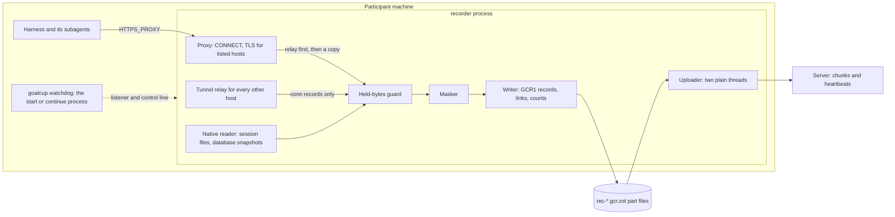

# Architecture

This page is for contributors. It says what goalcup is built to do, how the code is shaped, and
what the words mean. The vision is in [VISION.md](../VISION.md), the rules for changes in
[AGENTS.md](../AGENTS.md), the decisions behind the shape in [DECISIONS.md](DECISIONS.md).

## 1. What it is for

goalcup sits next to a coding harness for the length of a run and keeps a complete record of what
the harness did. Seven points decide every change:

1. Record every model call the harness makes, to any provider, for the whole run.
2. Record every subagent, however many and however long.
3. Never block or slow the harness. If something cannot be recorded, note a gap and keep going.
4. Never record secrets.
5. Upload everything, so the server can rebuild the full story by ID and time.
6. Tell the participant plainly what was recorded.
7. Work with the harnesses people actually use, run the way they use them.

## 2. The crates

| Crate | Does |
|---|---|
| `goalcup-format` | The record format (GCR1): framing, records, links, the part file reader and writer |
| `goalcup` | The program the participant runs: watchdog, recorder, proxy, native reader, masking, uploader, connectors, commands |
| `goalcup-verify` | Reads a record after upload: `check`, `dump`, `usage`, `secrets` |

The dependency rule: the recorder never links the verifier. `goalcup` and `goalcup-verify` share
only `goalcup-format`, so a check cannot be fooled by recorder code and the recorder carries no
checking code. Each of the two programs depends on the format crate alone.

## 3. The one process

The rules of the shape:

- **Relay first, record second.** The proxy forwards the bytes, then offers a copy to the recorder
  with a call that never waits. Past the stated memory guard the copy is dropped and the loss is a
  gap with its start, end and lost bytes. The harness is never slowed (point 3).
- **Mask before disk.** Raw bytes live only in memory: in the queue, in the masker's hold and in the
  decoder state. Nothing unmasked reaches a file or a log line.
- **No raw bytes leave memory any other way.** The recorder turns core dumps off before it reads a
  byte, and its panic hook prints only a file, a line and fixed text.
- **One writer** owns the part files. It counts at write, so every count the participant sees is
  of bytes already in a part file.
- **One process, no IPC for bytes.** The proxy, the native reader, the masker, the writer and the
  uploader run in the recorder process. Between the watchdog and the recorder only a listener and
  one control line pass, and neither carries a recorded byte (D75).
- **The watchdog** is the `goalcup start` or `continue` process. It binds the port once and hands
  the socket to each recorder boot, so a restart never closes the port. It mints the run CA, runs
  the connector's helper stops, starts the harness, ends it at the deadline and on `goalcup seal`,
  and restarts a dead recorder at once (D85). It never reads, masks, writes or uploads a recorded
  byte. `goalcup recover` reopens the port and the CA when the watchdog itself died.
- **Null mode.** If the recorder crashes three times in ten minutes, each within a minute of its
  start, the watchdog runs a relay-only recorder, says so in `status.json`, and retries a normal
  boot after 30 seconds, then 1, 2 and 5 minutes, never more than 5 minutes apart. The harness
  keeps its connections. The span is a `recorder_down` gap.
- **Boot-time timers.** Every timer counts boot time, which keeps running while the machine
  sleeps, on a one-second tick: deadline, restart pauses, null-mode retries, upload backoff.
- **The memory guard is a guard, not a cap** (D79). Held bytes stay under a stated size (512 MiB,
  or an eighth of memory if that is smaller, at least 128 MiB). Past it, a gap is written and
  recording goes on. A write error ends the recorder and the watchdog starts another (D78).
- **No proxy credential.** The harness gets `HTTPS_PROXY=http://127.0.0.1:<port>` and nothing else
  to present.

## 4. Which hosts are decrypted

There is one host list for every harness, `connectors/model-hosts.toml`
([CONNECTOR-SCHEMA.md](CONNECTOR-SCHEMA.md) has its rules). It holds providers, gateways (Vercel AI
Gateway, OpenRouter, Cloudflare AI Gateway), cloud model services and vendor backends (Amp,
Cursor). A host the participant registers, or that the harness config names, is added to it for
that run (D81). The proxy decrypts a connection only when its host is on the list, using a leaf from
the run CA, and records the plaintext byte for byte. Every other host is relayed untouched and
recorded as a tunnel: host, bytes and times.

Three shapes cover every harness, and the code knows no word for them:

- **Direct key and gateway are one case.** A gateway is an HTTPS host with its own key. The harness
  sends to it through `HTTPS_PROXY` as it sends to a provider. What differs is inside the bytes
  (model names, usage fields), which the usage reader handles after upload.
- **Vendor backends** are decrypted like a gateway when the client trusts the run CA. The vendor's
  own call to the model happens on its servers and no recorder on the participant's machine can
  see it.
- **Dodgers** ignore `HTTPS_PROXY`, pin certificates or refuse the run CA. We never work around
  it. Bytes that reach the proxy become a tunnel and a named gap (`pinned`, `tls_refused`); the
  session files are still read. A client that ignores the proxy leaves no connection at all.

A model server on the participant's own machine is reached past the proxy (`NO_PROXY` covers
loopback) and is not recorded. A host missing from the list is only a tunnel. Per harness, only
data changes: CA variables, a proxy setting to unset, background servers to stop, session-file
patterns, the auto-update switch. The per-harness facts are in
[harnesses/README.md](harnesses/README.md); the tier of each harness is read from
`connectors/tiers.toml`, set by the test pad, and is not repeated here.

## 5. Session files

A harness's own session files are a second record of the same work. The native reader is one
low-priority thread. For each row a connector names it walks the root, follows no symlink, and
reads the files raw, never parsing them.

- **Tail.** An append file (a JSON lines transcript) is read from the last offset to its end each
  pass, after it has settled for a second. A file that changes with bytes still unread is a
  `source_changed` gap.
- **Snapshot.** A database (with its `-wal` and `-shm` files) is copied whole as raw bytes when it
  changed and its interval has passed, and again at every seal. The copy is a stream like any other.
- The reader reads only as much as the recorder has room for, and a row it cannot find is named in
  an event, not skipped silently. At the seal it finishes what is open, with `cut_at_seal` for
  anything the seal's time ran out on.

## 6. Masking

Every recorded byte and every metadata string passes the masker before it is written. A masked
byte becomes `*`, so lengths and offsets stay those of the source. The rules are the shared literal
shapes in `crates/goalcup/src/mask/shapes.tsv`, the connector's own rules, and the exact values of
the run (the project's `GH_TOKEN` among them). The stream form keeps a small hold so a secret split
over two chunks is still caught, and its output equals the whole-record result. When the masker
cannot decide a piece it stars it (fail closed); if it fails outright the piece is dropped under a
`mask_failed` gap. A MASK record names the rule and the span, never the value. The masker is pure:
no threads, no clock, and no error text that formats a byte or a value (D80).

## 7. The record and the upload

The recorder writes one record stream per entry as zstd part files under
`runs/<run_id>/<entry_id>/rec/`. The format is in [RECORD-FORMAT.md](RECORD-FORMAT.md): framing,
records, stream kinds, IDs, time, gaps, links, the seal, and a reader in Python. The upload is
in [UPLOAD-API.md](UPLOAD-API.md): chunks of the part files, a heartbeat with the written counts,
and the run credential. The server stores bytes and interprets nothing. The uploader runs on two
plain threads with a blocking client, sends each part file soon after it is written, and frees
local disk only once the server holds the bytes. It never ends the process and never blocks the
recorder.

After upload, outside the Worker, `goalcup-verify` fetches the chunks, checks the links, counts and
masks, and works out usage from the raw bytes.

## 8. Terms

| Term | Means |
|---|---|
| run | One participant's attempt, identified by a run ID. It can span many boots and entries |
| entry | One `goalcup start` or `goalcup continue`. A participant sees it as a "part" |
| boot | One life of the recorder process inside an entry. A restart is a new boot |
| part file | One `rec-*.gcr.zst` file. A participant sees these as "record files" |
| stream | One recorded flow with an ID: an HTTP request, a WebSocket direction, a tunnel, a file |
| gap | A recorded loss: a start, an end, a reason and the lost bytes when known |
| off span | Time when the recorder was not running or ran in null mode; a `recorder_down` gap |
| link | A hash that chains every byte before it; one per flush |
| seal | The end of an entry: what was open is closed, the last counts and the seal event are written |
| written count | A count of records already in a part file; "model requests written" is `http_post` plus `ws_up_msgs` |
| tier | How well a harness is recorded (verified, not verified, not supported), set by the test pad |

Say "model requests written", never "model calls recorded": the count is of requests.

## 9. Where each point is tested

The seven points, the real-run proof for each and the guard tests that hold it are in
[README.md](../README.md#the-seven-points-and-their-tests). The rules for tests are in
[AGENTS.md](../AGENTS.md#tests).

## 10. Lessons

What earlier runs taught, and why some designs were dropped, is in
[LESSONS.md](plans/2026-10-30-v1.0/LESSONS.md).
