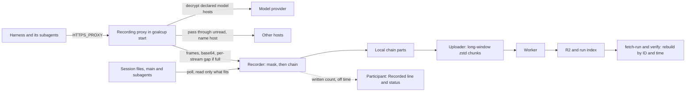

# Cut-first plan for Goal Cup Proxy, Edition 01

Date: Thursday 29 October 2026. Base: main at 4b226de2.
Status: **revision 2**, needs owner review. Nothing in this plan has been built or run.
Revision 1 was checked by a fact check and two reviews ([R-reviews.md](2026-10-30-audit/R-reviews.md)).
Revision 2 adds the 2-hour Codex run ([M](2026-10-30-audit/M-two-hour-run.md)) and the owner's answers
([N](2026-10-30-audit/N-architecture-and-owner-answers.md)).

**What changed since revision 1**

- **The 2-hour run found silent loss.** On the same build as the audit, recording stopped for good at
  minute 49. About 470 of Codex's 1,261 model calls and the wire records of 15 of 42 subagents are
  missing, and the finish still said "Recording works: 1736 model calls" ([M 1.1](2026-10-30-audit/M-two-hour-run.md#11-what-happened-step-by-step)).
  Eight silent-loss fixes (SL1 to SL8, section 3) now come before any cut.
- **Architecture: patch the shape we have (option A).** The proxy that writes its own record (option B)
  moves to after Edition 01, through a seam that already exists. A rewrite (option C) is out.
- **Owner answers applied.** No caps of our own on subagents (native caps deleted, one stated memory
  guard kept), the per-run size limit removed, prune once the server saved a part, no `goalcup mcp`
  setup lines, README promises replaced by the seven points.
- **Fewer cuts before Friday.** K1, K10, K11 and K12 move after Edition 01 to free review time for the
  loss fixes. Friday now saves about 8,300 source lines, not 19,000. That is the trade the owner asked
  for: "something that works versus not working".
- **New work and new dates.** An upload backoff fix and long-window compression; one stream per
  WebSocket direction waits until after Edition 01. A second 2-hour run on Monday 2 November with Codex
  and Claude Code, both asked for subagents in the prompt. A minimum shippable set and a fallback build.

## 1. The answer

Keep the recording core and fix the plumbing that lost the run, then cut. The core is the owner's own
idea, and it already exists: the harness reaches a local recording proxy through `HTTPS_PROXY`, the
proxy decrypts the model hosts the harness's config names, a recorder masks and chains the bytes, it
also reads the harness's session files, and the uploader sends everything to the Worker. Before 15:43
the wire matched Codex's own log in every 10-minute bucket ([N 2.1](2026-10-30-audit/N-architecture-and-owner-answers.md#21-facts-from-the-run)).
What failed was the hop between the proxy and the recorder: a shared 8 MiB queue, a rule that drops a
whole producer when one frame does not fit, a failure budget that read load as death, and a count taken
before anything was written. We choose **option A, patch today's shape**, because it fixes every cause
the run found in about 400 changed source lines and 3 working days, and leaves time for a measured rerun
before the 4 November feature stop. Option B (the proxy writes its own record, no IPC) is the right
next shape, but it changes the record format, uploader, Worker keys and verifier at once: 7 to 10 days.
Option C (fresh rewrite) is 15 to 25 days. **Fallback** if the bigger fixes are not green by Monday
night: ship the small set (SL1, SL2, SL4 and honest finish wording, section 9.3). Each load drop then
becomes a visible gap and a reconnect, not a silent stop. After Edition 01, move to option B through
the `CaptureSink` seam (`crates/goalcup-protocol/src/capture.rs:388-394`, taken by the emitter at
`crates/goalcup-cli/src/proxy/api.rs:262, 300`), then do the large cuts.

## 2. Owner answers so far

| # | Owner's answer (29 Oct) | What the plan now does |
|---|---|---|
| 1 | Yes: replace README P1 to P7 with the seven points. | PR1 replaces `README.md:276-288` with R1 to R7 and drops the never-delete rule (`AGENTS.md:101`). |
| 2 | Unsure what 16,384 means (agent threads?). Wants no caps. Remove the run size limit. | See "Q2 in plain words" below. Native caps go (SL4). One open-stream bound stays as a stated memory guard. The run limit goes (CH14). |
| 3 | Same as 2: remove the per-run size limit. | CH14 sets `RUN_MAX_COMPRESSED_BYTES` to `9007199254740991` (`server/worker/wrangler.toml:59, 151`). Cost below. |
| 4 | "Ideally we support both, with gateway and without gateway? Wasn't that the plan?" | Yes, and it already works. See "Q4" below. Hermes: support only 0.22.5, the version its installer gives. |
| 5 | Unsure. "I would like something that works versus not working." | Option A, loss fixes first. Structural cuts stay after Edition 01, and four more cuts join them (new question O1). |
| 6 | Yes, no need to print the `goalcup mcp` setup lines. | K8 in PR9. The `goalcup mcp` command keeps working through Edition 01. |
| 7 | Why Claude Code only? What about Codex and others? | See "Q7" below. Codex and Amp already have their switch; Claude Code and Hermes get one line each (CH15). |
| 8 | What does "table" mean? An API endpoint? | No. See "Q8" below. The plan stops a start that cannot record, with a one-line fix (AD5). Say no if you disagree. |
| 9 | Yes, prune a part once the server saved it. | CH10, plus the finish line stops printing a local check that cannot pass (AD9). |
| 10 | Hopes so, but fears it will not be done in 24 hours. | Nothing is due in 24 hours. There are five working days to the feature stop. Section 9 orders the work so the loss fixes land even if cuts slip, and names a minimum shippable set. |

**Q2 in plain words: what 16,384 counts.** It is not agents. A "stream" is one recorded flow of bytes
with an open, some bytes and an end (`crates/goalcup-protocol/src/capture.rs:96-103`). The bound counts
streams open at the same moment.

| Kind of stream | One stream is | Open for |
|---|---|---|
| HTTP request or response body | one model request, or its answer | seconds to minutes |
| WebSocket message | one message in one direction | a moment |
| Session file (native) | the main agent's or one subagent's transcript | the whole entry (one `goalcup start` or `continue`) |

So a subagent costs one long stream for its file, plus a few short ones while it calls the model. A
finished subagent's file keeps its slot until the entry ends. The run peaked at 54 open streams. At
16,384, about 16,000 subagents fit in one entry, and `goalcup continue` starts a new entry. The bound
guards memory: at most 16 KiB of not-yet-masked bytes per open stream
(`crates/goalcup-daemon/src/redact/stream.rs:122-125`), so 256 MiB in the worst case and near zero for a
quiet file. Past it, only the one new stream is refused, with a gap (SL5). The native caps (32 open
files, 1,024 and 20,000 tracked files, `crates/goalcup-daemon/src/native_capture.rs:187, 279-280`)
guard nothing real and lost 11 transcripts in the run: they go (SL4).

**Q3, the cost of no run limit.** R2 costs $0.015 per GB-month, with no egress fee
([R2 pricing](https://developers.cloudflare.com/r2/pricing/)). Production traces sit under a 180-day
bucket lock (`server/worker/wrangler.toml:29-32`), so each byte is paid for at least 6 months.

| Per run, compressed, busy 168 hours | Per month | 180 days | 100 entries, 180 days | 500 entries, 180 days |
|---|---|---|---|---|
| 68 GB (today's rate) | $1.02 | $6.12 | $612 | $3,060 |
| 15 to 27 GB (with CH18 long-window compression, estimate) | $0.23 to $0.41 | $1.35 to $2.43 | $135 to $243 | $675 to $1,215 |

The limit guarded one thing: a stuck or hostile client. One uploading 10 MB/s nonstop is about 6 TB a
week, about $90 a month and $540 for 180 days, per run ([M 4.8](2026-10-30-audit/M-two-hour-run.md#48-storage-cost-without-a-per-run-limit)).
New question O5 asks for a weekly look at stored bytes instead.

**Q4, gateways and Hermes.** "With and without a gateway" already works, by one rule (D74): goalcup
reads the one address the harness's own config names and records that host; with no address it records
the harness's default host (`crates/goalcup-cli/src/model_host.rs:1-25`).

| Harness | Where the gateway address goes | Measured |
|---|---|---|
| Claude Code | `env.ANTHROPIC_BASE_URL` in Goal Cup's `settings.json` (`connectors/claude-code-cli/harness.toml:40`) | Vercel gateway, 15 calls (`docs/research/results/2026-10-vercel-gateway.md:53`) |
| Codex | `model_provider = "vercel"` plus a `[model_providers.vercel]` table with `base_url` (`connectors/codex-cli/harness.toml:37`) | Vercel, 17 calls, HTTP only (same doc `:54`) |
| Hermes | `model.base_url` in `config.yaml` (`connectors/hermes-cli/harness.toml:68`) | Vercel, 9 calls (same doc `:55`) |
| Amp | none: Amp always talks to its own server | yes |

Routes the config reader cannot see record nothing today: Claude Code's cloud switches
(`CLAUDE_CODE_USE_BEDROCK` and the like), a base URL in a shell export or project file, Codex's
top-level `openai_base_url`, Codex built-ins with no table (Q8), and Hermes calls to hosts other than
`model.base_url`. The plan reads `openai_base_url` and stops the four Codex built-ins (AD5), and names the
rest in the participant text (AD8). A `--record-host` input for extra endpoints waits for after
Edition 01 (O8). "Gateway" in round 1's question meant Hermes's own gateway process: the plan supports
Hermes 0.22.5 only, drops the three 0.19.0 connector parts (`connectors/hermes-cli/harness.toml:54-57,
88-92, 103-109`), and says "Hermes subagents: not yet measured" until a 0.22.5 run passes (O9).

**Q7, auto-update per harness.** A running harness keeps its old binary; an update matters only at the
next `goalcup continue`.

| Harness | Updates itself? | Our switch today | Plan |
|---|---|---|---|
| Claude Code | Yes, in the background, also while running | `DISABLE_AUTOUPDATER = "1"` (`connectors/claude-code-cli/harness.toml:60`) | Add `DISABLE_UPDATES = "1"`, which also blocks a `claude update` the agent runs ([setup docs](https://code.claude.com/docs/en/setup)) |
| Codex | No. It only checks at start and asks | `-c check_for_update_on_startup=false` (`connectors/codex-cli/harness.toml:46`) | Nothing more |
| Amp | Checks; runner mode restarts for updates | `AMP_SKIP_UPDATE_CHECK = "1"` (`connectors/amp-cli/harness.toml:45`) | Nothing more |
| Hermes | No; a daily passive check | none | Add `updates.check: false` |

Participant text adds: "Do not run `brew upgrade`, `npm update -g` or `hermes update` during your run."

**Q8, what a "table" is.** Not an API. In Codex's `config.toml`, a table is a section that starts with a
name in square brackets:

```toml
model_provider = "vercel"

[model_providers.vercel]
base_url = "https://ai-gateway.vercel.sh/codex/v1"
```

goalcup reads `model_provider`, then that table's `base_url`, and records that host. Four Codex
built-ins have no table, so no address is written anywhere: `ollama` and `lmstudio` (plain `http` to
this computer, never through our proxy), `amazon-bedrock` and `gcp` (cloud hosts we are not told about,
so they pass through unread). A run with one of them records zero model calls. The plan stops
`goalcup start` before the harness launches with the fix ("add a provider table with an https
address"), and warns on any other provider name with no table. Stopping before launch never blocks a
running harness (point 3).

## 3. Stop silent loss first

Three rules now bind the recorder:

1. **A call counts only once written.** The participant's number is model requests whose bytes reached
   the chain, never requests the proxy merely saw.
2. **Off time is shown.** If wire recording is off, `goalcup status` says so at once, and the finish
   says how often and how long.
3. **Every loss is a gap with a start and an end.** A loss starts at its chained gap and ends at the
   next `Recovery` record, or at the end of the part. No new record kind is needed.

The fixes, in the order they land. Paths are under `crates/` unless noted. Line figures are estimates.
"P" numbers are the loss paths in [M section 2](2026-10-30-audit/M-two-hour-run.md#2-every-silent-loss-path-in-the-code-today).

| Id | Fix | Where | src / tests | Test that proves it | Point | Was |
|---|---|---|---|---|---|---|
| SL1 | **Never give up on a recorder that answers** (P3, P4). Delete `MAX_CONNECTION_FAILURES`, `STABLE_EPOCH`, the failure row fields and `count_failure` with its three callers. The proxy retries on the 1, 2, 5, 10 s schedule for as long as `goalcup start` lives, logging once a minute. Keep `stats.failures` as a log counter. Alone, this would have kept the run recording. | `goalcup-cli/src/proxy/ingest.rs:98-108, 380-383, 461-472, 938, 963-970, 1117-1133` | -35 / 200 rewritten | New sender test: 50 losses in a row, each under a second, with the emulator's close-after-handshake policy. The sink never answers `Disabled`, at least 50 epochs become ready, and a frame after the 50th loss is `Queued`. Rewrite the five budget tests at `goalcup-cli/tests/it/m2_capture_sender.rs:1008-1289` and the constant check at `:1915`. | 1, 3 | CH6, third part (moved from PR7 to the first PR) |
| SL2 | **Room for bursts.** Queue 8 to 64 MiB on both sides, control reserves scaled (proxy 512 KiB to 4 MiB, still under the `/8` check). Send ingest bytes as base64, not JSON number arrays: today each payload byte costs about 3.6 bytes, so 8 MiB held about 1.5 of Codex's 1.5 MB bodies. With both, the queue holds about 30 bodies. Memory cost: up to 64 MiB per side, and only while the writer is behind. | `goalcup-protocol/src/capture.rs:51, 228-231` (one serde attribute); `goalcup-daemon/src/runtime/capture/sink.rs:7-10`; `goalcup-cli/src/proxy/ingest.rs:113-128`; fixture `goalcup-protocol/tests/fixtures/m2-ingest/golden-stream.hex` | 5 / 30 | Regenerated golden fixture; one unit test that 1 MiB of payload encodes to under 1.4 MiB; N6 load test (AD6). | 1, 3 | CH1 queue part (moved from PR8a) |
| SL3 | **A full queue costs one stream's bytes, never the producer** (P1, P2). When a `Bytes` frame does not fit, queue a small `Gap { QueueFull, lost_bytes }` on the same stream instead and answer `Queued`. The redactor already moves the stream past the gap and resumes (`goalcup-daemon/src/redact/stream.rs:2834-2861`); the sink already admits later bytes past a gap (`goalcup-daemon/src/ingest.rs:1002-1008`). | `goalcup-daemon/src/runtime/capture/sink.rs:268-282`; `goalcup-cli/src/proxy/ingest.rs:513-516, 804-817` | 40 / 150 | Invert `full_queue_gap_is_sticky` (`goalcup-daemon/src/runtime/capture/tests.rs:1061`), `queue_full_reports_loss_outside_full_queue` (`goalcup-daemon/tests/it/capture_ingest.rs:1668`) and `queue_full_latches_without_blocking_relay` (`goalcup-cli/tests/it/m2_capture_sender.rs:297`): fill the queue, submit bytes, assert `Queued`, producer still live, one gap with `lost_bytes` equal to the length, the next bytes accepted, sealed trace "incomplete" with exactly one stream gap. | 1, 3 | New. Overturns round 1's rejection of a daemon-side per-stream rule (R 3a) |
| SL4 | **Session files never stop and have no caps** (P14 to P17). Delete the native share (32), the 1,024 and 20,000 file caps, and the 32-handle budget (K9 part). Raise `MAX_OPEN_STREAMS` 128 to 16,384 and `MAX_OPEN_CONNECTIONS` 128 to 1,024 as stated memory guards; every user reads the constant, verifier included (`goalcup-verifier/src/capture_analysis/reader.rs:1566, 1694`, `anthropic.rs:152`). Give the sink a `room()` read and stop a native pass when the queue is full, so a native frame is never refused: the file is the buffer, and the reader position moves only on `Queued`. Remove the 64 MiB finish cap; keep the 180 s finish budget. | `goalcup-daemon/src/native_capture.rs:84-91, 187, 279-280, 649-656, 940-975, 1323-1327, 1555-1558`; `goalcup-protocol/src/capture.rs:58, 60`; `goalcup-daemon/src/runtime/capture/sink.rs:246-283, 425-427`; `goalcup-daemon/src/runtime/capture/owner.rs:13`; `goalcup-platform/src/handle_budget.rs` | 20 net / 750 rewritten | N1 (AD6): 2,000 session files, 400 growing at once, `ulimit -n 256`; every byte recorded. Plus: fill the queue while native has a 10 MB file to read; assert all file bytes reach the chain and no native loss gap. | 2, 3 | CH1 streams part, CH2, CH12, plus the new no-latch rule |
| SL5 | **Close the other "off for good" switches** (P6, P7, P10, P11, P13). Past the emitter's stream or connection bound, refuse that one stream with a `Loss` frame and keep the epoch live (CH4). A local framing error latches a loss, not a terminal state. Delete the one-`Loss`-per-reason dedupe, so each event has its time. When the recorder drops a producer for a redaction error, also tell the sink, so the proxy reconnects. | `goalcup-cli/src/proxy/api.rs:451-453, 599-601, 671-674, 683`; `goalcup-cli/src/proxy/ingest.rs:504-511, 552-558, 600-606, 944-948`; `goalcup-daemon/src/runtime/capture/owner.rs:326-341` | 15 / 120 | One test per path: open 200 streams at once (P6); force a redaction refusal (P13). Each asserts a gap at the loss time, a `Recovery` after it, and that no relay call waited. | 1, 3 | CH4, plus new |
| SL6 | **The seal names any proxy loss left open.** If the proxy's sink was off at the finish, or `sink_refusals > 0`, write one stream-less `IngestLost` gap; the end of the part is its end. Fix the comment that says sink refusals "add none". The start time comes from SL7's off spans in the finish report. | `goalcup-daemon/src/runtime/capture/writer.rs:182-201`; `goalcup-protocol/src/control.rs:682-683` | 10 / 40 | Sender whose sink is disabled mid-run: the sealed trace ends with an `IngestLost` gap, and the finish report has the off span's start. | 3, 5, 6 | New |
| SL7 | **Count a call once written; keep the off time.** The chain writer counts each written request `Open` (`WireRequest` with `POST`, or `WsClient`) that carries a protocol hint, and reports it in its status. The emitter records every off span (left `Live`, back to `Live`) in shared counters. The finish and status print the written count and the off time, never the proxy's "seen" count, which moves to `host.log`. `CONTROL_API_VERSION` 12 to 13. | `goalcup-daemon/src/runtime/capture/writer.rs:327-345`; `goalcup-daemon/src/runtime/capture/mod.rs:1292-1301`; `goalcup-protocol/src/control.rs:67`; `goalcup-cli/src/daemon/mock.rs:157-168`; `goalcup-cli/src/proxy/api.rs:158-171, 351-353, 739-745`; `goalcup-cli/src/commands/start/finish.rs:405-407, 439-444, 499-509`; `goalcup-cli/src/run/mod.rs:266, 716-719` | 45 / 60 | Sender against a sink that drops one producer mid-run: the printed count is below the seen count, equals the verifier's `wire_model_requests` on the same trace (`goalcup-verifier/src/capture_analysis/session.rs:210`), and the off time is above zero. | 6 | AD2's source, rewritten |
| SL8 | **Say it while it happens.** `goalcup status` shows "Recording is off since 15:43" once the emitter has been off 60 s, or the recorder has not answered 3 watch ticks; one `PROBLEM:` line goes to `host.log` and `state.json`. A local-logs alarm: if session files grew in the last 5 minutes and the written count did not, one `PROBLEM:` line. It would have fired about 15:48 in the run. | `goalcup-cli/src/run/watch.rs`; `goalcup-cli/src/run/mod.rs:118-131`; `goalcup-cli/src/participant/status.rs:335-340` | 75 / 80 | Status test: emitter off for 61 s shows the line. Watch test: growing native bytes and a flat written count give one `PROBLEM:` line, not one per tick. | 6, 1 | AD3, rewritten, plus the owner's "check against local logs" |
| | **Total** | | **about 175 net / 1,430** | | | |

Left as they are, on purpose: P9 (65,536 producer IDs per entry, `capture.rs:63`) lasts 7.6 days at
one reconnect every 10 s, longer than a run, and SL3 makes reconnects rare; it guards the verifier's
lineage check, and if reached, SL6 and SL8 make it loud. P12 (a refused `Recovery`, `proxy/api.rs:774-785`)
stays terminal and loud for the same reason. P18 (masking hold over 16 KiB) masks, never loses. P19
(a decoded body over 8 MiB) is a stream gap with an end. P21 (a chain write error) is already loud. P22
(full disk): the owner chose no special handling; CH9 only trims the torn tail. P23 and P24 refuse the
harness rather than lose silently; CH6's other parts fix them in PR7.

What could go wrong: a request body can now have holes, so that stream is "incomplete" while every
other stream records; the verifier's provider decoders were not re-read for mid-body gaps (unverified,
K1 keeps them). A broken recorder is retried for ever (log noise, one producer ID per 10 s). The single
owner thread is still the throughput limit and its peak rate is unmeasured; N6 measures it. Lane N
preferred a "busy" answer with TCP backpressure instead of SL3. We choose SL3: it is half the code, needs
no new state, and cannot wedge a socket.

## 4. The target shape

Unchanged from revision 1: the harness reaches a loopback recording proxy through `HTTPS_PROXY`; the
proxy decrypts declared model hosts and names every other host it passes through; the recorder (still a
separate daemon for Friday) masks, then writes a hash-linked chain, and polls session folders; the
uploader sends chunks to the Worker, which stores them in R2 by sequence and `received_at`;
`scripts/fetch-run.sh` and `goalcup-verify --capture-integrity` rebuild a run by ID and time.



| Option | Shape | New or changed src | Days | Verdict |
|---|---|---|---|---|
| A | Today's shape, patched (section 3) | about 400 changed | about 3 | **For Edition 01** |
| B | The proxy masks and writes its own wire record; no IPC | about 1,300 to 1,600 new; about 2,850 removed | 7 to 10 | After Edition 01, via the `CaptureSink` seam |
| C | Fresh minimal rewrite | about 3,700 to 5,600 in Rust | 15 to 25 | No |

Details and risks: [N section 3](2026-10-30-audit/N-architecture-and-owner-answers.md#3-options-a-b-and-c).
Where this plan still differs from the two fresh designs (keep the daemon, chain, signing, termination
proof, declared host list, never change a forwarded byte) is unchanged from revision 1, for the same
reasons ([B top findings](2026-10-30-audit/B-fresh-design.md#top-findings)).

## 5. Numbers

Counted with `wc -l`; "src" is production code, inline tests count as tests. Figures after today are
estimates, plus or minus 30 percent. Per-area figures are in [A.1](2026-10-30-audit/A-inventory.md#a1-totals-by-area).

| | src | tests |
|---|---:|---:|
| Today | 102,176 | 159,498 |
| Friday cuts (section 6a) | about -8,270 | about -10,270 |
| Friday adds and changes (sections 3, 7, 8; rewrites not counted) | about +650 | about +1,300 |
| **Friday build** | **about 94,500** | **about 150,500** |
| Later cuts (section 6b, now including K1, K10, K11, K12) | about -35,800 | about -58,200 |
| **After Edition 01** | **about 58,700** | **about 92,300** |

The Friday build is about 7 percent smaller in source, against 19 percent in revision 1. The end state
after Edition 01 is the same as before.

## 6. Cut list

Points checked: which point could suffer, and why it does not. Full rows (paths, tests that go, risks)
are unchanged from revision 1 unless the row says otherwise.

### 6a. Before Friday (pure deletes first; each can slip without harm)

| Id | What | src | tests | When | Change from revision 1 |
|---|---|---:|---:|---|---|
| K2 | Scripts that serve no point and `check-version.py` (`scripts/campaign.py`, `linux-matrix.sh`, `kit_settle.py`, five `research-*.py`, `ci-scope.py`, `harnesses/install.sh`); edit `.github/workflows/ci.yml`, `scripts/gate.sh:61`, `scripts/release.sh:101-104` | 5,430 | 4,821 | PR2, any day | None. The run's 11 real upload errors were a better drill than `campaign.py`. |
| K6 | Spike prototypes and data (`spikes/cursor-cli`, `spikes/openclaw`, hermes and opencode plugin code); keep `spikes/redact.py` and the corpus files | 0 (+9,568 data) | 0 | PR2 | None |
| K4 | Connector byte goldens (`goalcup-cli/tests/it/harness_contract_golden.rs`, daemon twin, `connector_template.rs`) | 0 | 1,558 | PR4, any day | None. Saves regenerating goldens for CH15. |
| K26 | v5 corpus test (`goalcup-verifier/tests/it/v5_corpus.rs`) | 0 | 718 | PR4 | None |
| K8 | `goalcup mcp` setup lines (`commands/prep.rs:730-760`), legacy `git-credential` flow; the command stays | 310 | 150 | PR9, Tue | Owner said yes (answer 6) |
| K7 | Start-time provider probe and start-path leftovers; keep session sniffing on `continue` | 620 | 910 | PR9, Tue | None. The probe checks the provider, not the recorder; it would not have seen this loss. |
| K9 | Platform dead code; `handle_budget.rs` now goes with SL4 | 500 | 280 | SL4 and PR9 | Budget part moved into SL4 |
| K5 | Client disk-full handling, including the `SIGSTOP` pause; process vitals stay | 1,410 | 1,830 | PR6, Tue | Later in the week. If PR6 is not green, it slips and today's behaviour stays. |
| | **Total before Friday** | **about 8,270** | **about 10,270** | | |

### 6b. After Edition 01

Unchanged from revision 1: K3 (Rust Worker stand-in), K13 (daemon merge, now the path to option B), K14
(back-compat), K15 (platform rewrite), K16 (deny checks), K17 (pins), K18 (signing), K19 (CLI extras,
push lines kept until then), K20 (judged commit), K21 (workspace walk), K22 (finish stage machine),
K23 (rate limiter), K25 (`check-links.py`, oracle), K27 (leftovers). K24 still waits for test N5.

Moved here from Friday, to free review time for section 3 (new question O1):

| Id | What | src | tests | Why it moves |
|---|---|---:|---:|---|
| K1 | Verifier research decoders and reports | 9,816 | 16,775 | The biggest churn: `scripts/matrix.sh:2051-2064`, four kept tests and three docs read it. It fixes nothing the run found. The `decoders-ed01` branch is no longer needed. |
| K10 | Uploader leftovers (`repo_head`, dual versions, old deadline fallbacks) | 230 | 380 | CH17 and CH18 touch the same files this week. No point gains. |
| K11 | Proxy outage windows. **Narrowed:** when it lands, cut only `proxy/outage.rs` and the outage fields; keep `ProxyHealth`, `Counters`, `sink_answer` and `sink_refusals` (`goalcup-cli/src/proxy/mod.rs:604-624, 904-914`), which SL6 and SL8 need. | about 300 | 290 | The counters it would have cut are the only proxy-side proof of loss. |
| K12 | Writer quota half | 150 | 250 | SL6 and SL7 edit `writer.rs`. 218 GB a week is under the 1 TiB quota (`capture.rs:54`). |
| | **Total after Edition 01** | **about 35,800** | **about 58,200** | |

## 7. Change list

| Id | What | Point | Size | Status in revision 2 |
|---|---|---|---|---|
| CH1 | Raise our bounds with their cost stated | 2, 3 | | **Split:** queue part is SL2; stream and connection part is SL4. `MAX_LIVE_PRODUCERS` stays 128 (`goalcup-daemon/src/runtime/capture/sink.rs:18` allows at most 256). |
| CH2 | Delete native share and file caps | 2 | | **Moved into SL4**, with the no-latch rule and the bound raise. Deleting the caps alone is unsafe: the 129th stream or a full queue would turn native off for the whole part ([M 5.2](2026-10-30-audit/M-two-hour-run.md#52-two-traps-that-make-just-delete-the-cap-unsafe)). |
| CH3 | Cheap native poll: 1 s when idle, each parent folder once per pass (`owner.rs:16`, `native_capture.rs:1376-1430`) | 3 | about 40 src | Kept, PR8b Tue. The poll runs on the writer's thread, so measure its share in N6 first. Needed before thousands of session files; the run had 43. |
| CH4 | Refuse one stream past the bound, never latch | 1, 3 | | **Moved into SL5.** |
| CH5 | Raise the open-file soft limit at the top of `main` | 2, 3 | about 10 src | Kept, PR7, less urgent: the daemon used 17 to 18 files in the run. |
| CH6 | The proxy never refuses | 3 | | **Split:** the failure budget is SL1. The restart cap (`proxy/mod.rs:1022`) and the 503 past `MAX_CONNECTION_TASKS` (`:112`) stay in PR7. |
| CH7 | One proxy worker thread per core | | | Still withdrawn. The second run records per-call latency. |
| CH8 | Masking option b after AD1 | 4 | about -100 src | Kept, PR5 Mon. |
| CH9 | On `StorageFull`, cut the chain back to the last whole record | 3, 5 | about 10 src | Kept, with K5. |
| CH10 | Prune a part once the server acked it, never the last; no timer, no disk branch (`goalcup-cli/src/upload/prune.rs:47-82`) | 5 | about -60 src | Kept (owner answer 9), plus AD9's finish line. |
| CH11 | Name every passed-through host past the 10,000-row bound | 1, 5, 6 | about 30 src | Kept, PR10 Tue. May slip. |
| CH12 | Remove the 64 MiB native finish cap | 2, 5 | 1 line | **Moved into SL4.** |
| CH13 | `goalcup setup` warns on an unsupported filesystem | 3, 7 | small | Kept, PR9. |
| CH14 | Worker configuration only | 5 | config | **Changed:** `RUN_MAX_COMPRESSED_BYTES` to `9007199254740991` (the largest value `parseSafeUint` takes, `server/worker/src/util.ts:119-123`) at `server/worker/wrangler.toml:59, 151`, with a comment naming the storage cost; `MIN_COMPETITION_VERSION` to the Friday tag (`:55, 150`); `EVENT_ID` (`:42`). Keep `model_requests` in the heartbeat as the "harness is active" signal; its comment says it is a "seen" count. |
| CH15 | Connector data | 1, 2, 7 | data, 1 test, pins | **Changed:** Claude Code adds `DISABLE_UPDATES` and `CLAUDE_CODE_DISABLE_AGENT_VIEW`; Hermes 0.22.5 rows only, plus `updates.check: false`; Codex unchanged, with one test that its `-c` arguments stay. |
| CH16 | Fix a flake only when it fails a PR | | small | Kept. |
| CH17 | **New. Upload keeps up.** Reset the failure count whenever an attempt moved the server's offset (`goalcup-cli/src/upload/uploader/lifecycle.rs:513-533`; today it resets only on full catch-up, `:517-519`). Backoff cap 15 to 2 minutes (`goalcup-cli/src/upload/policy.rs:85`). A chunk every 5 minutes, or once 32 MiB of chain waits (`:81, :83`). | 5 | about 6 src, 20 tests | In the run, backoff waits added up to 82 of 120 minutes and only 7 percent was sent at minute 61 ([M 4.7](2026-10-30-audit/M-two-hour-run.md#47-upload-lag-and-the-backoff-fix)). Cost: about 2,000 to 10,000 more R2 objects per busy week. |
| CH18 | **New. Long-window compression.** After `Encoder::new` at `goalcup-cli/src/upload/uploader/chunk.rs:144`, set a 128 MiB window (`window_log` 27) and long-distance matching; fix the "no long window" comment at `:17-19`. | 5 | about 4 src, 1 test | On chain-shaped synthetic data with 20 interleaved agents, 4.0 to 1 became 14.5 to 1 ([M 4.5](2026-10-30-audit/M-two-hour-run.md#45-zstd-long-window-experiment)). Synthetic only: measure on run 2's saved chain before the release. Cost: about 140 MiB more memory in `goalcup start` while a chunk is built (use 26, 73 MiB, if that is too much). `zstd -d` reads a 2^27 window with no flag, so `scripts/fetch-run.sh:327` and the Worker do not change. That the `zstd` 0.13 crate exposes the setters with default features off is unverified until it builds; the raw `set_parameter` call is the fallback. |
| CH19 | **New, decided: one stream per WebSocket direction waits until after Edition 01.** | 5 | about 50 to 130 src, 300 to 600 tests | It would cut the chain by about a quarter and writer load by about two thirds (152,728 one-message streams in 49 minutes). But it changes the record shape across the proxy, the verifier's tracker and the decoders (an Amp `ping` breaks a joined JSON split, `goalcup-verifier/src/capture_analysis/thread.rs:48-51`), a week before the event. CH18 covers the size; SL2 and SL3 cover the load. Revisit only if run 2 shows the writer cannot keep up after CH3. |

## 8. Add list

| Id | Add | Point | Smallest version | Status |
|---|---|---|---|---|
| AD1 | URL password rule, before CH8 drops the email rule (`goalcup-daemon/src/redact.rs:280-283`) | 4 | about 61 src, 40 tests | Kept, PR5 |
| AD2 | One "Recorded:" line at each part's end and in `goalcup status`: written model requests with hosts, session files read, files not read yet, off time, gaps, hosts passed through, upload state | 6, 2 | about 30 src, 30 tests | **Changed:** reads SL7's written count and off time, never `model_calls` at `run/mod.rs:266`. Example: "Recorded: 842 model requests from chatgpt.com. Recording was off 17 times, 1 h 12 min in total. Session files read: 43 of 43." |
| AD3 | "Recording has stopped" | 6 | | **Became SL8.** |
| AD4 | `live-check` for organizers and the 2-hour runs: wire requests against the harness's own log per 10-minute bucket ("wire minus failed responses" against Codex `token_count` events, Claude Code distinct `requestId`), subagent files against chain paths, secret scan of local and server copies with each stream's segments joined, raw, base64 and percent-encoded | 1, 2, 4, 6 | **Changed:** about 300 lines of Python under `scripts/`, started from the run's observer scripts (`measure.py`, `final.py`, `secrets.py` on branch `origin/smart/tender-clarke-qupne3`). Not shipped to participants. K1 stays, so `matrix.sh` keeps `--research-json`. | PR-K, Mon morning |
| AD5 | Codex routes: read `openai_base_url` and `[model_providers.openai] base_url`; stop `ollama`, `lmstudio`, `amazon-bedrock`, `gcp` before launch with a fix; warn on any other provider name with no table | 1, 6 | about 40 src, 40 tests in `goalcup-cli/src/model_host.rs:334-405, 546-553` | Kept, PR11 (answer 8 explained above) |
| AD6 | Tests N1 (2,000 session files under `ulimit -n 256`), N2 (recorder dies ten times, the port serves again), **N6 (new)**: 20 to 40 producers sending 1.5 MB bodies in bursts for 10 minutes against the real owner; no terminal latch, every loss gap followed by a recovery, native stays live; prints drain MB/s and peak CPU | 1, 2, 3 | about 360 test lines, serial group | N1 with SL4, N2 with PR7, N6 with SL3 |
| AD7 | Server rebuild proof N4 under `wrangler dev`; `fetch-run.sh` names a missing range | 5 | about 10 src, 300 tests | Kept, PR12 Wed. More urgent: the run could not check the server copy at all. |
| AD8 | Participant text | 6 | text | **More lines:** Codex shows one expected warning about settings goalcup passes; a busy run makes about 1.3 GB of trace an hour; start your prompt with the push lines; recording may pause under load and the screen says when; do not run `brew upgrade`, `npm update -g` or `hermes update`; local models and the routes in Q4 are not recorded; Hermes subagents not yet measured; plus every revision 1 line. |
| AD9 | **New. Honest finish screen.** Print `verify:` only when the local chain is whole (`goalcup-cli/src/commands/seal.rs:452`); otherwise "The server holds your full recording (acknowledged at T). This computer keeps the last part." Move the support block (`proxy admission: ...`, "anchor", "terminal record") to `host.log`. Status wording "Start your prompt with these lines" (`goalcup-cli/src/commands/status.rs:478`). | 6 | about 20 src, 20 tests | With SL7, Sun |
| AD10 | **New, decided later:** `--record-host https://host/base` for routes the config reader cannot see | 1 | about 40 to 80 src | After Edition 01 (O8). It does not help Hermes, whose extra hosts would fail TLS. |

Decided not to add for Friday: closing quiet append-only streams, joined-view masking, periodic SQLite
snapshots, a daemon restart with a fresh producer, spilling the queue to disk, prefix dedupe of
repeated context, a per-harness call reconcile inside the client (AD4 does it for organizers; SL8's
alarm is the harness-blind client half), OpenCode or OpenClaw connectors.

## 9. PRs in order, day by day

Each PR runs `sh scripts/gate.sh fast`. Every PR in section 3 also runs `sh scripts/gate.sh full`,
because CI skips the daemon and CLI suites (`.github/workflows/ci.yml:15-16`). "Alone" means it can merge
by itself. Every client change ships in the one Friday release.

### 9.1 PRs

| PR | Scope | Rough size | Tests that prove it | Merge |
|---|---|---|---|---|
| PR1 | Docs: README R1 to R7 (answer 1); AGENTS and VISION lines; the false lines listed in revision 1; merge the run report `docs/research/results/2026-10-30-two-hour-run.md` and its folder from `origin/smart/tender-clarke-qupne3` | about 160 doc lines | link check | Alone |
| PR-S1 | SL1, SL2; D58 text (`docs/DECISIONS.md:495`) | about -30 src, 230 tests | SL1 and SL2 tests | Proxy, daemon and protocol together |
| PR-S2 | SL3, SL5, N6 | about 55 src, 400 tests | SL3, SL5 tests, N6 | Daemon and proxy together |
| PR-S3 | SL4, N1 (was PR8a) | about 20 src net, 750 rewritten | N1 on Linux and a Mac with `ulimit -n 256`; capture integrity tests | Protocol, daemon, proxy and verifier together |
| PR-S4 | SL6, SL7, SL8, AD2, AD9; one `CONTROL_API_VERSION` bump | about 150 src, 200 tests | SL6 to SL8 tests; `start_launch`, `m2_cli_lifecycle` wording | Daemon, CLI and mock together |
| PR-U | CH17, CH18 | about 10 src, 20 tests | upload policy tests; compress a saved chain and compare | Client only |
| PR-K | AD4 `live-check` | about 300 script lines | run on an existing trace and on run 1's evidence | Alone, tools only |
| PR2 | K2, K6 | -5,430 src, -4,821 tests | remaining script tests; redaction corpus test | Alone, any day |
| PR4 | K4, K26 | -2,276 tests | gate fast | Alone, any day |
| PR5 | AD1, CH8, AD8 masking lines | about -40 src | redaction suites, N3, oracle agreement | One commit |
| PR7 | CH5, CH6 rest, N2 | about -100 src | proxy integration, N2 | Alone |
| PR8b | CH3 | about 40 src | CPU at 1,000 and 10,000 synthetic files | Daemon. Ships without it if not green Tuesday. |
| PR11 | AD5, CH15, pins, HARNESS-SETUP and RULES lines | about 40 src | `model_host_from.rs`, `shipped_connectors.rs`, Codex `-c` test | Connector and pins in one commit |
| PR9 | K7, K8, CH13, rest of K9 | about -1,400 src | `start_launch`, `m2_cli_lifecycle` | Alone; may slip |
| PR6 | K5, CH9, CH10, disk text | about -1,500 src | writer `StorageFull`, prune, vitals tests | Client only; may slip |
| PR10 | CH11 | about 30 src | tunnel inline tests | Client only; may slip |
| PR12 | AD7 (N4), `#[ignore]` removed from `upload_worker.rs` | +300 tests | N4 in the full tier | Tests only, allowed after the feature stop |
| PR13 | Pure deletes of history docs | about -5,000 doc lines | link check | Thu, only if green |

### 9.2 Day by day

Nothing has to land in the next 24 hours. The days below leave slack; a PR that is not green moves to
the next day, and the cuts move first.

- **Thu 29 Oct:** owner reads this plan and section 15. PR1 if time.
- **Fri 30 Oct:** PR-S1 (small, mostly deletion). PR1. PR2 in parallel.
- **Sat 31 Oct:** PR-S2. Start PR-S3. PR4 in parallel.
- **Sun 1 Nov:** finish PR-S3. PR-S4. PR-U. Prepare the run 2 sandboxes and read-only server access (O3).
- **Mon 2 Nov:** PR-K in the morning. **Second 2-hour run** on main (section 10). In parallel: PR5, PR7.
- **Tue 3 Nov:** fix what run 2 found, first. Then PR11, PR8b, PR9, PR6, PR10, in that order, as time
  allows. Owner deploys the Worker configuration to staging. Feature stop at 4 Nov 00:00 UTC.
- **Wed 4 Nov:** PR12. Tag the release candidate. Full gate on the Linux sandbox and on a Mac.
  Release-candidate run (section 10.3).
- **Thu 5 Nov:** buffer. Fix only what Wednesday found. Re-run the kit on the newest harness builds.
  PR13 only if green.
- **Fri 6 Nov:** release at 12:00 UTC. Owner deploys the production Worker configuration before
  7 Nov 00:00 UTC. Freeze from here until the last run ends, except owner-signed fixes; a connector
  update for harness drift counts as one.

### 9.3 Minimum shippable set

If time runs out, ship these and nothing riskier:

1. SL1 (no failure budget) and SL2 (64 MiB queues, base64 bytes).
2. SL4 (no native caps, stream bound 16,384 with the verifier following, native never latched off).
3. SL7, or if it is not green, the fallback wording at `goalcup-cli/src/commands/start/finish.rs:499-509`:
   "N requests reached the recording proxy. Run `goalcup status` to see gaps." and a line in the guide
   that this count is not proof of recording.
4. CH14 configuration and `MIN_COMPETITION_VERSION`.
5. CH15's `DISABLE_UPDATES` line (one data line and pins).

With 1 and 2, the run's failure becomes a series of chained gaps with reconnects. Release notes then say
that a loss still costs every stream in flight at that moment, and that the count may be high.

**Slips to after Edition 01 if needed, in this order:** PR13, PR10, PR6, PR9, PR8b, PR4, PR2. Already
after Edition 01: K1, K3, K10 to K27, CH19, AD10, option B, dedupe of repeated context.

## 10. The second 2-hour run

### 10.1 How to run it (Monday 2 November)

- Vercel Sandbox on a plan whose session lasts past 2 hours (`docs/research/VERCEL-COMPAT.md:41`), Linux,
  a normal user, credential brokering off for model hosts (`:46`), a real terminal in `tmux`, real logins.
- **Sandbox 1, Codex:** same login and shape as run 1 (API key), chat mode. The prompt asks for subagents
  in plain words, for example "Build the app below. Split the work across as many parallel subagents as
  help, and keep going until it is done." Never force subagents by config. Script the "keep going", so
  there is no 45-minute idle like run 1.
- **Sandbox 2, Claude Code:** the same prompt, at least 1 hour.
- Push lines at the top of each prompt.
- Every 5 minutes, `cp -al` the trace folder to a folder on the same filesystem. Hard links keep each part
  after prune deletes its name, at no extra disk cost.
- Read-only R2 and database access for the observer, so `fetch-run.sh` runs on the server copy (O3).
- Every 10 s, sample CPU from `/proc/<pid>/stat` for the daemon, `goalcup start` and the harness.
- Save the report as `docs/research/results/2026-11-02-two-hour-run.md`.

### 10.2 Pass criteria

| # | Point | Check | Pass |
|---|---|---|---|
| T1 | 1, 3 | `live-check`: wire requests against the harness's own log, per 10-minute bucket | Every bucket has wire requests. Wire minus failed responses equals the harness count, or each difference sits inside a gap the screen showed. No bucket after a gap stays at 0. |
| T2 | 3 | Never off for good | Every `queue_full` or `ingest_lost` gap is followed by a `recovery` within 60 s. No terminal state in `host.log`. Ideally only per-stream `queue_full` gaps. |
| T3 | 3, 5 | Loss never silent | Every span with relayed model traffic and no recorded frames is covered by a gap with a start and an end. |
| T4 | 6 | Honest count | The finish and status count equals the written model requests in the chain, exactly. With any gap, the screen shows the off time and never "Recording works". |
| T5 | 2 | Every subagent | Every rollout and every Claude Code subagent file on disk is in the chain by path. No stream-less `limit_exceeded` gap. |
| T6 | 2 | Session files survive load | No native loss gap. Native bytes in the chain equal the files' bytes at the seal, less what the last poll had not read. |
| T7 | 5 | Upload keeps up | At every 10-minute tick the server is at most 10 minutes or 64 MiB behind. No backoff wait over 2 minutes. Seal acknowledged within 1 minute. |
| T8 | 5 | Server rebuild | `fetch-run.sh` output equals the hard-linked copy byte for byte. `goalcup-verify --capture-integrity` on the server copy exits 0 or names only gaps from T2 and T3. |
| T9 | 4 | Secrets | No API key, GitHub token or `Authorization: Bearer` in either copy, segments joined, raw, base64 and percent-encoded. A fake `.env` the agent prints and a URL with a password are masked. |
| T10 | 5 | Size | Chain and compressed bytes per hour by source; the long-window ratio against run 1's 3.2 to 1; the 168-hour projection. No pass line; it feeds CH18 and CH19. |
| T11 | 3 | Load | Peak daemon CPU per 10 s, drain MB/s, RSS, open files, per-call latency. No refused model connection. |
| T12 | 6 | Screen | No support block, no `verify:` that cannot pass, no internal words. The Codex warning is the one AD8 names. |
| T13 | 7 | Push | The GitHub repository has the agent's commits. |
| T14 | 1 | Run 1 unknowns | Name the cause of any stream-less `limit_exceeded` gap; explain run 1's `auth_refused=1` if it repeats. |

A run that fails T1, T2, T3 or T5 blocks the release candidate. Others are fixed on Tuesday or named in AD8.

### 10.3 Release-candidate run (Wednesday 4 November)

The same setup on the tagged candidate, plus: kill the recorder twice (the harness carries on, a gap is
written, the port serves again); kill the daemon once ("Recording is off" within 2 minutes, recording
resumes after `goalcup continue`); one manual 2-minute network cut (recording goes on, upload catches
up); a 30-minute Hermes 0.22.5 run with subagents asked for in the prompt (O9). Same pass table.

## 11. What must deploy together

| Change | Parts that move together | Rule |
|---|---|---|
| Ingest encoding (SL2) and gap substitution (SL3) | protocol `capture.rs`, proxy `ingest.rs`, daemon `sink.rs`, the golden fixture | One release. The installer ties CLI and daemon versions (`packaging/install.sh:104-195`). |
| Bounds (SL4) | protocol `capture.rs:58, 60`; proxy `api.rs:451, 599`, `mod.rs:1463`; daemon `sink.rs`, `ingest.rs:1335`, `writer.rs:252`, `redact/stream.rs:2769`, `native_capture.rs`; verifier `reader.rs:1566, 1694` and every decoder that reads the constant | One release. `MIN_COMPETITION_VERSION` set to it, or an old verifier calls new traces invalid. |
| `CONTROL_API_VERSION` 12 to 13 (SL7, SL8) | daemon, CLI, CLI mock (`goalcup-cli/src/daemon/mock.rs:157-168`) | Bump once, in the Friday release. |
| Upload (CH17, CH18) | client only | The Worker never decompresses (`server/worker/src/chunks.ts:199-227`); `fetch-run.sh` reads the window by default. N4 proves it. |
| Masking (PR5) | `redact.rs`, `redact/stream.rs`, `spikes/redact.py`, Codex `harness.toml`, pins, RULES | One commit, or `policy_ready` refuses every producer (`redact/stream.rs:754-772`). |
| Connector edits (PR11, PR5) | `harness.toml`, `sh scripts/pin-manifests.sh` | Same commit, or every start refuses. |
| Disk cut (PR6), tunnel rows (PR10) | client | Client only: the Worker accepts null disk fields (`runs.ts:507`) and the tunnel format line stays `goalcup-tunnels-v1`. |
| Friday release | client tag, Worker config (`RUN_MAX_COMPRESSED_BYTES`, `MIN_COMPETITION_VERSION`, `EVENT_ID`) | Staged Tuesday, production Friday before 7 Nov 00:00 UTC. No Worker code change. No website SQL change. |

The `decoders-ed01` row from revision 1 is gone: K1 waits, so main keeps the decoders.

## 12. Tests and gate

**Stays.** Redaction suites and the Python oracle; capture core (`capture_native.rs`, `capture_ingest.rs`,
`capture_lifecycle.rs`, `m2_capture_sender.rs`) with the budget and cap rows rewritten; proxy relay tests;
`m2_synthetic_vertical.rs`, `capture_crash_campaign.rs`, `capture_failure_campaign.rs`; the verifier's
decoder tests (K1 waits); the Rust Worker stand-in; `upload_worker.rs` without `#[ignore]`; Worker tests;
`chain_golden.rs`, `m2_contract.rs`, `no_family_literals.rs`, `shipped_connectors.rs`; termination and
installer tests; `test_gate.py`, `test_release.py`, `test_linux_check.py`, `test_codeowners.py`.

**New.** The SL tests in section 3, N1, N2, N4 and N6. About 1,800 test lines in all, counting rewrites.

**Goes before Friday.** The tests of K2, K4, K5, K7, K8, K9 and K26: about 10,300 lines.

**Gate.** Fast gate under 4 minutes warm on 4 vCPU (54 s to 306 s today,
[J B3](2026-10-30-audit/J-tests-gate.md#b3-time-per-step-and-total)). Full gate on every section 3 PR,
because CI excludes the daemon and CLI suites. Time the full gate once on Wednesday. N1 and N6 go in a
serial group. The gate refuses root (`scripts/gate.sh:32-39`).

## 13. Docs and decisions

- **PR1:** promise list R1 to R7, the run 1 report merged to main, the revision 1 list of false lines.
- **New decision, in PR-S1:** "Load never ends recording. Every loss is a gap with a start and an end. A
  model call counts once its bytes are written." D58 loses "`MAX_CONNECTION_FAILURES` still ends the wire
  leg" (`docs/DECISIONS.md:495`).
- **New decision, in PR1:** option A for Edition 01, option B after it through the `CaptureSink` seam; D3's
  "keep the signed daemon small" is void because the binaries are unsigned (`packaging/README.md:22-23`).
- **Inside each code PR:** `docs/ARCHITECTURE.md` IPC text (per-stream gaps, base64 bytes) with PR-S1 and
  PR-S2; cap text with PR-S3; count and off-time text with PR-S4; masking with PR5; Hermes 0.22.5, the
  update switches and the gateway table in `docs/HARNESS-SETUP.md` with PR11; disk text with PR6.
- **Thu 5 Nov, PR13, pure deletes only, if green:** the history docs listed in revision 1.
- **After Edition 01:** the doc merges and decision retirements from revision 1 ([K](2026-10-30-audit/K-docs-decisions.md#8-order-of-work)).
- **Never rename:** `docs/PARTICIPANT-GUIDE.md` (`goalcup-cli/src/main.rs:59`) and the `### <Harness>`
  anchors in `docs/HARNESS-SETUP.md` (`goalcup-cli/src/commands/prep.rs:896`).

## 14. Risks and blind spots

- **Writer throughput is unmeasured.** If the owner thread cannot keep up with a burst, SL2 only delays
  the loss and SL3 turns it into many stream gaps. N6 and T11 measure it. If it is low, CH3 moves first.
- **Mid-body gaps.** SL3 creates gaps inside request bodies. The verifier's decoders were not re-read for
  them; a decoder that calls such a trace invalid would hurt judging, not recording.
- **One run, one harness.** Run 1 was Codex only, about 20 subagents. Claude Code's load shape and 1,000
  subagents are untested. Hermes 0.22.5 delegation has never been measured by us.
- **The full chain of run 1 was pruned** and its server copy never fetched. Which producer each gap
  belonged to, and why 5 of 22 `queue_full` gaps have no recovery, is inferred.
- **Compression gain is synthetic.** CH18's figures come from made-up text. The `zstd` crate setters are
  unverified until it builds.
- **No run limit.** A looping client costs money until someone looks (O5).
- **Upload errors.** Run 1's network errors may be the sandbox's egress; CH17 helps either way.
- **A broken recorder is retried for ever.** Intended; logs once a minute.
- **Wording.** "Recording was off for 1 h 12 min" may alarm a participant whose run is valid. AD2 says what
  was kept as well as what was missed.
- **Silent bypass remains.** A tool that ignores `HTTPS_PROXY` gives a sealed run with no gap. SL8's alarm
  catches the case where session files grow and no call is written; it does not catch a harness that
  writes no session file.
- **A dead `goalcup start` still blocks the harness** until `goalcup continue`. Fixing it needs option B
  or K13.
- **Friday deploy from one device.** Stage the Worker configuration on Tuesday.
- **macOS.** Every run so far was Linux. N1 must run on a Mac with `ulimit -n 256`.
- **Estimates.** Line and day figures are estimates, plus or minus 30 to 50 percent.

## 15. Owner questions (new)

| # | Question | Recommendation |
|---|---|---|
| O1 | To make room for the loss fixes, may K1 (verifier decoders), K10, K11 and K12 wait until after Edition 01? Friday then removes about 8,300 source lines instead of 19,000. | Yes |
| O2 | When a queue is full, should we drop only the overflowing bytes of one stream, with a gap that says how many (SL3), rather than pause the recorder's socket? | Yes, drop and mark: half the code, and it can never freeze. |
| O3 | For the Monday run, may the observer get read-only access to R2 and the run database, so the server copy is checked for the first time? | Yes |
| O4 | Long-window compression makes uploads about 3 times smaller but uses about 140 MiB more memory in `goalcup start` while a chunk is built. Accept, if Monday's run confirms the gain? | Yes |
| O5 | With no run size limit, may we replace it with a weekly look at stored bytes per run during the event (no code)? | Yes |
| O6 | Upload a chunk every 5 minutes instead of 30, so the server copy stays close behind. This means more, smaller files in R2 (a few thousand more per busy week). Accept? | Yes |
| O7 | If Monday's run finds a new loss bug, may the feature stop move from 4 Nov 00:00 to 4 Nov 12:00 UTC for loss fixes only? | Yes |
| O8 | Add a "record this endpoint too" option (`--record-host`) after Edition 01, not this week? | Yes, after |
| O9 | Hermes: if a 30-minute 0.22.5 run with subagents fails on Wednesday, should the docs say "Hermes: main agent only" rather than drop Hermes? | Yes, keep it with the note |
| O10 | Should `goalcup start` set up the Git remote in the workspace for the agent, since run 1's agent never pushed? Or only fix the wording that tells the participant to start the prompt with the push lines? | Wording only for Friday |

## 16. Appendix index

- [A-inventory.md](2026-10-30-audit/A-inventory.md): every line counted by area and by point; caps and disk code listed.
- [B-fresh-design.md](2026-10-30-audit/B-fresh-design.md): two fresh designs from the seven points, and how the code compares.
- [C-module-audits.md](2026-10-30-audit/C-module-audits.md): keep, cut or change for each of eleven areas, with couplings.
- [D-harnesses.md](2026-10-30-audit/D-harnesses.md): Claude Code, Codex, Hermes and others as people run them today.
- [E-providers.md](2026-10-30-audit/E-providers.md): providers, gateways and clouds, and the routes the proxy cannot see.
- [F-week-long-risks.md](2026-10-30-audit/F-week-long-risks.md): what breaks over 168 hours on a real machine.
- [G-secrets.md](2026-10-30-audit/G-secrets.md): every masking rule under option b, and the real leak paths.
- [H-participant.md](2026-10-30-audit/H-participant.md): the participant's steps and every message they see.
- [I-server-upload.md](2026-10-30-audit/I-server-upload.md): the Worker and upload path, and the smallest server for point 5.
- [J-tests-gate.md](2026-10-30-audit/J-tests-gate.md): the test map, the gate, gate times and flakes.
- [K-docs-decisions.md](2026-10-30-audit/K-docs-decisions.md): every doc and decision, with what to delete, merge or retire.
- [L-red-team.md](2026-10-30-audit/L-red-team.md): unrecordable runs, day-3 breakage and cheats.
- [M-two-hour-run.md](2026-10-30-audit/M-two-hour-run.md): the 2-hour Codex run, the cause chain, every silent-loss path, trace size, upload and native caps.
- [N-architecture-and-owner-answers.md](2026-10-30-audit/N-architecture-and-owner-answers.md): options A, B and C, and the facts behind each owner answer.
- [R-reviews.md](2026-10-30-audit/R-reviews.md): the fact check, two adversarial reviews of revision 1, and the answer to every point.
