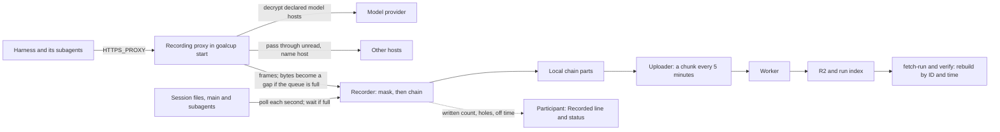

# Cut-first plan for Goal Cup Proxy, Edition 01

Date: Thursday 29 October 2026. Base: main at 4b226de2.
Status: **revision 4**, needs owner review. Nothing in this plan has been built or run.
Revision 1 was checked by a fact check and two reviews; revision 2 by two more reviews, one that
replayed a week of load against it and one that cut it down
([R-reviews.md](2026-10-30-audit/R-reviews.md), section 5). Revision 2 added the 2-hour Codex run
([M](2026-10-30-audit/M-two-hour-run.md)) and the owner's answers
([N](2026-10-30-audit/N-architecture-and-owner-answers.md)). Section 16 sums up what the revision 2
reviews changed. Revision 4 adds the review of run 1's server copy
([M section 9](2026-10-30-audit/M-two-hour-run.md#9-server-copy)).

**What the server copy changed (revision 4)**

A reviewer with read-only R2 and database access rebuilt run 1 from the server and compared it with Codex's own files.

- **Point 5 worked.** The server held every byte: 20 chunks, 1,304,968,017 bytes, every hash good. Prune at the
  seal lost nothing. No key or token in the whole 1.3 GB; all 378 `authorization` headers masked.
- **The loss is measured, not estimated.** 473 of Codex's 1,261 calls (37.5%) came after 15:43:15 and have no wire
  record. 15 of 43 threads have no wire call; 11 of them have no record at all.
- **Nothing on the server said recording had stopped.** Heartbeats said `gaps`, never `failed`; the participant got
  one email at 15:30. New: SL9 sends `failed`; an organizer query (SV1) finds such runs with no deploy.
- **The verifier missed it.** It said `cross_leg: consistent` and 0 provider errors. New: VF1 and VF2 in PR-V, and
  AD4 becomes five observer checks. Checks 1, 3 and 4 must fail run 1 before they judge run 2.
- **Masking has no left boundary.** The record has 1,412 masked spans and no real key. In the rollouts, 102 of 103
  such matches sit inside Codex's encrypted reasoning blobs, so those blobs are altered in the record, never on the
  wire. Friday adds only the URL password rule (AD1); run 2 counts the risky long spans; the guard (MK1)
  waits unless run 2 shows harm (O3).
- **Long-window compression is 4 times smaller on the real chunks** (12.9 to 1). CH18 moves up to Friday's PR-D,
  so run 2 tests it.
- **Owner questions:** 9, merged from revision 3's 12 and two new ones (section 15).

**What revision 3 changed**

- **Five recording PRs, not eighteen.** All five land by Sunday 1 November, so Monday's run tests main
  with a day of slack. About 290 changed source lines (60 of them the URL password rule), against
  about 650 added and 1,430 rewritten in revision 2.
- **Smaller forms of the same fixes.** The failure budget loses only its latch. The queue grows by one
  constant; base64 waits. Session-file limits are raised, not deleted, and never latch native capture
  off. The disk pause is switched off in one line; its code waits.
- **Four holes the first review found are closed.** A full queue now refuses only payload bytes, never
  the `Open` or `End` around them; native capture can no longer be latched off by a race or by the
  stream bound; three permanent stops (P11, P12 seen at the seal, P13) now end in a gap or a reconnect;
  and the screen says when bytes are being lost, not only when recording is off.
- **Almost no cuts before Friday.** Only pure test and data deletes, and the `goalcup mcp` print lines.
  Every other cut waits for after Edition 01. Friday is about the same size as today. That is the
  owner's own trade: "something that works versus not working".
- **New owner questions** (section 15): two stated limits instead of none, the 24-hour server close,
  masking timing, Hermes logins, Codex built-ins as text only.

## 1. The answer

Keep the recording core and fix the plumbing that lost the run. The core is the owner's own idea, and it
already exists: the harness reaches a local recording proxy through `HTTPS_PROXY`, the proxy decrypts
the model hosts the harness's config names, a recorder masks and chains the bytes, it also reads the
harness's session files, and the uploader sends everything to the Worker. Before 15:43 the wire matched
Codex's own log in every 10-minute bucket ([N 2.1](2026-10-30-audit/N-architecture-and-owner-answers.md#21-facts-from-the-run)).
What failed was the hop between the proxy and the recorder: a shared 8 MiB queue, a rule that drops a
whole producer when one frame does not fit, a failure budget that read load as death, and a count taken
before anything was written.

We choose **option A, patch today's shape**, in five small recording PRs and one verifier PR (section 9). Option B (the proxy writes
its own record, no IPC) is the right next shape, but it changes the record format, uploader, Worker keys
and verifier at once: 7 to 10 days. Option C (fresh rewrite) is 15 to 25 days. **Fallback** if PR-A is
not green by Saturday night: ship only the one-line parts (section 9.3). After Edition 01, move to option
B through the `CaptureSink` seam (`crates/goalcup-protocol/src/capture.rs:388-394`, taken by the emitter
at `crates/goalcup-cli/src/proxy/api.rs:262, 300`), then do the large cuts.

## 2. Owner answers so far

| # | Owner's answer (29 Oct) | What the plan now does |
|---|---|---|
| 1 | Yes: replace README P1 to P7 with the seven points. | PR1 replaces `README.md:276-288` with R1 to R7 and drops the never-delete rule (`AGENTS.md:101`). |
| 2 | Unsure what 16,384 means (agent threads?). Wants no caps. Remove the run size limit. | See "Q2 in plain words" below. Two stated limits stay, each with its cost (new question O2). Past either, a file waits; nothing is latched off. The run limit goes (CH14). |
| 3 | Same as 2: remove the per-run size limit. | CH14 sets `RUN_MAX_COMPRESSED_BYTES` to `9007199254740991` (`server/worker/wrangler.toml:59, 151`). Cost below. |
| 4 | "Ideally we support both, with gateway and without gateway? Wasn't that the plan?" | Yes, and it already works. See "Q4" below. Hermes: support only 0.22.5, the version its installer gives, with API-key logins (O5). |
| 5 | Unsure. "I would like something that works versus not working." | Option A, five recording PRs first. Nearly every cut waits until after Edition 01 (O1). |
| 6 | Yes, no need to print the `goalcup mcp` setup lines. | The print lines go in PR-C. The `goalcup mcp` command keeps working. |
| 7 | Why Claude Code only? What about Codex and others? | See "Q7" below. Codex and Amp already have their switch; Hermes does not update itself. Claude Code gets one more line (CH15). |
| 8 | What does "table" mean? An API endpoint? | No. See "Q8" below. For Friday the plan only says so in the text; the honest count shows 0 recorded (O5). |
| 9 | Yes, prune a part once the server saved it. | It already does, 2 hours after the server's acknowledgement (M 4.9). Run 1's server copy held every byte (M 9.1), so the timer stays and CH10 waits. Settled, not asked again. |
| 10 | Hopes so, but fears it will not be done in 24 hours. | Nothing is due in 24 hours. The five recording PRs land Friday to Sunday; Monday is the second 2-hour run. |

**Q2 in plain words: what 16,384 counts.** It is not agents. A "stream" is one recorded flow of bytes
with an open, some bytes and an end (`crates/goalcup-protocol/src/capture.rs:96-103`). The bound counts
streams open at the same moment, wire and session files together.

| Kind of stream | One stream is | Open for |
|---|---|---|
| HTTP request or response body | one model request, or its answer | seconds to minutes |
| WebSocket message | one message in one direction | a moment |
| Session file (native) | the main agent's or one subagent's transcript | the whole entry (one `goalcup start` or `continue`) |

So a subagent costs one long stream for its file, plus a few short ones while it calls the model. A
finished subagent's file keeps its slot until the entry ends. The run peaked at 54 open streams. The
plan keeps two stated limits:

| Limit | Value | What it guards | Past it |
|---|---|---|---|
| Open streams per entry | 16,384, of which session files may take all but 1,024 | Memory: at most 16 KiB of not-yet-masked bytes per open stream (`crates/goalcup-daemon/src/redact/stream.rs:122-125`), 256 MiB worst case, near zero for a quiet file | The file waits, unread, until a slot frees or the entry ends; the screen counts it as "waiting". Nothing is latched off. |
| Session files tracked per entry | 20,000 (`MAX_NATIVE_FILES`, `crates/goalcup-daemon/src/native_capture.rs:187`) | Poll CPU: every tracked file is checked each pass; at a 1 s poll, 20,000 files is about 30 percent of a core (M 5.3, scaled) | The file is not read; the finish names the count. |

At about 100 subagents an hour (the owner's "thousands" over a week, unverified), 15,360 session-file
slots last about 150 hours. `goalcup continue` starts a new entry with fresh limits. After Edition 01,
closing a quiet session file after 10 minutes removes the first limit's reach.

**Q3, the cost of no run limit.** R2 costs $0.015 per GB-month, with no egress fee
([R2 pricing](https://developers.cloudflare.com/r2/pricing/)). Production traces sit under a 180-day
bucket lock (`server/worker/wrangler.toml:29-32`), so each byte is paid for at least 6 months.

| Per run, compressed, busy 168 hours | Per month | 180 days | 100 entries, 180 days | 500 entries, 180 days |
|---|---|---|---|---|
| 68 GB (today's rate) | $1.02 | $6.12 | $612 | $3,060 |
| about 17 GB (long window, 12.9 to 1 measured on run 1's chunks; smaller chunks may compress less, M 9.7) | $0.25 | $1.52 | $152 | $760 |

The limit guarded one thing: a stuck or hostile client. One uploading 10 MB/s nonstop is about 6 TB a
week, about $90 a month and $540 for 180 days, per run ([M 4.8](2026-10-30-audit/M-two-hour-run.md#48-storage-cost-without-a-per-run-limit)).
Question O6 asks for a weekly look at stored bytes instead.

**Q4, gateways and Hermes.** "With and without a gateway" already works, by one rule (D74): goalcup
reads the one address the harness's own config names and records that host; with no address it records
the harness's default host (`crates/goalcup-cli/src/model_host.rs:1-25`).

| Harness | Where the gateway address goes | Measured |
|---|---|---|
| Claude Code | `env.ANTHROPIC_BASE_URL` in Goal Cup's `settings.json` (`connectors/claude-code-cli/harness.toml:40`) | Vercel gateway, 15 calls (`docs/research/results/2026-10-vercel-gateway.md:53`) |
| Codex | `model_provider = "vercel"` plus a `[model_providers.vercel]` table with `base_url` (`connectors/codex-cli/harness.toml:37`) | Vercel, 17 calls, HTTP only (same doc `:54`) |
| Hermes | `model.base_url` in `config.yaml` (`connectors/hermes-cli/harness.toml:68`) | Vercel, 9 calls (same doc `:55`) |
| Amp | none: Amp always talks to its own server | yes |

Routes the config reader cannot see record nothing today: Claude Code's cloud switches
(`CLAUDE_CODE_USE_BEDROCK` and the like), a base URL in a shell export or project file, Codex's
top-level `openai_base_url`, Codex built-ins with no table (Q8), and Hermes calls to hosts other than
`model.base_url`. For Friday the participant text names them (AD8), and the honest count (SL7) shows 0
recorded calls if a run uses one. Reading `openai_base_url`, stopping the four built-ins before launch
(AD5) and a `--record-host` input (AD10) wait for after Edition 01. "Gateway" in round 1's question meant
Hermes's own gateway process: the plan supports Hermes 0.22.5 only and says "Hermes subagents: not yet
measured" until a 0.22.5 run passes (O5).

**Q7, auto-update per harness.** A running harness keeps its old binary; an update matters only at the
next `goalcup continue`.

| Harness | Updates itself? | Our switch today | Plan |
|---|---|---|---|
| Claude Code | Yes, in the background, also while running | `DISABLE_AUTOUPDATER = "1"` (`connectors/claude-code-cli/harness.toml:60`) | Add `DISABLE_UPDATES = "1"`, which also blocks a `claude update` the agent runs ([setup docs](https://code.claude.com/docs/en/setup)) |
| Codex | No. It only checks at start and asks | `-c check_for_update_on_startup=false` (`connectors/codex-cli/harness.toml:46`) | Nothing more |
| Amp | Checks; runner mode restarts for updates | `AMP_SKIP_UPDATE_CHECK = "1"` (`connectors/amp-cli/harness.toml:45`) | Nothing more |
| Hermes | No; a daily passive check | none | Nothing for Friday |

Participant text adds: "Do not run `brew upgrade`, `npm update -g` or `hermes update` during your run."

**Q8, what a "table" is.** Not an API. In Codex's `config.toml`, a table is a section that starts with a
name in square brackets:

```toml
model_provider = "vercel"

[model_providers.vercel]
base_url = "https://ai-gateway.vercel.sh/codex/v1"
```

goalcup reads `model_provider`, then that table's `base_url`, and records that host. Four Codex
built-ins have no table, so no address is written anywhere: `ollama` and `lmstudio` (plain `http` to
this computer, never through our proxy), `amazon-bedrock` and `gcp` (cloud hosts we are not told about,
so they pass through unread). A run with one of them records zero model calls. For Friday the guide says
so and the screen shows "0 model requests recorded". Stopping such a start before launch waits (O5).

## 3. Stop silent loss first

Three rules now bind the recorder:

1. **A call counts only once written.** The participant's number is model requests whose bytes reached
   the chain, never requests the proxy merely saw. Requests with missing parts are counted as such.
2. **Off time and lost bytes are shown.** If wire recording is off, or bytes are being dropped,
   `goalcup status` says so at once, and the finish says how often, how long and how much.
3. **Every loss is a gap with a start and an end.** A loss starts at its chained gap and ends at the
   next `Recovery` record, or at the entry's seal. No new record kind is needed.

The fixes, by PR. Paths are under `crates/` unless noted. Line figures are estimates.
"P" numbers are the loss paths in [M section 2](2026-10-30-audit/M-two-hour-run.md#2-every-silent-loss-path-in-the-code-today);
"F" numbers are the first revision 2 review's findings (R section 5.1).

| Id | Fix | Where | src / tests | Test that proves it | Point | PR |
|---|---|---|---|---|---|---|
| SL1 | **Never give up on a recorder that answers** (P3, P4). `count_failure` still counts, but never calls `latch_terminal`. Reset `attempts` after an epoch that lived at least 30 s, so a later loss waits 1 s, not 10 s (F11; today `attempts` only grows). The constant, `STABLE_EPOCH` and the row fields stay until after Edition 01. | `goalcup-cli/src/proxy/ingest.rs:463-472, 860-878` | 3 / -220, +60 | New sender test: 50 losses in a row, each under a second, with the emulator's close-after-handshake policy: never `Disabled`, at least 50 epochs ready, a frame after the 50th loss is `Queued`. A loss after a 30 s epoch reconnects after 1 s. Delete the budget tests at `goalcup-cli/tests/it/m2_capture_sender.rs:1008-1289`. | 1, 3 | PR-A |
| SL2 | **Room for bursts.** `MAX_CAPTURE_QUEUE_BYTES` 8 to 64 MiB. Both reserve checks still hold (`ingest.rs:127-128`, `goalcup-daemon/src/runtime/capture/sink.rs:18`). Payload stays JSON number arrays (about 3.6 bytes per byte), so 64 MiB holds about 17 MB of payload, against run 1's 2.3 MB at overflow. Base64 waits unless N6 shows the receiver's parse is the limit (about 25 src and a fixture read by five files). | `goalcup-protocol/src/capture.rs:51` | 1 / 0 | N6. Tests that fill the queue by the constant may get slower (unverified which). | 1, 3 | PR-A |
| SL3 | **A full queue costs one stream's bytes, never the producer** (P1, P2, F1). In the daemon sink, for wire producers: when a `Bytes` frame would leave less than 8 MiB of the payload lane free, queue `Gap { QueueFull, lost_bytes }` on that stream instead and answer `Queued`. `Open`, `End`, `Gap` and `Connection` frames may use that last 8 MiB, so the frames around the lost bytes still fit. Today every frame takes the same lane and any refusal loses the whole producer (`sink.rs:270-292`). The redactor already moves a stream past a gap (`goalcup-daemon/src/redact/stream.rs:2834-2861`); the sink admits later bytes past one (`goalcup-daemon/src/ingest.rs:1002-1008`). Proxy side waits: N6 counts proxy-side `queue_full`; if it is not zero, the same rule goes into `ingest.rs:513-516` on Tuesday. | `goalcup-daemon/src/runtime/capture/sink.rs:246-292` | 25 / 100 | Invert `full_queue_gap_is_sticky` (`goalcup-daemon/src/runtime/capture/tests.rs:1061`) and `queue_full_reports_loss_outside_full_queue` (`goalcup-daemon/tests/it/capture_ingest.rs:1668`): fill to the mark, submit `Open`, `Bytes`, `End`; assert `Queued`, one gap with `lost_bytes` equal to the length, `Queued`, producer live, next bytes accepted, sealed trace "incomplete" with one stream gap. | 1, 3 | PR-A |
| SL5 | **Three permanent stops become losses** (P13, P11, P6). P13: when the owner drops a producer (`goalcup-daemon/src/runtime/capture/owner.rs:326-341`), also latch it lost in the sink, so the proxy is answered `Disabled` and reconnects. P11: the two local framing refusals (`ingest.rs:504-511, 600-606`) call `latch_loss`, not `latch_terminal`; the producer-ID bound (`:560-563`) and the handshake encode (`:944-948`) stay terminal. P6: past the emitter's stream bound, refuse that one stream with a `Loss` frame and keep the epoch live (`goalcup-cli/src/proxy/api.rs:451-453`). P7 and P10 wait. | as named | 10 / 60 | Force a redaction refusal: the proxy reconnects and a `Recovery` follows. A sequence break: a loss, then a new epoch. Open one stream past the bound: one `Loss`, the next request records. | 1, 3 | PR-A |
| SL6 | **The seal names any proxy refusal.** Add `(counters.sink_refusals, GapReason::IngestLost)` to the list in `proxy_gaps`; fix the comments that say sink refusals "add none". An open loss then ends at the seal. A recovered loss gets one more gap record; gap counts already count records, not losses (`goalcup-protocol/src/control.rs:686-689`). | `goalcup-daemon/src/runtime/capture/writer.rs:185-195`; `goalcup-protocol/src/control.rs:682-683` | 3 / 15 | Sender whose sink is disabled mid-run: the sealed trace ends with an `IngestLost` gap. | 3, 5, 6 | PR-A |
| SL4 | **Session files never stop** (P14 to P17, F3, F4). Raise, do not delete: `MAX_OPEN_STREAMS` 128 to 16,384 (every user reads the constant, verifier included: `goalcup-verifier/src/capture_analysis/reader.rs:1566, 1694`, `anthropic.rs:152`); native defaults `max_open_streams: MAX_OPEN_STREAMS - 1024` and `max_files: MAX_NATIVE_FILES` (`goalcup-daemon/src/native_capture.rs:279-280`); `NATIVE_EVERY` 100 ms to 1 s (`owner.rs:16`); `NATIVE_FINISH_BYTES` uncapped (`owner.rs:13`), the 180 s finish budget stays. **Native is never latched off:** a native frame that does not fit, or a native `Open` past the bound, is answered "try later" in the sink, under its lock, so no race with the wire receivers can latch it; the adapter stops the pass, keeps its file position and does not set `more_work` (today any refusal latches native for the entry, `native_capture.rs:964-973`, and `more_work` makes the owner poll every cycle, `owner.rs:186`). `MAX_OPEN_CONNECTIONS` stays 128: the proxy's control reserve is sized for 128 (`ingest.rs:113-116`), and past it a connection is relayed raw with a counted loss (`goalcup-cli/src/proxy/mod.rs:1463`). Cap code and `handle_budget.rs` stay until after Edition 01. | as named | 30 / -60, +120 | Fill the queue while native has a 10 MB file to read: all file bytes reach the chain, no native loss gap. 2,000 tracked files: all read. Delete `local_stream_limit_refusal_is_counted` (`goalcup-cli/tests/it/m2_proxy_integration.rs:2076-2130`), which would open 8,192 TLS pairs; `m2_emitter.rs:911` covers the bound. How "try later" is answered (a native-only sink call, or a new `SubmitResult` value that touches every match) is unverified until written; the second costs about 10 more lines. | 2, 3 | PR-B |
| SL7 | **Count a call once written; show holes and off time.** The daemon's chain writer counts each written request `Open` (`WireRequest` with `POST`, or `WsClient`) that carries a protocol hint, and also counts requests whose stream got a gap and the bytes those gaps lost (F2). The emitter keeps every off span (left `Live`, back to `Live`) in shared counters. The finish and status print the written count, the part with holes, the MB lost and the off time; the proxy's "seen" count moves to `host.log`. `CONTROL_API_VERSION` 12 to 13. Not a CLI-only count: a frame the proxy answered `Queued` can still be discarded by `latch_loss` (`ingest.rs:444-452`) before it reaches the chain. The heartbeat's `model_requests` stays the proxy's seen count (run 1 stored 1,766, wider than the 1,736 printed; `goalcup-cli/src/upload/uploader/heartbeat.rs:61`); D1 fixes the docs that call it model calls. | `goalcup-daemon/src/runtime/capture/writer.rs:327-345`; `goalcup-daemon/src/runtime/capture/mod.rs:1292-1301`; `goalcup-protocol/src/control.rs:67`; `goalcup-cli/src/daemon/mock.rs:157-168`; `goalcup-cli/src/proxy/api.rs:158-171, 739-745`; `goalcup-cli/src/commands/start/finish.rs:405-407, 439-444, 499-509`; `goalcup-cli/src/run/mod.rs:266, 716-719` | 55 / 60 | Sender against a sink that drops one producer mid-run: the printed count is below the seen count, equals the verifier's `wire_model_requests` on the same trace (`goalcup-verifier/src/capture_analysis/session.rs:210`), and the off time is above zero. A request with a mid-body gap is counted once, under "with missing parts". | 6 | PR-C |
| SL8 | **Say it while it happens.** `goalcup status` shows "Recording is off since 15:43" once the emitter has been off 60 s, or the recorder has not answered 3 watch ticks; and "Recording is losing data: 120 MB missing in the last 5 minutes" when chained lost bytes grew (F2). One `PROBLEM:` line each to `host.log` and `state.json`, not one per tick. The local-logs alarm (session files grew 5 minutes, written count flat; it would have fired about 15:48 in run 1) is last in the PR and may slip. | `goalcup-cli/src/run/watch.rs`; `goalcup-cli/src/run/mod.rs:118-131`; `goalcup-cli/src/participant/status.rs:335-340` | 30, +20 alarm / 40 | Emitter off 61 s shows the line; growing lost bytes give one `PROBLEM:` line. | 6, 1 | PR-C |
| | **Total** | | **about 180 / about -280, +455** | | | |

Left as they are, on purpose: P9 (65,536 producer IDs per entry, `capture.rs:63`) lasts 7.6 days at
one reconnect every 10 s, longer than a run, and SL3 makes reconnects rare; if reached, SL6 and SL8 make
it loud. P12 (a refused `Recovery`, `proxy/api.rs:774-785`) needs the socket to die between two lock
calls; it stays terminal, and SL6 gives it a gap end at the seal. P7 (connection bound) is guarded by the
proxy's own admission check (`proxy/mod.rs:1463`). P10 (one `Loss` per reason) loses only the time of a
repeat, not the fact. P18 (masking hold over 16 KiB) masks, never loses. P19 (a decoded body over 8 MiB)
is a stream gap with an end. P21 (a chain write error) is already loud. P22 (full disk): the owner chose
no special handling. P23 and P24 refuse the harness rather than lose silently; they were not reached in
run 1 and wait.

What could go wrong: a request body can now have holes, so that stream is "incomplete" while every
other stream records; the verifier's provider decoders were not re-read for mid-body gaps (unverified; on run 1
the `openai-responses` decoder already reported 429 unknown records and `incomplete` on 19 cut streams, M 9.5).
One huge body can still take most of the queue; a per-stream share is the next step if run 2 shows it.
The native rule takes the last 8 MiB from wire bodies, so wire gaps start a little sooner. A broken
recorder is retried for ever (log noise, one producer ID per reconnect). The single owner thread is still
the throughput limit and its peak rate is unmeasured: run 1's numbers suggest about 1.1 to 1.5 MB/s
(F2, unverified); N6 measures it.

### 3a. What the server copy adds

From [M section 9](2026-10-30-audit/M-two-hour-run.md#9-server-copy) and two code checks of its findings. Sizes are
estimates.

| Id | Fix | Where | src / tests | Test or proof | Point | PR, day |
|---|---|---|---|---|---|---|
| SL9 | **The server hears that recording is off.** In `write_beat`, after `heard`: if the emitter has been off 60 s or more (SL7's off-span counter, which SL8 reads) or `recorder_lost` is set, send `Recording::Failed`, not the daemon's word. Today the word is the daemon's view only, so run 1 said `gaps` to the end. `goalcup status` already prints `problem_recording_failed` for it. | `goalcup-cli/src/run/watch.rs:270-273`; mapping `goalcup-cli/src/run/mod.rs:114-124` | 10 / 30 | Emitter off 61 s: the next heartbeat body has `"recording":"failed"`; back to `Live`, it returns to the daemon's word. | 6, 5 | PR-C, Sat 31 |
| SL10 | **The native finish says which limit and how many files.** One `host.log` line with the stream-less gap: "N session files were never read: the open-stream limit (L) was reached". | `goalcup-daemon/src/runtime/capture/owner.rs:143-145` | 3 / 10 | A test with more files than the native bound prints the count. | 2, 6 | PR-B, Sat 31 |
| VF1 | **Verifier: a wire leg that ends early.** Add native's last observation time next to `wire_last`; new state `wire_ended_before_native` when it is more than 10 minutes after the wire's last request. Today `cross_leg` judges only zero against non-zero. | `goalcup-verifier/src/capture_analysis/session.rs:193-241`; `report.rs:326-333, 375-386` | 20 / 40, plus six byte goldens in `goalcup-verifier/tests/fixtures/m2-report-bytes/` | Unit test `report.rs:469-480` and `tests/it/m2_research_report.rs:1601-1625` extended; run 1's server copy reports the new state. | 5, 6 | PR-V, Sun 1 |
| VF2 | **Verifier: wire provider errors on their own line.** Print the wire leg's error total beside the token-source one. Count `response.failed` and HTTP error bodies; a stream `error` event only when no `response.failed` shares the turn, or the count doubles. | `goalcup-verifier/src/capture_analysis/stats.rs:749-779, 1023`; `openai.rs:475-486, 545-558` | 10 / 20 | `m2_run_stats`; run 1's server copy shows about 97 to 99, not 0 or 196. | 5, 6 | PR-V, Sun 1 |
| AD4 | **Observer checks, five, counts only.** Read the server copy (`fetch-run.sh`) and the harness's own files: (1) wire calls against the harness per 10-minute bucket and per thread, with the off time; (2) wire provider errors by code; (3) per proxy producer, first and last record, and whether it closed or a later `recovery` replaced it; (4) every session file on disk has a native stream, each missing one named; (5) secrets with segments joined, and redaction spans counted by kind and by length over 16 KiB. Each check has one pass rule. | an organizer script beside run 1's observer scripts on the research branch; not shipped | about 300 lines of Python (est.) | Dry run on run 1's server copy: checks 1, 3 and 4 must FAIL. | 1 to 6 | Sun 1 |
| SV1 | **Organizer query: requests rise, bytes per request collapse.** Hourly, read-only, on `goal_cup_tracer.heartbeats`: an entry whose last 6 heartbeats brought 20 or more requests at under a tenth of its own average bytes per request; `OR recording = 'failed'` once SL9 ships. No deploy. On run 1 it would have fired at about 15:54 to 15:59 (inferred). | SQL in the organizer notes; columns at `server/worker/sql/goal-cup-tracer-upload.sql:164-178` | no code | Dry run on run 1's heartbeat rows Sunday; tune on run 2 (a switch from HTTP to WebSocket drops bytes per request about 6 times). | 6, 5 | Sun 1, then the event |
| SV2 | **Optional: a second email when `failed` follows `gaps`.** Website SQL: `note_heartbeat` lets `failed` replace an earlier `gaps` flag; Worker: notice dedupe key `"failed"` when `flag_reason` is `failed`, else `""` as today, same in the local twin. (Keying on every reason would make each run already flagged `gaps` owe a duplicate email.) Only if the owner says yes (O9). | `server/worker/sql/goal-cup-tracer-upload.sql:2831-2832` (mirror; authority is the website repo's migrations); `server/worker/src/notices.ts:150`; `server/worker/src/db-local.ts:605` | 8 SQL, 2 / 20 | A run that sent `gaps` then `failed` gets two `recording` notices. | 6 | PR-T, Tue 3, if O9 |
| MK1 | **Optional: left guard on vendor-prefix masking rules.** Drop a match when the byte before it is in `[A-Za-z0-9_-]`, unless that byte ends a JSON escape, `%XX` or an ANSI code. Thirteen rules; never a plain `\b`, which misses keys after `\n` in JSON text. Loses keys glued after a letter, digit, `_` or `-`. | `goalcup-daemon/src/redact.rs:50, 706-777`; `redact/stream.rs:88-95, 1603-1618, 2082`; `spikes/redact.py:54-62` | 80 to 110 / 120 to 180 | Probes for each allowed left context; prefixes glued inside random base64url runs; a 20 KiB base64url run with `sk-` near its start comes through byte for byte; `all_three_agree`. | 1, 4 | After Edition 01; PR-T Tue 3 only if run 2 shows a span over 16 KiB and O3 says yes |
| CH18 | **Long-window compression, moved up** (section 7). | `goalcup-cli/src/upload/uploader/chunk.rs:17-19, 144` | 4 / 10 | Run 2 measures ratio and memory at the shipped chunk size (T10). | 5 | PR-D, Fri 30 |
| D1 | **Docs.** `docs/UPLOAD-API.md:366-367`: `model_requests` is "requests the proxy relayed to a model host, recorded or not". `docs/CHEAT-CHECKLIST.md:46-47`: `cross_leg` catches only a wire with zero streams. Next to F-07 (`docs/CHEAT-CHECKLIST.md:178-181`): masked "keys" inside `encrypted_content` are chance matches in ciphertext. `docs/UPLOAD-API.md:278`: a chunk's zstd window is at most 2^27. | as named | text | link check | 5, 6 | PR1 |
| | **Total before Friday** (SL9, SL10, VF1, VF2, CH18) | | **about 47 / about 110, plus goldens** | | | |

Not changed by the server copy: SL1 to SL8 stand as written. The copy confirms their causes: 18 proxy producers, a
budget exhausted by nine short epochs after a 161 s one, no `producer_closed`, every gap with `lost_bytes: null`,
and 32 native streams held to the finish.

## 4. The target shape

Unchanged: the harness reaches a loopback recording proxy through `HTTPS_PROXY`; the proxy decrypts
declared model hosts and names every other host it passes through; the recorder (still a separate
daemon for Friday) masks, then writes a hash-linked chain, and polls session folders; the uploader sends
chunks to the Worker, which stores them in R2 by sequence and `received_at`; `scripts/fetch-run.sh` and
`goalcup-verify --capture-integrity` rebuild a run by ID and time.



| Option | Shape | New or changed src | Days | Verdict |
|---|---|---|---|---|
| A | Today's shape, patched (sections 3 and 3a) | about 340 changed | about 3 | **For Edition 01** |
| B | The proxy masks and writes its own wire record; no IPC | about 1,300 to 1,600 new; about 2,850 removed | 7 to 10 | After Edition 01, via the `CaptureSink` seam |
| C | Fresh minimal rewrite | about 3,700 to 5,600 in Rust | 15 to 25 | No |

Details and risks: [N section 3](2026-10-30-audit/N-architecture-and-owner-answers.md#3-options-a-b-and-c).
Where this plan still differs from the two fresh designs (keep the daemon, chain, signing, termination
proof, declared host list, never change a forwarded byte) is unchanged from revision 1, for the same
reasons ([B top findings](2026-10-30-audit/B-fresh-design.md#top-findings)).

## 5. Numbers

Counted with `wc -l`; "src" is production code, inline tests count as tests. Figures after today are
estimates, plus or minus 30 percent. Per-area figures are in [A.1](2026-10-30-audit/A-inventory.md#a1-totals-by-area).

| | src | tests |
|---|---:|---:|
| Today | 102,176 | 159,498 |
| Friday cuts (section 6a) | about -30 | about -2,280 |
| Friday adds and changes (sections 3, 3a, 7, 8) | about +340 | about +585 net (-280, +865) |
| **Friday build** | **about 102,500** | **about 157,800** |
| Later cuts (section 6b, every other K) | about -44,000 | about -66,200 |
| **After Edition 01** | **about 58,500** | **about 91,600** |

The Friday build is the same size as today. Revision 1 cut 19 percent before Friday, revision 2 cut
7 percent; this revision cuts nothing that touches the recording path, the start path, the gate or the
release script in release week. The end state after Edition 01 is the same as before.

## 6. Cut list

Points checked: which point could suffer, and why it does not. Full rows (paths, tests that go, risks)
are unchanged from revision 1 unless the row says otherwise.

### 6a. Before Friday (pure deletes only; each can slip without harm)

| Id | What | src | tests | When | Change from revision 2 |
|---|---|---:|---:|---|---|
| K4 | Connector byte goldens (`goalcup-cli/tests/it/harness_contract_golden.rs`, daemon twin, `connector_template.rs`) | 0 | 1,558 | PR4, any day | None. Saves regenerating goldens for CH15. |
| K26 | v5 corpus test (`goalcup-verifier/tests/it/v5_corpus.rs`) | 0 | 718 | PR4 | None |
| K6 | Spike prototypes and data (`spikes/cursor-cli`, `spikes/openclaw`, hermes and opencode plugin code); keep `spikes/redact.py` and the corpus files | 0 (+9,568 data) | 0 | PR4 | None |
| K8 (part) | The printed `goalcup mcp` setup lines only (`goalcup-cli/src/commands/prep.rs:729-758`) | about 30 | small | PR-C | Narrowed. The git-credential flow waits. |
| K5 (effect) | The disk pause is switched off: `pause: None` at `goalcup-cli/src/commands/start/phases.rs:1177` (`None` never pauses anything, `goalcup-cli/src/run/watch.rs:131`). The 1,410 source lines go later. | 1 line | 0 | PR-D | Was a 1,410-line delete in PR6 that "may slip"; now a 1-line switch that cannot. |
| | **Total before Friday** | **about 30** | **about 2,280** | | |

### 6b. After Edition 01

Unchanged from revision 1: K3 (Rust Worker stand-in), K13 (daemon merge, now the path to option B), K14
(back-compat), K15 (platform rewrite), K16 (deny checks), K17 (pins), K18 (signing), K19 (CLI extras,
push lines kept until then), K20 (judged commit), K21 (workspace walk), K22 (finish stage machine),
K23 (rate limiter), K25 (`check-links.py`, oracle), K27 (leftovers). K24 still waits for test N5.
Already moved in revision 2: K1 (verifier research decoders), K10, K11 (narrowed), K12.

Moved here in revision 3, to keep release week for the recording fixes (O1):

| Id | What | src | tests | Why it moves |
|---|---|---:|---:|---|
| K2 | Scripts that serve no point and `check-version.py` | 5,430 | 4,821 | It edits `scripts/gate.sh`, `scripts/release.sh` and `ci.yml` in release week, and it deletes `scripts/research-measure.py`, which measures chain size, gaps and compression: what run 2 needs. |
| K5 | Client disk-full code, including the `SIGSTOP` pause | 1,410 | 1,830 | The one-line switch (6a) gives point 3 now. |
| K7 | Start-time provider probe and start-path leftovers | 620 | 910 | Touches the start path tested by `m2_cli_lifecycle` (full tier only). |
| K8 (rest) | Legacy `git-credential` flow | 280 | 150 | No point gains this week. |
| K9 | Platform dead code and `handle_budget.rs` | 500 | 280 | SL4 raises limits instead of deleting the cap code. |
| | **Total after Edition 01, all K** | **about 44,000** | **about 66,200** | |

## 7. Change list

| Id | What | Point | Size | Status in revision 3 |
|---|---|---|---|---|
| CH1 | Raise our bounds with their cost stated | 2, 3 | | Queue part is SL2 (constant only); stream part is SL4. `MAX_OPEN_CONNECTIONS` and `MAX_LIVE_PRODUCERS` stay 128. |
| CH2 | Delete native share and file caps | 2 | | **Changed:** raised, not deleted, inside SL4. Deletion waits. |
| CH3 | Cheap native poll | 3 | 1 line | **Changed:** only `NATIVE_EVERY` 1 s, inside SL4. The parent-once refactor waits. |
| CH4 | Refuse one stream past the bound, never latch | 1, 3 | | Inside SL5 (P6) for the proxy, SL4 for native. |
| CH5 | Raise the open-file soft limit at the top of `main` | 2, 3 | | **After Edition 01.** `goalcup start` already raises it (`goalcup-cli/src/commands/start/proxy.rs:25-61`); the daemon used 17 to 18 files and native holds no handle between polls. |
| CH6 | The proxy never refuses | 3 | | Failure budget is SL1. Restart cap and the 503 past `MAX_CONNECTION_TASKS` **wait**: loud, not reached in run 1. |
| CH7 | One proxy worker thread per core | 3 | 1 line | Withdrawn unless N6 shows over about 50 ms added per call at 40 senders (F14); then `worker_threads(2)` at `goalcup-cli/src/commands/start/proxy.rs:96-100`. |
| CH8 | Masking option b: drop the email and Codex rate-limit rules | 4 | about -100 src | **Optional this week**, after AD1, Tuesday if green; else after Edition 01 (O3). It couples the Codex `harness.toml` and pins into one commit. |
| CH9 | On `StorageFull`, cut the chain back to the last whole record | 3, 5 | | After Edition 01, with K5. |
| CH10 | Prune once acked, no timer | 5 | | After Edition 01. Today's prune already deletes a part 2 hours after the ack, and run 1's server copy held every byte (M 9.1). AD9 fixes what the participant sees. |
| CH11 | Name every passed-through host past the 10,000-row bound | 1, 5, 6 | about 30 src | **Optional this week**, first after CH8. A week of package installs can fill the list before a late model host shows (F9). |
| CH13 | `goalcup setup` warns on an unsupported filesystem | 3, 7 | | After Edition 01. |
| CH14 | Worker configuration only | 5 | config | Unchanged: `RUN_MAX_COMPRESSED_BYTES` to `9007199254740991` (`server/worker/wrangler.toml:59, 151`) with a comment naming the storage cost; `MIN_COMPETITION_VERSION` to the Friday tag (`:55, 150`); `EVENT_ID` (`:42`). The 24-hour close (`server/worker/src/db.ts:17`) stays (O4). |
| CH15 | Connector data | 1, 7 | data, pins | **Narrowed:** Claude Code `DISABLE_UPDATES` and `CLAUDE_CODE_DISABLE_AGENT_VIEW`, plus pins. Hermes rows wait (text says API keys only, O5). |
| CH16 | Fix a flake only when it fails a PR | | small | Kept. |
| CH17 | Upload keeps up | 5 | 2 constants | **Narrowed:** `backoff_max` 15 to 2 minutes and `interval` 30 to 5 minutes (`goalcup-cli/src/upload/policy.rs:80-85`). `eager_bytes` stays 256 MiB, so a chunk holds about 5 minutes of chain (about 100 MB at run 1's rate) and long-window compression still has data to work on (F10). The reset-on-progress logic is dropped: with a 2-minute cap it changes waits by seconds. The jitter adds up to 25% (`policy.rs:283-291`), so a wait can be 150 s: T7 says 2.5 minutes. |
| CH18 | Long-window compression | 5 | about 4 src, 1 test; `fetch-run.sh` 1 line, 1 test | **Moved up to PR-D, Fri 30** (O6). Run 1's real chunks: 408.9 MB at `-3` against 100.8 MB at `-3 --long=27`, 4 times smaller (M 9.7). Two setters after `Encoder::new` (`goalcup-cli/src/upload/uploader/chunk.rs:144`), fix the comment at `:17-19`. The Worker never decompresses (`server/worker/src/chunks.ts:165-225`); `fetch-run.sh`'s `zstd -dcq` (`scripts/fetch-run.sh:327`) accepts a 2^27 window by default, so add `--long=27` only to document it, with one case in `scripts/test_fetch_run.py`. If the setters do not build with default features off (`Cargo.toml:70-72`), drop it to after Edition 01. Run 2 measures the gain at the shipped chunk size and the memory (T10). |
| CH19 | One stream per WebSocket direction | 5 | | After Edition 01. Run 1's server copy measured what it would save: 362 MB of open, end, framing and base64 for the server messages, 418 MB for both directions, of a 1,305 MB chain (M 9.7). |

## 8. Add list

| Id | Add | Point | Smallest version | Status |
|---|---|---|---|---|
| AD1 | URL password rule (`goalcup-daemon/src/redact.rs:280-283`) with the Python oracle | 4 | about 61 src, 40 tests | PR-E, alone. |
| AD2 | One "Recorded:" line at each part's end and in `goalcup status` | 6, 2 | about 30 src | **Narrowed**, in PR-C: written requests with hosts, how many have missing parts and how many MB, off count and time, session files read and waiting, and "N MB not yet on the server; the server closes this run at T" (F7). Example: "Recorded: 842 model requests from chatgpt.com (12 with missing parts, 40 MB missing). Recording was off 3 times, 2 min in total. Session files: 43 read, 0 waiting. 120 MB not yet on the server." The rest waits. |
| AD4 | `live-check` for organizers | 1, 2, 4, 6 | about 300 lines of Python, not shipped | **Changed (section 3a):** run 1's scripts as they are do not reach T1 to T5 (`final.py` hard-codes paths and a start time and has no pass rule; `secrets.py` decodes each segment alone), and `goalcup-verify` has the two blind spots VF1 and VF2 fix. Five checks on the server copy, each with one pass rule, dry-run on run 1 first. |
| AD5 | Codex routes: read `openai_base_url`; stop four built-ins | 1, 6 | | **After Edition 01** (O5). Text only for Friday. |
| AD6 | Load tests | 1, 2, 3 | about 250 test lines | **Narrowed:** N6 only, as an `#[ignore]` test, run by hand on Saturday night and before the release candidate: 20 to 40 producers sending 1.5 MB bodies in bursts for 10 minutes against the real owner and the real proxy. It reports owner-thread CPU (`/proc/<pid>/task/<tid>/stat`), drain MB/s, proxy-side `queue_full`, and added latency per call. N1 becomes the 2,000-file case in SL4's tests; N2 waits with CH6. |
| AD7 | Server rebuild proof | 5 | | **Done once:** run 1's server copy rebuilt whole (M 9.1). Run 2 repeats it (T8), with read-only access (O7). N4 waits. |
| AD8 | Participant text | 6 | text | Revision 2's lines, plus: keep the computer on and online until goalcup says "uploaded" (the server closes 24 hours after the run's end); Hermes with API-key logins only; Codex `ollama`, `lmstudio`, `amazon-bedrock` and `gcp` are not recorded; recording may drop bytes under heavy load and the screen says how much. |
| AD9 | Honest finish screen | 6 | about 20 src | In PR-C: `verify:` only when the local chain is whole (`goalcup-cli/src/commands/seal.rs:448-455`); otherwise "The server holds your full recording (acknowledged at T). This computer keeps the last part." Support block to `host.log`. Status wording "Start your prompt with these lines" (`goalcup-cli/src/commands/status.rs:478`). |
| AD10 | `--record-host` | 1 | | After Edition 01. |

Decided not to add for Friday: base64 ingest (unless N6), proxy-side gap substitution (unless N6),
closing quiet append-only streams, joined-view masking, periodic SQLite snapshots, a daemon restart with
a fresh producer, spilling the queue to disk, prefix dedupe of repeated context, a per-harness call
reconcile inside the client, OpenCode or OpenClaw connectors, a longer server close.

## 9. PRs in order, day by day

Each PR runs `sh scripts/gate.sh fast`. PR-A, PR-B and PR-C also run `sh scripts/gate.sh full`, because CI
skips the daemon and CLI suites (`.github/workflows/ci.yml:15-16`). PR-A times the full gate for the
first time. Every client change ships in the one Friday release.

### 9.1 PRs

| PR | Scope | src / tests | Proof | Day |
|---|---|---|---|---|
| PR-A | **Never off for good:** SL1, SL2, SL3, SL5, SL6; D58 text (`docs/DECISIONS.md:495`) and the new decision | about 42 / -220, +235 | SL tests; full gate timed | Fri 30 |
| PR-D | **Constants and data:** pause off, CH17 two constants, CH18 long window, CH15 Claude Code lines and pins, CH14 staged | about 9 / about 20 | upload policy tests; a chunk test that round-trips through `zstd -dcq`; `shipped_connectors.rs` | Fri 30 |
| PR-B | **Every session file:** SL4, SL10; N6 written as an ignored test | about 33 / -60, +380 | SL4 and SL10 tests; N6 run once by hand Saturday night | Sat 31 |
| PR-C | **Honest screen:** SL7, SL8, SL9, AD2, AD9, K8 print lines; one `CONTROL_API_VERSION` bump | about 145 (165 with the alarm) / about 130 | SL7, SL8 and SL9 tests; `start_launch`, `m2_cli_lifecycle` wording | Sat 31, may run into Sun 1 |
| PR-E | **Secrets:** AD1 with the oracle | about 61 / 40 | redaction suites, oracle agreement | Sun 1 |
| PR-V | **Verifier tells the truth:** VF1, VF2 | about 30 / about 60, six goldens | verifier suites; run 1's server copy shows `wire_ended_before_native` and the wire error count | Sun 1 |
| PR1 | Docs: README R1 to R7, the run 1 report with its server copy section (commit `74daaa03`) and its folder merged from `origin/smart/tender-clarke-qupne3`, the revision 1 false lines; AD8 text in `docs/PARTICIPANT-GUIDE.md`; D1 | docs | link check | Thu 29 to Sun 1 |
| PR4 | K4, K26, K6 | -2,276 tests, data | gate fast | Any day, optional |
| PR-T | Tuesday fixes from run 2; then, only if green: CH8, CH11, base64 or proxy-side SL3 if N6 asked for them; MK1 only if run 2 shows a span over 16 KiB and O3 allows it; SV2 only if O9 says yes | small | per item | Tue 3 |

### 9.2 Day by day

- **Thu 29 Oct:** owner reads this plan and section 15. PR1 starts.
- **Fri 30 Oct:** PR-A (time the full gate). PR-D, with CH18. PR4 in parallel if a reviewer is free.
- **Sat 31 Oct:** PR-B, then PR-C. Saturday night: run N6 by hand on main; if it shows proxy-side
  `queue_full` or a receiver-bound drain, note it for Tuesday.
- **Sun 1 Nov:** PR-E. PR-V. Finish PR-C if needed. Build release-like binaries from main. Prepare both
  sandboxes and read-only server access (O7). Write the five AD4 checks and the SV1 query; dry-run both on run 1's
  server copy and heartbeat rows. AD4 checks 1, 3 and 4 must FAIL run 1, or they are not ready.
- **Mon 2 Nov:** **second 2-hour run** on main (section 10). CH18 is in the build; run 2 measures it.
- **Tue 3 Nov:** fix what run 2 found, first. Then PR-T's optional items, in order, only if green. Owner
  deploys the Worker configuration to staging; if O9 says yes, the website migration and the 2 Worker lines of SV2
  go to staging too. Feature stop at 4 Nov 00:00 UTC (O8).
- **Wed 4 Nov:** tag the release candidate. Run N6 again by hand. Full gate on the Linux sandbox, and on a Mac if one is
  available. Release-candidate run (section 10.3).
- **Thu 5 Nov:** buffer. Fix only what Wednesday found. Hermes 0.22.5, 30 minutes, if time (O5).
- **Fri 6 Nov:** release at 12:00 UTC. Owner deploys the production Worker configuration before
  7 Nov 00:00 UTC. Freeze from here until the last run ends, except owner-signed fixes; a connector
  update for harness drift counts as one. During the event, an organizer runs SV1 every hour (O7).

### 9.3 Minimum shippable set

Ship PR-A, PR-B, PR-D and these parts of PR-C: SL7 (or, if it is not green, the wording "N requests
reached the recording proxy. Run `goalcup status` to see gaps." at `goalcup-cli/src/commands/start/finish.rs:499-509`),
SL8's two status lines, and SL9. In order: SL1, SL2, SL3, SL5, SL6 (Fri), the pause switch (Fri), SL4 (Sat), SL7, SL8, SL9 (Sat). With these, the first revision 2 review's list of open paths is closed: no
failure budget, no whole-producer drop for payload, no native latch, P11 and P13 recover, an open loss
ends at the seal, the screen and the server say when recording is off, and the harness is never paused.

**Fallback if PR-A is not green on Saturday night:** the one-line parts only: SL1's latch removal, SL2's
constant, SL6's line, the pause switch, CH15 and CH14. Each load drop is then a visible gap and a
reconnect, and release notes say that a load drop still costs every stream in flight and at least 1 s.

**Slips to after Edition 01 if needed, in this order:** PR-T's optional items, PR4, PR-V (then the judge notes
name the two blind spots, and AD4's checks stand in), PR-E (then Friday ships today's masking rules). Already after Edition 01: every K but section 6a, CH2's deletion, CH3's
refactor, CH5, CH6 rest, CH9, CH10, CH13, CH19, AD5, AD7's N4 test, AD10, MK1 unless run 2 asks for it, SV2 unless O9, option B.

## 10. The second 2-hour run

### 10.1 How to run it (Monday 2 November)

- Vercel Sandbox on a plan whose session lasts past 2 hours (`docs/research/VERCEL-COMPAT.md:41`), Linux,
  a normal user, credential brokering off for model hosts (`:46`), a real terminal in `tmux`, real logins.
- **Sandbox 1, Codex:** same login and shape as run 1 (API key), chat mode. The prompt asks for subagents
  in plain words, for example "Build the app below. Split the work across as many parallel subagents as
  help, and keep going until it is done." Never force subagents by config. Script the "keep going", so
  there is no 45-minute idle like run 1.
- **Sandbox 2, Claude Code:** the same prompt, asking for up to 20 parallel subagents in plain words, at
  least 1 hour. Run 1 had one to four at a time; this is the heavier load the reviews asked for (F2).
- Push lines at the top of each prompt.
- Every 5 minutes, `cp -al` the trace folder to a folder on the same filesystem. Hard links keep each part
  after prune deletes its name, at no extra disk cost.
- Read-only R2 and database access for the observer, so `fetch-run.sh` runs on the server copy and SV1 runs on
  the heartbeats (O7).
- Every 10 s, sample CPU from `/proc/<pid>/stat` for the daemon, `goalcup start` and the harness, and
  from `/proc/<pid>/task/<tid>/stat` for the daemon's owner thread.
- Observer: the five AD4 checks on the server copy, `goalcup-verify` with PR-V, SV1 every 30 minutes, and
  `scripts/research-measure.py`.
- Save the report as `docs/research/results/2026-11-02-two-hour-run.md`.

### 10.2 Pass criteria

| # | Point | Check | Pass |
|---|---|---|---|
| T1 | 1, 3 | Wire requests against the harness's own log, per 10-minute bucket and per thread (AD4 check 1) | Every bucket has wire requests. Wire minus failed responses equals the harness count, or each difference sits inside a gap the screen showed. No bucket after a gap stays at 0. Every harness thread has wire calls (`thread-id` header, `client_metadata`). |
| T2 | 3 | Never off for good | Every `ingest_lost` gap is followed by a `recovery` within 60 s. No terminal state in `host.log`. Ideally only per-stream `queue_full` gaps. |
| T3 | 3, 5 | Loss never silent | Every span with relayed model traffic and no recorded frames is covered by a gap with a start and an end. No proxy producer is left without a `producer_closed` or a later `recovery`, and the last proxy record is within 5 minutes of the last harness call (AD4 check 3). Whether a clean finish closes the last proxy producer is unverified; run 2 shows it. |
| T4 | 6 | Honest count | The finish and status count equals the written model requests in the chain, exactly; requests with missing parts and MB missing match the chain's gaps. With any gap, the screen never says "Recording works". The heartbeat's `model_requests` is the seen count and is not compared. |
| T5 | 2 | Every subagent | Every rollout and every Claude Code subagent file on disk is in the chain by path (AD4 check 4). No stream-less `limit_exceeded` gap; if a file waits, `host.log` names the limit and the count (SL10). |
| T6 | 2 | Session files survive load | No native loss gap. Native bytes in the chain equal the files' bytes at the seal, less what the last poll had not read. |
| T7 | 5 | Upload keeps up | At every 10-minute tick the server is at most 10 minutes behind. No backoff wait over 2.5 minutes (the 2-minute cap plus jitter). Seal acknowledged within 1 minute. |
| T8 | 5 | Server rebuild | `fetch-run.sh` output equals the hard-linked copy byte for byte. `goalcup-verify --capture-integrity` on the server copy exits 0 or names only gaps from T2 and T3. Run 1 passed the rebuild half (M 9.1). |
| T9 | 4 | Secrets | No API key, GitHub token or `Authorization: Bearer` in either copy, segments joined, raw, base64 and percent-encoded. A fake `.env` the agent prints and a URL with a password are masked. Run 1's server copy had 0 hits (M 9.2). |
| T10 | 5 | Size | Chain and compressed bytes per hour by source; the shipped long-window ratio at the shipped chunk size against run 1's 3.2 to 1 at `-3` and 12.9 to 1 with `--long=27`; `goalcup start` RSS with it; the 168-hour projection. No pass line; if RSS grows more than 200 MiB, use `window_log(26)`. |
| T11 | 3 | Load | Peak owner-thread CPU and daemon CPU per 10 s, drain MB/s, RSS, open files, added latency per call, peak concurrent subagents. No refused model connection. |
| T12 | 6 | Screen | No support block, no `verify:` that cannot pass, no internal words. The Codex warning is the one AD8 names. |
| T13 | 7 | Push | The GitHub repository has the agent's commits. |
| T14 | 1 | Run 1 unknowns | Explain run 1's `auth_refused=1` if it repeats. (The `limit_exceeded` cause is settled: the native finish, M 9.3.) |
| T15 | 5, 6 | The server shows when recording was off | Every off span of 60 s or more shows as `recording: failed` in the server's heartbeats within one heartbeat (5 minutes), and in `goalcup status`. SV1 lists the entry for that window, and lists nothing for an entry with no off span. If run 2 has no off span, this is checked in the release-candidate run's kills. |
| T16 | 5 | A wire leg that stops early is reported | On run 1's server copy, AD4 checks 1, 3 and 4 FAIL and the PR-V verifier says `wire_ended_before_native` with a wire error count of about 97 to 99, not 0. On run 2, any wire stop of 10 minutes or more while session files grow is named by both. |
| T17 | 1, 4 | Masking keeps model data whole | No redaction span over 16 KiB (AD4 check 5), so no request tail was masked to the next line (F-07). Spans inside `encrypted_content` are counted by kind and named in the organizer notes; if MK1 has shipped, there are none. |

A run that fails T1, T2, T3, T5, T15 or T16 blocks the release candidate. If PR-V slipped, T16 needs only the AD4 half. A span over 16 KiB in T17 makes MK1 a
Tuesday item, if O3 allows it. Others are fixed on Tuesday or named in AD8.

### 10.3 Release-candidate run (Wednesday 4 November)

The tagged candidate, 1 hour, Claude Code with subagents asked for in the prompt, plus: kill the recorder
once (the harness carries on, a gap is written, the port serves again); kill the daemon once ("Recording
is off" within 2 minutes, recording resumes after `goalcup continue`); one 2-minute network cut
(recording goes on, upload catches up). After each kill, the server's next heartbeat says `failed` and SV1 lists
the entry (T15). Same pass table. Hermes 0.22.5 moves to Thursday, if time.

## 11. What must deploy together

| Change | Parts that move together | Rule |
|---|---|---|
| Queue constant (SL2), gap substitution (SL3), P13 sink latch (SL5) | protocol `capture.rs`, proxy `ingest.rs`, daemon `sink.rs`, `owner.rs` | One release. The installer ties CLI and daemon versions (`packaging/install.sh:104-195`). No wire format change. |
| Stream bound (SL4) | protocol `capture.rs:58`; proxy `api.rs:451`; daemon `sink.rs`, `native_capture.rs`; verifier `reader.rs:1566, 1694` and every decoder that reads the constant | One release. `MIN_COMPETITION_VERSION` set to it, or an old verifier calls new traces invalid. |
| `CONTROL_API_VERSION` 12 to 13 (SL7, SL8) | daemon, CLI, CLI mock (`goalcup-cli/src/daemon/mock.rs:157-168`) | Bump once, in the Friday release. |
| Upload (CH17) | client only | Constants only; the Worker is unchanged. |
| Long window (CH18) | client encoder; `scripts/fetch-run.sh`; `docs/UPLOAD-API.md:278` | Client only for the format: the Worker never decompresses, and `zstd -dcq` reads a 2^27 window by default. The docs name 27 as the limit; a later client that wants 28 must change `fetch-run.sh` first. |
| Heartbeat `failed` (SL9) | client only | The Worker already accepts `failed` (`server/worker/src/runs.ts:455-456`). The server flag is set once (`server/worker/sql/goal-cup-tracer-upload.sql:2831-2832`), so a run flagged `gaps` gets no second email without SV2. SV1 sees the `failed` rows either way. |
| Second email (SV2, only if O9) | website migration (authority: the website repo's `supabase/migrations/`, with its gate and `pnpm db:check`); then Worker `notices.ts:150` and `db-local.ts:605` | Migration first: an old Worker with the new SQL is harmless (one email, as today); a new Worker with old SQL never sees `failed` after `gaps`. Runs already flagged keep key `""`, so none gets a duplicate. Staged Tuesday, production before 7 Nov 00:00 UTC. |
| Verifier (VF1, VF2) | verifier, its six byte goldens, `scripts/matrix.sh:2057-2062` (reads `--research-json`) | One PR. The new JSON key changes the goldens; the verifier ships in the Friday release. |
| Masking (AD1, MK1) | `redact.rs`, `redact/stream.rs`, `spikes/redact.py` | One commit each. A regex and its stream shape must change together, or `policy_ready` refuses every producer (`redact/stream.rs:751-767`). CH8, if it lands, also takes the Codex `harness.toml` and pins. |
| Connector edits (CH15) | `harness.toml`, `sh scripts/pin-manifests.sh` | Same commit, or every start refuses. |
| Friday release | client tag (with verifier), Worker config (`RUN_MAX_COMPRESSED_BYTES`, `MIN_COMPETITION_VERSION`, `EVENT_ID`) | Staged Tuesday, production Friday before 7 Nov 00:00 UTC. No Worker code change and no website SQL change, unless O9 says yes to SV2. |

## 12. Tests and gate

**Stays.** Everything in revision 2's list, with the budget tests and the stream-limit integration test
rows changed as section 3 says.

**New.** The SL tests in section 3, SL9, SL10, VF1 and VF2 in section 3a, the CH18 round-trip, the PR-C screen
tests, AD1's tests and N6 as an ignored test. About 865 new test lines, about 280 deleted, plus six regenerated
verifier goldens. AD4's checks and SV1 are organizer scripts, run by hand, not in the gate.

**Goes before Friday.** The tests of K4 and K26: about 2,280 lines.

**Gate.** Fast gate under 4 minutes warm on 4 vCPU (54 s to 306 s today,
[J B3](2026-10-30-audit/J-tests-gate.md#b3-time-per-step-and-total)). Full gate on PR-A, PR-B and PR-C,
because CI excludes the daemon and CLI suites; PR-A times it. N6 is run by hand, not in the gate. The
gate refuses root (`scripts/gate.sh:32-39`). Unverified: how many tests assume the 100 ms native poll or
the 8 MiB queue.

## 13. Docs and decisions

- **PR1:** promise list R1 to R7, the run 1 report with its server copy section merged to main, the revision 1
  list of false lines, AD8 text, D1 (the meaning of `model_requests`, the `cross_leg` bound, ciphertext "keys", the
  zstd window).
- **New decision, in PR-A:** "Load never ends recording. Every loss is a gap with a start and an end. A
  model call counts once its bytes are written." D58 loses "`MAX_CONNECTION_FAILURES` still ends the wire
  leg" (`docs/DECISIONS.md:495`).
- **New decision, in PR1:** option A for Edition 01, option B after it through the `CaptureSink` seam; D3's
  "keep the signed daemon small" is void because the binaries are unsigned (`packaging/README.md:22-23`).
- **Inside each code PR:** `docs/ARCHITECTURE.md` IPC text (per-stream gaps) with PR-A; limit text with
  PR-B; count, holes and off-time text with PR-C; masking with PR-E; the update switch in
  `docs/HARNESS-SETUP.md` with PR-D.
- **After Edition 01:** the history-doc deletes (was PR13), the doc merges and decision retirements from
  revision 1 ([K](2026-10-30-audit/K-docs-decisions.md#8-order-of-work)).
- **Never rename:** `docs/PARTICIPANT-GUIDE.md` (`goalcup-cli/src/main.rs:59`) and the `### <Harness>`
  anchors in `docs/HARNESS-SETUP.md` (`goalcup-cli/src/commands/prep.rs:896`).

## 14. Risks and blind spots

- **Writer throughput is unmeasured.** Run 1 suggests the owner thread drains about 1.1 to 1.5 MB/s
  (unverified). Twenty senders resending 1 MB every 10 s is 2 MB/s. Then most bodies get holes for
  hours: loud in the chain and on the screen (SL7, SL8), but the record is thin. N6 and T11 measure it. If
  it is low, base64 and CH19 come back, after Edition 01 if not before.
- **Mid-body gaps.** SL3 creates gaps inside request bodies. The verifier's decoders were not re-read for
  them; a decoder that calls such a trace invalid would hurt judging, not recording.
- **Proxy side still drops a producer** if its own 64 MiB queue fills (`ingest.rs:513-516`). With the
  daemon no longer refusing, this needs the daemon's receiver to fall behind; N6 counts it.
- **One run, one harness.** Run 1 was Codex only, one to four subagents at a time. Run 2 adds Claude Code.
  1,000 subagents are untested. Hermes 0.22.5 delegation has never been measured by us.
- **The 24-hour server close.** A laptop asleep at the deadline, or the Worker down near the end, loses
  the unsent tail on the server (kept locally) (`server/worker/src/db.ts:17`). Text only for Friday (O4).
- **The Worker down mid-week.** Recording goes on, but `goalcup continue` needs the server
  (`goalcup-cli/src/upload/mod.rs:43-45, 103-117`), and no acks means no prune. Ops: a Worker uptime
  alert during the event.
- **Hermes logins.** With an OAuth login, the token refresh may fail through our CA bundle
  (`connectors/hermes-cli/harness.toml:88-92`; source-traced, unverified). Text: API keys only (O5).
  Hermes's `state.db` is re-read at each seal; past about 200 MB it may not fit the 180 s finish budget.
  The Thursday Hermes run measures its size.
- **Fewer cuts.** The Friday build is today's size. The owner's "over-engineered" stays true until after
  Edition 01; the review time went to recording.
- **Compression gain at the shipped chunk size.** Run 1's real chunks gave 4 times smaller, but they held up to
  264 MB of chain; 5-minute chunks hold about 100 MB, so the gain may be smaller. Each chunk needs about 140 MiB more
  memory in `goalcup start` (synthetic). T10 measures both.
- **Masking alters ciphertext in the record.** Run 1 had 1,412 masked spans and no real key; 102 of 103 matches in the rollouts sat inside `encrypted_content`. Harmless for
  secrets, but a reader may count them as leaked keys (D1 says otherwise), and a span over 16 KiB would mask the rest
  of a request line (F-07). Unmeasured in run 1; T17 measures it. MK1, if it ships, misses keys glued after a letter,
  digit, `_` or `-`.
- **Judges read the verifier.** Until PR-V lands, `cross_leg` and `provider_errors` say "fine" on a run like run 1.
  If PR-V slips, the judge notes must say so.
- **No email when recording stops after an earlier gap**, unless O9. The participant sees it on their screen
  (SL8); if they are away for a week, only SV1 catches it, and only if an organizer runs it.
- **SV1 false alarms.** A harness that moves from HTTP bodies to WebSocket messages drops its bytes per request
  about 6 times, close to the 10-times line. Tune on run 2; a tool that bypasses the proxy is not counted at all.
- **The heartbeat word can flip** between `failed` and `gaps` in the heartbeats table. The flag is set once, so no
  email changes.
- **No run limit.** A looping client costs money until someone looks (O6).
- **A broken recorder is retried for ever.** Intended.
- **Wording.** "12 with missing parts" may alarm a participant whose run is valid. AD2 says what was kept
  as well as what was missed.
- **Silent bypass remains.** A tool that ignores `HTTPS_PROXY` gives a sealed run with no gap. The
  local-logs alarm, if it lands, catches the case where session files grow and no call is written.
- **A dead `goalcup start` still blocks the harness** until `goalcup continue`. Fixing it needs option B
  or K13.
- **Friday deploy from one device.** Stage the Worker configuration on Tuesday.
- **macOS.** Every run so far was Linux. No Mac has run the gate yet.
- **Estimates.** Line and day figures are estimates, plus or minus 30 to 50 percent. Review time per PR
  is not measured.

## 15. Owner questions

Nine questions. Revision 3's twelve are merged where they touch the same thing, and the server copy adds two (part
of O3, and O9). None re-asks the ten you answered on 29 October.

| # | Question | Recommendation |
|---|---|---|
| O1 | Friday removes almost no code (about 30 source lines and 2,300 test lines). Every other cut (about 44,000 source lines) waits until after Edition 01, so release week goes to recording fixes. Accept? | Yes |
| O2 | You asked for no caps. May two stated limits stay for Edition 01: 16,384 open streams per entry (memory) and 20,000 session files per entry (poll CPU)? Past either, a file waits and the screen says so; nothing stops recording; `goalcup continue` starts fresh. | Yes |
| O3 | Masking. The URL password rule ships this week. Two other changes may wait: (a) dropping the email and Codex rate-limit rules, if not green by Tuesday; (b) a guard so masking stops changing Codex's encrypted reasoning text in the record (run 1 had 1,412 masked spans and no real key; 102 of 103 matches in Codex's own files were inside that text; never on the wire). (b) would stop catching a key typed straight after a letter or digit. May (b) wait until after Edition 01, unless Monday's run shows it cost recorded data? | Yes to both waits |
| O4 | The server stops taking uploads 24 hours after a run ends. Keep that for Edition 01 and tell participants to stay online until "uploaded", rather than change SQL and Worker code this week? | Keep, with the text |
| O5 | Harness limits for Edition 01, said plainly in the guide: Hermes 0.22.5 with API-key logins only, and "main agent only" if Thursday's subagent run fails or does not happen; Codex's four built-in providers with no address (`ollama`, `lmstudio`, `amazon-bedrock`, `gcp`) record nothing and the screen shows "0 model requests recorded". Stopping such a start waits until after Edition 01. Accept? | Yes |
| O6 | Storage and upload, together: no per-run size limit, replaced by a weekly look at stored bytes per run (no code); a chunk every 5 minutes instead of 30 (a few thousand more R2 objects per busy week); and long-window compression from Friday, which made run 1's real upload 4 times smaller but costs about 140 MiB more memory while recording. Accept all three? | Yes |
| O7 | May organizers keep read-only access to R2 and the run database for Monday's run and through the event? It lets us check the server copy and run an hourly query that finds runs whose recording stopped. It reads no IP or member column. | Yes |
| O8 | If Monday's run finds a new loss bug, may the feature stop move from 4 Nov 00:00 to 4 Nov 12:00 UTC for loss fixes only? | Yes |
| O9 | When recording stops, the participant sees it on their screen (SL8) and the server's heartbeat says "failed" (SL9). But they get an email only for the first problem: run 1 got one at the first gap and nothing when recording stopped. A second email needs a small website database change and 2 Worker lines before 7 Nov. Do it now, or rely on the screen and the hourly organizer query for Edition 01? | Screen and query for Edition 01; the email after it |

Settled without asking: revision 3's O5 (pruning 2 hours after the server's confirmation stays, since run 1's server
copy held every byte), revision 2's O8 (`--record-host` after Edition 01) and O10 (push lines: wording only).

## 16. Challenges and answers, revision 2

Two reviews read revision 2 ([R section 5](2026-10-30-audit/R-reviews.md#5-revision-2-reviews)). Review A
replayed run 1 and a 168-hour week against the plan and found fourteen ways it could still lose or block.
Review B argued the plan was still too much work for eight days. Every disputed point was checked in the
code. What changed:

| Topic | Revision 2 | Revision 3 | From |
|---|---|---|---|
| Size of the recording work | 18 PRs, about 650 src added, 1,430 rewritten | 5 PRs, about 290 src changed, all on main by Sunday | B |
| Failure budget (SL1) | Delete the constant, fields and callers; rewrite 5 tests | Remove the latch only; delete the budget tests; reset the reconnect delay after a 30 s epoch | B, A F11 |
| Queue (SL2) | 64 MiB plus base64 | 64 MiB only; base64 if N6 asks. Base64 was not "one serde attribute": no `base64` dependency in the protocol crate and a fixture read by five files | B |
| Full queue (SL3) | Gap for `Bytes`, both sides | Gap for `Bytes` with an 8 MiB headroom for `Open`, `End`, `Gap` and `Connection`, daemon side; proxy side if N6 asks. Confirmed: every frame shares one lane today (`sink.rs:270-292`) and the proxy's lane depends only on stream 0 (`ingest.rs:804-811`) | A F1, B |
| Native (SL4) | Delete caps; check `room()` before a pass | Raise the limits; native refusals are answered "try later" under the sink's lock and never latch; no `more_work` on a stop; 1 s poll. Confirmed: any native refusal latches native for the entry (`native_capture.rs:964-973`), the open-stream bound is shared with the wire (`sink.rs:421-428`) | A F3, F4, F5; B |
| Connections | 128 to 1,024 | Stay 128: the proxy's control reserve is sized for 128 (`ingest.rs:113-116`) | Code check |
| Other stops (SL5) | Five paths | P13, two P11 sites and P6 (about 10 src); P7, P10 later. B's "drop all" rejected: P13 is silent (`owner.rs:326-341` never tells the sink) | A F6 |
| Seal gap (SL6) | 10 src, start time from SL7 | One tuple line (`writer.rs:189-195`) | B |
| Count (SL7) | Daemon count at write | Kept daemon-side, plus "with missing parts" and MB lost. B's CLI count rejected: the proxy's `latch_loss` discards frames it had answered `Queued` (`ingest.rs:444-452`) | A F2, B |
| Alarm (SL8) | Off line plus local-logs alarm | Off line plus a "losing data" line; local-logs alarm may slip | A F2, B |
| Disk pause | 1,410-line delete that may slip | One line, `pause: None` (`phases.rs:1177`) | A F8, B |
| Upload (CH17) | Reset on progress, 2 min cap, 5 min, 32 MiB | 2 min cap and 5 min only; `eager_bytes` stays 256 MiB so compression has data (F10) | A F10, B |
| Compression (CH18) | Ship with a memory cost | Measure on run 2 first | B |
| `live-check` (AD4) | New 300-line tool on Monday morning | Run 1's scripts, `secrets.py` fixed | B |
| Server proof (AD7) | N4 stand-in test | Real server copy in run 2 | B |
| Cuts before Friday | About 8,300 src | About 30 src; K2 waits, partly because run 2 needs `research-measure.py` | B |
| Run 2 load | Subagents asked for | Claude Code asked for up to 20 at once; owner-thread CPU measured | A F2 |
| RC run | 2 h plus kills, network cut, Hermes | 1 h plus kills and network cut; Hermes Thursday if time | B |
| Week-long text | none | 24-hour server close, Hermes API keys only, Worker uptime alert | A F7, F8, F12 |

Rejected or deferred: B's CLI-side count (above); B's "drop SL5" (above); A's CH11 in the minimum set
(optional first, because tunnels are unread either way and the finish counts them); A's Hermes
`state.db` growth signal (Hermes is note-level for Edition 01); A's F13 finish budget for snapshots
(measured Thursday first).

## 17. Appendix index

- [A-inventory.md](2026-10-30-audit/A-inventory.md): every line counted by area and by point; caps and disk code listed.
- [B-fresh-design.md](2026-10-30-audit/B-fresh-design.md): two fresh designs from the seven points, and how the code compares.
- [C-module-audits.md](2026-10-30-audit/C-module-audits.md): keep, cut or change for each of eleven areas, with couplings.
- [D-harnesses.md](2026-10-30-audit/D-harnesses.md): Claude Code, Codex, Hermes and others as people run them today.
- [E-providers.md](2026-10-30-audit/E-providers.md): providers, gateways and clouds, and the routes the proxy cannot see.
- [F-week-long-risks.md](2026-10-30-audit/F-week-long-risks.md): what breaks over 168 hours on a real machine.
- [G-secrets.md](2026-10-30-audit/G-secrets.md): every masking rule under option b, and the real leak paths.
- [H-participant.md](2026-10-30-audit/H-participant.md): the participant's steps and every message they see.
- [I-server-upload.md](2026-10-30-audit/I-server-upload.md): the Worker and upload path, and the smallest server for point 5.
- [J-tests-gate.md](2026-10-30-audit/J-tests-gate.md): the test map, the gate, gate times and flakes.
- [K-docs-decisions.md](2026-10-30-audit/K-docs-decisions.md): every doc and decision, with what to delete, merge or retire.
- [L-red-team.md](2026-10-30-audit/L-red-team.md): unrecordable runs, day-3 breakage and cheats.
- [M-two-hour-run.md](2026-10-30-audit/M-two-hour-run.md): the 2-hour Codex run, the cause chain, every silent-loss path, trace size, upload and native caps, and the server copy review (section 9).
- [N-architecture-and-owner-answers.md](2026-10-30-audit/N-architecture-and-owner-answers.md): options A, B and C, and the facts behind each owner answer.
- [R-reviews.md](2026-10-30-audit/R-reviews.md): the fact check and four adversarial reviews, with the answer to every point.
