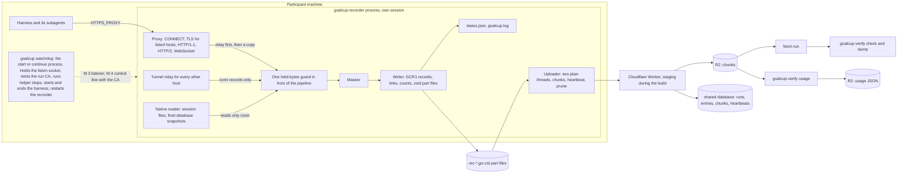

# PRD-00: goalcup 1.0, index and architecture

Id: PRD-00. Version: **goalcup 1.0** (today 0.7.0). Revision 4, 30 October 2026 (the alignment pass against the ledger;
revisions 3 and 2: earlier the same day; revision 1: 29 October). Base: main at 4b226de2. Status: final index for one big build by
many parallel agents. The build starts in the morning after the owner wakes and the keys are in place
(ledger B7). The ledger, [OWNER-DECISIONS.md](OWNER-DECISIONS.md), wins over this file where they differ.

Read [PRD-01](PRD-01-record-format.md) next: every other PRD builds against it.

Revision 2 closed the "Asks of PRD-00" sections of PRD-02 to PRD-17 and answered three reviews of the
PRD set (a consistency check, review A "this still loses data", review B "can it be built, is it
over-built"). Revision 3 is the final pass after every PRD reached its own revision 2: the PRD list
(with a status per PRD), the ownership map and the build order now match the PRDs as written; the asks
the PRDs left open are ruled in "Revision 3 rulings"; the owner questions are cut to eight; and the
end-of-build report has a template ("Morning report template"). Revision 4 aligns this file with the
ledger after the alignment reviews: each fix is listed in "Alignment answers" at the end, and owner
questions 9 to 12 are new. A PRD that disagrees with a ruling writes a night-log line; it does not build
its own answer.

Sources: the [cut-first plan](../2026-10-30-cut-first-plan.md) (revision 4, superseded where the owner's
later decisions differ), the audit appendices in [2026-10-30-audit](../2026-10-30-audit/) (A to O and R),
and run 1's report with its server copy review
(`docs/research/results/2026-10-30-two-hour-run.md`, today only on branch
`origin/smart/tender-clarke-qupne3`; PRD-15 copies it to main, see the ownership table).

## Goal

Rebuild the recorder as one process with one record format, so that a week-long run with thousands of
subagents is recorded whole, every loss is a named gap, and the participant sees only true counts.
Test it on real harnesses through one test pad before it ships.

## Points served

All seven. This file maps each point to the PRD that leads it (section "The seven points, mapped").

## Owner decisions it carries out

- The whole ledger: L1 to L7 (fresh core, one process, all cuts, no backward compatibility), R1 to R8 with R3a and R3b
  (record everything, never block, never stop for good, no silent loss, no caps, written counts),
  H1 to H10 (one system for every harness), F1, F2, M1, U1, S1 to S3, T1 to T9, B1 to B8.
- The owner's answers relayed on 30 Oct: "1 core OK" (the core set Claude Code, Codex and Hermes blocks
  the release, T8), "version 1 sure" (goalcup 1.0, L1), "3 i can fund one" and "2 swp" (read below in
  owner question 8; the readings are unverified), and the gateway question, answered in the next section.
- AGENTS.md: the hard rules stand, with the changes ledger section 7 lists (section "AGENTS.md").

## Today

Today's release: five Rust crates (`crates/goalcup-{cli,daemon,platform,protocol,verifier}`), listed as
workspace members at `Cargo.toml:3-9`. PRD-13 measured 86,516 Rust src lines and 142,413 Rust test
lines, the Worker at 4,001 src and 5,775 test lines (PRD-13 "Target size after 1.0"). Run 1 lost about
470 of 1,261 model calls and 15 of 42 subagents with no gap, because the proxy handed bytes to a
separate daemon through one shared 8 MiB queue with a failure budget (BRIEF2, run report "Root cause").
The gate is red today: `python3 scripts/check-version.py` exits 1 with about 95 findings, all in
`docs/plans/` (run 30 Oct 01:25 UTC), so no merge rule can pass before PRD-14's phase 0 change.

## What 1.0 is, in seven lines

1. A fresh recorder crate (`crates/goalcup`; `crates/goalcup-format` is the format library it shares
   with `crates/goalcup-verify`, the verifier binary), written from [PRD-01](PRD-01-record-format.md), with proven tricky parts
   copied in (TLS and CA, HTTP/1.1 parsing, brotli and WebSocket deflate, masking rules and corpus,
   connector data, the Worker chunk store).
2. One process records everything: proxy, session-file reader, masker, writer, uploader. A tiny
   watchdog holds the port, mints the run CA once, starts and ends the harness, and restarts the
   recorder.
3. One proxy for every harness and every model host, gateways included.
4. The old crates are deleted in the same build. No backward compatibility.
5. The verifier and the Worker move to the new format and ship with the client.
6. A test pad proves 15 harnesses with real keys; Claude Code, Codex and Hermes block the release.
7. Code is written in this cloud session; every build, test and real run happens in Vercel Sandboxes,
   against the staging Worker (ledger B1, B4).

## One system for every harness (the owner's gateway question)

The owner asked: "when it's a gateway, isn't it still an HTTPS proxy, just a different API endpoint? If
someone uses Vercel AI Gateway under Kilo, isn't that also something we easily solve?" **Yes.** A gateway
is one more HTTPS address with its own API key. The harness sends to it through `HTTPS_PROXY` exactly as
it sends to a provider, and the same proxy records it. There is one system, not a patchwork.

```
direct key:     harness --HTTPS_PROXY--> goalcup proxy --TLS--> provider
gateway:        harness --HTTPS_PROXY--> goalcup proxy --TLS--> gateway (Vercel AI Gateway, OpenRouter, ...) --> provider
vendor backend: harness --HTTPS_PROXY--> goalcup proxy --TLS--> vendor host (Amp, Cursor) --> provider
dodger:         harness ---- ignores HTTPS_PROXY, or refuses our CA, or pins ----> anywhere
```

The proxy decrypts a connection when its host is on the **one host list**: a shared list of model
hosts for all harnesses (providers, gateways such as Vercel AI Gateway, OpenRouter and Cloudflare AI
Gateway, cloud model services, and vendor backends such as Amp's and Cursor's), plus hosts the
participant registers, plus hosts the harness config names (a hint, not the rule). A decrypted call is
recorded byte for byte, the same for all three wire cases:

- **Direct key and gateway are the same case.** Kilo through Vercel AI Gateway is Kilo with a direct
  key to a different address. The only fact we need is the gateway's host name, and it is on the shared
  list (`connectors/model-hosts.toml`, PRD-11). We record every token the harness sent and received. The
  gateway's own call to the provider happens on the gateway's servers, not on the participant's machine,
  so nobody can record it and nothing is lost by that: the bytes the agent saw are the bytes we have.
  What differs per gateway is inside the bytes (model names, extra usage fields), which the usage reader
  handles after upload (PRD-09).
- **Vendor backends** (Amp, Cursor) are decrypted and recorded like a gateway when the client trusts
  our CA (ledger H5, H10). The vendor's call to the provider is out of reach, as with a gateway.
- **Dodgers are the one different case.** A dodger ignores `HTTPS_PROXY`, pins its certificates, or
  refuses the run CA. We never hack around it (ledger T3). It still goes through the same pipeline: a
  tunnel record and a named gap (`pinned`, `tls_refused`) when its bytes pass through us, its session
  files from disk, and, for a real dodger, the tier "not supported". A client that ignores
  `HTTPS_PROXY` leaves no connection record at all; only its session files and a quiet wire show it.
- **Words.** The ledger's "proxy dodgers (Amp, Cursor)" (H5) are this plan's vendor backends: listed,
  decrypted, recorded, tier "verified" or "not verified". Only a client that ignores `HTTPS_PROXY`,
  pins, or refuses the CA on its own model host gets "not supported" (T3).

So the strong path is `HTTPS_PROXY` plus gateways (a full wire record), and dodgers get the light path
(tunnels, session files, an honest label). That is the owner's "strong pads for HTTPS proxy and
gateway, dodgers get the current way". The test pad has exactly these three cases (direct key, gateway,
dodger) with the same checks (PRD-12).

Every other connection is relayed untouched and recorded as a tunnel (host, bytes, times). We do not
decrypt every host: a tool that does not trust the run CA would break (point 3).

Per harness, only data changes (PRD-11): which CA variables to set (`NODE_EXTRA_CA_CERTS`,
`SSL_CERT_FILE` with the full bundle, `CODEX_CA_CERTIFICATE`, `GOOSE_CA_CERT_PATH`,
`REQUESTS_CA_BUNDLE`), the harness's own proxy setting where it overrides `HTTPS_PROXY` (OpenClaw,
Qwen Code), background daemons or gateways to stop before start (OpenCode 2, Hermes gateway, Codex,
Droid), session-file patterns, and the auto-update switch.

Blind spots: a model server on the participant's own machine (Ollama and the like) is reached past the
proxy (`NO_PROXY` covers loopback) and is not recorded; PRD-11 and PRD-10 name it, they do not build
around it. A host missing from the shared list is only a tunnel; the per-host long-tunnel flag (PRD-03)
and the live wire-against-native line (PRD-10) are how it shows.

## Architecture



Rules of the shape:

- **Relay first, record second.** The proxy forwards bytes, then offers a copy with a call that never
  waits. Past the stated memory guard the copy is dropped and the loss becomes a GAP with start, end
  and lost bytes. The harness is never slowed (point 3).
- **Masking before disk** (D14). Raw bytes live only in memory: in the queue, the masker's hold and
  decoder state. Masking runs off the relay tasks (PRD-02 and PRD-05).
- **No raw bytes leave memory any other way.** At recorder start, before the first byte is read: core
  dumps off (`RLIMIT_CORE` 0 on Linux and macOS, `PR_SET_DUMPABLE` 0 on Linux) and a panic hook that
  writes only file, line and fixed text. Owner: PRD-02. Residual: swap on Linux (PRD-15 says so).
- **One writer** owns the part files. It counts at write, so every count the participant sees is of
  bytes already in a part file (PRD-01 section 9).
- **The watchdog** is the `goalcup start` or `continue` process itself (PRD-10 hands over to
  `watchdog::run`). It binds `127.0.0.1:<port>` once and passes the socket to each recorder boot, so a
  restart never closes the port: new connections wait in the kernel's backlog for a moment instead of
  being refused. It mints the run CA once per entry, keeps its key in one 0600 file, `rec/run-ca.key`,
  from the mint to the seal (ledger R3b), and hands the key to each boot on the control line (seam S8),
  so a restarted recorder serves the same CA the harness already trusts. It runs the
  connector's helper stops before the harness starts and before the native finish, ends the harness
  at the deadline and on `goalcup seal`, and records nothing itself (PRD-02).
  Why this fits ledger R3: the watchdog is the `goalcup start` process the participant already runs.
  Its only recorder duty is restart. Spawning, shielding and ending the harness and the helper stops
  are today's launcher duties, not new ones. It holds the socket and the CA only so a restart keeps the
  same port and the same trust (R3: "on the same port fast"). It never reads, masks, writes or uploads
  a recorded byte; all recording stays in the one recorder process (L5). This reading awaits the
  owner's confirmation (owner question 9).
- **No proxy credential.** `HTTPS_PROXY=http://127.0.0.1:<port>` (PRD-03 rule 5). The credential, its
  control-line field and its mask rule are gone.
- **A crashed recorder is restarted at once** (ledger R3a), with no pause and no restart cap.
- **Null mode** is the one place where recording is off while the harness runs: only a crash loop (3
  crashes within 10 minutes, each within 60 s of its start) makes the watchdog start a relay-only
  recorder. It says so in `status.json` and retries a normal boot after 30 s, then 1, 2 and 5 minutes,
  never more than 5 minutes apart, and never stops trying (ledger R3, R3a). The count resets as soon as
  a recorder stays up 60 s, so a crash at hour 5 and one at hour 140 never add up. Null mode is not a
  failure budget: it only spaces out boots that crash at once, so a crash loop does not reset the
  harness's connections every few seconds (point 3). The next normal boot's `recorder_down` gap covers
  the span (PRD-02 section 8).
- **`goalcup recover`** is the way back when the watchdog itself died (ledger R3b). It reopens the same
  port with the same run CA (the key from `rec/run-ca.key`), starts only the recorder and writes a
  `recorder_down` gap for the time it was down. The harness never restarts. `goalcup continue` is for an
  entry whose harness is gone (PRD-02 sections 8.1 and 9.4).
- **Every timer uses boot time** (`Recorder::now()`, which counts a suspend), checked on a 1 s tick:
  deadline, restart pauses, null-mode retries, upload backoff.
- **No IPC for bytes, no producers, no epochs, no failure budget, no shared 8 MiB queue.** That
  hand-off lost 37.5% of run 1's calls (run report, "Root cause").
- **The server stores bytes and interprets nothing.** The usage reader runs after upload, outside the
  Worker, because decoding needs a 128 MiB window and a Worker isolate has 128 MB (PRD-01 section 15).
- **No speed number fails a gate.** Throughput and latency are measured and logged (PRD-14).

## The seven points, mapped to PRDs

| Point | Led by | Also |
|---|---|---|
| 1. Record every model call | PRD-03 proxy | 01 format, 02 core, 11 host list and connectors, 12 pad check "wire calls match the harness log" |
| 2. Record every subagent | PRD-04 native capture | 02 (no caps), 03 (one stream per WebSocket direction), 09 per-subagent stats, 12 check "every subagent recorded" |
| 3. Never block or slow the harness | PRD-02 recorder core | 03 relay first, 06 upload never waits, 10 watchdog start path, 17 lessons |
| 4. Never record secrets | PRD-05 masking | 02 no core dumps, 08 secret check, 12 check "no secret" |
| 5. Upload everything | PRD-06 uploader | 01 format, 07 Worker and fetch, 08 server copy check |
| 6. Tell the participant plainly | PRD-10 CLI | 02 written counts, 07 heartbeat `failed`, 09 stats, 15 docs |
| 7. Work with the harnesses people use | PRD-11 connectors | 03 HTTP/2, 12 pad, 15 contributor docs |

## The PRDs

Every PRD is at revision 2 (30 Oct) and ready to build. Each PRD below has a **Status** line: its
revision, when it builds (phase or slice, section "Build order"), and what is still open. "R3-n" points
to "Revision 3 rulings"; the PRD's owner applies that ruling in its first commit, or the replan appends
it as an Amendments note.

| Id | Title | One line |
|---|---|---|
| PRD-00 | Index and architecture | This file: shape, ownership, seams, order, merge rule, done, owner questions, rulings, the morning report template |
| PRD-01 | Record format | GCR1: binary framing, raw bytes, one stream per WebSocket direction, gaps with start and end, written counts, one link per flush, zstd part files with a long window |
| PRD-02 | Recorder core | One process pipeline: recorder handle, the held-bytes guard, one mask worker, writer thread, gaps, counts, `status.json`, watchdog (CA hand-over, helpers, harness end), restart and null mode, the seal, no core dumps |
| PRD-03 | Proxy | CONNECT, run CA and TLS, host-list decisions, HTTP/1.1, HTTP/2, WebSocket, body decoding, tunnels, pinned and refused fallback, per-boot refusal learning |
| PRD-04 | Native capture | Session files for every harness with `**` patterns, no caps, path as ID, the file as the buffer, periodic and seal database copies |
| PRD-05 | Masking | Every secret rule kept, URL password rule added, email and Codex rate-limit rules dropped, left word boundary, same-length mask, `boundary()` per WebSocket message, exact values only with the owner's yes (owner question 3; default not built), shapes as data (S12) |
| PRD-06 | Uploader and compression | Chunks from the part files every 5 minutes or 16 MiB, capped backoff, heartbeat with written counts, prune once stored, `goalcup upload` |
| PRD-07 | Worker, server and database | Chunk store kept; signing, receipts and the run size limit deleted; seal on the completing chunk; heartbeat `failed`; device flow, notices, mail and the judged-commit cron untouched; fetch-run on the new format (S13) |
| PRD-08 | Verifier and checks | `goalcup-verify check` (14 invariants, honesty and coverage checks), `dump`, server copy check, secret scan; dispatches `usage` |
| PRD-09 | Usage and research stats | Per call, per subagent and per run model and tokens, from the record and the harness's own files, as an organizer job writing R2 |
| PRD-10 | CLI and participant experience | `setup`, `start`, `continue`, `status`, `seal`, `upload`, `time-left` (`login` is cut); plain written counts and off time; the end screen |
| PRD-11 | Connectors and the 15 harnesses | One flat file per harness (16 files), the shared host list, CA and proxy variables, helpers to stop, auto-update switches, harness fact pages |
| PRD-12 | Test pad and real-run loop | Three cases (direct key, gateway, dodger), checks C1 to C6, one pass or fail table, `connectors/tiers.toml`, `selftest`, the watcher fix loop |
| PRD-13 | Cuts | Delete the old crates, spikes, research and disk-full scripts, pins, deny lists, termination proof, signing, legacy seams, retired versions, once PRD-17's gate passes |
| PRD-14 | Tests and gate | Test budget, shared test support, `rule_code` and `e2e_run`, the new two-tier gate, CI, release packaging |
| PRD-15 | Docs, AGENTS.md and decisions | README seven points, AGENTS.md changes of ledger section 7 and new map, DECISIONS entries, `docs/RECORD-FORMAT.md`, participant guide, RULES edits |
| PRD-16 | Orchestration and acceptance | Lanes and roles, integration branch, merge rule, real-run schedule, watchers, caps, stop rules, the night log, the end-of-build report, acceptance runs A1 to A4 |
| PRD-17 | Lessons from the old code | The edge cases the old code learned the hard way, as acceptance cases; the four-check deletion gate |

Status per PRD:

- **PRD-00.** Status: revision 3, final. Open: the twelve owner questions only; their defaults are in force.
- **PRD-01.** Status: revision 2, ready; built first (phase 0 step 4, F1 by H+1). Open: R3-4 (four note
  names, `long_tunnel` facts, `tunnel_hosts.listed`), taken in its first commit.
- **PRD-02.** Status: revision 2, ready; scaffold in phase 0, pipeline in the core slice, restart and null
  mode in the second slice. Open: R3-1, R3-2, R3-3.
- **PRD-03.** Status: revision 2, ready; HTTP/1.1, WebSocket and tunnels in the core slice, refusal
  learning in the second, HTTP/2 in the third. Open: R3-5 (already its own text), R3-11.
- **PRD-04.** Status: revision 2, ready; append rows in the core slice, Hermes `state.db` and database
  copies in the second. Open: none beyond R3-3 and R3-4 (other PRDs' changes).
- **PRD-05.** Status: revision 2, ready; own lane from H+0, option b and the left guard in the core slice,
  exact values in the second slice only after the owner's yes (owner question 3, default not built).
  Open: R3-11 (its six asks, accepted; the exact-value parts wait for question 3).
- **PRD-06.** Status: revision 2, ready; second slice. Open: none; its asks P1 to P5 are ruled by R3-2,
  R3-6 and R3-11.
- **PRD-07.** Status: revision 2, ready; from H+0; first staging deploy after its builder step 2 and the
  PRD-06 merge. Open: R3-6 (its own two notes, now in S5 and S13).
- **PRD-08.** Status: revision 2, ready; from H+0 on fixtures, S6 by H+3. Open: R3-11 (drops the "unless
  the pad lists it" clause).
- **PRD-09.** Status: revision 2, ready; `usage --json` for Codex and Claude Code in the core slice, Hermes
  `sqlite.rs` in the second, the organizer job and bucket in the third. Open: none.
- **PRD-10.** Status: revision 2, ready; `main.rs` stubs in phase 0; `start`, `status`, `seal` in the core
  slice; `setup --yes` (S15) in the second; `continue`, `time-left`, `--prompt`, sleep lock in the third.
  Open: R3-2 (its N7, N8), R3-11.
- **PRD-11.** Status: revision 2, ready; host list, schema and four connectors (Claude Code, Codex, Hermes,
  Kilo) in phase 0; the other 12 in the third slice. Open: R3-11 (`secret_values` with key paths).
- **PRD-12.** Status: revision 2, ready; pad image in phase 0, pad in sandboxes in the second slice,
  `selftest` at phase 2, rows in phases 4 and 5. Open: R3-9, R3-11.
- **PRD-13.** Status: revision 2, ready; read only until phase 3; deletes only after PRD-17's gate, target
  H+10, and as soon as the gate is green if later, before `REPORT_AT` (R3-8, phase 3).
- **PRD-14.** Status: revision 2, ready; the gate change is the first merge after the docs (phase 0 step 2),
  `tests/common/` stubs by H+1.5. Open: R3-11.
- **PRD-15.** Status: revision 2, ready; docs land as soon as each is green; tier columns after phase 5.
  Open: R3-11.
- **PRD-16.** Status: revision 2, ready; runs the build. Open: R3-8, R3-9, R3-10.
- **PRD-17.** Status: revision 2, ready; read only from H+0, `LESSONS.md` by H+3, deletion gate at phase 2.
  Open: R3-7 (its own ask, taken).

## Numbers and names every PRD shares

PRD-01 owns the record format. These are the values the PRDs agreed; PRD-01 writes them in its tables.

| Thing | Value |
|---|---|
| GAP reasons added | 12 `mask_failed` (a masker panic dropped a piece; no raw byte written), 13 `upstream_untrusted` (a listed host's server certificate fails our check, or it asks for a client certificate; tunnelled) |
| GAP reasons reserved | 8 `write_error` and 9 `read_error`: never written by 1.0. A write error ends the process (exit 74); the next boot's `recorder_down` gap names it in its tail (`"cause":"write_error"`). Readers show 8 and 9, if seen, as `other(n)` |
| Tunnel reasons (conn meta) | `not_listed`, `tls_refused`, `pinned`, `not_tls`, `upstream_untrusted`, `sign_in`, `alpn_other`. `h2_unsupported` is never a tunnel reason: it is a GAP on a decrypted connection that keeps relaying unparsed (PRD-03 5a) |
| Guard counter names | `held_bytes`, `held_peak` (COUNT, `status.json`, GAP tail `{"guard":"held_bytes"}`). `queue_bytes` is not used |
| Seal reasons | PRD-01's four, plus `recovered` (both processes died; closed by `continue` or `seal`) and `server_stop` (the heartbeat answered `stop`; the tail names the server's reason) |
| Local files, never uploaded | In `$GOALCUP_HOME/runs/<run>/<entry>/`: `rec/lock`, `rec/watchdog.pid`, `status.json`, `counts.jsonl`, `cursors.json`, `upload.json`, `upload.lock`, `goalcup.log`, `run-ca.pem`, `bundle.pem`. In `$GOALCUP_HOME/runs/<run>/`: `server.json` |
| Environment | `GOALCUP_HOME` (replaces `GOALCUP_CONFIG_DIR`), `GOALCUP_SERVER` (unset: production; a URL; `off`: local only, parts kept), `GOALCUP_KEEP_PARTS=1` (set by the pad and the acceptance runs) |
| Word "part" | In PRD prose and code a `rec-*.gcr.zst` file is a **part file**. In participant text a "part" is one `start` or `continue` (an entry), as README does today |
| Rate-limited calls in run 1 | 95 to 99 rate-limited calls (95 `rate_limit_exceeded` failures, about 97 `error` events, 99 `response.failed` messages), from the run report. A count, not a share (R3-7). PRD-08, 09, 12 and 17 use this one range |
| Note names added (R3-4) | `outlived` (PRD-02: `count`, `programs`), `native_missing` (PRD-04: `what`, `row`), `parse_stopped` (PRD-03: `conn`, `reason`); `long_tunnel` facts `why`, `conns`, `up`, `down`, `secs`. Readers show an unknown note as is |

## File ownership

Each path has one owner. A builder edits only paths its PRD owns. A change to someone else's file goes
through that file's owner, by a note in the night log or a review comment on the owner's branch.

### New code

```
crates/goalcup-format/          PRD-01  lib, codec, link, part (PartWriter, PartOptions), read, dump
  tests/**                      PRD-01  zstd_close, golden, roundtrip, recovery; tests/data/worked-example.gcr and .dump.jsonl
crates/goalcup/                 the recorder crate, binary `goalcup`
  Cargo.toml                    PRD-02  every dependency declared once in the scaffold; `test-hooks` feature, off by default, never in a release build (owner question 12)
  src/lib.rs                    PRD-02  module list, frozen after the scaffold
  src/main.rs                   PRD-10  seven commands and every flag, the hidden recorder entry; stubs in phase 0
  src/pipeline/                 PRD-02  handle, guard, mask_worker, writer, counts, clock, status, cursors, seal, boot, dead, fds, secure
  src/watchdog/                 PRD-02  mod (restart loop, null mode, control lines), shield (copied), spawn
  src/proxy/                    PRD-03  mod, connect, ca, tls, hosts (decide, refusal table), pump, tunnel, http1, h2, ws, decode
  src/native/                   PRD-04  mod, pattern, walk, tail, snapshot, fsx
  src/mask/                     PRD-05  mod, rules, stream, values, meta, shapes.tsv (seam S12, data only)
  src/upload/                   PRD-06  mod, client, chunk, send, beat, policy, prune, state (upload.json), manual
  src/connector/                PRD-11  mod, schema, builtin (include_str! list), hosts, hints, launch
  src/cli/                      PRD-10  start, folder, approve, continue_run, status, finish, seal, upload, setup, push, time_left, awake, skill, log (S11), text
  tests/common/                 PRD-14  shared test support (fake upstream, scripted Worker, temp homes, recorder)
  tests/rule_code.rs, tests/e2e_run.rs, tests/data/ (incl. data/connectors/fake.toml, fake-hosts.toml)   PRD-14
  tests/pipeline_*.rs, tests/watchdog_*.rs       PRD-02
  tests/proxy_*.rs, tests/proxy_fixtures/        PRD-03
  tests/native_*.rs             PRD-04
  tests/mask_*.rs, tests/mask_corpus/            PRD-05  corpus copied from spikes/ (86 files) before PRD-13 deletes it
  tests/upload_*.rs             PRD-06
  tests/connector_*.rs          PRD-11
  tests/cli_*.rs                PRD-10
  tests/lessons_*.rs, tests/lessons_fixtures/    PRD-17  seven files; lessons_launch.rs runs in PRD-14's `heavy` group
crates/goalcup-verify/          PRD-08  binary `goalcup-verify`: Cargo.toml (zstd, rusqlite bundled), main.rs dispatch, lib, input,
                                        integrity, honesty, legs, server, secrets, report
  tests/check_*.rs, server_*.rs, secrets_*.rs, tests/common/   PRD-08  incl. the run 1 shape builder PRD-09 and PRD-12 use
  src/usage/                    PRD-09  the usage reader (subcommand `usage`, `usage::run(args) -> ExitCode`)
  tests/usage_*.rs, tests/usage_fixtures/        PRD-09
```

### Existing paths

| Path | Owner | Note |
|---|---|---|
| `Cargo.toml` (workspace), `Cargo.lock`, `rust-toolchain.toml`, version `1.0.0` | PRD-16 | Each new crate joins `members` in the merge that creates it (phase 0 step 3); the five old crates move to `exclude` in the same merge as the first new member. Phase 3: `exclude` entries and dead workspace dependencies removed in the cut merge. The lock is refreshed only by the integrator, at merge |
| `connectors/<id>.toml` (one flat file per harness, 16 files: OpenCode has two), `connectors/model-hosts.toml` (the shared host list), `docs/harnesses/**` (one page per harness and `README.md`) | PRD-11 | No folders, no seed files. PRD-11 lists the deletes of the four old `connectors/*/harness.toml` folders, `crates/goalcup-protocol/providers.toml`, `crates/goalcup-protocol/pins/` (goes with the crate) and `scripts/pin-manifests.sh`; PRD-13 runs them in the cut |
| `connectors/tiers.toml` | PRD-12 | Written by `scripts/pad/table`; the one tier source for the start line, the guide and README. The only path under `connectors/` PRD-12 writes |
| `server/worker/**` (src, test, `wrangler.toml`, `README.md`, `scripts/delete-test-runs.sh`) | PRD-07 | Deletes `sign.ts`, `test/sign.test.ts`, `test/vectors/signing.json`, `test/quota.test.ts`. `server/worker/sql/**` mirrors the website's database and is not touched; `notices.ts`, `mail.ts`, `github.ts`, `ratelimit.ts` are not touched (owner question 1) |
| `scripts/fetch-run.sh`, `scripts/test_fetch_run.py`, `docs/UPLOAD-API.md` | PRD-07 | The upload contract is seam S5; the fetched layout is S13 |
| `scripts/pad/**` (new), `docs/plans/2026-10-30-v1.0/PAD-RESULTS.md` (new), `skills/adding-a-capture-harness/**` | PRD-12 | Including deleting `writing-a-decoder.md` and `templates/connector-harness.toml` there |
| `scripts/usage-job.sh` (new, third slice) | PRD-09 | Split by ledger B1. The credential steps (list sealed entries read-only, `fetch-run`, the R2 put) run on the conductor during the build, or on an organizer machine in production. `goalcup-verify usage` runs in a build box during the build; the conductor never compiles or runs it |
| `scripts/gate.sh`, `scripts/ci-scope.py`, `scripts/check-version.py`, `scripts/check-links.py`, `scripts/third-party-licenses.py`, `scripts/linux-check.sh`, `.github/**` (workflows, `CODEOWNERS`, `PULL_REQUEST_TEMPLATE.md`, `ISSUE_TEMPLATE/`, `dependabot.yml`), `.config/**`, `scripts/release.sh`, `scripts/package-release.sh`, `scripts/smoke-release.sh`, `packaging/**`, their `scripts/test_*.py` | PRD-14 | PRD-14 alone edits `gate.sh`. Deletes in phase 0: `check-version.py`, `ci-scope.py` and their tests; with the new `ci.yml`: `linux-x86_64.yml`, `linux-check.sh` and its test; in the phase 3 merge, after PRD-15's last run: `check-links.py` and its test |
| `skills/goal-cup/**`, `skills/goal-cup-setup/**` | PRD-10 | Participant-facing. `skills/goal-cup-setup/` is deleted by PRD-10 |
| `README.md`, `AGENTS.md`, `TODO.md`, `SECURITY.md`, `CONTRIBUTING.md`, `scripts/README.md`, `docs/*.md` and `docs/**` except `docs/UPLOAD-API.md`, `docs/harnesses/**` and `docs/plans/2026-10-30-v1.0/**`; new `docs/RECORD-FORMAT.md`; the copy of run 1's report at `docs/research/results/2026-10-30-two-hour-run.md` | PRD-15 | Moves to `docs/archive/` (`git mv`, no edit): `CONTRACTS.md`, `TERMINATION.md`, `CHEAT-CHECKLIST.md`, `HARNESS-SETUP.md`, and `SERVER-DESIGN.md` once PRD-07 confirms its facts are in the Worker README. Deletes `docs/README.md`. `CLAUDE.md`, `VISION.md`, `CODE_OF_CONDUCT.md`, `LICENSE`, `NOTICE` are not edited. History docs are kept in this build (see "Not in this build") |
| `docs/plans/2026-10-30-v1.0/LESSONS.md` (new) | PRD-17 | Feeds `tests/lessons_*.rs` |
| `docs/plans/2026-10-30-v1.0/NIGHT-LOG.md`, `MORNING.md`, `ACCEPTANCE.md` (new) | PRD-16 | The lane logs live outside the repository in `<night-dir>`; the scribe merges them into `NIGHT-LOG.md` every 30 minutes. `MORNING.md` follows "Morning report template" below |
| Deleted: `crates/goalcup-{cli,daemon,platform,protocol,verifier}/`, `spikes/` (after PRD-05 and PRD-17 copy what they need), research and disk-full scripts (group D), `scripts/linux-harness-smoke.sh`, `.claude/agents/campaign-cell.md`, `harnesses/install.sh`, and the old connector files PRD-11 lists | PRD-13 | Deletes only after PRD-17's deletion gate passes on the new core: by H+10, or as soon as the gate is green after it, before `REPORT_AT` (phase 3) |
| `.gitignore` | PRD-12 and PRD-13, one line each | PRD-12 adds `/pad-out/` in the pad's first commit (phase 0), before any run writes there. PRD-13 removes the `spikes/*/out/` and `spikes/wire-pty/out/` lines in the commit that deletes `spikes/`. No other edit |
| `OWNER-DECISIONS.md`, `VISION.md` | the owner | Never edited by an agent |
| `BUILD-PROMPT.md` | the planner of this PRD set | Edited before H+0 only (R3-10). Not edited during the build: the conductor holds the pasted text, so a later edit reaches no one. The build plan of ledger B2a is PRD-16 (with this file's "Build order"); during the build the replan updates it, and the remaining PRDs, by appending an Amendments note to each. Where the prompt and PRD-16 differ, PRD-16 wins; the ledger wins over both |
| Each `PRD-NN-*.md` | its author | During the build a replan adds an "Amendments" note at the end of a PRD, PRD-00 and PRD-16 included; it never rewrites a section a builder is working from |

## Seams

A seam is a shape two PRDs build against. Only the seam's owner changes it, with a night-log line
`seam S<n>: <change>, users <PRDs>`. Users merge integration into their branch within the hour (merge
commits, no rebase of a pushed branch). "Stable by" is hours after H+0.

| Seam | What | Owner | Used by | Stable by |
|---|---|---|---|---|
| F1 | `goalcup_format`: `Record`, `StreamKind`, `GapReason`, `EndReason`, `PartWriter` (with `window_log`, default 27, and `rotate_at`), `IndexLine`, `read`, `dump` | PRD-01 | 02, 06, 08, 09 | H+1 |
| S1 | `pipeline::Recorder` and `StreamHandle`, below | PRD-02 | 03, 04, 14 | H+1.5, stubs first |
| S2 | `mask::Masker` and `StreamMasker`, below | PRD-05 | 02, 10 | H+1.5 |
| S3 | `connector::{load, plan, Env, LaunchPlan, HostList, NativeSources, NativeSource, MaskRule}`, below; the full block is PRD-11 section 5 | PRD-11 | 02, 03, 04, 05, 10, 12 | H+1.5 |
| S4 | `pipeline::Counts` snapshot, the durable point (entry totals over boots), `pipeline::entry_totals(entry_dir) -> Counts`, and the `status.json` schema (incl. `harness {pid, started, exit}`, last 20 notes plus the first of each `what`, `last_request_at`, `last_native_at`, `written` with every COUNT key as entry totals; sealed: `seal {reason, workspace_head}`, `cut_files`, `outlived`) (R3-2) | PRD-02 | 06, 10 | H+2 |
| S5 | Upload HTTP contract, `docs/UPLOAD-API.md`: one flat `counts` object in the heartbeat (at most 2 KiB, with `waiting_bytes`), `repo_head`; the chunk that completes the chain seals; the final heartbeat repeated until a heartbeat, chunk or position answer says `sealed: true`; no seal call (R3-6) | PRD-07 | 06 | H+2 |
| S6 | `goalcup-verify check --json` report | PRD-08 | 12, 16 | H+3 |
| S7 | Usage JSON in R2: `usage/{event}/{run}/{entry}.json`, `{entry}.calls.jsonl`, `run.json`; bucket `goalcup-usage` (`goalcup-usage-staging` during the build) | PRD-09 | 12 | H+4 |
| S8 | Watchdog and recorder, below | PRD-02 | 03, 10 | H+1.5 |
| S9 | `upload.json` schema, incl. `server_word: {stop, reason, seconds_left, asked_at}` from the last heartbeat answer, read by `goalcup time-left` | PRD-06 | 10, 12, 16 | H+3 |
| S10 | `ServerWord` watch channel inside the recorder: the server's `stop` and deadline reach the seal | PRD-06 | 02, 10 | H+3, a stub type published with PRD-06's first merge; PRD-02 builds its `server` line in the second slice |
| S11 | `goalcup.log` writer, `cli::log::line` (fixed text, never a header value, body byte or key) | PRD-10 | 02, 03, 06 | H+1.5 |
| S12 | Secret shapes as data: one data file under `src/mask/` with the patterns only, no matcher, that the verifier includes with `include_str!` | PRD-05 | 08 | H+3 |
| S13 | Fetched layout: `<outdir>/<entry>/rec.gcr.zst` (chunks joined and checked, not decoded) and `fetch.json` (the chunk list with keys, SHA-256 and compressed size, and the entry row: `model_requests`, `upload_offset`, `final_seq`, final head, the last heartbeat's `recording` and `counts`, sealed time) (R3-6) | PRD-07 | 08, 12, 16 | H+3 |
| S14 | Not used. The silent-drop test hook is cut (see "Not in this build") | | | |
| S15 | `goalcup setup --harness <id> --yes`: writes the connector's no-prompt values and its auto-update switch (`update_off`) into goalcup's isolated home with no question, prints that home's path (owner question 2, ledger H9) | PRD-10 | 12 | H+4 |
| S16 | Connectors override: `goalcup start --connector <file> --hosts <file>`. Flags owned by PRD-10, loading by PRD-11. Refused in competition mode. No `GOALCUP_CONNECTORS_DIR` | PRD-10 | 11, 12, 14 | H+3 |
| U1 | Usage call table (one row per call: model, tokens, outcome incl. `RateLimited`, `Cancelled`, and `whole`) | PRD-09 | 08, 12 | H+4 |
| S17 | `StartFacts` and the first control line: run, entry, deadline, server_time, local wall, workspace, connector ref, keep, build, `HostList`, `NativeSources`, mask rules, values, CA PEM, previous end, harness pid and start, `null_since`, `LaunchPlan.notes`; every type serializes with serde | PRD-02 | 05, 10, 11 | H+1.5 |
| S18 | `upload::spawn(ctx) -> UploadHandle`; `UploadHandle::finish(wrap_up, seal_facts { reason, workspace_head, totals })` | PRD-06 | 02 | H+3 |

### S1, final shape

```rust
// crates/goalcup/src/pipeline (PRD-02)
impl Recorder {
    pub fn open(&self, kind: StreamKind, conn: Sid, req: Sid, from: u64,
                flags: OpenFlags, meta: serde_json::Value) -> StreamHandle;
    pub fn event(&self, ev: serde_json::Value);
    pub fn room(&self) -> u64;                       // bytes free under 3/4 of the soft guard
    pub fn reserve(&self, n: u64) -> Reserved;       // counts n in `held` until dropped (R3-1)
    pub fn native_cursors(&self) -> Cursors;
    pub fn now(&self) -> Mono;                       // boot time, counts a suspend
    pub fn counts(&self) -> Counts;                  // S4
    pub fn durable(&self) -> tokio::sync::watch::Receiver<Durable>;   // S4
    #[cfg(feature = "test-hooks")]
    pub fn for_tests(room: u64) -> (Recorder, Calls);
}
impl StreamHandle {
    pub fn sid(&self) -> Sid;
    pub fn data(&mut self, t: Mono, bytes: bytes::Bytes);
    pub fn ws(&mut self, t: Mono, opcode: u8, fin: bool, bytes: bytes::Bytes);
    pub fn gap(&mut self, reason: GapReason, start: Mono, lost: Option<u64>, tail: Option<Value>);
    pub fn end(self, t: Mono, reason: EndReason, tail: Option<Value>);
}
pub fn low_priority();                               // for PRD-04 and PRD-06 threads (R3-1)
pub mod fds { pub fn may_accept() -> bool; }         // for PRD-03, before each accept (R3-1)
pub fn entry_totals(entry_dir: &Path) -> Counts;     // S4, for PRD-06 and PRD-10 (R3-2)
```

- Nothing blocks and nothing returns a value the caller must act on. After the seal's stop, a call on a
  wire stream (`conn`, `http_req`, `http_resp`, `ws_up`, `ws_down`) is a no-op that only counts;
  `native` and `snapshot` calls stay admitted until `NativeReader::finish` returns (R3-3).
- **The handle owns offsets.** `from` is the first offset (0 for wire streams, the resumed cursor for
  native). Each `data` or `ws` piece moves the offset by its length, written or dropped.
- **A caller reports its own loss with `gap()`.** The GAP's `off` is the handle's offset; its end is
  the time of the call, so a caller whose loss runs on (a connection that stopped parsing) calls it
  when the loss ends, at the latest just before `end()`. `Some(n)` moves the offset by `n`; `None`
  means unknown and leaves it. A GAP on a `conn` stream is allowed (PRD-01).
- `ws(..., fin: true)` marks a message end; the stream masker gets it as a boundary, so a fail-closed
  mask span never crosses a WebSocket message (S2).

### S2, final shape

```rust
// crates/goalcup/src/mask (PRD-05)
Masker::new(rules: &[connector::MaskRule], values: Vec<SecretValue>) -> Result<Masker, MaskError>;
Masker::stream(&self, kind: StreamKind) -> StreamMasker;
Masker::mask_meta(&self, meta: &mut serde_json::Value);
Masker::mask_rules(&self) -> Vec<String>;     // one name per kind, indexed by MASK.rule
Masker::value_counts(&self) -> ValueCounts;    // counts only, for the start event
StreamMasker::push(&mut self, bytes: &[u8]) -> Masked;
StreamMasker::boundary(&mut self) -> Masked;   // end of a WebSocket message
StreamMasker::gap(&mut self) -> Masked;
StreamMasker::finish(self) -> Masked;
pub struct Masked { pub bytes: Vec<u8>, pub spans: Vec<Span> }   // spans relative to bytes
```

### S3, final shape

```rust
// crates/goalcup/src/connector (PRD-11); every field and type is in PRD-11 section 5, which wins on detail
connector::load(id_or_path: &str, hosts_file: Option<&Path>) -> Result<Connector, ConnectorError>;
connector::plan(connector: &Connector, env: &Env, home: &Path) -> LaunchPlan;
LaunchPlan { connector, harness_version, program, argv, env, home, lock, before, after,
             hosts: HostList, native: NativeSources, mask_rules: Vec<MaskRule>,
             secret_values, notes, refusal }
LaunchPlan::finish_env(&mut self, port: u16, run_ca: &Path, bundle: &Path);
HostList::decide(&self, name: &str) -> Decision;   // Listed { source, kind, pinned } | Never | NotListed
HostList::ca_subtrees(&self) -> Vec<String>;
connector::hosts::check(name: &str, source: Source) -> Result<Host, Skipped>;  // one entry point for all sources
NativeSource { name, root, pattern, form, since, warn_missing }   // root from {home} or {workspace}; `**`; form append, snapshot or final; no row cap
```

Connector fields kept for PRD-10 and PRD-12: `no_prompts`, `update_off` (the auto-update switch,
ledger H7, H9), `skills_dir`, `first_screen`, `warn_missing` (per native row), `vendor = true`. The
tier is not in connector data; it comes from `connectors/tiers.toml`. `secret_values` stays empty and
`secret_files` is not read unless the owner says yes to question 3.
Host hints (the config source of `hosts`) come from config files and from the connector's named base-URL variables only, never from a
scan of every `*_HOST` or `*_ENDPOINT` variable (a database host would be decrypted and break a tool,
point 3). Host kinds are `provider`, `gateway`, `vendor`, and `other` for participant and config hosts;
the `start` event carries each host's kind and `pinned` flag, so PRD-09 reads kinds from the record.

### S8, final shape

- The watchdog is the `goalcup start` or `continue` process (the launcher). Its only recorder duty is
  restart (ledger R3); launching, helper stops and ending the harness are launcher duties, as in
  today's CLI (owner question 9). The recorder is the same binary with a hidden subcommand, in its own
  session (`setsid`).
- fd 3: the listen socket `127.0.0.1:<port>`, bound once by the watchdog. fd 4: one control socket
  (a socketpair), JSON lines of at most 64 KiB, never a recorded byte, never logged.
- First line, watchdog to recorder: the start facts (S17), the run CA (certificate and key, PEM), and how the
  previous boot ended (`{"code":n}`, `{"signal":n}` or null). The boot number comes from the last part
  file, not from this line. Null mode is the `--null` argument.
- The watchdog mints the CA once per entry with PRD-03's `proxy::ca::RunCa::mint` and writes
  `run-ca.pem` and `bundle.pem` to the entry folder before the harness starts. The key has one file,
  `rec/run-ca.key` (0600, created new, removed at the seal), so `goalcup recover` can reload the same
  CA (ledger R3b); never argv, env or a log line. Lines back: `ready`, `sealed`.
- The watchdog owns: raising the open-file limit (PRD-02 section 10; PRD-03 uses `fds::may_accept()`
  and keeps an `EMFILE` retry only as a fallback), `plan.before` before the harness starts, ending the
  harness at the deadline and on seal (SIGTERM to the harness tree, SIGKILL after 10 s), `plan.after`
  before `native.finish`, and writing `rec/watchdog.pid`. PRD-10 does none of these itself.
- The seal at the end of the run window (reason `deadline`, `server_stop` or `signal`) is bounded by
  PRD-02: the drain (60 s, wire bytes only) plus the native finish's time guard (180 s, today's finish
  budget). On `harness_exit` and `seal_command` the native finish reads every session file to the size
  seen in its first pass with no time guard, and status shows `sealing: reading session files`
  meanwhile (ledger R5, H8). The upload wrap-up after that never holds the harness.

Smaller interface rulings, so two PRDs do not build two answers:

| Between | Ruling |
|---|---|
| PRD-02 and PRD-03 | `proxy::serve(listener, ProxyCtx { recorder, hosts, ca, extra_roots }) -> ProxyHandle`. Relay threads: 2 by default, stated in PRD-03 |
| PRD-02 and PRD-04 | `native::start(rec, sources) -> NativeReader`; `NativeReader::finish(self, harness_exited) -> NativeFinish` |
| PRD-02 and PRD-06 | The uploader runs on two plain threads with a blocking client, not on the recorder's async runtime |
| PRD-06 and PRD-07 | PRD-06 sends PRD-07's flat `counts` (plus `waiting_bytes`) and `repo_head`; it never sends `recording: "unknown"`, and PRD-07 drops `unknown` from the client table. `goalcup upload` of a sealed or recovered entry sends the seal's totals from `pipeline::entry_totals` (R3-2), so `counts` stays required |
| PRD-08 and PRD-09 | PRD-09 owns U1; PRD-08 uses it as is. `crates/goalcup-verify/Cargo.toml` declares `zstd` and `rusqlite` (bundled) in phase 0 |
| PRD-05 and PRD-11 | Only if the owner says yes to question 3: PRD-11 collects candidate values (key files, `secret_files`); PRD-05 owns the floor (20 bytes), the cap (32 values, ordered env, `.env`, `secret_files`) and reports the skipped count in `mask_values`. The 32-value limit guards `Masker::new` start time and memory (PRD-05 A5); the count of values past it is shown to the participant. Without that yes, PRD-11 reads no `secret_files`, passes no `secret_values`, and only today's `GH_TOKEN` exact value is masked |
| PRD-08 and PRD-03 | Every named tunnel reason on a listed host counts as `named`, not as a failure, in `listed_hosts_decrypted` and `wire_keeps_up` |

## Where the build runs

- **Conductor:** this cloud session, 4 CPUs. It writes code, reviews and orchestrates; it never compiles,
  tests or runs a binary of the build (`goalcup`, `goalcup-verify`). Lanes run as parallel workflows in
  this one session, at most 2 agents at once each (the environment's per-workflow limit, BRIEF3);
  several lanes in parallel get past it (ledger B2).
  Separate cloud sessions are the fallback only. There is no 18-CPU conductor.
- **Build boxes:** Vercel Sandboxes, user `ubuntu`, from a build snapshot. Every build, test and gate
  run happens here, never as root. Code goes in as a git bundle; no key or token ever enters a build box.
- **Pad boxes:** Vercel Sandboxes from PRD-12's pad image, one harness and its key file (0600) for the
  life of one run.
- **Staging Worker:** every real run uploads to staging, approved with the staging test approval key
  and the owner's member id (ledger B4).
  Agents deploy staging themselves. Production is the owner's.
- **Read-only database and R2 credentials** live on the conductor only, never in a box. `fetch-run`,
  the read-only queries and the R2 put of usage files run there. The fetched copy is copied into the
  run's pad box (or a build box, for `usage`) and every `goalcup-verify` command (`check`,
  `check --server`, `usage`, `secrets`) runs there. The per-run known-values file copied into the pad
  box holds only values that entered that box, is 0600, and is removed with the box. Nothing from the
  build under test runs on the conductor (ledger B1).

## Build order

H+0 is the start of the build, in the morning. Times are targets, not limits; PRD-16 runs them and
its hours win where a PRD names another (R3-8).

### Lanes (PRD-16 section 1, R3-10)

Each lane is one workflow in the conductor session, at most 2 agents at once.

| Lane | PRDs | Starts |
|---|---|---|
| Integrator | PRD-16: phase 0, merges, gate runs in build boxes, staging deploys, build snapshot, the scribe | H+0, first |
| Lessons | PRD-17 (read only; `LESSONS.md` by H+3) | H+0 |
| Format and core | PRD-01, PRD-02 | H+0 |
| Masking | PRD-05 (a copy; needs only the S2 stub) | H+0 |
| Wire | PRD-03, PRD-04 | after the S1 and S3 stubs (H+1.5) |
| Upload and server | PRD-07 at H+0; PRD-06 after S1 and S4 | H+0 |
| Judge | PRD-08, PRD-09 (from fixtures) | H+0 |
| Harnesses and pad | PRD-11, PRD-12 | H+0 |
| Participant | PRD-10 (`main.rs` stubs in phase 0) | H+0 |
| Test support and gate | PRD-14 (gate change first, then `tests/common/`) | H+0 |
| Cut and docs | PRD-13 (read only until phase 3), PRD-15 | H+0 |
| Real runs | Watchers (PRD-12 section 13) | phase 1a, when the core slice records |

Per PRD inside a lane: plan, build in worktrees, at least two independent reviewers (each a fresh
agent, not the builder, writing its findings before it sees the other's; a third, the breaker, for
PRD-01, 02, 03, 05, 06), fix, merge, replan (ledger B2, B2a).

### Phase 0: foundations (H+0 to H+1.5)

In this order where order matters; the rest in parallel.

1. **Integrator:** branch `v1.0/integration` from `main` at 4b226de2. Merge the docs-only plan branch
   (`smart/intelligent-newton-0avrpi`), so builders read the PRDs from integration.
2. **Integrator, PRD-14's gate change first:** the gate is red on `docs/plans/` today; no merge rule can
   pass before this lands.
3. **Integrator, workspace edit:** version `1.0.0`. `members` gains each new crate in the merge that
   creates it (`crates/goalcup-format` with PRD-01's first merge, `crates/goalcup` with PRD-02's
   scaffold, `crates/goalcup-verify` with PRD-08's first stub); the integrator applies that one
   `Cargo.toml` line inside the merge. The five old crates move to `exclude` in the same merge as the
   first new member, so the workspace is never empty and never names a missing crate (never built,
   linted or tested again; read by PRD-17 and the copy-ins). No binary rename and no `--exclude` line
   in `gate.sh`.
4. **PRD-01:** format types, the golden test, and the worked example committed as files
   (`worked-example.gcr`, `worked-example.dump.jsonl`), with the zstd hand-close proven in Rust first.
5. **PRD-02:** the `crates/goalcup` scaffold: `Cargo.toml` with every dependency the PRDs named
   (PRD-03 ask 4 list, `regex`, `socket2`, `h2` for the fake upstream, `ureq`), `lib.rs` with the full
   module list, S1 (with `for_tests` and `reserve`), S4 and S8 as compiling stubs, and an empty
   placeholder `mod.rs` in every other module folder of `crates/goalcup/src/`. This is the one
   ownership exception; each owner replaces its own placeholder in its first merge. PRD-05 publishes
   the S2 stub in `src/mask/` by H+1; PRD-11 the S3 stub in `src/connector/` by H+1, before the host
   list.
6. **PRD-10:** `src/main.rs` with every subcommand and flag as stubs, and `start` with
   `GOALCUP_SERVER=off`.
7. **PRD-11:** `connectors/model-hosts.toml`, the schema, and the connectors for Claude Code, Codex,
   Hermes and Kilo. The other 12 follow in the third slice.
8. **PRD-14:** `tests/common/` starts at once in its own lane; until it lands, a PRD may keep a private
   helper, removed at phase 3.
9. **PRD-12:** the pad image with the three core harnesses; the others are added later.
10. **Lanes that start at H+0 besides these:** PRD-05 masking (a copy; needs only the S2 stub), PRD-07,
    PRD-08 and PRD-09 from fixtures, PRD-17 (read only; `LESSONS.md` by H+3, R3-8), PRD-13 (read only,
    its copy ledger), PRD-15 (DECISIONS entries from the ledger).

Gate to leave: `cargo build` and `cargo test -p goalcup-format` green in a build box on integration.

### Phase 1: parallel build in three slices (H+1.5 to H+8)

| Slice | What | Gate |
|---|---|---|
| **Core slice** (blocks 1a) | Format codec and `PartWriter`; pipeline handle, one mask worker, writer, counts, `status.json`; proxy CONNECT, CA, HTTP/1.1, decoding, WebSocket, tunnels; masking copy with option b and the left guard; native append rows with `**`; launch plans for Claude Code and Codex; `start`, `status`, `seal` with `GOALCUP_SERVER=off`; `goalcup-verify check` (invariants, gaps have an end, counts recount) and `usage` for Codex and Claude Code; `pad-run --where here` | Each PRD's own tests green |
| **1a. Early real test** | The micro rungs of PRD-12 section 1a through the rig (ledger B3, B9), in pad boxes: Claude Code and Codex, one key each, `mode = "micro"`, `server = "off"` first (nothing uploaded), then one layer at a time (upload, subagents, recorder crash, watchdog kill and `goalcup recover`, keep going, gateway, dodger, HTTP/2). Check decode, no unexplained gap and the history check from the record (ledger T4), counts against the verifier's recount, no secret. Then one micro run after each later core feature lands | Pass, or a night-log line naming the failing PRD. If the concept fails here, no new feature is added until it is fixed |
| **Second slice** | Watchdog restart with CA hand-over and null mode; uploader; Worker changes; fetch-run; first staging deploy (after PRD-07's heartbeat step and PRD-06 merge); server checks; secret scan; Hermes connector and `state.db` reading; exact-value masking only if the owner said yes (owner question 3; default not built); gateway and dodger cases; the pad in sandboxes; refusal learning (PRD-03) | Each PRD's own tests green; one micro run per feature; `cycle` runs per pad (PRD-12 section 1a) as soon as the pad runs in sandboxes and staging is deployed (ledger B3) |
| **Third slice** | HTTP/2 (HEADERS, CONTINUATION, DATA, END_STREAM, RST_STREAM, GOAWAY; anything else stops parsing for that connection with GAP `h2_unsupported` while it keeps relaying unparsed, PRD-03 5a); the other 12 connectors; PRD-10's `continue`, `time-left`, `setup`, `--prompt` composition, sleep lock; the usage organizer job and its bucket; PRD-15's docs | Each PRD's own tests green; each new connector's `cycle` runs as soon as it lands, many in parallel (ledger B3, B11) |

**ALPN on the release path.** Until the HTTP/2 pad rows pass, the proxy offers upstream only what the
client offered and prefers `http/1.1` when the client offers both; it mirrors `h2` only for a client that
offers only `h2`. Then PRD-03 may switch to full mirroring with a night-log line. HTTP/2 stays supported
(ledger H6); this keeps new parser code off the release blockers' main path.

### Phases 2 to 6

| Phase | When | What | Gate to leave it |
|---|---|---|---|
| 2. Integration | H+8 to H+10 | Everything merged. PRD-17's deletion gate passes on the new core. The core set's `cycle` rows PASS on staging (the pad end to end, PRD-16 section 5). PRD-12 `selftest` makes the pad trusted. Kill test (PRD-02 R1). `gate full` timed (PRD-14 G1) | `gate fast` green, PRD-17's four checks green |
| 3. Cut | target H+10; as soon as the gate is green if later | PRD-13 deletes the old crates and cut scripts. PRD-14's gate and CI edits and PRD-15's doc rewrite land earlier, as soon as each is green, guarded to work with the old crates still on disk; the phase 3 merge holds only PRD-13's deletes, PRD-14's delete of `check-links.py` and PRD-16's workspace edit. If PRD-17's gate is not green by H+10, phases 4 to 6 start without the cut and the owner is called under PRD-16 W6 (locked L3 cannot hold on time). The lessons lane keeps working and reruns the gate after each fix merges; the cut lands as soon as it is green, before `REPORT_AT`, with the core set `direct` rows and the Codex kill row rerun on the cut commit. If it is still not green at `REPORT_AT`, `MORNING.md` line 1 reads "Not ready: old crates not deleted (ledger L3)" | `gate full` green; PRD-13's reference guard clean (provenance comments and history docs excluded); CI green |
| 4. Pad, core set | from H+10, about 2 h | Claude Code, Codex, Hermes in the three cases. All 9 rows (direct, gateway, dodger) run `full`, the 20-minute payments prompt (ledger T5), plus `--kill-recorder` on the three `direct` `full` rows and the fault rows once each (PRD-12 P10, P11). Watchers fix failures; three failed fixes on one cause end that loop with a note | Core set green (done item 1) |
| 5. Pad, the rest | with phase 4, all in parallel (ledger B3), about 2.5 h | The other 12 harnesses, all `full`, no box count of our own (ledger B11), at most 2 runs per provider key except DeepSeek (R3-9); no key means "not verified: no key" with no run; each "verified" (on a named version) or "not verified" | `connectors/tiers.toml` and the table published |
| 6. Acceptance | when the core set is green, about 2.5 h, beside phase 5 | A1 (the 2-hour Codex run, run 1's prompt), A2, A3 at 30 to 60 minutes, A4 as a pad row, all on staging (PRD-16 section 7). The owner may repeat A1 on production after his deploy | `MORNING.md` at H+16 (`REPORT_AT`); the owner decides the merge |

### Not in this build

These serve no point for release day or duplicate a cheaper proof. They wait until after the merge to
main, or are cut:

| What | Why | Fate |
|---|---|---|
| The run 1 converter (v5 to GCR1) | Needs a v5 reader of deleted code; `check_run1_shape.rs` proves the same checks synthetically, and A1 gives real numbers | Cut |
| Judge view (`goalcup-verify judge`) | Judging is after the event; `check --json` holds the facts | After merge |
| Silent-drop test hook and pad proofs K3, K4, PRD-08 R5 | 1.0 has no silent drop path; a hook that drops data silently is the riskiest hook to ship by mistake; the checks are proven on synthetic records | Cut |
| Live pricing inside goalcup (`prices.toml`, seal at 80%) | goalcup itself never prices calls; the cap is the pad's job | Cut. The pad holds the 10 USD per-run cap (T6): every 5 minutes during every pad run and A1 to A3, it runs `goalcup-verify usage --json` on the open entry in the box, prices the totals with PRD-12's per-model rates and runs `goalcup seal --yes` at 10 USD (PRD-12 section 7, PRD-16 section 9) |
| `stopped-runs.sql` | An organizer query for the event, not the build | After merge |
| HTTP/2 PUSH_PROMISE, WebSocket over HTTP/2 (RFC 8441), the gRPC branch | No harness of the 15 needs them | After merge |
| Mask worker pool and per-thread QoS | One mask worker first; the pool only if PRD-02's throughput test fails | When measured |
| Native hot and quiet scheduler, 64-byte tail witness, the 20,000-file soak script | The duty-cycle rule bounds CPU; `native_walk.rs` covers 20,000 files | PRD-04 decides; default cut |
| History docs purge and the DECISIONS rewrite from 57 to 24 entries | Serve no point tonight and conflict with every doc edit; three history docs are live evidence for other PRDs | After merge; this build writes only the new DECISIONS entries |
| PRD-14 G2 (sabotage) and G5 (release workflow on four targets), PRD-12 P8 (contributor dry run), PRD-15 acceptance runs other than the newcomer run | Trust in the tooling, not the core set | After merge |

## Branches and the merge rule

- Integration branch: **`v1.0/integration`**, from `main` at 4b226de2. Each PRD works on
  `v1.0/prd-NN-<slug>` from the integration branch. No branch is named plain `v1.0`. Pushes go only to
  `v1.0/*` branches.
- PRD-16's integrator merges a PRD branch when: (1) it touches only paths its PRD owns, or a seam change
  the seam's owner approved in the night log; (2) its own tests pass in a build box; (3) `gate fast` (as
  it stands on integration at that hour) passes on the merged result, in a build box, as `ubuntu`;
  (4) at least two independent reviewers read the merge request's diff (one for correctness, the seven
  points and masking; one for code quality and less code), and core parts (format, recorder core,
  proxy, masking, uploader) get a third who tries to break it, once per merge request (ledger B2).
  Merge commits, no squash, no force push on integration.
- A conflict is resolved by the owner of the conflicting file.
- Nothing merges to `main` until the pad is green on the core set. The owner gives the final merge.

## Definition of done

1. **The pad passes on Claude Code, Codex and Hermes** in all three cases (direct key, gateway and
   dodger, all `full`), with `GOALCUP_KEEP_PARTS=1`, on every check, read from the proxy record (ledger
   T4): no unexplained gap and the history check finds no missed call, every subagent recorded, no
   secret anywhere in the record, the logs or the server copy, the server copy equal to the kept
   local part files byte for byte, usage stats present, and the counts shown to the participant equal
   the verifier's recount.
   - The harness's own session files are an optional extra check (PRD-12's local log check), never
     required. No outside API is called to verify (no provider usage lookup).
   - In that optional check, for a harness whose own log has no per-call times (Hermes keeps
     per-session totals in `state.db`, PRD-09), "wire calls match" compares per session after the seal: wire model requests per session
     against the session's own count. If `state.db` message rows carry times, the per-call join is
     used instead (owner question 7).
   - The dodger case is simulated: the pad passes a copy of the host list with the harness's model host
     marked `pinned` (`--hosts`, S16; PRD-12 section 2). It does not change the harness's tier.
     In the dodger case, "pass" means the loss is shown honestly: every `conn` to the pinned host is a
     tunnel with a GAP `pinned`, zero decrypted requests to it, the harness finished, native streams
     whole, and the start line and end screen say "not recorded", never "recording works". PRD-12 sets
     the verifier exit code that goes with it.
2. **The kill test passes:** the recorder killed twice mid-run on a Codex run; the harness finishes its
   turn with no participant action, and the history check finds no missed call outside the two gaps
   (PRD-02 R1);
   two `recorder_down` gaps each under PRD-02's bound (2 s), links whole across three boots. After each
   kill, `status.json`, the end screen and the next heartbeat show the off time, and the gaps' total
   equals it (ledger R6).
3. **PRD-17's deletion gate passes:** every lesson with a guard has its test and it passes; every `X`
   and `I` row names the decision that made it so; real-run rows pass through PRD-12 and block the
   release, not the deletion.
4. **`gate full` passes with the old crates deleted,** and CI `check` is green on the same commit.
5. **The 15-harness table is published** from `connectors/tiers.toml`, with a tier per harness and a
   named version for each "verified".
6. **Docs match the build:** README with the seven points, AGENTS.md with the ledger section 7 changes and the new
   map, DECISIONS entries for the format and the one-process shape, the participant guide,
   `docs/RECORD-FORMAT.md`.
7. **Client, verifier and Worker are built from the same commit**, the Worker deployed to staging from
   it and ready for the owner to deploy to production.
8. **Null mode is proven:** `watchdog_null.rs` passes, and a heartbeat sent in null mode says `failed`
   (PRD-02, PRD-07; ledger R3, R7).
9. **HTTP/2 works:** PRD-03 acceptance 3 passes in a pad box against the release build (an `h2`-only
   client to a listed host: one `conn` with `alpn: "h2"`, four decoded request and response pairs, zero
   `h2_unsupported`), PRD-03's `long-tunnel.sh` passes there too, and `tests/proxy_h2.rs` is green in
   `gate full` (ledger H6, H3).

The acceptance runs A1 to A4 are not in this list. They run after the core set is green and inform the
owner's merge decision (PRD-16).

## Defaults taken (the owner may override any of them)

| Default | Value |
|---|---|
| Autonomy | Agents decide anything inside the seven points, AGENTS.md and the ledger. They stop and leave a note for a hard-rule change, the website database, production, or spend past a cap (ledger B8) |
| Keys | In 0600 files in pad boxes only, one harness key per box for the life of one run. Never in a build box, the repo, a log, a record, argv or a prompt |
| Spend | 10 USD per run (ledger T6), checked live by the pad every 5 minutes (see "Not in this build"). A `smoke` run is expected near 2 USD: an estimate, not a cap. No whole-build cap (ledger T6: cost is otherwise not a constraint). The scribe writes a `spend` line and tells the owner at 200 and 400 USD of model spend by the pad's ledger estimate and at 75 and 150 USD of sandboxes; runs and builds go on |
| Keys per harness | Separate where possible; at most 2 runs at once per provider key (run 1 hit OpenAI's rate limit with about 20 subagents), except DeepSeek: up to 6 at once, back to 2 if a row's 429 share passes 5% (R3-9). A1 holds the OpenAI key alone |
| Fix loop stop rule | Three failed fixes on the same cause end that loop with a note |
| Server | The staging Worker with the test approval route. `GOALCUP_SERVER=off` only before staging carries 1.0. Staging carries the 1.0.0 floor from its first deploy |
| Server access | Read-only database and R2 credentials on the conductor only, never in a box |
| Pad workload | `full`: about 20 minutes of the payments-platform prompt asking for many subagents in parallel (T5); every release row runs `full`. `smoke`: a short prompt with one subagent, for the micro rungs from "subagents" on, the build's short tests and watcher reproduction; `micro` (no subagent) for the first micro rung; `cycle` runs use the `full` prompt sealed after a few minutes (PRD-12 section 1a, ledger B3) |
| Same-length masking | A masked value keeps its length, so the length of a masked value stays visible in the record (PRD-05; a planner default, not in the ledger) |
| Kept parts | `GOALCUP_KEEP_PARTS=1` on every pad and acceptance run, so the server copy can be compared with local |
| Chunk cadence | A chunk every 5 minutes, or at once when 16 MiB compressed waits (PRD-06): about 3,000 `chunks` rows per busy entry-week (owner question 1) |
| Usage reader | `goalcup-verify usage --json` first (core slice); the organizer job writing S7 to R2 in the third slice. No database change |
| Gateway case in the pad | The pad sets the gateway address in the harness's isolated config, as a participant would. goalcup's own launch code never sets a base URL |
| macOS | The owner runs the pad once on a real Mac after the build; this build is tested on Linux sandboxes |
| Branches | One integration branch; main only after the core set is green; the owner merges |
| Release blockers | Claude Code, Codex, Hermes ("1 core OK"). The others may ship "not verified" |
| The 15 harnesses | Claude Code (Claude key), Codex (OpenAI key), Hermes, OpenCode, OpenClaw, Amp, GitHub Copilot CLI, Gemini CLI (one funded Google key), Goose, Kilo CLI, Qwen Code, Crush, Factory Droid, Kimi Code, Cline CLI. Bring-your-own-key harnesses use DeepSeek or the cheapest current OpenAI model. No keys this cycle for OpenRouter, Amp or Factory: those ship "not verified: no key" and their acceptance lines say "not run: no key". Cursor and Aider are out; Cursor stays the documented dodger case |
| The long run | Run 1's Codex prompt, so the two runs compare. If the owner has not put it in a file, A1 runs as a load comparison (owner question 6) |
| History docs | Kept in this build (see "Not in this build") |

## AGENTS.md: what stands and what changes

These hard rules stand as written (`AGENTS.md:79-95`):

- Never set a model base URL on any harness; the only wire path is the loopback proxy through
  `HTTPS_PROXY` (D1, D36).
- Goal Cup Proxy records and never manages the agent; D66 (`goalcup time-left`, pull only) stays.
- No harness names in core code: a harness is data.
- Never write into `~/.claude`, `~/.codex`, `~/.hermes` or any app-wide config.
- Never commit anything under `spikes/*/out/`, `harnesses/` or `target/`.
- Record raw, interpret later: the recorder captures bytes; the verifier and the usage reader judge
  them (ledger section 7).

Tests note: "one test per behaviour; test the promise, not the shape" stands as AGENTS.md writes it.

The rules that change (ledger section 7):

1. **The P1 to P7 promise-test rule** (`AGENTS.md:101`) becomes: "A test stays if it proves one of the
   seven points."
2. **The D65 exception goes** (`AGENTS.md:83-86`): goalcup no longer freezes the agent on a nearly full
   disk. Disk full gets no special handling: recording goes off (null mode), goalcup never stops the
   harness, and the gap covers the time.

Consequences, not rule changes:

- The pin rule (`AGENTS.md:90-91`) goes with the pins (ledger section 7, L6). PRD-15 deletes the line.
- The map (`AGENTS.md:32-50`) is rewritten because the daemon, the platform crate and the protocol crate
  go; the dependency rule (`AGENTS.md:49`) becomes "the recorder never links the verifier".
- Ending the harness at the deadline and on `goalcup seal` stays as today's behaviour (owner question
  2, old 11). PRD-15 records it in DECISIONS and the participant guide, not in the hard-rule text,
  because ledger section 7 changes only the rows it lists and this is not one of them.
- AGENTS.md "Done" (one reviewer reads the PR once) is met and exceeded by the rule of at least two
  independent reviewers.

## Owner questions

Twelve questions, only things a builder cannot decide. Each has a default the build uses until the
owner answers; `MORNING.md` repeats them with the default used. Revision 2 had nineteen; they are merged
into 1 to 8. Questions 9 to 12 are new in revision 4. Other PRDs written before revision 4 cite the old
numbers 1 to 19: the "old" note after each question maps them. A citation of 9 to 12 that names this
revision's topic (watchdog, left guard, rate-limit headers, test feature) is the new number. Answered before
revision 2: the Worker deploy (agents deploy staging, ledger B4, B5), keys (ledger T2), the pin rule (it
goes with the pins, ledger section 7). If OWNER-DECISIONS gains one "questions in force" table, it wins
over this list.

1. **Server and data (old 1, 2, 4, 6, 7).** No website database change in 1.0: `model_requests` holds
   model requests written, `recording` gains a real `failed`, `counts` go in `heartbeats.vitals`, the seal
   link hash and `connector_sha256` go in the existing digest columns, the chunk `ack` column gets `{}`.
   Usage stats are made by `goalcup-verify usage` as an organizer job after an entry seals, stored in R2,
   seen by organizers only. A chunk every 5 minutes or 16 MiB (about 3,000 `chunks` rows per busy
   entry-week). The 24-hour tail window stays, with a one-time "Run `goalcup upload` before <time>" line.
   Default: all of this. Do you want a migration later for usage and off time, or a longer tail window?
2. **Participant-facing changes (old 8, 9, 10, 11, 13).** `goalcup setup` always writes the
   connector's auto-update switch (`update_off`) into goalcup's own isolated harness home (ledger H9,
   no question), and writes the no-prompt values there after one question (reverses D67; run 1 waited
   8.7 of 10 minutes at a prompt). `goalcup login` is cut. The push
   block goes in by one paste through `--prompt`, not `git init`. goalcup ends the harness at the deadline
   and on `goalcup seal`, with no termination proof. The harness gets the participant's whole
   environment minus proxy and CA variables, so a key exported in the shell works as it does without
   goalcup. Default: yes to all five.
3. **Masking beyond "option b, nothing more" (old 12).** Mask by exact bytes the credential-named values
   from the workspace `.env` files, the launch environment and the harness's key files (`cat .env` is the
   biggest real leak path), and widen the Stripe rule to test keys and webhook secrets, since the pad
   prompt is a payments platform. Not in the ledger (M1 is the masking list). Default: no. Not built
   until the ledger records the owner's yes (as M1a): without it PRD-05 builder step 6 is skipped,
   PRD-11 reads no `secret_files`, the pad plants no `sk_test_`, `whsec_` or canary, only today's
   `GH_TOKEN` exact value is masked, and `MORNING.md` lists it as not built. With a yes before H+0 the
   second slice builds it as planned.
4. **Rules and judging (old 3, 14, 15).** The baseline manifest and termination proof are cut; the seal
   records the workspace git HEAD and a digest of uncommitted changes, and the judged-commit cron stays
   untouched. A tier does not decide eligibility; RULES' label rule does, and RULES names Copilot
   `/delegate`, Droid cloud computers and Qwen Code's harness-starting subagents as not allowed. File
   connectors (`--connector`, `--hosts`) are refused in competition mode. Default: yes to all three.
5. **Release order (old 5).** After your merge: publish the 1.0.0 release, then deploy production with
   `MIN_COMPETITION_VERSION = 1.0.0`, so nobody is refused while 1.0 cannot be downloaded and 0.7.x
   clients are refused after. Default: this order (PRD-16 section 14).
6. **Run 1's prompt (old 16).** It is not in the repository or the evidence folder. Please put it in a
   file on the conductor before phase 6, so A1 repeats run 1 word for word. May it be committed in
   `ACCEPTANCE.md`? Default: not committed; without the file A1 runs the pad's `full` prompt and compares
   by load only.
7. **Hermes and "wire calls match" (old 19).** Hermes keeps per-session totals, not per-call times.
   Default: Hermes passes per call when its `state.db` assistant rows carry usable times (PRD-09);
   otherwise a per-session (or per-entry) comparison after the seal counts as a pass (PRD-08 totals
   form; done item 1). Alternative: Hermes
   passes on the other checks with this one marked "no per-call log".
8. **Your short answers and the build budget (old 17, 18).** "1 core OK" is read as the core set (Claude
   Code, Codex, Hermes) blocking the release; "version 1 sure" as goalcup 1.0; "2 swp" as "swap the
   harnesses in the list" (Cursor and Aider out, Kimi Code and Cline CLI in); "3 i can fund one" as one
   funded Google key for Gemini CLI. The last two readings are unverified. Build spend: no whole-build
   cap (ledger T6); the scribe reports at 200 and 400 USD of model spend and at 75 and 150 USD of
   sandboxes, and runs go on; the per-run cap stays 10 USD. Default: these readings and these report
   lines. Correct either.
9. **The watchdog's jobs (new; ledger R3 says "a tiny watchdog that only restarts the recorder").** The
   watchdog is the `goalcup start` or `continue` process itself. Its only recording duty is the restart
   loop. Beside it, it holds the listen socket and the run CA, runs helper stops, and starts and ends
   the harness, because those must survive a recorder crash and were already the launcher's jobs. It
   never touches a recorded byte. Default: yes.
10. **Left guard class (new; ledger M1).** `[A-Za-z0-9_]` (the ledger's word boundary) or
   `[A-Za-z0-9_-]` (also `-`, so no guarded rule matches inside a base64url blob). Default:
   `[A-Za-z0-9_]`.
11. **Rate-limit headers (new; ledger M1).** M1 drops the Codex rate-limit rules and keeps every other
   secret rule. Should a header whose name contains `ratelimit` or `rate-limit` also be exempt from the
   name rule, so research can read it? Default: no; the name rule applies to it.
12. **One compile-time test feature (new; ledger L6 cut the test seams).** Keep one `test-hooks`
   feature in `crates/goalcup` only, off by default, never in a release build (PRD-14 greps the shipped
   binary for `GOALCUP_TEST_`), because restart, guard and rotation cannot be proven from a real run in
   the gate's time. No `GOALCUP_TEST_*` variable is read by a release build; `goalcup-verify` gets no
   hooks unless PRD-08 names one it needs. Default: keep it, as a test-only build feature that never
   ships.

## Risks for the build

| Risk | What we do |
|---|---|
| The fresh core misses an edge case the old code handled | PRD-17's lessons list is acceptance; old crates are deleted only after its deletion gate passes |
| Parallel builders collide | One owner per path, seams published as stubs in phase 0, every dependency declared in the scaffold, `main.rs` stubs for every command, merges only through PRD-16 |
| A seam changes late and breaks three PRDs | Seam owners change a seam only with a night-log line; users merge integration into their branch the same hour (merge commits, no rebase of a pushed branch) |
| The build is too big for one day | Three slices; the core slice blocks the early real test; "Not in this build" holds what can wait; the other 12 harnesses may ship "not verified" |
| Real runs are slow or rate limited | Separate keys per harness, at most 2 runs per key at once (DeepSeek up to 6, R3-9), core set first |
| New HTTP/2 code on the release path | ALPN prefers `http/1.1` until the HTTP/2 pad rows pass (Build order) |
| A recorder exit resets every harness connection (review A finding 4) | PRD-02 R1 on Codex; PRD-02 weighs a graceful hand-over for planned restarts and a hard guard that drops instead of exits. A kill case per core harness in PRD-12 |
| Refusal learning tunnels the harness itself after one cut handshake (review A finding 1) | PRD-03 learns only from an explicit TLS alert, never a plain close or timeout, and never for a fingerprint that completed a handshake earlier in this boot; both tables are per boot with a 10-minute expiry (R3-5). Built in the second slice |
| A parser fault drops later requests on a reused connection with no gap (review A finding 2) | PRD-03 opens one `conn` GAP from the fault to the close, counted in lost bytes, so status says so |
| A fail-closed mask span stars out a whole WebSocket direction (review A finding 3) | `StreamMasker::boundary()` at each message end (S2); PRD-05 adds the lessons case |
| Raw bytes reach disk through a core dump or a panic message (review A finding 5) | Rules of the shape; PRD-02 test |
| Untested sleep, network change and hours of many subagents | PRD-12 and PRD-16 add a whole-tree `SIGSTOP` of 10 minutes and a 60 s route drop during a Codex run; A2 is the many-subagent run |
| The pad passes on Linux but not macOS | The owner's Mac run after the build; macOS-only code paths (clock, CA store, open-file limit) are named in PRD-02 and PRD-03 |

## Size budget (the owners' estimates)

Src from each PRD's own "Files it owns" estimate (revision 2); tests from PRD-14's test budget, the one
source for tests.

| Area | Today (PRD-13, `wc -l`) | 1.0 src | 1.0 tests |
|---|---:|---:|---:|
| Format (PRD-01) | | 1,000 | 800 |
| Pipeline and watchdog (PRD-02) | | 1,350 | 1,500 |
| Proxy (PRD-03) | | 4,250 | 2,000 |
| Native (PRD-04) | | 780 | 1,000 |
| Masking (PRD-05) | | 3,530 | 2,000 |
| Upload (PRD-06) | | 940 | 1,000 |
| CLI (PRD-10) | | about 2,900 | 1,200 |
| Connector code (PRD-11) | | 800 | 400 |
| Verifier (PRD-08) | | 1,400 | 1,100 |
| Usage reader (PRD-09) | | 1,470 | 200 |
| Lessons (PRD-17), test support, `rule_code`, `e2e_run` (PRD-14) | | 0 | 3,000 |
| **Rust** | 86,516 src, 142,413 tests | **about 18,100** | **at most about 14,200** (PRD-14 section 3, after the ledger B10 cuts) |
| Worker (PRD-07) | 4,001 src, 5,775 tests | about 3,440 | about 4,950 |
| Scripts | 11,406 src, 10,393 tests | gate, release, packaging, fetch-run (about 900) plus the pad (PRD-12, about 1,350 to 1,450 with its tests; PRD-12's estimate wins) | |

Each row is a ceiling, not an estimate (ledger L2). A builder who would pass its row first cuts what
serves no point; past the row by more than 10% needs a replan `decision` line that names the point the
extra lines serve. Reviewer B checks each merge request against its row and against the fresh design's
row (audit B, B1.11 and B2.12). The Rust totals are targets after the cuts the alignment pass made
(`--prompt` size limit and start warnings in PRD-10, ALPN mirroring in PRD-03, and the cuts other PRDs
list): about 18,100 src and at most about 14,200 tests (ledger B10: do not overbuild tests).

## Builder notes

- Read this file, PRD-01, your PRD and the seams you use, then start. Seams are stubs first; build
  against the stub, not against a guess of the final code.
- Never build a second answer to a question this file rules on. Write a night-log line and keep going
  on the rest.
- Every harness-specific part starts with the vendor's current docs, cited in the commit (ledger T7).
- A watcher proves this PRD in a real run by the definition of done: one row per core harness and case
  in the pad table, each with the check results, the version and the commit.

## Morning report template

The scribe (PRD-16) copies this page into `docs/plans/2026-10-30-v1.0/MORNING.md` at H+0 and fills it in
as the build goes; at `REPORT_AT` (H+16) it is the end-of-build report. One screen first, details after,
in the order of PRD-16 section 13. Every `<...>` is filled or replaced by "not run: <why>". A skipped
check says it was skipped. No key, token, planted value, model name or model id.

```
# goalcup 1.0 build: morning report

Written <date> <HH:MM>Z by the scribe. Integration head: <commit>. Build ran H+0 <time>Z to <time>Z.

## Verdict
<"Ready to merge v1.0/integration at <commit>" | "Not ready: <the one main reason>">
Acceptance: A1 <PASS|FAIL|not run> (<why>), A2 <...>, A3 <...>, A4 <...>
Definition of done (PRD-00): 1 pad core set <y/n>, 2 kill test <y/n>, 3 lessons gate <y/n>,
4 gate full and CI with old crates deleted <y/n>, 5 tier table <y/n>, 6 docs <y/n>, 7 one commit and staging <y/n>,
8 null mode <y/n>, 9 HTTP/2 <y/n>

## Core set (release blockers)
| Harness (version) | direct full | gateway full | dodger full | kill row | why, if not PASS |
| Claude Code <v>   | <PASS/FAIL> | <...>         | <...>        | <...>    | <row.json link>  |
| Codex <v>         | ...
| Hermes <v>        | ...

## Acceptance runs (A1 next to run 1)
| Measure | Run 1 | A1 | A2 | A3 |
| Wire requests / harness calls, worst 10-min bucket (X1) | stopped at 49 min | <...> | <...> | totals form |
| Subagents spawned / recorded (X2) | 42 / 27 | <...> | <...> | <...> |
| Gaps and off time (X3, X4) | 23 written (22 `queue_full`, 1 `limit_exceeded`); none covered the last 71 min | <...> | <...> | <...> |
| Raw and compressed MB per hour (X9) | about 1,300 raw | <...> | <...> | <...> |
| Upload lag, worst (X5) | up to 18 min | <...> | <...> | <...> |
| Recorder RSS minus held bytes (X9) | n/a | <...> | <...> | <...> |
| Screen count equals verifier recount (X10) | no (1,736 shown) | <...> | <...> | <...> |
| Secrets found (X7) | see run report | <...> | <...> | <...> |
| Spend, USD | about 1.50 | <...> | <...> | <...> |

## The 15 harnesses
<verified n> verified, <n> not verified, <n> not supported. Table: PAD-RESULTS.md, connectors/tiers.toml.
Not verified or not supported, one line each: <harness>: <reason, e.g. "no key", "ignores HTTPS_PROXY">

## Gateway and dodger answer
Gateway: <two sentences from the gateway rows, A3, A4: same host list, same proxy, no gateway code>.
Dodger: <one sentence: tunnel, named gap, session files, honest label>.

## Blockers
| Signature | Owning PRD | Cause | Fix attempts (max 3) | State |

## Decisions agents took (you may reverse)
<one line per `decision`, `amendment` and `check changed` log line, with a link>
Standing readings from the plan: a crashed recorder restarts at once; null-mode retry after 30 s, 1, 2,
then every 5 min, never ending (ledger R3a); `goalcup recover` when the watchdog died (ledger R3b);
the watchdog is the start process with launcher duties (owner question 9).

## Owner questions (PRD-00, twelve) and the default used
1 <default used / answered> ... 12 <...>; new `owner question` log lines: <...>

## Your steps (PRD-16 section 14)
Merge to main at <commit>; gate full on main; release.sh tag 1.0.0; release.yml four targets;
production Worker deploy with MIN_COMPETITION_VERSION 1.0.0; delete RECEIPT_SIGNING_KEY;
production smoke; macOS pad run; EVENT_ID switch; rerun core set on 5 Nov versions.

## Spend and resources
Model spend by provider (ledger estimate): <...>. Sandboxes: <USD>. Build tokens: <...>.
Staging Worker version: <id>. Staging runs: <n>. GitHub repos created (to delete): <list>.
Codebase before and after (wc -l): Rust src <86,516 -> n>, tests <142,413 -> n>, Worker <...>, scripts <...>.
Every sandbox removed: <y/n>. Every key file wiped: <y/n>. Lessons tests: <passed>/<total>.
```

## Revision 3 rulings

The asks the PRDs left open after their revision 2, ruled here. The owner of each named PRD applies the
ruling in its first commit; the replan may append it as an Amendments note. None changes a locked
ledger item.

| Id | Ruling | Asked by | Applied by |
|---|---|---|---|
| R3-1 | S1 gains `Recorder::reserve(n) -> Reserved`, `pipeline::low_priority()` and `pipeline::fds::may_accept()`, as PRD-02 section 2 writes them | PRD-02 ask 1 | PRD-02 (in S1 above) |
| R3-2 | S4 gains `pipeline::entry_totals(entry_dir) -> Counts` (one function for boot recovery, `close_dead_entry`, the null recorder and `goalcup upload`); `Durable` counters are entry totals; `UploadHandle::finish` takes the seal's `workspace_head` (seam S18); `status.json` `written` carries every COUNT key as entry totals and keeps the first note of each `what` beside the last 20; the sealed `status.json` carries `seal {reason, workspace_head}`, `cut_files`, `outlived`, and `close_dead_entry` writes the same file | PRD-06 P1 to P3, PRD-10 N7, N8 | PRD-02 |
| R3-3 | The seal's stop covers wire streams only (`conn`, `http_req`, `http_resp`, `ws_up`, `ws_down`); `native` and `snapshot` calls stay admitted until `NativeReader::finish` returns, and the drain waits for wire bytes only; `cursors.json` keeps `mtime_ns` for snapshot paths. `pipeline_seal.rs` proves it: a native file that grows during the seal and a `final` set are both in the record after the seal | PRD-04 asks 2, 3 | PRD-02, PRD-04 |
| R3-4 | Notes `outlived`, `native_missing`, `parse_stopped` and the `long_tunnel` facts join PRD-01's note list; each `tunnel_hosts` value gains `listed` (the GAP reason name) for a listed host; PRD-04 is a writer of GAP 10 `cut_at_seal` beside PRD-02 | PRD-02 ask 2, PRD-03 ask 1, PRD-04 ask 1, PRD-10 A7 | PRD-01 |
| R3-5 | Refusal learning tables (trusted set, refusals) are per boot with a 10-minute expiry, as PRD-03 section 4 says. The risk row and review A answer now say so | PRD-03 ask 2 | PRD-00 (done) |
| R3-6 | S5: the chunk that completes the chain seals, and the final heartbeat repeats until a heartbeat, chunk or position answer says `sealed: true`; `counts` takes `waiting_bytes`; no `unknown` state; cadence 16 MiB. S13: `fetch.json` adds the last heartbeat's `counts` and each chunk's compressed size | PRD-07 notes 1, 2, PRD-06 P4, PRD-08 ask 2 | PRD-07 |
| R3-7 | The run 1 registry row is "95 to 99 rate-limited calls", a count, not a share | PRD-17 ask 1 | PRD-00 (done); PRD-08, 09, 12 read it so |
| R3-8 | Hours: phases 2 and 3 H+8 to H+10; real runs H+10 to about H+15; report H+16; the cut target is H+10 (PRD-13's "H+9" reads H+10), and the cut lands later if the gate is green later (phase 3); `LESSONS.md` by H+3 (PRD-17's own number; PRD-16's "H+1.5" reads H+3) | PRD-16 asks 1, 2 | PRD-13, PRD-16 |
| R3-9 | At most 2 runs at once per provider key, except DeepSeek up to 6, back to 2 for the rest of the build when a row's 429 share passes 5% | PRD-16 asks 1, 4 | PRD-12, PRD-16 |
| R3-10 | Ledger B1, B2 and B2a are locked and win over this file, PRD-16 and BUILD-PROMPT.md. Within them the conductor starts PRD-16 section 1's twelve lanes with its start times and roles. BUILD-PROMPT section 4's older table differs (Masking inside Format and core, Judge after PRD-01, Participant after PRD-02, PRD-14 inside Cut and docs, no Real runs lane) and is replaced by a pointer to PRD-16 before H+0. BUILD-PROMPT's per-PRD pipeline (plan, parallel builders in worktrees, at least two independent reviewers, fix, merge, replan) is the ledger's and stands | Final pass; alignment pass | PRD-16; BUILD-PROMPT before H+0 |
| R3-11 | The remaining small asks are accepted as their PRD wrote them: PRD-03 asks 3 to 5; PRD-05 asks 1 to 6 (PRD-11 passes `secret_values` with key paths and drops its 16-byte floor; PRD-10 adds `mask::harness_values`; the writer counts `mask_failclosed_bytes`; PRD-08 reads `shapes.tsv`; the mask bench reports with no floor; the pad plants `sk_test_`, `whsec_` and the gateway key; the `secret_values`, `harness_values`, `sk_test_` and `whsec_` parts only after the owner's yes to question 3); PRD-06 P5; PRD-08 asks 1, 3 to 5; PRD-09 asks 1 to 3; PRD-10 C1, T1, W1; PRD-11 asks 1 to 5; PRD-12 asks 1 to 4 (PRD-08 drops "unless the pad lists it as expected"); PRD-14 asks 1 to 3 (G3 read from the build's own gate and CI runs; builds never fall back to the conductor; `check-sql.sh` is not a gate step); PRD-15 asks 1 to 3; PRD-16 ask 3 | Each PRD's "Asks" section | The PRD asked |

## Review answers

Answers to the three reviews of 30 Oct. "Accepted" means the ruling is in the body above; "partly"
says what was taken; "rejected" says why; "routed" names the PRD that owns the change, with this file's
ruling where it made one.

Owner question numbers in this section are revision 2's (1 to 19), written "old N (now M)" where a
reader may meet them. This section is history: where it differs from the body above, the ledger or
"Alignment answers", those win.

### Consistency check

| Item | Answer |
|---|---|
| Registry (GAP 12 and 13, S9 to S16, U1) | Accepted. "Numbers and names" and "Seams". S14 is left unused because the silent-drop hook is cut |
| 1 No ask absorbed | Accepted. This revision rules on every ask of PRD-00; the rulings are in the body and in the lists below. Asks of PRD-01 are PRD-01's to rule; their shared numbers and names are fixed in "Numbers and names" |
| 2 Defaults contradict 30 Oct decisions | Accepted. Staging Worker, agents deploy staging, 10 USD per run, 20-minute payments prompt, build in sandboxes, starts in the morning. Questions 2 and 5 of revision 1 closed as answered. Build spend: report lines only, no whole-build cap (old 18, now 8; ledger T6, revision 4) |
| 3 S1 out of date | Accepted, PRD-02's shape with caller-reported `gap()`; `for_tests` added |
| 4 S2 sketch | Accepted, plus `boundary()` from review A finding 3 |
| 5 S3 sketch | Accepted, PRD-11's shape with `kind`, `finish_env`, `MaskRule`, `NativeSources`, `hosts::check` |
| 6 S8 does not carry the CA | Accepted. CA on the first control line; no credential |
| 7 Missing seams | Accepted. S7 widened, S9 to S13, S15, S16, U1 added |
| 8 PRD table rows | Accepted. PRD-05, PRD-07 (signing and receipts deleted, the rest untouched), PRD-10 (`login` cut) |
| 9 Ownership gaps | Accepted as proposed |
| 10 Paths with two owners | Accepted. PRD-14 owns and decides the check scripts and `ci-scope.py`; `check-links.py` goes in the phase 3 merge; PRD-12 deletes its two skill files; history docs are PRD-15's and are kept in this build (review B C20 wins over a delete default) |
| 11 Connector layout | Accepted. Flat files |
| 12 `src/watchdog/` folder | Accepted. Other PRDs' "must not touch" lines now read `src/watchdog/` |
| 13 Old crates during phases 0 to 3 | Accepted. PRD-16's `exclude` plan; no rename, no gate exclude line |
| 14 Phase 0 order | Accepted. Docs merge first, PRD-14's gate change second. Checked: `check-version.py` exits 1 with about 95 findings in `docs/plans/` today |
| 15 Build host and concurrency | Accepted. "Where the build runs"; no 18-CPU conductor |
| 16 Phase 6 and the 2-hour run | Accepted. A1 on staging after the core set is green; the owner may repeat on production; not a done item |
| 17 Dodger exit code | Partly. Done item 1 states the observable pass (review B A11); PRD-12 owns the exit code |
| 18 Done items 3 and 4 | Partly. Item 3 is PRD-17's deletion gate. Item 4 adds CI `check` green; the release workflow on four targets is the owner's release step, after merge (review B T4) |
| 19 Server access | Accepted. Read-only credentials on the conductor only |
| 20 Judged-commit logic | Accepted. Kept and untouched in 1.0 (old 3, now 4); checked `server/worker/src/github.ts:173` |
| 21 Cadence numbers | Accepted. 5 minutes or 16 MiB, about 3,000 rows |
| 22 Question 8 additions | Accepted (question 5 now). Staging floor 1.0.0 from the first deploy (review B N14 rejected: no 0.7 client runs on staging in this build, and it tests the refusal path) |
| 23 New owner questions | Accepted. Questions 2 and 7 to 19 |
| 24 Size budget | Accepted. Owners' numbers |
| 25 Null mode in the rules | Accepted |
| 26 Pin rule question | Accepted. Answered by the ledger; listed under "Consequences" |
| 27 Run report path | Accepted. PRD-15 copies it to main (ownership table); PRD-13 excludes it from the reference guard |
| 41 Proxy credential | Accepted (natural owner: the shape). No credential anywhere |
| 42 Open-file raise | Accepted. The watchdog raises it; PRD-03 calls `fds::may_accept()` |
| 43 to 46 `serve`, relay threads, native API, uploader runtime | Accepted. "Smaller interface rulings" |
| 47 Helpers and the harness end | Accepted. The watchdog owns all three (S8); PRD-10 drops its own helper stop |
| 48 `status.json` keys, `watchdog.pid`, log | Accepted into S4, S8, S11. The silent-drop hook part rejected (cut) |
| 49 Seal time budget | Accepted. PRD-02 owns the 60 s plus 180 s bound |
| 50 Kill-test gap length | Partly. Done item 2 uses PRD-02's 2 s on the Codex run; PRD-16's 5 s under A2 load is a different run and PRD-16 cites it as such |
| 52 Named tunnel reasons on listed hosts | Accepted. "Smaller interface rulings" |
| 53, W3 Runs with no key | Accepted. "not run: no key" in Defaults |
| 63 Exact-value floor and cap | Accepted. "Smaller interface rulings" |
| 64 Exact values beyond "nothing more" | Accepted as a question. Old 12 (now 3); default not built (revision 4) |
| 67 to 70 Heartbeat body, manual heartbeat, `unknown`, final repeat | Accepted. S5 and "Smaller interface rulings"; `goalcup upload` sends the seal totals |
| 71, 72 `upload.json` key, `server.json` | Accepted. `server_word` in S9; local `server.json` per run; fetch output is `fetch.json` (S13) |
| 73 Connector fields | Accepted. S3 keeps `no_prompts`, `first_screen`, `warn_missing`, `vendor` |
| 74, 75 Flags and one override | Accepted. S16 |
| 79 Fetched layout | Accepted. S13 |
| 83 Verifier dependencies | Accepted. `zstd`, `rusqlite` in phase 0 |
| 84 Rate-limit range | Accepted. 95 to 99 rate-limited calls, a count (R3-7) |
| 85 U1 enum | Accepted. PRD-09's U1 |
| 86 No-return guard against `test-hooks` | Pending the owner (owner question 12): ledger L6 cut the test seams. The plan asks to keep one compile-time `test-hooks` feature in `crates/goalcup` only, off by default, never in a release build (PRD-14 greps the shipped binary for `GOALCUP_TEST_`). No `GOALCUP_TEST_*` variable is read by a release build. `goalcup-verify` gets no hooks unless PRD-08 names one it needs |
| 93 Root | Accepted. The gate runs in build boxes as `ubuntu`; the root refusal stays |
| 94, 95 Rotate hook, seam numbers | Accepted. `PartWriter::rotate_at` (F1); numbers per the registry |
| 98 Tier file | Accepted. `connectors/tiers.toml`, PRD-12 |
| 99 Test bucket | Accepted. The staging buckets |
| 102 Docs other PRDs cite | Accepted. History docs kept in this build |
| 104 to 106 PRD-16 conductor, `failed` rule, "night" | Accepted in the body: no 18-CPU host; `failed` only while recording is off (null mode); the build starts in the morning, the report is the end-of-build report (`MORNING.md` keeps its name) |
| 110 Host kinds | Accepted. Kinds in the `start` event, `other` added (S3) |
| Other items (28 to 40, 51, 54 to 62, 65, 66, 76 to 78, 80 to 82, 87 to 92, 96, 97, 100, 101, 103, 107 to 109, 111, 112) | Routed to the owning PRD; none needs a PRD-00 ruling beyond the registry and seams above |

### Asks of PRD-00 from the PRDs (not already covered above)

| Ask | Answer |
|---|---|
| PRD-02 asks 7 to 10 | Accepted (folder, S1, null mode, S8 without credential) |
| PRD-03 asks 1 to 6 | Accepted. 5: the dodger section now separates vendor backends (decrypted) from dodgers (ignore the proxy or refuse the CA). 6: 4,400 lines |
| PRD-04 asks 1 to 4 | Accepted. 2: `warn_missing` stays as a row field (S3). 3: the watchdog runs `plan.after` before `finish`. 4: 870 lines |
| PRD-05 asks 1 to 3 | Accepted |
| PRD-06 A1 to A5 | Accepted. A4 is old 2 (now 1). A5 in Defaults and done item 1 |
| PRD-07 asks 1 to 7 | Accepted, except 2: read-only credentials are on the conductor (BRIEF3 lists a read-only database key), not "none overnight". 4: bucket `goalcup-usage`. 5: 16 MiB, not 32 MiB, to match PRD-06 |
| PRD-08 asks of PRD-00 1 to 6 | Accepted, except 5 (silent-drop hook): rejected, cut. 4: 1,500 lines (the judge view is deferred, so it may land lower) |
| PRD-09 asks 1 to 5 | Accepted 1 to 4. 5 rejected: the run 1 converter is cut; A1 gives real numbers |
| PRD-10 A4 to A6, P1 to P4 | Accepted. P1 to P4 are old 8 to 11 (now 2) |
| PRD-11 asks 1 to 5 | Accepted. 5 is old 13 (now 2) |
| PRD-12 asks 1 to 9 | Accepted except 1 (hook, cut) and 5 (tier file is PRD-12's own `connectors/tiers.toml`, not a copy by PRD-11). 6: up to 6 pad boxes at once. 7: routed to PRD-15. 9: routed to PRD-14 |
| PRD-13 asks 1 to 7 | Accepted. 1 and 3: PRD-16's workspace edits. 6: provenance comments and history docs are excluded from the guard. 7: routed to PRD-01 |
| PRD-14 asks 1 to 8 | Accepted, with 6 partly (see consistency item 18) |
| PRD-15 asks 1 to 11 | Accepted except 2: history docs are kept in this build (review B C20, N13). 3: PRD-15's rewrite lands as soon as it is green, not held for phase 3; the tier columns land after phase 5 |
| PRD-16 asks 1 to 11 | Accepted. 8 is old 16 (now 6); 9 is old 17 (now 8) |
| PRD-17 asks 1 to 4 | Accepted |

### Review A

| Finding | Answer |
|---|---|
| 1 Refusal learning | Accepted direction; routed to PRD-03 (explicit alert only, a trusted set kept per boot, 10-minute expiry, R3-5), second slice. Risk table |
| 2 Parser loss on a reused connection | Accepted. Conn-level GAP routed to PRD-03, `conn_bytes` to PRD-08; ALPN preference ruled in Build order |
| 3 Fail-closed masking on a WebSocket direction | Accepted. `boundary()` in S2; lessons case routed to PRD-05 and PRD-17 |
| 4 Every recorder exit resets every connection | Partly. Routed to PRD-02 (graceful hand-over for planned restarts, hard guard drops instead of exits, `oom_score_adj`) and PRD-12 (a kill case per core harness). Null mode keeps its timed retry: the recorder never stops for good (ledger R3) |
| 5 Core file and panic text | Accepted. Rules of the shape, owner PRD-02 |
| 6 Unlisted model host is a silent tunnel | Routed to PRD-03 (per-host flag) and PRD-10 (live wire-against-native line); named in "One system" |
| 7 Local model server | Routed to PRD-11 and PRD-10 (a `local_model` note and one status line); named in "One system" |
| 8 Processes that outlive the harness | Routed to PRD-02 (after-seal grace, subreaper note, port reuse on `continue`) |
| 9 SQLite harnesses captured only at the seal | Routed to PRD-04 (hourly copies when changed; no copy in `close_dead_entry`, PRD-02 9.4) |
| 10 Decoder memory outside the guard | Routed to PRD-02 and PRD-03 |
| 11 Raising the harness's file limit | Routed to PRD-02 (recorder to the hard limit; the harness to at most 4,096 above its current soft limit) |
| 12 Mid-run secrets and test payment keys | Old 12 (now 3, default not built); routed to PRD-05 |
| 13 Half-open upstream | Routed to PRD-03 |
| 14 Which clock | Accepted. Rules of the shape: every timer on boot time |
| 15 Worker outage near the end | Accepted. Old 2 (now 1) with the one-line warning |
| 16 Auto-update and cross-harness subagents | Partly. Old 8 (now 2) covers the update switch in the isolated home, written with no question (ledger H9); cross-harness subagents routed to PRD-11 (name the case "wire only" if not built) |
| Coverage gaps | Routed to PRD-12 and PRD-16; named in the risk table |

### Review B

| Item | Answer |
|---|---|
| C1 S1 | Accepted, PRD-02's shape. No separate `skip(n)`: `gap()` with `Some(n)` moves the offset |
| C2, C3 | Accepted for the shared numbers; the rest routed to PRD-01 |
| C4, C5 | Accepted. No credential; CA on the control line |
| C6 to C9 | Accepted. S5, uploader threads, S9 `server_word`, S13 (named `fetch.json`, not `server.json`, to avoid the clash with the local file) |
| C10 | Accepted |
| C11, C12 | Accepted. Flat files; S16 |
| C13 | Accepted. Old 8 (now 2), default yes, so S15 exists |
| C14 | Accepted. `warn_missing` kept |
| C15 | Accepted (consistency item 86) |
| C16, C17 | Accepted |
| C18 | Accepted |
| C19 | Accepted in Branches and merge rule; PRD-16 rewrites its sections 1 and 4 |
| C20 | Accepted. History kept in this build |
| C21 | Accepted. PRD-14 owns both scripts; `check-links.py` goes at phase 3 |
| C22 to C25 | Accepted |
| C26 | Accepted. S12, a data file under `src/mask/` |
| A1, A2 | Routed to PRD-01; phase 0 step 4 requires the files and the Rust proof |
| A3 | Partly. One questions list here; OWNER-DECISIONS is not this PRD's file, so if the ledger gains a table, it wins |
| A4 | Accepted. Core slice by file |
| A5 | Partly. Old 12 (now 3): built in the second slice only after the owner's yes (revision 4) |
| A6 | Accepted. Build order |
| A7, A8 | Routed to PRD-09 and PRD-12; done item 1 handles the Hermes case |
| A9 | Accepted. Phase 0 step 5 |
| A10 | Partly. Ledger B2a (locked) has replans update the PRDs; a replan only appends an "Amendments" note and never rewrites a section a builder is working from. No separate `AMENDMENTS.md` |
| A11 | Accepted in done item 1 |
| A12 | Routed to PRD-17 |
| R1 Hermes cannot pass C1 | Accepted, option (a) as default; old 19 (now 7) |
| B1 to B5 | Accepted as slices and "Not in this build" |
| B6 | Partly. A2 and A3 30 to 60 minutes; A4 as a pad row. PRD-16 sets the minutes. Superseded in revision 4: every core row runs `full` (ledger T5), not `smoke` |
| B7 | Accepted. At least two independent reviewers per merge request; the third once per core merge request |
| N1 to N5 | Accepted. "Not in this build". N3 partly: `usage --json` in the core slice, the job and bucket in the third slice, not after merge, because the owner asked for stats in this build |
| N6 Simplify null mode to "null until the seal" | Rejected. The recorder never stops for good (ledger R3), so null mode retries a normal boot |
| N7 to N9 | Accepted as defaults in "Not in this build"; PRD-02 and PRD-04 decide |
| N10 | Accepted. Refusal learning in the second slice |
| N11, N12, N13 | Accepted. N12 routed to PRD-14 (a small `e2e_run`) |
| N14 Staging floor empty overnight | Rejected (consistency item 22 answer) |
| N15 Env host hints and whole-env pass-through | Partly. Env scan of every `*_HOST` rejected (S3); whole environment is old 13 (now 2) with default yes, because point 7 runs the harness the way people run it |
| T1 to T9 | Accepted where they are scope (T4, T5, T8 in "Not in this build"; T3 as "no speed number fails a gate"); the rest routed to the owning PRDs |
| M1 to M3 | Accepted. Phase 0 steps 5, 6 and 8 |
| M4 | Accepted. `rusqlite` is needed for Hermes |
| M5 | Accepted. Phase 3 holds only the deletes |
| M6 | Routed to PRD-16 (one log file per lane allowed in the ownership table) |
| M7 | Accepted. `status.json` in S4, `upload.json` as S9 |
| M8 | Accepted. Tier file is PRD-12's; the Codex rate-limit rows go in PRD-11's first commit |
| M9 | Accepted. PRD-14 alone edits `gate.sh` |
| M10 | See A10 |
| O1 to O8 | Accepted. Phase 0 and slices; O8: the build starts in the morning |
| W1, W2, W4, W5, W8 | Routed to PRD-03, PRD-06, PRD-11 and PRD-12: the watcher runs the command itself in the pad box |
| W6, W7, W11 | Routed to PRD-07 and PRD-15 |
| W9 | Accepted. Old 16 (now 6); A1 falls back to a load comparison |
| W10 | Accepted. Done item 1 says "with kept parts" |
| Section 10, the smaller plan | Accepted in substance: this revision is step 0, and the three slices plus "Not in this build" follow it |

## Alignment answers

Revision 4 answers the three fix lists for this file (groups 1 to 3) from the alignment reviews. The
ledger wins. "Applied" means the body above now says it; "partly" says what was taken; "rejected" says
why. Fixes for other files are made by those files' owners; this list covers only PRD-00's part.

### Group 1

| Id | Answer |
|---|---|
| L2-01 | Applied, merged with G2-22. S1 rule: after the seal's stop only wire-stream calls are no-ops; `native` and `snapshot` calls stay admitted until `NativeReader::finish` returns. R3-3 rewritten with the `pipeline_seal.rs` case |
| L4-1 | Applied, merged with G2-18. Owner question 3: default no, not built until the ledger records the owner's yes; PRD table row, PRD-05 status, second slice, the PRD-05 and PRD-11 ruling, S3 note and R3-11 say so |
| L5-01 | Applied, merged with G3-X11. "Not in this build": the pad checks spend every 5 minutes on every pad run and A1 to A3 and seals at 10 USD; no `prices.toml` |
| L5-02/L6-09 | Applied, merged with P00-1. Spend default and owner question 8: no whole-build cap, report lines at 200 and 400 USD model and 75 and 150 USD sandboxes, `smoke` 2 USD is an estimate |
| L6-05 | Applied, merged with G3-X1. "Where the build runs": the conductor runs `fetch-run`, read-only queries and the R2 put only; every `goalcup-verify` command runs in a box. Ownership row `scripts/usage-job.sh` split the same way. The PRD-16 N6 part (a check box holding the full known-values file) is PRD-16's; PRD-00's Keys default still says no key enters a build box, so N6 must hold to that or be raised as a `decision` line |
| F1 | Applied, merged with P00-8 and G3-X6. Phase 3: target H+10; if not green by then the owner is called under W6, the lessons lane keeps working, and the cut lands as soon as the gate is green, before `REPORT_AT`. Ownership "Deleted" row, PRD-13 status and R3-8 follow |
| F6/L2-06 | Applied. Null mode retries after 5 minutes, doubling, never past 10 minutes (rules of the shape; morning report standing line). Superseded on 30 Oct by ledger R3a: 30 s, 1, 2, then every 5 minutes |
| L3-3 | Applied as done item 9 (merged with P00-9 item 9), not as "2a", so done item numbers stay stable. The PRD-12 part is PRD-12's |
| L4-3 | Applied. Owner question 10, default `[A-Za-z0-9_]` (the ledger's word boundary) |
| L4-4 | Applied. Owner question 11, default no. Checked: ledger M1 drops the Codex rate-limit rules only; an exemption from the name rule is more than that |
| L5-03 | Applied, merged with G3-X13. Done item 1, phase 4, Pad workload default and the morning report's core-set columns: every core row runs `full`; `smoke` stays for phase 1a, short build tests and watcher reproduction. Risk row "gateway and dodger rows as `smoke`" removed |
| L6-01 | Applied, merged with G2-03 and G3-X2. R3-10 and the `BUILD-PROMPT.md` ownership row rewritten |
| L6-02 | Applied, merged with G2-04 and G3-X3. Row for each PRD: "PRD-00 and PRD-16 included" |
| L7-01 | Applied. New `.gitignore` ownership row: PRD-12 adds `/pad-out/`, PRD-13 removes the `spikes` lines |
| F5/L2-19 | Applied, merged with G2-17 and G3-X19. Owner question 9 (the watchdog's jobs, default yes); the reading is in rules of the shape and S8 |
| F10 | Applied in "What 1.0 is" item 1 |
| L3-5 | Applied. A "Words" bullet in "One system"; "for a real dodger" in the dodger bullet |
| L3-10 | Applied, merged with P03-5. Third slice row |
| L6-11 | Applied. Lanes paragraph and the AGENTS.md "Done" consequence: at least two independent reviewers |
| L7-07 | Applied, merged with P00-15. Consequences now cite ledger section 7 and owner question 2 (old 11) |

### Group 2

| Id | Answer |
|---|---|
| G2-22 | Applied (see L2-01). R3-3 names PRD-04 beside PRD-02 as appliers |
| P00-1 | Applied (see L5-02/L6-09). No risk row named the stop line, so none changed |
| G2-03 | Applied (see L6-01) |
| G2-04 | Applied (see L6-02). The build plan of ledger B2a is PRD-16 with this file's "Build order" |
| G2-05 | Applied, merged with G3-X27. Phase 0 step 3 and the workspace ownership row |
| G2-06 | Applied. Phase 0 step 5: placeholder `mod.rs` for every other folder, the one ownership exception; PRD-05 and PRD-11 publish their S2 and S3 stubs by H+1 |
| G2-07 | Applied, merged with G3-X41. S3 block now has `load`, `plan` and the full `LaunchPlan` field list; PRD-11 section 5 wins on detail |
| G2-08 | Applied. Seam S17 (`StartFacts`) added; S8's first line cites it |
| G2-16 | Partly. The wait never grows past a ceiling and null mode is named "not a failure budget", as asked. The 30 s then 60 s timer is rejected for group 1's F6 timer (5 minutes, doubling to 10): a failed normal boot resets every harness connection, so a 60 s retry would reset them once a minute while a lasting cause such as a full disk holds, which slows the harness (ledger R2, point 3). Superseded on 30 Oct by ledger R3a, which the owner locked: 30 s, 1, 2, then every 5 minutes. The SIGKILL exemption is PRD-02's to weigh; PRD-00 does not rule on it |
| G2-17 | Applied (see F5/L2-19) |
| G2-18 | Applied (see L4-1), with the 32-value limit's guard named in the PRD-05 and PRD-11 ruling |
| G2-19 | Applied. Owner question 12 and consistency item 86; Cargo.toml ownership line cites it |
| G2-28 | Applied. S8 seal bound: 180 s native time guard only for `deadline`, `server_stop` and `signal`; none on `harness_exit` and `seal_command` |
| G2-38 | Applied. Size rows are ceilings; 10% rule with a replan `decision` line; Rust about 18,100 src and 15,000 tests; one pad number |
| P00-12 | Applied. Done item 1 dodger bullet starts with the simulation sentence |
| P00-8 | Applied (see F1) |
| P00-9 | Applied. Done item 2 adds the off-time check; items 8 (null mode) and 9 (HTTP/2 and `long-tunnel.sh`) added; morning report verdict line lists them |
| P03-5 | Applied. `h2_unsupported` removed from the tunnel reasons in "Numbers and names"; third slice row |
| X2-03 | Applied for PRD-00's part: CLI row about 2,900. The sleep lock stays (owner item, not in this list) |
| 06-23 | Applied. Smaller rulings: totals from `pipeline::entry_totals` (R3-2) |
| G2-12 | Applied. Consequences use "owner question 2, old 11"; review answers write "old N (now M)"; the owner questions intro says how new 9 to 12 differ from old 9 to 19 |
| G2-13 | Applied. Consistency item 84 |
| G2-15 | Applied. Seam S18 added; R3-2 cites it |
| G2-25 | Applied. Proxy row 4,250 |
| P00-15 | Applied. Record raw reworded, the test rule reads as ledger section 7, the test style line moved to a "Tests note" |
| P00-16 | Applied |
| P00-17 | Applied |
| P00-18 | Applied. Checked: `crates/goalcup-protocol/pins/` exists; there is no top-level `pins/` |
| P00-19 | Applied in "Today" and consistency item 14 |
| P00-21 | Applied |
| P00-22 | Applied in done item 2 |
| P01-19 | Applied. "Same-length masking" row in the defaults |
| P04-25 | Applied. Review A item 9 |
| X1-10 | Applied. Checked against the run report, row 4: 23 gaps, 22 `queue_full` and 1 `limit_exceeded` |
| X2-11 | Partly. Moving every review section into a new `REVIEW-HISTORY.md` is not done here: this pass may edit only this file, and seventeen writers of one new file would race. Instead "Review answers" now says it is history and that the body, the ledger and these answers win over it. The move may run once, after every PRD's alignment pass, as one commit by one agent |
| X3-27 | Applied. S10 stable by H+3 as a stub with PRD-06's first merge |

### Group 3

| Id | Answer |
|---|---|
| G3-X1 | Applied (see L6-05) |
| G3-X16 | Applied. Owner question 2: `update_off` written always, with no question (ledger H9); S15 and the S3 field list name `update_off` and `skills_dir` |
| G3-X2 | Applied (see L6-01) |
| G3-X3 | Applied (see L6-02) |
| G3-X6 | Applied (see F1), including the reruns on the cut commit and the `MORNING.md` line 1 text |
| G3-X11 | Applied (see L5-01) |
| G3-X13 | Applied (see L5-03) |
| G3-X18 | Applied. AGENTS.md change 2: disk full means recording goes off, goalcup never stops the harness, and the gap covers the time |
| G3-X27 | Applied (see G2-05) |
| G3-X7 | Applied. Owner question 7 default: per call when `state.db` rows carry times, otherwise per session or per entry |
| G3-X19 | Applied (see F5/L2-19) |
| G3-X41 | Applied (see G2-07) |
| G3-00a | Applied. Seams intro and the risk row: merge integration in, no rebase of a pushed branch |
| B3, B9, B10, B11 sweep | Applied 30 Oct. Phase 1a is the micro rungs through the rig (`micro`, `server = "off"` first, then one layer at a time); second and third slices add `cycle` runs per pad as each connector lands; phase 2 needs the core set's `cycle` rows on staging; phase 5 starts with phase 4 with no box count of our own; the pad workload default names `micro`, `smoke` and `cycle`. Size budget tests follow PRD-14 section 3 (masking 2,000, usage 200, lessons and PRD-14 3,000, at most about 14,200) |

## Amendments

### 2026-10-30, replan after PRD-04 core slice part 1 (merge 403d9165)

- **Ruling row "PRD-02 and PRD-04" reads with the guard:** `NativeReader::finish(self, harness_exited,
  guard: Option<Duration>) -> NativeFinish`, as PRD-04 section 1 and PRD-02 ask 10 both state and S8's
  rule needs (180 s only at `deadline`, `server_stop` and `signal`). The row above is not rewritten;
  this note is the shape both builders use.
- No locked ledger item is touched and no owner question comes from this slice.

### 2026-10-30, replan after PRD-11 slice 2 (merge b9fa50f8)

- **S3 is on integration** (skeleton; the stubs are listed in PRD-11's note). Additions to the final
  shape, PRD-11 section 5 winning on detail: `LaunchPlan.ca_env: Vec<String>` (filled by
  `finish_env`; the watchdog need not read it); `before` and `after` hold arguments without the
  program; `Refusal` is `SettingSet { file, key }`, `HomeLocked { home }` or
  `VersionMismatch { program, want }`; `HomeLock::is_held()`; `HomeLock` and `write_settings` are
  re-exported at `connector::`. `LaunchPlan` is not `Clone`.
- **`builtin.rs`** stays the hand-written `include_str!` list the ownership row names. PRD-11 section
  1's "generated by `build.rs`" is superseded; no owner for `crates/goalcup/build.rs` is needed.
- **Size table, row "Connector code (PRD-11)":** a replan decision sets its ceiling to 1,510 src and
  620 tests (PRD-11 note names the points the lines serve). That is 710 src and 220 tests over the
  row; the Rust totals of about 18,100 src and at most about 14,200 tests hold only if other rows come
  in under them. PRD-16 tracks the totals.
