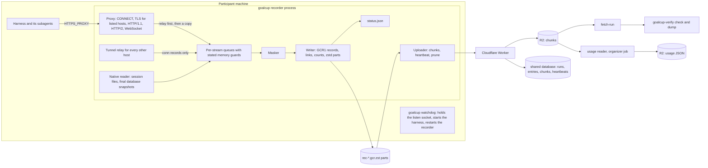

# PRD-00: goalcup 1.0, index and architecture

Id: PRD-00. Version: **goalcup 1.0** (today 0.7.0). Date: 29 October 2026. Base: main at 4b226de2.
Status: the plan for one overnight build by many parallel agents. Read [PRD-01](PRD-01-record-format.md)
next: every other PRD builds against it.

Sources: the [cut-first plan](../2026-10-30-cut-first-plan.md) (revision 4, now superseded where the
owner's 29 Oct decisions differ), the audit appendices in [2026-10-30-audit](../2026-10-30-audit/)
(A to O and R), and run 1's report with its server copy review
(`docs/research/results/2026-10-30-two-hour-run.md` on branch `origin/smart/tender-clarke-qupne3`).

## Goal

Rebuild the recorder as one process with one record format, so that a week-long run with thousands of
subagents is recorded whole, every loss is a named gap, and the participant sees only true counts.
Test it on real harnesses through one test pad before it ships.

## What 1.0 is, in six lines

1. A fresh recorder crate, written from [PRD-01](PRD-01-record-format.md), with proven tricky parts
   copied in (TLS and CA, HTTP/1.1 parsing, brotli and WebSocket deflate, masking rules and corpus,
   connector data, the Worker chunk store).
2. One process records everything: proxy, session-file reader, masker, writer, uploader. A tiny
   watchdog only holds the port and restarts it.
3. One proxy for every harness and every model host, gateways included.
4. The old crates are deleted in the same build. No backward compatibility.
5. The verifier and the Worker move to the new format and ship with the client.
6. A test pad proves 15 harnesses with real keys; Claude Code, Codex and Hermes block the release.

## One system for every harness (the owner's gateway question)

Yes: a gateway is just another HTTPS endpoint, and it goes through the same proxy.

```
harness  --HTTPS_PROXY-->  goalcup proxy  --TLS-->  gateway (Vercel AI Gateway, OpenRouter, ...)  -->  provider
harness  --HTTPS_PROXY-->  goalcup proxy  --TLS-->  provider (direct key)
```

The proxy decrypts a connection when its host is on the **one host list**: a shared list of model
hosts for all harnesses (providers, gateways such as Vercel AI Gateway, OpenRouter and Cloudflare AI
Gateway, cloud model services, and vendor backends such as Amp's), plus hosts the participant
registers, plus hosts the harness config names (a hint, not the rule). A decrypted gateway call is
recorded byte for byte exactly like a direct call. So Kilo through Vercel AI Gateway is the same case
as Kilo with a direct key; the only fact we need is the gateway's host name, and it is on the shared
list. What differs per gateway is inside the bytes (model names, extra usage fields), which the usage
reader handles later (PRD-09).

Every other connection is relayed untouched and recorded as a tunnel (host, bytes, times). We do not
decrypt every host: a tool that does not trust the run CA would break (point 3).

**Dodgers are the one different case**, and the light path already covers them. A dodger ignores
`HTTPS_PROXY`, pins its certificates, or runs inference behind a vendor channel we cannot read. We
never hack around it. It still gets the same pipeline: a tunnel record when its bytes pass through us,
its session files from disk, a named gap (`pinned`, `tls_refused`), and the tier "not supported". So
the strong pads are HTTPS_PROXY and gateways (full wire record); dodgers get tunnels, session files
and an honest label. One system, no patchwork.

Per harness, only data changes (PRD-11): which CA variables to set (`NODE_EXTRA_CA_CERTS`,
`SSL_CERT_FILE` with the full bundle, `CODEX_CA_CERTIFICATE`, `GOOSE_CA_CERT_PATH`,
`REQUESTS_CA_BUNDLE`), the harness's own proxy setting where it overrides `HTTPS_PROXY` (OpenClaw,
Qwen Code), background daemons or gateways to stop before start (OpenCode 2, Hermes gateway, Codex,
Droid), session-file patterns, and the auto-update switch.

## Architecture



Rules of the shape:

- **Relay first, record second.** The proxy forwards bytes, then offers a copy to the stream's queue
  with a call that never waits. Past a stated memory guard the copy is dropped and the loss becomes a
  GAP with start, end and lost bytes. The harness is never slowed (point 3).
- **Masking before disk** (D14). Raw bytes live only in memory, in the queues and the masker's hold.
  Masking runs off the relay tasks (PRD-02 and PRD-05).
- **One writer** owns the part files. It counts at write, so every count the participant sees is of
  bytes already in a part (PRD-01 section 9).
- **The watchdog** is a tiny parent process. It binds `127.0.0.1:<port>` once and passes the socket to
  each recorder process, so a restart never closes the port: new connections wait in the kernel's
  backlog for a moment instead of being refused. It starts the harness, restarts a dead recorder at
  once, and tells the new boot how the old one ended. It records nothing itself.
- **No IPC, no producers, no epochs, no failure budget, no shared 8 MiB queue.** That hand-off lost
  37.5% of run 1's calls (run report, "Root cause").
- **The server stores bytes and interprets nothing.** The usage reader runs as an organizer job,
  because decoding needs a 128 MiB window and a Worker isolate has 128 MB (PRD-01 section 15).

## The seven points, mapped to PRDs

| Point | Led by | Also |
|---|---|---|
| 1. Record every model call | PRD-03 proxy | 01 format, 02 core, 11 host list and connectors, 12 pad check "wire calls match the harness log" |
| 2. Record every subagent | PRD-04 native capture | 02 (no caps), 03 (one stream per WebSocket direction), 09 per-subagent stats, 12 check "every subagent recorded" |
| 3. Never block or slow the harness | PRD-02 recorder core | 03 relay first, 06 upload never waits, 10 watchdog start path, 17 lessons |
| 4. Never record secrets | PRD-05 masking | 08 secret check, 12 check "no secret" |
| 5. Upload everything | PRD-06 uploader | 01 format, 07 Worker and fetch, 08 server copy check |
| 6. Tell the participant plainly | PRD-10 CLI | 02 written counts, 07 heartbeat `failed`, 09 stats, 15 docs |
| 7. Work with the harnesses people use | PRD-11 connectors | 03 HTTP/2, 12 pad, 15 contributor docs |

## The PRDs

| Id | Title | One line |
|---|---|---|
| PRD-00 | Index and architecture | This file: shape, ownership, order, merge rule, done, owner questions |
| PRD-01 | Record format | GCR1: binary framing, raw bytes, one stream per WebSocket direction, gaps with start and end, counts, links, zstd parts |
| PRD-02 | Recorder core | One process pipeline: recorder handle, queues and memory guards, writer thread, gaps, counts, watchdog and restart |
| PRD-03 | Proxy | CONNECT, run CA and TLS, the one host list, HTTP/1.1, HTTP/2, WebSocket, decoding, tunnels, pinned and refused fallback |
| PRD-04 | Native capture | Session files for every harness, no caps, path as ID, final database snapshots after exit |
| PRD-05 | Masking | Every secret rule kept, URL password rule added, email and Codex rate-limit rules dropped, left word boundary, same-length mask |
| PRD-06 | Uploader and compression | Chunks from the part files, cadence, capped backoff, heartbeat with written counts, prune once stored |
| PRD-07 | Worker, server and database | Chunk store as is, signing cut, heartbeat `failed`, no run size limit, fetch-run on the new format |
| PRD-08 | Verifier and checks | `goalcup-verify check`, `dump`, server copy check, secret scan, the observer checks the pad runs |
| PRD-09 | Usage and research stats | Per call, per subagent and per run model and tokens, from the record and the harness's own files |
| PRD-10 | CLI and participant experience | `start`, `continue`, `status`, `seal`, `upload`, `login`, `setup`, `time-left`; plain written counts and off time |
| PRD-11 | Connectors and the 15 harnesses | Connector data, the shared host list, CA and proxy variables, daemons to stop, auto-update switches |
| PRD-12 | Test pad and real-run loop | Three cases (direct key, gateway, dodger), the same checks, one pass or fail table, watcher fix loop |
| PRD-13 | Cuts | Delete the old crates, research decoders, scripts, disk-full code, pins, deny lists, termination proof, signing, legacy seams |
| PRD-14 | Tests and gate | Test layout, the new gate, CI, release packaging |
| PRD-15 | Docs, AGENTS.md and decisions | README seven points, AGENTS.md two changes and new map, DECISIONS entries, record format doc, participant guide |
| PRD-16 | Overnight orchestration and acceptance | Integration branch, merge rule, schedule, watchers, the night log, the morning hand-off, the 2-hour run after green |
| PRD-17 | Lessons from the old code | The edge cases the old code learned the hard way, as acceptance cases the fresh core must pass |

## File ownership

Each path has one owner. A builder edits only paths its PRD owns. A change to someone else's file goes
through that file's owner, by a note in the night log or a review comment on the owner's branch.

### New code

```
crates/goalcup-format/          PRD-01  record types, codec, links, PartWriter, index, reader, dump
crates/goalcup/                 the recorder crate, binary `goalcup`
  Cargo.toml                    PRD-02  every dependency declared once in the scaffold
  src/lib.rs                    PRD-02  module list, frozen after the scaffold
  src/main.rs                   PRD-10  argument parsing and command dispatch
  src/pipeline/                 PRD-02  recorder handle, queues, guards, writer thread, counts, gaps, clock
  src/watchdog.rs               PRD-02  listen socket, harness spawn, recorder restart
  src/proxy/                    PRD-03  listener, connect, tls (CA), http1, h2, ws, decode, tunnel, hosts
  src/native/                   PRD-04  discovery, tailing, generations, snapshots
  src/mask/                     PRD-05  rules, stream masker, metadata masking
  src/upload/                   PRD-06  chunks, client, heartbeat, prune, `goalcup upload`
  src/connector/                PRD-11  connector schema, loader, host list merge, launch plan
  src/cli/                      PRD-10  commands, participant text, status view, setup, login
  tests/common/                 PRD-14  shared test support (fake upstream, fake Worker, temp homes)
  tests/pipeline_*.rs           PRD-02
  tests/proxy_*.rs              PRD-03
  tests/native_*.rs             PRD-04
  tests/mask_*.rs, tests/mask_corpus/   PRD-05
  tests/upload_*.rs             PRD-06
  tests/connector_*.rs          PRD-11
  tests/cli_*.rs                PRD-10
  tests/lessons_*.rs            PRD-17
crates/goalcup-verify/          PRD-08  binary `goalcup-verify`: check, dump, server compare, secret scan
  src/usage/                    PRD-09  the usage reader (subcommand `usage`)
  tests/usage_*.rs              PRD-09
```

### Existing paths

| Path | Owner | Note |
|---|---|---|
| `Cargo.toml` (workspace), `Cargo.lock`, `rust-toolchain.toml`, version `1.0.0` | PRD-16 | Members list written once in the scaffold; old crates removed by PRD-13 through PRD-16 |
| `connectors/**`, new `connectors/model-hosts.toml` (the shared host list), `docs/harnesses/**` | PRD-11 | One connector folder per harness |
| `server/worker/**` (src, test, wrangler.toml, scripts) | PRD-07 | `server/worker/sql/` is a mirror of the website's database; changing the real schema needs the owner (question 1) |
| `scripts/fetch-run.sh`, `scripts/test_fetch_run.py`, `docs/UPLOAD-API.md` | PRD-07 | The upload contract is seam S5 |
| `scripts/pad/**` (new), `docs/plans/2026-10-30-v1.0/PAD-RESULTS.md` (new), `skills/adding-a-capture-harness/**` | PRD-12 | The pad is also the contributor path |
| `scripts/gate.sh`, `scripts/ci-scope.py`, `.github/workflows/**`, `scripts/release.sh`, `scripts/package-release.sh`, `scripts/smoke-release.sh`, `packaging/**`, their `scripts/test_*.py` | PRD-14 | |
| `skills/goal-cup/**`, `skills/goal-cup-setup/**` | PRD-10 | Participant-facing |
| `README.md`, `AGENTS.md`, `CLAUDE.md`, `TODO.md`, `docs/*.md` except `docs/UPLOAD-API.md`, new `docs/RECORD-FORMAT.md` | PRD-15 | `VISION.md` is the owner's and is not edited |
| `docs/plans/2026-10-30-v1.0/LESSONS.md` (new) | PRD-17 | Feeds `tests/lessons_*.rs` |
| `docs/plans/2026-10-30-v1.0/NIGHT-LOG.md` (new) | PRD-16 | Decisions, seam requests, stops, fix loops |
| Each `PRD-NN-*.md` | its author | |
| Deleted: `crates/goalcup-{cli,daemon,platform,protocol,verifier}/`, `spikes/` (after PRD-05 and PRD-17 copy what they need), research and disk-full scripts | PRD-13 | Deletes only after PRD-17's lessons tests pass on the new core |

### Seams

| Seam | What | Owner | Used by | Stable by |
|---|---|---|---|---|
| F1 | `goalcup_format`: `Record`, `StreamKind`, `GapReason`, `EndReason`, `PartWriter`, `IndexLine`, `read`, `dump` | PRD-01 | 02, 06, 08, 09 | H+1 |
| S1 | `pipeline::Recorder` and `StreamHandle`: `open(kind, conn, req, meta)`, `data(t, off, bytes)`, `ws(t, opcode, fin, bytes)`, `end(reason)`, `gap(...)`, `event(json)`. Never blocks; nothing returned that the caller must act on | PRD-02 | 03, 04 | H+1.5, stubs first |
| S2 | `mask::Masker`: `stream(kind)` gives a stream masker with `push(bytes)` returning masked bytes and spans, and `finish()`; `mask_meta(&mut meta)` | PRD-05 | 02 | H+1.5 |
| S3 | `connector::{Connector, HostList, NativeSource, LaunchPlan}` | PRD-11 | 02 (spawn), 03, 04, 10 | H+1.5 |
| S4 | `pipeline::Counts` snapshot and the durable point | PRD-02 | 06, 10 | H+2 |
| S5 | Upload HTTP contract, `docs/UPLOAD-API.md` | PRD-07 | 06 | H+2 |
| S6 | `goalcup-verify check --json` report | PRD-08 | 12, 16 | H+3 |
| S7 | Usage JSON (`usage/{event}/{run}/{entry}.json` in R2) | PRD-09 | 12 | H+4 |
| S8 | Watchdog and recorder: inherited listen socket, boot number, previous exit status | PRD-02 | 10 | H+1.5 |

## Build order inside the night

H+0 is the start of the night. Times are targets, not limits.

| Phase | When | What | Gate to leave it |
|---|---|---|---|
| 0. Foundations | H+0 to H+1.5 | PRD-16 opens the integration branch and adds the new crates to the workspace beside the old ones. PRD-01 publishes the format types and the golden test. PRD-02 publishes the `crates/goalcup` scaffold: `Cargo.toml` with every dependency, the module tree with stubs, seams S1, S2, S3, S8 as compiling stubs. PRD-11 publishes `connectors/model-hosts.toml` and the connector schema. PRD-17 starts the lessons list at once (read only). | `cargo build` and `cargo test -p goalcup-format` green on integration |
| 1. Parallel build | H+1.5 to H+6 | PRD-02 to PRD-12, PRD-14 and PRD-15 build in parallel on their own branches. PRD-07 can start at H+0 (it needs only PRD-01 section 12). | Each PRD's own tests green; merged by the rule below |
| 1a. Early real test | as soon as 01, 02, 03 and 05 record one request | A watcher runs short real runs in a sandbox: Claude Code and Codex with a direct key, one subagent, local only. Check decode, counts against the harness's own log, no secret. Proves the concept before the build finishes | Pass, or a note in the night log that names the failing PRD |
| 2. Integration | H+6 to H+8 | Everything merged. PRD-17's lessons tests pass on the new core. The pad runs end to end against a local Worker. Kill test (PRD-01 acceptance 3) | `gate fast` green, lessons green |
| 3. Cut | after phase 2 | PRD-13 deletes the old crates and the cut scripts; `gate full` green with nothing old left | No reference to an old crate |
| 4. Pad, core set | after phase 3 | Claude Code, Codex, Hermes, each in the three cases. Watchers read failures and fix them; three failed fixes on one cause ends that loop with a note | Core set green |
| 5. Pad, the rest | after phase 4 | The other 12 harnesses; each is "verified" (passed on a named version) or "not verified" | The table is published |
| 6. After green | morning | The owner deploys the Worker and merges to main. Then the 2-hour run with run 1's Codex prompt (PRD-16) | Owner's call |

## Branches and the merge rule

- Integration branch: **`v1.0/integration`**, from `main` at 4b226de2. Each PRD works on
  `v1.0/prd-NN-<slug>` from the integration branch. No branch is named plain `v1.0`.
- PRD-16's integrator merges a PRD branch when: (1) it touches only paths its PRD owns, or a seam
  change the seam's owner approved in the night log; (2) its own tests pass; (3) `gate fast` (as it
  stands on integration at that hour) passes on the merged result. Merge commits, no squash, no force
  push on integration.
- A conflict is resolved by the owner of the conflicting file.
- Nothing merges to `main` until the pad is green on the core set. The owner gives the final merge.

## Definition of done

1. The pad passes on **Claude Code, Codex and Hermes**, in all three cases (direct key, gateway,
   dodger), with every check: wire calls match the harness's own log, every subagent recorded, no
   secret anywhere in the record or the server copy, server copy equal to the local parts byte for
   byte, and the counts shown to the participant equal the verifier's recount. In the dodger case,
   "pass" means the loss is shown honestly (tunnel records, a named gap, a "not supported" label),
   never a false "recording works".
2. The kill test passes: the recorder killed twice mid-run, the harness unaffected, two
   `recorder_down` gaps, links whole.
3. Every acceptance case in PRD-17's lessons list passes on the new core.
4. `gate full` passes with the old crates deleted.
5. The 15-harness table is published with a tier per harness and a named version for each "verified".
6. README, AGENTS.md (the two changes), DECISIONS entries for the format and the one-process shape, and
   the participant guide match the build.
7. Client, verifier and Worker are built from the same commit; the Worker is ready for the owner to
   deploy.

The 2-hour run is not in this list. It runs after the build is green.

## Defaults taken (the owner may override any of them)

| Default | Value |
|---|---|
| Autonomy overnight | Agents decide anything inside the seven points and AGENTS.md. They stop and leave a note for a hard-rule change, the website database, or spend past a cap |
| Keys | In 0600 files inside the sandbox only. Never in the repo, a log, a record or a prompt |
| Spend caps | Placeholder about $50 a night and $5 per pad run; the owner said cost is not a constraint for test runs and sets the real numbers |
| Keys per harness | Separate where possible (run 1 hit OpenAI's rate limit with about 20 subagents) |
| Fix loop stop rule | Three failed fixes on the same cause end that loop with a note |
| Server access overnight | Read-only database and R2 access to check the server copy |
| macOS | The owner runs the pad once on a real Mac after the build; this build is tested on Linux sandboxes |
| Branches | One integration branch; main only after the core set is green; the owner merges |
| Release blockers | Claude Code, Codex, Hermes. The others may ship "not verified" |
| The 15 harnesses | Claude Code (Claude key), Codex (OpenAI key), Hermes, OpenCode, OpenClaw, Amp (Amp account; records Amp's own traffic), GitHub Copilot CLI, Gemini CLI (one funded Google key), Goose, Kilo CLI, Qwen Code, Crush, Factory Droid, Kimi Code, Cline CLI. Bring-your-own-key harnesses use DeepSeek. Cursor and Aider are out; Cursor stays the documented dodger case |
| The long run | Run 1's Codex prompt, so the two runs compare |
| Usage reader | An organizer job that writes usage JSON to R2; no database change (question 1) |
| Pad server | A local Worker (`wrangler dev` with the local database twin) overnight; the deployed Worker after the owner deploys (question 2) |
| Gateway case in the pad | The pad sets the gateway address in the harness's isolated config, as a participant would. goalcup's own launch code never sets a base URL |

## AGENTS.md: what stands and what changes

These hard rules stand as written (`AGENTS.md:81-95`):

- Never set a model base URL on any harness; the only wire path is the loopback proxy through
  `HTTPS_PROXY` (D1, D36).
- Goal Cup Proxy records and never manages the agent; D66 (`goalcup time-left`, pull only) stays.
- No harness names in core code: a harness is data.
- Never write into `~/.claude`, `~/.codex`, `~/.hermes` or any app-wide config.
- Never commit anything under `spikes/*/out/`, `harnesses/` or `target/`.
- Record raw, interpret later (the word "daemon" becomes "recorder").
- One test per behaviour; test the promise, not the shape.

The two that change:

1. **The P1 to P7 promise-test rule** (`AGENTS.md:101`) becomes: "Every behaviour that serves one of
   the seven points has a test, and that test is not deleted while the point stands."
2. **The D65 exception goes** (`AGENTS.md:83-86`): goalcup no longer freezes the agent on a nearly full
   disk. Disk full gets no special handling; the harness stops and the participant cleans up.

Not a rule change: the map (`AGENTS.md:32-50`) is rewritten because the daemon, the platform crate and
the protocol crate go; the dependency rule becomes "the recorder never links the verifier". One rule is
left with nothing to act on, the connector pin rule (`AGENTS.md:90-91`), because pins are cut
(question 3).

## Owner questions

Only things a builder cannot decide. Each has a default the night uses until the owner answers.

1. **Website database.** Default: no schema change tonight. Written counts map onto existing columns
   (`model_requests` = model requests written; `recording` gains real `failed`), the chunk `ack` column
   gets `{}` since signing is cut, and usage stats go to R2 as JSON. Do you want a website migration
   later for usage tables and off time?
2. **Worker deploy overnight.** Default: the pad checks the server copy on a local Worker, and you
   deploy 1.0 to staging and production in the morning before the 2-hour run. Or may an agent deploy
   to staging with a staging-only token?
3. **The pin rule in AGENTS.md.** Pins are cut, so the rule has nothing to act on. Default: PRD-15
   deletes that line as a consequence of the cut. Do you agree, or keep it until you rewrite it?
4. **Baseline manifest, termination proof and judged-commit logic are cut.** The seal records the
   workspace git HEAD and a digest of uncommitted changes. Rules that relied on the manifest (planted
   files) become an organizer check of the repo. Default: yes.
5. **Keys and accounts tonight.** Which of Amp, GitHub Copilot, Factory Droid, Kimi Code, Cline and
   Gemini have a key or account in the sandbox? Default: a missing one ships "not verified".
6. **Who sees usage stats.** Default: organizers only; the participant sees written counts and off time.
   Show participants their tokens and models too?
7. **Chunk cadence.** Default: a chunk every minute while data flows. That is up to about 10,000
   `chunks` rows per busy entry-week in the shared database. Fine, or every 5 minutes?
8. **Release.** Default: tag `v1.0.0` and set `MIN_COMPETITION_VERSION` to 1.0.0, so 0.7.x clients are
   refused, after your merge. Confirm.

## Risks for the night

| Risk | What we do |
|---|---|
| The fresh core misses an edge case the old code handled | PRD-17's lessons list is acceptance, and old crates are deleted only after it passes |
| Parallel builders collide | One owner per path, seams published as stubs in phase 0, merges only through PRD-16 |
| A seam changes late and breaks three PRDs | Seam owners change a seam only with a night-log note; users rebase the same hour |
| Real harness runs are slow or rate limited | Separate keys per harness; short prompts that ask for one subagent; core set first |
| The pad passes on Linux but not macOS | The owner's Mac run after the build; macOS-only code paths (clock, CA store) are named in PRD-02 and PRD-03 |
| Not everything lands by morning | Phase order puts the core set first; the other 12 harnesses may ship "not verified" |

## Size budget (estimates, for the "less code" rule)

| Area | Today, src lines (`wc -l`) | 1.0 target, src lines (estimate) |
|---|---:|---:|
| Rust crates | about 102,000 | about 12,000 to 16,000 (format 1,000; core 1,500; proxy 4,000 with copied parts; native 800; masking 3,500 with copied rules; upload 700; CLI and connectors 2,000; verifier 1,200; usage 1,500) |
| Worker | about 4,000 | about 3,000 (signing, receipts and research paths cut) |
| Scripts | about 22,000 incl. tests | gate, release, fetch-run and the pad only |

A builder who needs more than the estimate for its area says why in the night log.
