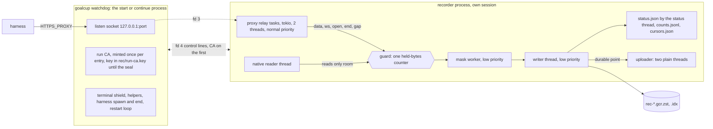

# PRD-02: Recorder core (one process pipeline, guards, writer, watchdog)

Id: PRD-02. Version: goalcup 1.0. Revision 4, 30 October 2026 (revisions 2 and 3 earlier the same
day, revision 1: 29 October). Base: main at 4b226de2. Index: [PRD-00](PRD-00-index.md) revision 4. Format:
[PRD-01](PRD-01-record-format.md) (binding).

Revision 2 brought this PRD into line with PRD-00 and PRD-01 revision 2 and answered the three reviews
of 30 October (section "Review answers", now history). Revision 3 is the alignment pass against the
ledger (OWNER-DECISIONS.md); section "Alignment answers" at the end lists each fix and what was done.
Revision 4 carries the new ledger items R3a, R3b and T4 (last row of "Alignment answers").

## Goal

One process carries every recorded byte from the proxy and the session-file reader through masking
to the part files, with no IPC for bytes, no producers and no failure budget. Any loss is a gap with
a start and an end, the harness is never slowed, and a dead recorder is back on the same port at once.

## Points served

3 (lead: never block or slow the harness, note a gap and go on), 1 and 2 (no cap of ours on calls,
streams, connections or subagents), 4 (raw bytes live only in the recorder's memory until PRD-05's
masker has seen them, D14; no core dumps, no secret in a panic message), 5 (the durable point the
uploader sends from), 6 (written counts and off time in `status.json`).

## Owner decisions it carries out

- Architecture option B, one process: proxy, native reader, masking, writer and uploader in the
  recorder process. The proxy to daemon hand-off (IPC, producers, epochs, the shared queue, failure
  budgets) is removed (ledger L5).
- No caps of our own. Only stated memory guards that never stop recording: past one, write a gap
  and go on.
- Never block the harness. A drop caused by load never counts toward "the recorder is dead". Loss is
  never silent. Count a request only once its bytes are written. Show how long recording was off.
- The recorder never stops for good (ledger R3): it restarts on the same port fast, writes a gap for
  the dead time and marks the failure. A tiny watchdog is allowed (R3); in 1.0 it is the `goalcup
  start` or `continue` process, with the jobs in section 8 (PRD-00 owner question 9).
- Crash-loop retry is eager and never ends (ledger R3a). A crashed recorder is restarted at once.
  Only a crash loop (3 crashes within 10 minutes, each within 60 s of its start) switches to null
  mode (pass-through), which retries a normal boot after 30 s, 1, 2 and 5 minutes, never more than
  5 minutes apart. The count resets as soon as a recorder stays up 60 s (section 8 step 9).
- `goalcup recover` restarts only the recorder when the watchdog itself died (ledger R3b). A new
  watchdog reopens the same port with the same run CA, starts the recorder and writes a gap for the
  time it was down. It never touches the harness. The run CA key is kept in a 0600 file,
  `rec/run-ca.key`, from the mint to the seal (section 8.1).
- The proxy record is the proof (ledger T4). Every real-run proof below reads the record and the
  server copy; none calls an outside API. The pad's history check must find no missed call outside a
  gap.
- Check open file handles first (macOS default 256 per process) and raise the limit.
- Disk full: no special handling (ledger L6; D65 is gone). A write error ends the recorder like any
  crash; after three fast exits null mode keeps the harness working, unrecorded, and status says why.
  Recording goes off, goalcup never stops or freezes the harness, and the gap covers the time
  (section 5).
- Ending the harness at the deadline and on `goalcup seal` stays (PRD-00 owner question 2, old 11,
  default yes). Nothing else ends it: a server `stop` for any other reason seals the recording only
  (section 8 step 10).
- Fresh core: copy only proven tricky parts; old crates are deleted in the same build.

## Today

| What | Where (src lines, `wc -l`) | Fact that matters here |
|---|---|---|
| The shared queue | `crates/goalcup-protocol/src/capture.rs:51` | 8 MiB for every producer of an entry, controls included |
| Stream and connection bounds | `capture.rs:58`, `:60`, `:63`, `:66` | 128 open streams, 128 connections, 65,536 producer IDs, 128 live producers |
| Sink refusal loses the whole producer | `crates/goalcup-daemon/src/runtime/capture/sink.rs:246-283` (file 556) | One frame that does not fit calls `lose(&mut state, &id, reason)` at `:279` |
| New epochs refused under load | `sink.rs:322` | `Pending` while the queue is over half full |
| Owner thread does everything | `runtime/capture/owner.rs:162-196` (file 388) | Drains the queue, runs every redactor and polls native files on one thread; sync every 800 ms (`:10`), native poll every 100 ms (`:16`), 256 items per drain (`:28`) |
| Failure budget | `crates/goalcup-cli/src/proxy/ingest.rs:98-108, 455-472` (file 1,177) | `MAX_CONNECTION_FAILURES = 10`, `STABLE_EPOCH = 60 s`, `latch_terminal` ends wire capture for good |
| Daemon ingest receiver | `crates/goalcup-daemon/src/ingest.rs` (1,356) | Socket, handshake, JSON frames with byte arrays as numbers (about 3.6 bytes per payload byte, M section 1.1 step 4) |
| Emitter terminal latches | `crates/goalcup-cli/src/proxy/api.rs:451-453, 599-601, 671-683` (file 824) | 129th stream or connection disables capture; one `Loss` per reason per launch |
| Native latches on refusal | `crates/goalcup-daemon/src/native_capture.rs:940-975` (file 1,632) | Any `Disabled` answer latches native off for the life of the adapter; caps at `:279-280` (32 streams, 1,024 files) |
| Redactor hold | `crates/goalcup-daemon/src/redact/stream.rs:125` (file 4,008, about half inline tests) | At most 16 KiB undecided per stream, fail closed past it |
| Proxy runtime | `crates/goalcup-cli/src/commands/start/proxy.rs:96-100` (file 437) | One tokio worker thread; the proxy dies with `goalcup start` (`:64-65`) |
| Open-file raise | `commands/start/proxy.rs:27, 33-62` | Soft limit raised only to 2,304 (2 x 1,024 connections + 256) |
| Connection cap and 503 | `crates/goalcup-cli/src/proxy/mod.rs:112, 120, 991-996` (file 1,532) | The 1,025th connection gets a 503 |
| Accept loop restart cap | `proxy/mod.rs:1022`, `:1050-1100` | 5 restarts, then the port is no longer served; a rebind window refuses connections |
| Terminal sharing | `crates/goalcup-platform/src/terminal.rs:1-26` (module comment), code `:27-292` (file 482) | The harness shares the host's process group; the host catches (never ignores) SIGINT, SIGQUIT, SIGTSTP, SIGHUP; `Modes` and `wait_resuming` restore the terminal |
| TUI process group | `crates/goalcup-cli/src/launch.rs:75-80` (file 2,090) | A TUI must stay in the terminal's foreground group, so the host can never signal the harness's group without signalling itself |
| Subreaper | `crates/goalcup-cli/src/subreaper.rs:73-74` (file 617) | `PR_SET_CHILD_SUBREAPER` on Linux; the sweep excludes children that started before the harness (`:11-14`) |
| Native handle budget | `crates/goalcup-platform/src/handle_budget.rs:13` (file 79) | 32 handles for native capture |
| Core dumps | `grep -rn "RLIMIT_CORE\|PR_SET_DUMPABLE" crates/` | No hit: nothing turns core dumps off today |

Run 1 (`docs/research/results/2026-10-30-two-hour-run.md` on `origin/smart/tender-clarke-qupne3`,
measure 7): the daemon used 50 to 52 MB RSS and 17 to 18 open files; `goalcup start` 19 to 67 open
files; Codex up to 97. Recorded payload was about 0.25 MB/s on average, with bursts of about
30 MB when 20 subagents resent 1.5 MB contexts after a rate-limit window (M section 3, ask 2).

## Design

### 1. The shape



- **One recorder process per entry.** It holds the proxy, the native reader, the mask worker, the
  writer and the uploader. Nothing crosses a process boundary except control lines with the
  watchdog (section 8). No recorded byte is ever serialised for another process.
- **Threads.** Relay tasks on a tokio runtime with 2 worker threads (PRD-03 states the count). One
  native thread (PRD-04). **One mask worker** in 1.0; a pool is built only if R8 shows masking is
  the slow stage (section 4). One writer thread. One status thread that writes `status.json` each
  second from live atomics and checks the stall exit (sections 3 and 5). The uploader's two plain threads with a blocking
  client (PRD-06), never on the relay runtime. The mask worker, the writer, the native thread and
  the uploader run at low priority through `pipeline::low_priority()`: Linux `setpriority` per
  thread, nice 10. On macOS it is a no-op in 1.0 (per-thread QoS is deferred, PRD-00 "Not in this
  build"). Run 1's owner thread did masking, native polls and writing on one thread
  (`owner.rs:162-196`); that is split here.
- **One source of truth for loss.** Bytes are dropped in exactly one place, the guard at the front
  of the pipeline. Inside the pipeline every stage waits for the next one; that wait can never
  reach a relay, because the relay only offers and never waits.
- **Every timer uses boot time.** Deadline, restart pauses, null-mode retries, the seal's budgets
  and the status tick read `Recorder::now()` (`CLOCK_BOOTTIME` on Linux, `mach_continuous_time` on
  macOS) on a 1 s tick. No deadline is a runtime sleep: `std::time::Instant` and tokio timers use
  `CLOCK_MONOTONIC`, which stops during suspend (PRD-01 section 6).

### 2. The recorder handle (seam S1, owned here)

This is PRD-00's S1 block (revision 4, rulings R3-1 and R3-2), plus a test constructor for the real
pipeline and `fds::raise`, each added by a night-log line (`seam S1: ...`).

```rust
#[derive(Clone)] pub struct Recorder { /* Arc inside */ }
impl Recorder {
    pub fn open(&self, kind: StreamKind, conn: Sid, req: Sid, from: u64,
                flags: OpenFlags, meta: serde_json::Value) -> StreamHandle;
    pub fn event(&self, ev: serde_json::Value);           // notes and facts from other PRDs
    pub fn room(&self) -> u64;                            // bytes free under 3/4 of the soft guard
    pub fn reserve(&self, n: u64) -> Reserved;            // counts n in `held` until dropped
    pub fn native_cursors(&self) -> Cursors;              // durable file positions (section 9.3)
    pub fn now(&self) -> Mono;                            // boot time in ns, counts a suspend
    pub fn counts(&self) -> Counts;                       // S4
    pub fn durable(&self) -> tokio::sync::watch::Receiver<Durable>;   // S4
    #[cfg(feature = "test-hooks")]                        // pending PRD-00 owner question 12
    pub fn for_tests(room: u64) -> (Recorder, Calls);     // records every call, before masking; PRD-14
    #[cfg(feature = "test-hooks")]
    pub fn real_for_tests(dir: &Path, masker: Masker) -> Recorder; // real mask worker and writer
}
pub struct StreamHandle { /* sid, next_off, guard gap state; owned by one task, not Clone */ }
impl StreamHandle {
    pub fn sid(&self) -> Sid;
    pub fn data(&mut self, t: Mono, bytes: bytes::Bytes);
    pub fn ws(&mut self, t: Mono, opcode: u8, fin: bool, bytes: bytes::Bytes);
    pub fn gap(&mut self, reason: GapReason, start: Mono, lost: Option<u64>, tail: Option<Value>);
    pub fn end(self, t: Mono, reason: EndReason, tail: Option<Value>);
}
impl Drop for StreamHandle { /* no end() called: END interrupted */ }
pub fn low_priority();                                    // for PRD-04 and PRD-06 threads
pub mod fds { pub fn may_accept() -> bool;               // section 10, for PRD-03
              pub fn raise(target: Target) -> u64; }      // the watchdog's pre_exec and tests
pub fn entry_totals(entry_dir: &Path) -> Counts;          // S4, R3-2, for PRD-06 and PRD-10
```

Rules every caller can rely on:

1. **Nothing blocks and nothing returns a value the caller must act on.** Every call is an atomic
   load, a counter update and an unbounded channel send (`std::sync::mpsc`) of a `Bytes` (a
   reference count, no copy). No lock is held across a call. After the seal's stop, a call on a wire
   stream (`conn`, `http_req`, `http_resp`, `ws_up`, `ws_down`) is a no-op that only counts; `native`
   and `snapshot` calls stay admitted until `NativeReader::finish` returns (section 11, PRD-00 R3-3).
   A send whose receiver is gone (a pipeline thread died) exits the process with 70, once, from the
   first caller, so the watchdog restarts it and a `recorder_down` gap covers the span.
2. **The handle owns offsets.** `from` is the first offset (0 for wire streams; the resumed cursor
   for native, section 9.3). Each `data` or `ws` piece moves the offset by its length, written or
   dropped.
3. **A caller reports its own loss with `gap()`.** The GAP's `off` is the handle's offset, its start
   is `start`, its end is the time of the call. A caller whose loss runs on (a connection that
   stopped parsing) calls it when the loss ends, at the latest just before `end()`. `Some(n)` moves
   the offset by `n`; `None` means unknown and leaves it. If a guard gap is open on the handle, the
   handle writes that one first. A GAP on a `conn` stream is allowed (PRD-01 section 4).
4. **Pieces over 256 KiB are split** into DATA records of at most 256 KiB (PRD-01). A WebSocket
   message keeps its opcode on every piece and `fin` on the last. `ws(..., fin: true)` marks a
   message end; the mask worker passes it to the masker as a boundary (section 4).
5. **`flags`** carry what the writer counts without parsing JSON: `POST`, `DECRYPTED`, `TUNNEL`.
   `meta` is masked by PRD-05's `mask_meta` on the mask worker, never on the relay.
6. **Relay first, record second** (PRD-03's duty): forward the bytes to the peer, then offer the same
   `Bytes`. Decoding (gzip, br, zstd, deflate, WebSocket inflate) stays on the relay before the
   offer, so a guard drop never breaks a decoder's state: the dropped bytes are decoded bytes and
   the decoder goes on.
7. **`reserve(n)`** adds `n` to `held` and takes it off when the returned `Reserved` drops. PRD-03
   uses it for every decoder window (a brotli body may hold up to 16 MiB): it checks `room()`, holds
   `reserve(window)` until the body ends, and with no room does not decode that body and writes GAP
   `memory_guard` with guard `decoder_window` (PRD-01 guard list). So decoder memory sits inside the
   one guard, and PRD-03 keeps no process-wide decoder limit of its own.

### 3. Memory guards

There is one counter, `held`: bytes offered and not yet written to a part file, plus reservations.
It covers the mask worker's queue, the masker hold, the channel to the writer and the writer's
input. It goes up on offer and down when the writer has handed the record to the compressor. It has
two thresholds.

| Guard | Default | What passing it does | What it guards |
|---|---|---|---|
| **Soft** | 512 MiB, or one eighth of RAM if that is smaller (floor 128 MiB) | The offered DATA or WS piece is dropped and counted on its stream's open gap. OPEN, END, GAP and EVENT items are always admitted (they are small). Native reads only `room()`, so native never drops | The participant's memory. Run 1's worst burst was about 30 MB, 65 MB with 43 subagents (M section 3); 512 MiB is about 8 times that |
| **Writer stall** (the hard mark) | 2 x soft, or 60 s of boot time with no write while records wait | The recorder exits with code 75. The watchdog restarts it; the next boot writes `recorder_down` with cause `writer_stalled`. This is a recorder failure under R3, not an R5 guard: past the soft guard only control items fill memory, so reaching 2 x soft means the writer is stuck. It is the one stall exit | Memory and the participant's view when the writer or the mask worker is stuck (a hung disk, a masker loop) and control items keep coming |

The gap rule, kept entirely inside the `StreamHandle`, so no shared map is needed:

- The first dropped piece opens a gap on that stream: start wall and record time = that piece's
  time, `off` = the handle's offset, lost = its length. Later drops add to `lost`.
- A stream in a gap admits its next piece only when `held` is under three quarters of the soft guard
  (hysteresis, so one stream does not flap into thousands of tiny gaps). Streams not in a gap admit
  up to the soft guard. `room()` answers against the same three-quarter mark, so native reading
  never pushes the wire into the band where it drops; PRD-04 reads at most `room()` and subtracts
  nothing of its own.
- When a piece is admitted again, the handle first sends `GAP {reason memory_guard, start, end =
  this piece's time, off, lost + 1, tail {"guard":"held_bytes","limit":<soft>}}`, then the DATA.
- `end()` or `Drop` while a gap is open sends the GAP (end = the end time), then END. `END.seen`
  is the end offset (PRD-01 invariant 11).
- At the seal, an open gap is closed by the seal (section 11).
- Live counters for status: `dropped_bytes` (bytes dropped this boot) and `streams_in_gap`.
  `goalcup status` can say "losing data now" before any GAP record exists (PRD-01 section 7).

Fairness: one guard means the stream that offers when memory is full loses bytes, which may be a
small WebSocket message while a large body is held. Accepted; the hysteresis and the 3/4 rule give
streams in a gap a lower claim. Per-stream shares are not built.

The status thread checks the stall exit each second from the live atomics (`held`, `writer_idle_ms`,
boot time), so a stuck writer cannot hide it. Why a stall exits instead of dropping more (review A
finding 4b weighed): past the hard mark only small control
items are filling memory, which means the writer has written nothing for a long time. Dropping
control items too would leave streams with no OPEN or no END that no reader can place, and a stuck
writer cannot write the gaps anyway. A new boot recovers the part file and names the span. The cost
is one reset per open connection, the same as any crash. On Linux the recorder also sets its
`oom_score_adj` to 500 at start, so under memory pressure the kernel kills the recorder (a
`recorder_down` gap) before the harness.

### 4. Masking off the relay: the mask worker

- One worker thread in 1.0. It owns every stream's `StreamMasker` (seam S2, PRD-05). The `Masker`
  is built at boot from the rules and exact values on the first control line (section 8).
- Per item: OPEN runs `mask_meta`; DATA runs `push(bytes)` and gets back masked bytes and spans; a
  piece with `fin` (end of a WebSocket message) then runs `boundary()`, so a fail-closed span never
  crosses a message (review A finding 3); GAP first runs the masker's `gap()` (held bytes decided as
  end of input) and then passes the GAP on, its tail through `mask_meta`; END runs `gap()` when its
  reason is not `complete`, then `finish()`, and its tail (for example `trailers`) runs `mask_meta`;
  EVENT runs `mask_meta` on its body, every event (cheap, and no caller has to know which ones carry
  upstream text). The worker emits
  DATA, then one MASK record per span (PRD-01 section 8), then the next item. `fin` goes on the last
  DATA of the message; an empty message gets one empty DATA with `fin`.
- A DATA record's time is the time of the earliest input piece whose bytes it holds (the hold can
  merge pieces). Its `off` is the source offset of its first byte, which equals the record offset
  because masks keep length.
- **A masker panic never writes raw bytes.** Each item runs inside `catch_unwind`. On a panic the
  piece and the masker's held bytes are dropped, the stream's masker is replaced with a fresh one,
  and the worker writes one GAP with reason `mask_failed` (12): `off` is the first byte the old masker
  had not yet emitted, `lost` is the held bytes plus the piece's length, plus one (PRD-01 encoding);
  start is the time of the earliest held byte, end the panic. The worker knows both offsets, so DATA
  and GAP stay exactly contiguous (PRD-01 invariant 4). The stream goes on. A panic outside the
  per-item `catch_unwind` (the worker's own loop) exits 70 (section 9.2).
- Worker to writer: one bounded channel of 256 records. A full channel makes the worker wait. That
  wait never reaches a relay: it only lets `held` grow until the soft guard drops at the front.
- **The pool, when measured.** If R8 shows the mask worker is the slow stage, the builder adds
  `N = clamp(available_parallelism / 2, 1, 4)` workers with a stream pinned to worker `sid % N` at
  OPEN, and writes a night-log line. Nothing else changes.

### 5. The writer thread

One thread owns one `goalcup_format::PartWriter` (seam F1, `PartWriter::open(dir, PartOptions)`). Its
loop:

1. Receive a record (1 s timeout). Write it. Subtract its offered size from `held`. Update the
   written counters and the per-sid table (kind, whether a GAP was written, native path and offset,
   and for `conn` streams the `host` and `mode` read from the OPEN meta, the only meta it reads).
2. LINK when a second has passed since the last link and records were written, when 16 MiB raw wait
   since the last link, before rotation, and at the seal (PRD-01 section 10). At each link compare
   the clocks: add `{"ev":"clock"}` when wall time moved more than 2 s from the record clock, and
   `{"ev":"suspend"}` when the record clock moved more than 2 s past the awake clock (PRD-01
   section 6).
3. COUNT every 60 s (PRD-01 section 9, all its keys), followed by a LINK. At every LINK, before its
   index line, append this boot's counters at that LINK with the link's `seq` to `counts.jsonl` (one
   compact line, local only). At each durable point rewrite the file by atomic rename (written and
   synced before the rename) to one line per earlier boot plus this boot's latest, so it stays small.
   A later boot takes the dead boot's COUNT from it (section 9.2) without decoding part files.
4. `fdatasync` the part file, then the index, at most every 5 s, at rotation and at the seal. Then
   publish the **durable point** (part path, `c_end`, `raw_end`, link `seq` and hash, and the
   counters as they stood at that LINK, as entry totals: `pipeline::entry_totals`, S4) on the `watch`
   channel (seam S4), and write `cursors.json`
   (per native path: generation, file identity, written offset; per snapshot: size and `mtime_ns`)
   by atomic rename. Counts that leave the machine are these, never ahead of the durable LINK.
5. The writer does not write `status.json`. Every second a status thread (not the writer) writes it
   by atomic rename from the live atomics: `written`, `losing`, `held_bytes`, `writer_idle_ms`
   (section 6). The same thread checks the stall exit (section 3), so a stuck writer is seen.
6. Rotate when PRD-01's rule says so (512 MiB raw or 60 minutes). Under `test-hooks`,
   `GOALCUP_TEST_ROTATE_MB` sets `PartOptions.rotate_at`; `goalcup-format` has no hooks.

A write error (EIO, ENOSPC, EMFILE on a new part file) or a writer panic ends the process with exit
code 74 (write error) or 70 (panic). There is no in-process retry: the restart path of section 8 is
the one recovery path, and it truncates to the last index line exactly as after a crash. GAP
reasons 8 and 9 are never written (PRD-01). Disk full therefore gets no special handling: each boot
fails, the watchdog moves to null mode (section 8), the harness keeps working, and status says
"recording off: disk write failed".

### 6. Written counts, off spans and `status.json`

- **Counted at write, by the writer only.** The keys are PRD-01 section 9's. `http_post` counts
  `http_req` streams with `POST` and `DECRYPTED` whose END is written (a request counts once its body
  is in the record; `req_holes` says which have holes); `ws_up_msgs` counts `ws_up` DATA written with
  `fin` and a text or binary opcode. `http_post + ws_up_msgs` is "model requests written", a request
  count, not a call count. Nothing counts at selection (run 1 counted at selection:
  `proxy/http.rs:306-320`). Status shows `req_holes` and `req_whole` beside `model_requests` whenever
  `req_holes` is above 0, so a request whose body is in a gap is never shown as whole.
- **Entry totals** (`pipeline::entry_totals`, S4, R3-2: one function for boot recovery,
  `close_dead_entry`, the null recorder and `goalcup upload`) = each earlier boot's last COUNT (for a
  dead boot, the COUNT in its recovery frame), plus each recovery frame's `recorder_down` GAP, summed
  as PRD-01 section 9 says, plus this boot's counters. `written` in `status.json` shows them at the
  last LINK whose index line is written (at most about 1 s behind; recovery keeps that LINK after a
  process crash), so it never goes down across a crash.
- **Off time** = the sum of the lengths of `sid 0` `recorder_down` gaps. Status adds the open span
  while a null recorder runs.
- **Only the recorder writes `status.json`** (normal or null: its status thread, and the seal step
  once that thread has stopped), so it has one writer. The watchdog's facts (harness pid, start, exit)
  reach the recorder on the control socket and the recorder writes them. In `mode: sealed`, `written`
  and `off` are the seal's `totals`, so the end screen equals the verifier's recount.
- `written` carries every COUNT key (PRD-01 section 9) as entry totals; the example below is abridged.
  In `mode: sealed` the file also carries `seal {reason, workspace_head}`, `cut_files {files, bytes}`
  from `NativeFinish` (PRD-04), `outlived` (section 11 step 7) and `after_seal {bytes, hosts}`
  (section 11 step 6). `close_dead_entry` writes the same sealed file.

```json
{"v":1,"updated":"2026-11-07T10:00:01Z","pid":4242,"boot":2,"port":53817,"mode":"recording",
 "harness":{"pid":4250,"started":"2026-11-07T08:00:03Z","exit":null},
 "written":{"model_requests":905,"http_post":243,"ws_up_msgs":662,"req_whole":896,"req_holes":9,
            "conns":120,"tunnels":118,"native_files":43,"native_bytes":48200000,"gaps":3,
            "lost_bytes":1500000,"lost_unknown":0,"off_ms":2300,"mask_failclosed_bytes":0,
            "hosts":{"api.openai.com":905},
            "tunnel_hosts":{"github.com":{"conns":12,"up":40960,"down":2097152,"listed":null}}},
 "last_request_at":"2026-11-07T09:59:58Z","last_native_at":"2026-11-07T09:59:59Z",
 "losing":{"streams_in_gap":0,"dropped_bytes":0},
 "off":{"spans":1,"ms":2300,"since":null},
 "notes":[{"at":"2026-11-07T09:12:00Z","what":"long_tunnel","host":"example.net"}],
 "held_bytes":1048576,"held_peak":67108864,"guard":536870912,"writer_idle_ms":12,
 "durable":{"seq":3601,"raw_end":726000000},"deadline":"2026-11-14T00:00:00Z","sealing":null}
```

`mode` is `recording`, `losing` (some stream in a gap, or a connection whose `parse_stopped` note is
written and whose closing GAP is not yet: that loss runs on, PRD-03), `writer_slow` (records wait and
nothing was written for 10 s; display only; at 60 s the stall exit of section 3 follows), `null`
(records nothing; `off.since` is set), or `sealed`. While the seal reads session files with no time
guard, `sealing` says `reading session files` (null otherwise).
`notes` holds the first note of each `what` and the last 20 `note` events. `last_request_at` and `last_native_at` are the wall times of
the last written model request and native DATA (PRD-10's "agent is working but no request was
written" line). `port` lets `goalcup continue` ask for the same port (section 8). The participant
and the heartbeat see `written`, `losing` and `off`; never an offered or selected count. The
heartbeat's `failed` means recording is off: `mode: null`, or `writer_idle_ms` over 60 s while records
wait (PRD-06 section 6 computes it from `Durable` age and these atomics, not only from this file).

### 7. Never block or slow the harness: the rules

1. A relay never waits on recording. Its only calls are S1's (section 2, rule 1).
2. No backpressure on the wire. Backpressure exists only inside the pipeline and on native reads,
   where the file is the buffer (`room()`).
3. Loss under load is a stream gap, never a recorder state. There is nothing to count toward "dead":
   no producer, no epoch, no socket between proxy and recorder.
4. No cap on connections, streams, subagents, files or bytes. The only limits are the memory guard
   and the stall exit (section 3) and the operating system's file limit (section 10), and neither refuses a
   harness connection.
5. Recording work runs at low priority; relays at normal priority.
6. A crash of the recorder resets the harness's open connections once; new connections wait in the
   kernel backlog for the restart (section 9). A crash loop falls back to null mode so the harness
   keeps working, and null mode retries every 5 minutes at most, for ever (ledger R3a).

### 8. The watchdog (seam S8, owned here)

The watchdog is the `goalcup start` or `goalcup continue` process itself, after PRD-10 has done the
approval, the mask values and the connector checks. PRD-10 calls
`watchdog::run(plan: LaunchPlan, facts: StartFacts) -> ExitCode` (`StartFacts` is seam S17). It
records nothing itself. Its only recording duty is the restart loop. Everything else it does is what
`goalcup start` already did (spawn, terminal, deadline, run CA, helpers); none of it records or
touches recorded bytes. Why this fits ledger R3: it is the process the participant already runs, and
it holds the socket and the CA only so a restart keeps the same port and the same trust (R3: "on the
same port fast"). All recording stays in the one recorder process (L5). This reading awaits the owner
(PRD-00 owner question 9, default yes).

1. **Make the process safe and raise limits.** `PR_SET_DUMPABLE` 0 (Linux) at once: the watchdog
   holds the CA key and the exact mask values. Raise its own soft `RLIMIT_NOFILE` (section 10).
2. **Bind** `127.0.0.1:<port>` with `socket2`, `SO_REUSEADDR` (so `goalcup recover` can reopen a
   port whose closed connections sit in TIME_WAIT, section 8.1), backlog 4,096 (the kernel clamps it
   to `somaxconn`), `FD_CLOEXEC` set. On `continue`, first try the previous entry's `status.json` `port`, so a helper
   left from the previous entry reaches a live proxy (it then meets the new CA, a `tls_refused` GAP,
   not a silent miss); if taken, bind port 0. Make one `socketpair` for control lines. Keep both open
   for the whole run. Write `rec/watchdog.pid`.
3. **Mint the run CA** once per entry with PRD-03's `proxy::ca::RunCa::mint(&plan.hosts)` and write
   `run-ca.pem` (certificate only) and `bundle.pem` (OS roots plus the run CA) as 0600 files. Write
   the key once to `rec/run-ca.key` (PEM, created with `O_EXCL`, mode 0600, in the 0700 `rec/`
   folder, then `fsync`), only so `goalcup recover` can reuse it (section 8.1, ledger R3b). The seal
   removes it (section 11 step 6). It is never in argv, env, a log line, a record or an upload.
   Call `plan.finish_env(port, run_ca, bundle)`.
4. **Start the recorder**: the same `goalcup` binary with a hidden subcommand (PRD-10's `main.rs`
   dispatches it to `pipeline::run_recorder`). In `pre_exec`: `setsid()` (terminal signals and a
   closed window never reach it), `dup2` the listener to fd 3 and the control socket to fd 4, clear
   `FD_CLOEXEC` on those two only, `RLIMIT_CORE` 0, and the soft open-file limit to the hard limit
   (section 10). The harness never inherits fd 3 or fd 4. The first control line is below.
5. **Wait for `ready`** (proxy accepting, part file opened) for at most 10 s on the first boot only.
   If the first boot fails, remove `rec/run-ca.key` and refuse to launch the harness (nothing to
   break yet); PRD-10 words it. A
   recorder that cannot build its `Masker` from built-in shapes exits 78 before `ready`; the watchdog
   passes 78 to PRD-10, which shows PRD-05's fixed text.
6. **Run `plan.before`** (stop the connector's background helpers: OpenCode server, Hermes gateway,
   Codex app server, Droid), 10 s each, a failure only logged. PRD-10 no longer does this.
7. **Spawn the harness** from `plan` (argv, env with `HTTPS_PROXY=http://127.0.0.1:<port>`, no
   credential) in the watchdog's own process group (a TUI must stay in the terminal's foreground
   group: `launch.rs:75-80`), with its soft open-file limit set in `pre_exec` (section 10). On Linux
   the watchdog is a child subreaper (`PR_SET_CHILD_SUBREAPER`, copied from `subreaper.rs:73-74`),
   so a process the harness forks and leaves stays findable. After the spawn: take the terminal
   shield copied from `terminal.rs:27-292` (catch, never ignore, SIGINT, SIGQUIT, SIGTSTP, SIGHUP;
   ignore SIGTTOU only after the fork), set the watchdog's own `RLIMIT_CORE` to 0 (after the spawn,
   so the harness keeps its own), and send `launch` to the recorder.
8. **Restart loop.** When the recorder exits without having sealed, start the next one at once,
   with how the previous one ended. The port never closes because the watchdog holds the listener;
   connections made meanwhile wait in the backlog. There is no pause before a restart (ledger R3a:
   restarted at once) and no restart cap; a fast crash loop is step 9's, not a pause's. If a `seal` line was sent and not
   answered with `sealed`, the watchdog sends it again to the new boot after `ready`.
9. **Null mode (pass-through, ledger R3a).** A crash loop is 3 exits within 10 minutes, each less
   than 60 s after its start. The count resets as soon as a recorder stays up 60 s, so a crash at
   hour 5 and one at hour 140 never add up. On a crash loop the next recorder starts with `--null`
   and `null_since` on its first line: the proxy relays exactly as normal, every S1 call is a no-op,
   the writer does not run, the uploader still sends what is on disk, and the null recorder writes
   `status.json` with `mode: "null"`. The watchdog then tries a normal boot after 30 s, 1 minute,
   2 minutes, then every 5 minutes, never more than 5 minutes apart, and never stops trying: it sends
   the null recorder a `restart` control line (it exits 0 without sealing, which resets its
   connections once), then starts a normal one. A normal boot that again exits within 60 s goes
   straight back to null mode and the next wait; one that stays up 60 s resets the count and the
   waits. The waits run on boot time and are one small pure function (`next_wait`), unit-tested.
   Null mode is not a failure budget: it only spaces out boots that crash at once, so a crash loop
   does not reset the harness's connections every few seconds (point 3), and the 5 minute ceiling
   keeps the restart fast (ledger R3, R3a). Every fast exit counts toward the 3, a SIGKILL included: an OOM-kill loop is exactly the loop null mode spaces out,
   and a null recorder holds no records, so memory comes back. The next normal boot's `recorder_down`
   gap covers the whole span, tail `{"cause":"null_mode","exits":n,"last":{...}}`. A seal while in
   null mode: section 11.
10. **End of the run.** The watchdog owns the deadline timer (boot time, from the start facts, reset
    by the server's `seconds_left` which the recorder forwards). On the deadline, on `goalcup seal`
    (SIGUSR1 to the pid in `rec/watchdog.pid`) and on the server's `stop` with `server_reason:
    "deadline"` (forwarded by the recorder), it ends the harness: SIGTERM to the harness tree, SIGKILL after 10 s. The tree is the
    harness pid, its descendants by a parent walk (Linux `/proc/*/stat`, macOS `ps -A -o pid=,ppid=`),
    and on Linux the watchdog's own children that started no earlier than the harness and are not a
    recorder (orphans reparented by the subreaper; Codex's npm wrapper hides the native binary, D22,
    PRD-17 P7). The watchdog's own process group is never signalled. On a plain harness exit it ends
    nothing. On a server `stop` with any other reason it ends nothing either: it sends `seal`
    (`server_stop`, `harness: "running"`) at once and leaves the harness alone (ledger section 7:
    records and never manages the agent); the recorder keeps relaying until the harness exits, and
    PRD-10 says one line.
11. **Then the seal.** After the harness has exited or been ended: send `exit`, run `plan.after`
    (10 s each), then send `seal` with the reason (`harness_exit`, `deadline`, `seal_command`,
    `server_stop`). Wait for `sealed`, give SIGINT, SIGQUIT and SIGTSTP back (`Shield::harness_exited`),
    let PRD-10 show the end screen, and wait for the recorder's upload wrap-up (PRD-06, at most
    60 minutes on boot time). Ctrl-C now ends the watchdog only; the recorder, in its own session,
    finishes the wrap-up alone.

Control lines are one JSON object per line, at most 64 KiB, on fd 4. They carry no recorded byte and
are never logged.

| Direction | Line | Carries |
|---|---|---|
| Watchdog to recorder, first | `start` | `StartFacts` (seam S17): run, entry, deadline, server time, local wall, workspace, connector ref, `keep`, `build`, `HostList`, `NativeSources`, mask rules, the exact mask values, the run CA (certificate and key, PEM), how the previous boot ended (`{"code":n}`, `{"signal":n}` or null), the harness pid and start time if launched, `null_since` for a null recorder, and `LaunchPlan.notes` (written with `Recorder::event` after `start`, on boot 0 only). Every type serializes with serde. The boot number comes from the last part file, not from this line |
| Watchdog to recorder | `launch`, `exit` | Harness pid and program; exit code or signal. The recorder writes the `launch` and `exit` events and the `harness` block of `status.json` |
| Watchdog to recorder | `seal` | The reason; the recorder seals (section 11) |
| Watchdog to recorder | `restart` | Null recorder only: exit 0 without sealing (step 9). SIGTERM stays the seal signal for outside callers |
| Recorder to watchdog | `ready`, `sealed` | Boot started; seal durable |
| Recorder to watchdog | `server` | The heartbeat answer's `stop`, `reason` and `seconds_left` (PRD-06's `ServerWord`, S10) |

Losing the control socket never stops recording (section 9.1, the watchdog row).

Size target: the watchdog about 530 src lines, of which about 266 are the copied shield, modes and
`wait_resuming`, and about 80 are `goalcup recover` (section 8.1).

#### 8.1 `goalcup recover` after the watchdog died (ledger R3b)

The watchdog can die (`kill -9`, a crash, a closed terminal that takes it along). The recorder then
serves on alone (section 9.1), but with no restart loop: its next crash would leave the port dead
while the harness still runs. `goalcup recover` puts a watchdog back without touching the harness.
PRD-10 owns the command: it builds `LaunchPlan` and `StartFacts` as for `continue`, but for this
entry (same connector; the exact mask values read again from the participant's environment and
harness config; deadline and port from `status.json`; harness pid and start time from its `harness`
block), and calls `watchdog::recover(entry_dir, plan, facts) -> ExitCode` (seam S8 gains this one
function). An email that tells the participant to run it is a later server-side follow-up, not
built here.

1. **Refuse** (PRD-10 words each) when the watchdog in `rec/watchdog.pid` lives (pid plus start
   time), when `status.json` says `sealed` or `sealing`, when the harness is gone (`goalcup continue`
   or `goalcup upload` is the way then), or when `rec/run-ca.key` is missing.
2. **Detach.** Fork a watchdog in its own session (`setsid`), stdio to `/dev/null`, lines to
   `goalcup.log`. It takes step 1 of section 8 (`PR_SET_DUMPABLE` 0, the open-file raise),
   `RLIMIT_CORE` 0, and writes `rec/watchdog.pid`. The `goalcup recover` process waits for its
   `ready` report on a pipe, prints one line and exits.
3. **Load the same CA.** Read `run-ca.pem` and `rec/run-ca.key` and import them with PRD-03's
   `RunCa::import`. Nothing is minted, `bundle.pem` is not rewritten, so the harness still trusts
   every certificate the proxy serves.
4. **Replace a live orphan.** If a recorder still holds `rec/lock` (pid plus start time from
   `status.json`), send it SIGKILL: the crash path R1 proves, with no new signal handling. Poll
   `rec/lock` every 10 ms for up to 10 s until it is free.
5. **Reopen the port** from `status.json` at once, as in section 8 step 2, with a new control
   socket. If another program took the port, exit with that reason: the harness cannot be moved to
   another port, so `goalcup continue` with a harness restart is the way back.
6. **Start the recorder** as in section 8 steps 4 and 5, with `prev` `{"cause":"watchdog_lost"}`
   on the first line. Its boot recovery (9.2 step 4) writes one `recorder_down` gap from the last
   point it keeps (the last LINK named by an index line, never before the last durable point) to the
   new boot's first record, tail `{"cause":"watchdog_lost","prev":{...}}`.
7. **Then it is a watchdog** with steps 8 to 11 of section 8 (the restart loop and null mode, the
   control lines, the deadline, `goalcup seal` by SIGUSR1, the server `stop`, the seal and the upload
   wrap-up), except that it **never touches the harness**: no spawn, no signal, no terminal shield,
   no `plan.before` or `plan.after`. It watches the harness pid every second (pid plus start time)
   and on its exit sends `exit` and `seal` (`harness_exit`). At the deadline, on `goalcup seal` and
   on a server `stop` it sends `seal` and leaves the harness running.

The harness sees what it sees after a recorder crash: one reset per open connection, and new
connections refused for the few milliseconds between the orphan's exit and the new bind (none when
the orphan was already dead). A harness that lost its terminal with the watchdog (section 9.1) does
not get it back: recover never touches it.

### 9. Crash and restart

#### 9.1 What an `HTTPS_PROXY` harness sees

| What dies | Harness's open connections | New connections | Recording | How it ends |
|---|---|---|---|---|
| The recorder (crash, OOM kill, `kill -9`, exit 70, 74 or 75) | Reset once; the harness retries (Codex: `stream_max_retries` 5 and `request_max_retries` 4 by default; Claude Code's retry watchdog; others unverified, `docs/plans/2026-10-30-audit/F-week-long-risks.md:597-607`) | Wait in the kernel backlog, then are served by the next boot | One `recorder_down` gap from the last LINK named by an index line (the point recovery truncates to, PRD-01 section 12 step 1; after a plain process kill at most about 1 s before the kill) to the next boot's first record | Automatic |
| Recorder crash loop | As above, each time | Served by the null recorder | Off, shown in status with its start time | Automatic retry of normal mode after 30 s, 1, 2, then every 5 minutes, never ending (R3a) |
| The watchdog only | Unaffected: the recorder holds the listener and serves on | Served | Goes on. A non-TUI harness is unaffected; a TUI harness likely loses its terminal (the shell takes the foreground back), so it may stop or exit | The recorder sees EOF on fd 4, then watches the harness pid every second (pid plus start time, against reuse) and runs its own deadline timer. When the harness is gone, or at the deadline, it seals with reason `harness_exit` (exit null) or `deadline`. Nobody ends the harness or runs `plan.after` then. `goalcup recover` replaces this recorder and puts a watchdog back (8.1) |
| The watchdog, then later the recorder | Refused once the recorder is gone: nobody holds the port | Refused | Off; nothing sends a heartbeat; `goalcup status` says off (PRD-10 both-dead line) | `goalcup recover` reopens the port with the same CA, the harness untouched, and a `recorder_down` gap covers the time (8.1). Once the harness is gone, `goalcup continue` closes it `recovered` (9.4) |
| Both (power loss, laptop crash, `kill -9` of both) | Refused: nobody holds the port | Refused | Off until the participant acts | If the harness still runs, `goalcup recover` (8.1). Otherwise `goalcup continue` closes the dead entry (9.4) and starts a new one, and the harness is restarted too |

The recorder never asks the harness to wait and never sets a base URL. The only harness-visible
effect of a recorder crash is one connection reset per open connection, the same as a network blip.

Planned replacements (a null-mode retry, exit 74, exit 75) also reset open connections once. A
graceful hand-over, where the old recorder stops accepting and lingers on its open connections, was
weighed and not built (review A finding 4a): a lingering recorder relays long-lived WebSocket
connections for hours with nothing recorded and no gap that covers them, which is worse for point 1
than one reset the harness already survives (R1). The kill case runs on all three core harnesses
(PRD-12) so the reset cost is measured, not assumed.

#### 9.2 How a boot starts (in this order)

1. Before reading anything: core dumps off (`setrlimit(RLIMIT_CORE, 0)`, `prctl(PR_SET_DUMPABLE, 0)`
   on Linux), `oom_score_adj` 500 (Linux), and the panic hook: it writes only file, line and a fixed
   text to stderr and `goalcup.log`, never the panic message (an `expect` could format a value). A
   panic in the writer, the mask worker's loop or the native thread then exits 70; a panic inside a
   relay task or a masker call is caught where it happens (PRD-03 rule 4, section 4). The uploader
   catches its own panics and never ends the process (PRD-06 section 1): recording never depends on
   it.
2. Read the first control line (it holds the CA key). Take the entry lock (`rec/lock`, `flock`),
   waiting up to 10 s for a dying previous boot to let go; if it is still held, exit 73 (two
   recorders never write one entry).
3. Start the proxy on fd 3 at once (PRD-03, `proxy::serve(listener, ProxyCtx { recorder, hosts, ca,
   extra_roots })`), so a slow recovery never holds the harness. Records offered from now on wait
   under the guard.
4. On the writer thread: `PartWriter::recover()` (PRD-01 section 12): truncate to the last index
   line, close the frame, write the recovery frame (PRD-01 section 12 step 3): the dead boot's COUNT,
   taken from the `counts.jsonl` line whose `seq` equals the recovered last LINK, so that boot's last
   COUNT recounts every record it kept; then `GAP {sid 0, recorder_down, start = last LINK, end = now,
   lost 0, tail {"cause": <from the previous exit>, "prev": {...}}}`; then a LINK. If no line has
   that `seq` (a power loss can lose the file's tail), the writer recounts the dead boot from its part
   files first; the proxy is already serving, so this only delays writing.
   The boot number is the last PART's boot plus one, read from the part file, never from the
   watchdog. Then PART, `start` (with `resume: true`, `fd_limit`, `mask_values`), `prev_boot`, then
   the queued records.
5. Start the native reader (`native::start(rec, sources) -> NativeReader`) with the cursors of 9.3,
   then the uploader (`upload::spawn(ctx) -> UploadHandle`, seam S18, PRD-06). Send `ready`.

Streams that were open in the dead boot have no END; the reader reads them as cut by the
`recorder_down` gap (PRD-01 section 7). In-flight requests are not resumed; the harness's retry is a
new request on a new stream.

#### 9.3 Native resume, across boots and entries

- `cursors.json` holds, per session file path (the ID), the generation, a file identity (`fid`:
  device, inode and on macOS birth time) and the offset durably written; per snapshot its size and
  `mtime_ns`. It is written only at a durable point (section 5, step 4).
- A new boot gives PRD-04 these cursors through `Recorder::native_cursors()`. A file with the same
  identity is reopened as a new `native` stream in this boot with `from` = its cursor. Bytes read
  after the last durable point and lost in the crash are read again from the file: native loses
  nothing across a crash (PRD-01 invariant 14 allows the overlap, forbids a hole). A file whose
  identity changed starts a new generation from 0.
- `goalcup continue` copies the previous entry's `cursors.json` into the new entry, so a week of
  rollouts is never read twice.

#### 9.4 `goalcup continue` after a dead entry

`pipeline::close_dead_entry(entry_dir) -> Result<Closed, StillRecording>` (called by PRD-10 before
`continue` starts a new entry, by `goalcup seal` on an entry with no live recorder, and by
`goalcup upload`, PRD-06):

1. Take `rec/lock` without waiting. If it is held, a recorder still lives: return `StillRecording`
   and let PRD-10 tell the participant to run `goalcup seal` first.
2. Recover the last part file as in 9.2 step 4, but the recovery frame holds the dead boot's COUNT
   (as in 9.2 step 4), `GAP {sid 0, recorder_down, start = last LINK, end = now, tail
   {"cause":"abandoned"}}`, a `seal` event with reason `recovered`, `harness: "unknown"` and the entry
   totals (`entry_totals`), a LINK, the frame end and an `R` index line (PRD-01 section 12). Nothing
   is appended after it. Then write the sealed `status.json` (section 6) and remove
   `rec/run-ca.key`.
3. Leave the part files for the uploader (PRD-06 uploads and commits the dead entry before the new
   one).

No database copy is taken here (review A finding 9, case 1, weighed): a session database is
cumulative, the next entry's own seal copies the same files with every row, and `continue` carries
the cursors so transcripts lose nothing. The only loss is a participant who never runs goalcup
again after both processes died; the end screen of `goalcup upload` says the copy is missing.

### 10. File handles and the open-file raise

| Holder | Descriptors |
|---|---|
| Each relayed connection, decrypted or tunnelled | 2 (client and upstream) |
| Listener, control socket, stdio | 5 |
| Part file and index (4 for a moment at rotation) | 2 to 4 |
| `status.json`, `cursors.json`, `counts.jsonl`, `goalcup.log` (opened, written, closed) | 1 at a time |
| Native reader: one parent chain and one file per poll, plus retained roots per source (PRD-04) | about 10 to 30 (`native_capture.rs:76-81`; run 1's daemon held 17 to 18 in all) |
| Uploader HTTP connections | 1 to 4 |
| Seal: `git` child pipes | 3, briefly |

So the recorder needs about 64 fixed descriptors plus 2 per open connection.

- **The recorder** (its `pre_exec`): soft `RLIMIT_NOFILE` to the hard limit. On macOS clamp it to
  `min(OPEN_MAX, hard)` (10,240), because `setrlimit` refuses `RLIM_INFINITY` there (Apple setrlimit(2)
  man page,
  [link](https://developer.apple.com/library/archive/documentation/System/Conceptual/ManPages_iPhoneOS/man2/setrlimit.2.html);
  `F-week-long-risks.md:131-133`; PRD-17 P6). If that fails, try 4,096, then keep what we have.
  Copied from `commands/start/proxy.rs:33-62` with the target changed. The result goes in the `start`
  event (`fd_limit`).
- **The harness** (its `pre_exec`): `max(current soft, 4096)`, at most the hard limit, and on macOS
  at most `OPEN_MAX`. Not the hard limit: in Docker and many Linux sandboxes the hard limit is
  1,048,576, and tools the agent runs that loop over every descriptor or use `select()` slow down or
  break past 1,024 (review A finding 11). Codex with 20 subagents held up to 97 (measure 7).
- **The watchdog** raises its own soft limit the same way as the harness; it holds few descriptors.
  All three raises go through `pipeline::fds::raise(target) -> u64`, which returns the limit set; the
  watchdog's `pre_exec` and PRD-14's tests call it.
- **Reserve** (an interface PRD-03 calls before each `accept`): `pipeline::fds::may_accept()` is
  true while `2 x open connections + 64` is under the recorder's limit. When false, the accept loop
  waits 10 ms and tries again, so new connections wait in the backlog: slower, never refused. PRD-03
  keeps an `EMFILE` retry only as a fallback and does not raise the limit itself. A `note` event
  `fd_limit` is written once per episode with the limit and the connection count. The 1,024 task cap
  and the 503 (`proxy/mod.rs:112, 120, 991-996`) are gone.
- On a 256 default whose raise fails, about 96 connections can be open at once; the rest wait. The
  owner's macOS pad run must watch this case. Past that, with long-lived WebSockets, waiting
  connections may never be served: the recorder writes the `fd_limit` note, and `goalcup status` and
  the end screen say `Too few open files: N agent connections waited.`
- The native handle budget (`handle_budget.rs:13`, 32 handles) is not copied.

### 11. The seal

Triggers: the `seal` line from the watchdog (section 8 step 11, after the harness exited or was
ended and `plan.after` ran); when no watchdog lives, the recorder's own harness watch and deadline
timer, and the server's `stop` (reason `server_stop`, `harness: "running"`); SIGTERM to the recorder
(reason `signal`). SIGTERM is the seal signal for outside callers only; the watchdog ends a null
recorder with the `restart` line (section 8 step 9).

1. **Grace on a harness exit.** For reason `harness_exit` only, keep recording until no relay has
   moved a byte for 5 s, at most 30 s after the `exit` line, so a helper or child that finishes a
   call just after the harness is still recorded (review A finding 8). The quiet time comes from
   PRD-03's `ProxyHandle::quiet_since()`, the `Recorder::now()` of the last byte any relay moved: the
   grace ends when it is 5 s old, or 30 s after the `exit` line. A connection held open and
   idle (Hermes's gateway holds them up to 600 s, PRD-17 P8) never holds the seal: idle is no
   bytes, not no connections.
2. **Stop the wire.** Every S1 call on a wire stream (`conn`, `http_req`, `http_resp`, `ws_up`,
   `ws_down`) after this point is a no-op that only counts: bytes offered after the stop and the
   `conn` streams that carried them, with their hosts (the writer's table for connections open at the
   stop; a short list for `conn` OPENs after it). Relays keep relaying. `native` and `snapshot` calls
   stay admitted until `NativeReader::finish` returns (PRD-00 R3-3).
3. **Drain** (wire bytes only): wait until no wire bytes are held. There is no time limit while
   records keep being written (ledger R5). A writer that writes nothing for 60 s while records wait is
   the stall exit (section 3): the watchdog restarts the recorder and sends `seal` again, and the
   next boot's `recorder_down` gap names the span. On `signal` the drain stops after 5 s, and wire
   bytes still queued become `cut_at_seal` gaps (step 5).
4. **Native finish:** `NativeReader::finish`, which reads every file to the size seen in its first
   pass and copies the `final` rows. Its 180 s time guard (today's finish budget) applies only when
   the reason is `deadline`, `server_stop` or `signal`, where it guards the end of the run window. On
   `harness_exit` and `seal_command` there is no time guard (ledger R5, H8), and `status.json`
   `sealing` says `reading session files` meanwhile. `finish` needs the reason for this (ask 10).
5. **Writer:** for every sid with records still unwritten, a `GAP cut_at_seal` with their bytes; for
   every open guard gap, a GAP ending at the seal; for every sid still open, `END cut_at_seal`; when
   bytes were relayed after the stop, one `GAP after_stop` (15) on `sid 0` with start = the stop time
   (step 2), end = the seal time, `lost` = the bytes counted after the stop plus one, and tail
   `{"conns": n, "hosts": [...]}` (not off time). Then COUNT, the `seal` event (reason, `server_reason` for
   `server_stop`, exit, `harness`, `workspace_head` from `git rev-parse HEAD`, `dirty` = SHA-256 of
   `git --no-optional-locks status --porcelain -z` (it never takes the workspace's index lock), each
   `git` call with a 10 s budget, null on failure, boots and
   totals), LINK, frame end, `E` line, `fdatasync`, durable point.
6. Remove `rec/run-ca.key` and `fsync` `rec/` (ledger R3b: the key lives only until the seal). Send
   `sealed`, write `status.json` with `mode: "sealed"`, and hand over with
   `UploadHandle::finish(wrap_up, seal_facts)` (seam S18), `seal_facts` holding `reason`,
   `workspace_head` and `totals`. Bytes relayed after the seal's LINK cannot be recorded; their count
   and hosts go to `goalcup.log` and to the sealed `status.json` (`after_seal {bytes, hosts}`, kept
   current while the recorder lives), and PRD-10's end screen and `goalcup status` name them in the
   `after_stop` line.
7. **Outlived processes.** At the seal the watchdog lists its Linux children that started after the
   harness and are still alive (the subreaper keeps them findable); the recorder writes one `note`
   `outlived` with the count and program names (PRD-00 R3-4), and PRD-10 says one line.

**In null mode.** A `seal` line, the deadline or a server `stop` while a null recorder runs: the null
recorder (which holds `rec/lock` like any boot) seals through `close_dead_entry`'s recovery steps
(9.4): recover the last part file and write one recovery frame with the dead boot's COUNT, `GAP
recorder_down` with cause `null_mode` up to now, the `seal` event with the real reason, `harness` and
the entry totals, a LINK, the frame end and the `R` line; then the uploader finishes as usual. If that
fails too (the cause of the crash loop may still hold), the null recorder exits, its last heartbeat
says `failed`, and the entry is left for `close_dead_entry` (seal reason `recovered`) on the next
`goalcup continue`, `seal` or `upload`.

**The bound.** At the end of the run window (`deadline`, `server_stop`, `signal`) the harness, where
it is ended, is ended within 10 s (SIGKILL after SIGTERM), `plan.after` takes at most 10 s per command,
the drain lasts while the writer writes (at most the held bytes, under the soft guard, at the
writer's rate; 60 s with no write is the stall exit) and the native finish at most 180 s. So the seal
LINK is durable about 4 minutes after the deadline plus the `after` commands. On `harness_exit` and
`seal_command` the native finish has no time guard: it reads every session file to the size seen in
its first pass, and status says so; on a harness exit add the grace (at most 30 s). The upload
wrap-up after that never holds the harness. PRD-02 owns the 60 s and 180 s numbers (PRD-00 S8, whose
"drain 60 s" reads as 60 s with no write).

### 12. The silent-loss paths of run 1, P1 to P14

From `docs/plans/2026-10-30-audit/M-two-hour-run.md:99-114`. Each is impossible by design or a gap
with a start and an end.

| P | Run 1 path | In 1.0 | Why | Test |
|---|---|---|---|---|
| P1 | Daemon queue full drops the whole producer (`sink.rs:279`) | Gap | No producer exists. Only the offered piece of one stream is dropped; that stream gets a `memory_guard` GAP with start, end, `off` and lost bytes; every other stream records on | `pipeline_guard.rs` |
| P2 | Proxy queue full (`proxy/ingest.rs:513-516`) | Impossible | There is no second queue: the one guard is the only drop point (P1) | `pipeline_guard.rs` |
| P3 | Failure budget latches wire capture off (`proxy/ingest.rs:98-108, 455-472`) | Impossible | No socket, epoch or failure count between proxy and writer. A recorder crash is a process restart with a `recorder_down` gap | `pipeline_no_latch.rs`, kill test |
| P4 | New epoch `Pending` past 5 s (`sink.rs:322`) | Impossible | No epochs. OPEN is always admitted | `pipeline_guard.rs` |
| P5 | Entry-wide 128 open streams (`sink.rs:425`) | Impossible | No stream bound. Per-stream memory (masker hold) is inside `held` | `pipeline_many_streams.rs` (20,000 streams) |
| P6 | Emitter 129th stream disables capture (`proxy/api.rs:451-453`) | Impossible | No emitter, no bound | `pipeline_many_streams.rs` |
| P7 | Emitter 129th connection (`proxy/api.rs:599-601`) | Impossible | No bound; descriptors are handled in section 10 by waiting, not refusing | `pipeline_many_streams.rs`, PRD-03 accept test |
| P8 | Capture table full, connection relayed raw (`proxy/mod.rs:1381-1392`) | Impossible | No table. Every connection is a `conn` stream, decrypted or tunnelled | PRD-03 |
| P9 | 65,536 producer IDs spent | Impossible | No producer IDs. `sid` is a u64 varint, never reused in a boot | none needed |
| P10 | One `Loss` per reason per launch (`proxy/api.rs:671-683`) | Impossible | Every loss is its own GAP on its own stream; every tunnel is its own `conn` stream. Nothing deduplicates | `pipeline_guard.rs` counts one GAP per drop episode per stream |
| P11 | Local framing error latches terminal | Impossible or gap | Records are built by the pipeline from typed calls, so a record cannot be malformed. A pipeline thread panic exits 70 and is a `recorder_down` gap | `pipeline_panic.rs` |
| P12 | Refused `Recovery` frame | Impossible | No recovery frames between processes. Boot recovery is local file work (PRD-01 section 12) | `pipeline_restart.rs` |
| P13 | Redactor refuses a frame; the producer is dropped silently while the sink admits it (`owner.rs:296-341`) | Gap | The masker has no refusal path. A masker panic drops only that piece and writes a `mask_failed` GAP; the stream goes on. A bad connector rule fails `goalcup start` before the harness launches (`Masker::new` returns an error) | `pipeline_mask_panic.rs` |
| P14 | Native refused, latched off for the life of the adapter (`native_capture.rs:940-975`) | Impossible | Native reads only `room()` and never meets a refusal; unread bytes stay in the file. Across a crash it resumes from durable cursors (9.3) | `pipeline_native_room.rs` |

The rest of M's list, for completeness: P15 to P17 (native caps and finish budget) are PRD-04's and
have no cap. P18 (masker hold) is PRD-05's and masks, never loses. P19 (8 MiB per decoded read)
goes: decoding streams with no size bound (PRD-03). P20 (writer drops inadmissible records) cannot
happen: the writer writes every record it gets. P21 and P22 (write error, disk full) are exit 74
and a `recorder_down` gap, then null mode while the disk is full. P23 (accept loop restart cap) and
P24 (1,024 tasks, 503) are gone (sections 8 and 10). P25 (upload) is PRD-06's and loses nothing
local.

### 13. What moves from the old crates, and what is deleted

Nothing is linked from the old crates. "Copied" means a builder reads the old code and writes the
same behaviour into the new file, keeping the old tests' cases as acceptance cases where they apply.

| Old part (src lines incl. inline tests) | Fate in 1.0 | Who |
|---|---|---|
| `goalcup-daemon/src/redact.rs` (1,279), `redact/stream.rs` (4,008) | Rules, corpus and the hold algorithm copied into `src/mask/` in the same-length `*` form | PRD-05 |
| `goalcup-daemon/src/runtime/capture/writer.rs` (391) | Deleted. Replaced by `PartWriter` (PRD-01) and `src/pipeline/writer.rs`. Idea kept: closures (OPEN, END, GAP) are never refused | PRD-01, here |
| `runtime/capture/owner.rs` (388) | Deleted. Its one thread becomes the mask worker, the writer thread and the native thread | here |
| `runtime/capture/sink.rs` (556), `goalcup-daemon/src/ingest.rs` (1,356), `goalcup-cli/src/proxy/ingest.rs` (1,177) | Deleted. No queue protocol, no producers | PRD-13 |
| `goalcup-daemon/src/native_capture.rs` (1,632), `runtime/capture/native_plan.rs` (311) | Discovery, generations and no-follow reads copied; caps, admission latch and handle budget dropped | PRD-04 |
| `goalcup-platform/src/sourcecap.rs` and `sourcecap/unix.rs` (616 + 669) | No-follow open chain copied | PRD-04 |
| `runtime/capture/mod.rs` (1,346), `finish.rs` (763), `harness.rs` (118), `harness_build.rs` (179) | Deleted. Seal flow rewritten in `src/pipeline/seal.rs` (section 11) | here |
| `runtime/daemon.rs` (640), `runtime/mod.rs` (117), `bin/goalcup-daemon.rs` (259), `control/*` (1,714), `registry.rs` (1,009), `status.rs` (149), `config.rs` (236), `fsutil.rs` (317) | Deleted. Private-file creation (0600 in a 0700 folder) is rewritten in a few lines in `src/pipeline/status.rs` | PRD-13 |
| `terminate/*` (2,498), `runtime/termination.rs` (285) | Deleted (termination proof is cut). Ending the harness at the deadline and on seal is the watchdog's, with no proof (section 8 step 10) | PRD-13, here |
| `workspace.rs` (485), `workspace_git.rs` (549) | Deleted. The seal's two `git` calls replace them (section 11) | here |
| `goalcup-cli/src/commands/start/proxy.rs:33-62` (open-file raise) | Copied into the watchdog with the new targets and the macOS clamp | here |
| `goalcup-platform/src/terminal.rs:27-292` (constants and handler, `Shield`, `Modes`, `wait_resuming`; PRD-17's `:60-292` plus the 33 lines above it that `Shield` needs) | Copied into `src/watchdog/shield.rs` | here |
| `goalcup-cli/src/subreaper.rs` (617) | About 20 lines copied: `PR_SET_CHILD_SUBREAPER` (`:73-74`) and the start-time filter idea (`:11-14`). The sweep, refusal and exit 1 are not | here |
| `goalcup-cli/src/launch.rs` (2,090) | Deleted. The watchdog spawns from `LaunchPlan` in about 60 lines | here, PRD-11 |
| `goalcup-cli/src/proxy/mod.rs:1022-1100` (accept restart cap) | Deleted | PRD-03 |

Daemon crate today: 23,045 src lines (including `runtime/capture/tests.rs`, 2,340) and 30,260 lines
under `crates/goalcup-daemon/tests/`. PRD-13 deletes all of it.

## Files it owns

Create:

- `crates/goalcup/Cargo.toml`: the scaffold, with every dependency of the crate declared once in
  phase 0 (PRD-00 phase 0 step 5). Versions are those in today's `Cargo.lock` where the crate is
  already locked; the integrator refreshes the lock at merge (PRD-16).

  | Use | Crates (locked version) |
  |---|---|
  | Pipeline, watchdog (here) | `goalcup-format` (path), `bytes` 1.12.1, `serde` 1.0.229 (derive), `serde_json` 1.0.151, `libc` 0.2.189, `socket2` 0.6.5 (`all`), `tokio` 1.53.1 (`rt-multi-thread`, `net`, `io-util`, `sync`, `time`, `macros`), `thiserror` 2.0.21. Channels are `std::sync::mpsc`, so no `crossbeam-channel` |
  | Proxy (PRD-03 ask 4) | `rustls` 0.23.43 (ring, std, tls12, no defaults), `tokio-rustls` 0.26.5, `rcgen` 0.14.10 (ring, pem), `webpki-roots` 1.0.9, `flate2` 1.1.10 (`rust_backend`), `brotli-decompressor` 5.0.3 (no defaults), `zstd` 0.13.3 (no defaults), `sha1` 0.11.0, `sha2` 0.10.9, `base64` 0.22.1, one HPACK decoder (PRD-03 names it; `loona-hpack` first choice, version unverified, not in the lock) |
  | Masking (PRD-05) | `regex` 1.13.1 |
  | Uploader and CLI (PRD-06, PRD-10) | `ureq` 2.12.1 (no defaults; TLS through the rustls connector hook, as `crates/goalcup-cli/src/upload/http.rs:4-6`), `hex` 0.4.3, `clap` 4.6.6 |
  | Connectors (PRD-11) | `toml` 0.8.23 |
  | Dev only (PRD-14) | `tempfile` 3.27.0, `x509-parser` 0.18.1, `h2` for the fake upstream (version unverified, not in the lock), the crate itself with `test-hooks` |

  A PRD that needs one more names it in the night log in the first hour; the scaffold adds it. The
  `test-hooks` feature is declared here, off by default, pending the owner (PRD-00 owner question 12;
  ledger L6 cut the test seams): one compile-time feature in `crates/goalcup` only, never in a release
  build (PRD-14 greps the shipped binary for `GOALCUP_TEST_`), because restart, guard and rotation
  cannot be proven from a real run in the gate's time. No `GOALCUP_TEST_*` variable is read by a
  release build.
- `crates/goalcup/src/lib.rs`: the module list, frozen after the scaffold, and an empty placeholder
  `mod.rs` in every other module folder of `crates/goalcup/src/` (PRD-00 phase 0 step 5, the one
  ownership exception; each owner replaces its own placeholder in its first merge).
- `crates/goalcup/src/pipeline/`: `mod.rs` (`Recorder`, `run_recorder`, `low_priority`), `handle.rs`
  (`StreamHandle`, the gap rule), `guard.rs`, `mask_worker.rs`, `writer.rs`, `counts.rs`, `clock.rs`,
  `status.rs`, `cursors.rs`, `seal.rs`, `boot.rs`, `dead.rs` (`close_dead_entry`), `fds.rs`,
  `secure.rs` (core dumps, `oom_score_adj`, panic hook).
- `crates/goalcup/src/watchdog/`: `mod.rs` (`run`, the restart loop, null mode with `next_wait`,
  control lines), `shield.rs` (copied), `spawn.rs` (recorder and harness spawn, limits, helpers,
  ending the tree), `recover.rs` (`recover`, section 8.1).
- `crates/goalcup/tests/pipeline_*.rs`, `tests/watchdog_*.rs`.
- Local files in the entry folder: `rec/lock`, `rec/watchdog.pid`, `status.json`, `counts.jsonl`,
  `cursors.json`; written by the watchdog with PRD-03's code: `run-ca.pem`, `bundle.pem`, and
  `rec/run-ca.key` (0600, removed at the seal, ledger R3b).

Must not touch: `src/proxy/` (PRD-03), `src/native/` (PRD-04), `src/mask/` (PRD-05), `src/upload/`
(PRD-06), `src/connector/` (PRD-11), `src/cli/` and `src/main.rs` (PRD-10), `tests/common/`
(PRD-14), `crates/goalcup-format/` (PRD-01), `crates/goalcup-verify/` (PRD-08, PRD-09), `server/`
(PRD-07), `connectors/` (PRD-11), the old crates (PRD-13).

## Interfaces with other PRDs

| PRD | What crosses | Direction |
|---|---|---|
| PRD-00 | S1, S4, S8 and S17 as written in PRD-00 revision 4 (rulings R3-1 to R3-3), plus `Recorder::real_for_tests` and `fds::raise` (night-log lines); S8 gains `watchdog::recover(entry_dir, plan, facts) -> ExitCode` and the key file `rec/run-ca.key` (ask 11) | Both |
| PRD-01 | `PartWriter::{open(dir, PartOptions), recover, write, link, rotate_if_due, seal}`, `Record`, `StreamKind`, `GapReason`, `EndReason`, `IndexLine` (F1); GAP reasons 1, 2, 10, 12, 15; seal reasons incl. `recovered`, `server_stop`; notes `fd_limit`, `writer_slow`; the `clock` and `suspend` events; COUNT keys | Used here |
| PRD-03 | S1; `proxy::serve(listener, ProxyCtx { recorder, hosts, ca, extra_roots }) -> ProxyHandle`; `pipeline::fds::may_accept()`; `Recorder::room` and `Recorder::reserve` for every decoder window; `ProxyHandle::quiet_since()` for the seal's grace; a `parse_stopped` note when a connection stops parsing (status `losing`); `proxy::ca::RunCa::{mint, write_files, export, import}` called by the watchdog (mint, and `import` from `rec/run-ca.key` in `goalcup recover`) and the recorder (import). PRD-03 must: relay first, then offer the same `Bytes`; decode before the offer; never hold a lock across an S1 call; never deduplicate losses; keep a panic inside one connection's task; not raise the open-file limit itself; run 2 relay threads | Both |
| PRD-04 | S1 with `kind = native` or `snapshot`, `from` = cursor; `room()` (already leaves a quarter of the soft guard free); `native_cursors()` with `gen`, `fid`, offset, snapshot size and `mtime_ns`; `low_priority()`; `native::start(rec, sources) -> NativeReader` at boot step 5; `NativeReader::finish(self, harness_exited) -> NativeFinish` at seal step 4, after the watchdog ran `plan.after`, plus the seal reason for the time guard (ask 10); `NativeFinish.cut_files` and `cut_bytes` for the sealed `status.json` | Both |
| PRD-05 | S2: `Masker::new(rules, values) -> Result`, `Masker::stream(kind)`, `mask_meta`, `mask_rules`, `value_counts`; `StreamMasker::{push, boundary, gap, finish}` returning `Masked {bytes, spans}`. Must be `Send`, keep length, never return an error after `new`. The S2 stub stars every byte until the core-slice masker lands; a `MaskError` on a built-in shape is exit 78 | Used here |
| PRD-06 | S4: `Counts`, `Durable` (with the counters at the durable LINK) on a `watch` channel, read by `borrow()` from plain threads; `status.json`, from which with `Durable` age and the live atomics PRD-06 computes the heartbeat's `failed`; `pipeline::entry_totals`; `upload::spawn(ctx) -> UploadHandle` after boot recovery and in null mode (S18); the seal hands over with `UploadHandle::finish(wrap_up, seal_facts)` (S18); S10 `ServerWord` read by the recorder and forwarded to the watchdog as the `server` line; `close_dead_entry` for `goalcup upload`. The uploader never reads or sends `rec/run-ca.key` | Both |
| PRD-08 | Gap tail keys written here: `guard`, `limit`, `cause`, `prev`, `exits`, `last`, `conns`, `hosts`. Exit codes 70, 73, 74 and 75 (cause `writer_stalled`), and the causes `null_mode`, `abandoned` and `watchdog_lost` (section 8.1), as `recorder_down` causes | Used there |
| PRD-10 | `watchdog::run(plan, facts) -> ExitCode` for `start` and `continue`; the hidden recorder subcommand dispatched to `pipeline::run_recorder`; `pipeline::close_dead_entry(dir) -> Result<Closed, StillRecording>`; `status.json` (section 6, S4); `goalcup seal` sends SIGUSR1 to the pid in `rec/watchdog.pid`, or SIGTERM to the recorder's pid in `status.json` when no watchdog lives. PRD-10 drops its own helper stop (start step 7) and harness end; the sleep lock stays PRD-10's, held in the watchdog process. PRD-10 shows: exit 78's text, `sealing`, `after_seal` in the `after_stop` line, `req_whole` beside `model_requests`, the `fd_limit` line, the both-dead line. PRD-10 adds `goalcup recover`, which builds the plan and facts for the live entry and calls `watchdog::recover` (section 8.1, ask 12) | Used there |
| PRD-11 | S3 `LaunchPlan` (`program`, `argv`, `env`, `home`, `before`, `after`, `hosts`, `native`, `mask_rules`, `secret_values`, `notes`), `finish_env(port, run_ca, bundle)`; `HostList`, `NativeSources` and `MaskRule` serialize with serde (S17) | Used here |
| PRD-12 | Pad cases: the kill case on all three core harnesses (`--kill-recorder`), the low file limit, the watchdog kill, the watchdog kill then `goalcup recover` (R9), continue after both die. The pad's history check (ledger T4) runs on every one of them | Used there |
| PRD-13 | The deletions in section 13 | Done there |
| PRD-14 | The `test-hooks` feature in this scaffold; hooks `GOALCUP_TEST_WRITER_STALL`, `GOALCUP_TEST_GUARD_MB`, `GOALCUP_TEST_CRASH_AT_BOOT`, `GOALCUP_TEST_ROTATE_MB` (owner PRD-02, sets `PartOptions.rotate_at`), all pending owner question 12; `Recorder::for_tests` (calls before masking) and `Recorder::real_for_tests(dir, masker)` (the real mask worker and writer in a temp entry folder, for `common::recorder::real(dir)`). No silent-drop hook (cut, PRD-00) | Both |
| PRD-15 | A DECISIONS entry: one process, one guard, restart by watchdog, the eager crash-loop retry (R3a), `goalcup recover` and the key file (R3b), no core dumps. The security page says the run CA key sits in a 0600 file during an entry | Written there |
| PRD-16 | Kill test R1 (2 s on the Codex pad run); X4's 5 s under A2 load is a different run; X3 reads `held_peak`; the breaker uses `pipeline_guard.rs`, `pipeline_stall.rs` and `by_hand_load` at 40 and 200 streams | Used there |
| PRD-17 | Cases P1, P3 to P8, P15, R1, R2, R4, C11, C12 (listener is loopback only); H10 and K15 run through `real_for_tests`, because `for_tests` shows bytes before masking | Used here |

## What is cut

| Path | Src lines | Tests that go |
|---|---|---|
| `crates/goalcup-daemon/` (whole crate) | 23,045 | `crates/goalcup-daemon/tests/**` (30,260), among them `it/capture_ingest.rs` (3,095), `it/capture_lifecycle.rs` (3,529), `full/capture_finish_budget.rs` (1,267), `full/process_kill.rs` (1,285), `it/capture_native.rs` (2,664, cases copied by PRD-04) |
| `crates/goalcup-cli/src/proxy/ingest.rs` | 1,177 | `crates/goalcup-cli/tests/it/m2_capture_sender.rs` (1,991), `m2_ipc_compose.rs` (1,606), `m2_emitter.rs` (1,517), `restarts.rs` (497) |
| `crates/goalcup-cli/src/proxy/api.rs` recovery, epochs and latches | about 450 of 824 | in `m2_emitter.rs` |
| `crates/goalcup-cli/src/commands/start/proxy.rs` | 437 | in `start_launch.rs` |
| `crates/goalcup-cli/src/launch.rs`, `subreaper.rs` | 2,090 + 617 | their tests |
| `crates/goalcup-platform/src/handle_budget.rs` | 79 | its unit tests |
| `crates/goalcup-protocol/src/capture.rs` queue, producer and frame types | most of 847 | `goalcup-protocol/tests/fixtures/m2-ingest/` |

PRD-13 deletes; this PRD only makes them dead. New code here: about 1,430 src lines (pipeline about
900 with one mask worker, watchdog about 530 with `recover`) and about 1,600 test lines (PRD-14's
table).

## Acceptance

### Real-run proofs (on the pad, PRD-12, Vercel Sandbox (Linux), `GOALCUP_KEEP_PARTS=1`)

No real-run proof here needs a `test-hooks` build (review B T2). R2 and R6 keep their numbers so
other PRDs' references hold; they are automated tests now. The proxy record is the proof (ledger
T4): every pass line is read from the entry, `goalcup-verify` and the server copy, never from an
outside API. On every real run here the pad's history check (PRD-12) finds no missed call outside a
`recorder_down` gap.

| # | Proof | Pass |
|---|---|---|
| R1 | **Kill test** (PRD-00 done item 2, PRD-01 acceptance 3). A Codex direct-key pad run (`full` prompt). `kill -9` the recorder twice, 2 minutes apart, while a response streams (no test hooks). The first kill comes after the first heartbeat row. PRD-12 runs the same `--kill-recorder` case on Claude Code and Hermes | The harness finishes its turn with no participant action (optional extra, where it keeps a log: no failed call it did not retry, ledger T4). The entry decodes; exactly two `recorder_down` gaps, start before end, each under 2 s long; links verify across three boots; `goalcup.log` shows the next boot's `ready` within 1 s of each kill, and the next boot's first `conn` OPEN comes after its `recorder_down` gap end (`goalcup-verify dump`); written model requests after the second kill are above zero; every new `conn` to a listed host after a restart is `decrypt` (same CA); the history check finds no missed call outside the two gaps; the server copy equals local |
| R2 | **Stalled writer**: now `pipeline_stall.rs` (below) | |
| R3 | **Counts are written counts.** A Claude Code run with one subagent, then `goalcup-verify check` | The seal's `model_requests` equals the verifier's recount; a watcher reading `status.json` every second never saw a model request count above the verifier's recount at that second; the end screen's numbers equal the seal's totals |
| R4 | **Low file limit.** `ulimit -Sn 256` in the sandbox shell, then a Codex run whose prompt asks for 20 subagents | `start` event shows the raised `fd_limit`; `/proc/<pid>/limits` shows the hard limit (or 10,240 on macOS) for the recorder and at least `min(4096, hard)` for the harness; no EMFILE in the logs; no refused connection |
| R5 | **Watchdog death.** `kill -9` the watchdog mid-run in a Claude Code run | The recorder keeps writing while the harness runs; the watcher writes down whether the harness kept working (a TUI harness may lose its terminal, section 9.1); once the harness exits, the seal starts within 31 s of the exit (`goalcup.log`) and the `seal` event, reason `harness_exit` and exit null, is written within the section 11 bound |
| R6 | **Null mode**: now `watchdog_null.rs` (below). PRD-10 acceptance 2 and PRD-06 U6 may still use the hook on a real run | |
| R7 | **Continue after both die.** `kill -9` watchdog and recorder together, then `goalcup continue` | The old entry ends with `seal` reason `recovered` and an `abandoned` gap and is uploaded; per native path, the new entry's first `from` equals the old entry's last written offset (checked from both `goalcup-verify dump` outputs); the new entry got the same port |
| R8 | **Writer throughput, measured.** `by_hand_load` (below), both sizes, on a 4 vCPU Vercel Sandbox (Linux) | Reported, never a pass line (PRD-00: no speed number fails a gate): mask and writer MB/s, `held_peak`, the `memory_guard` gap count and S1 call time for 40 and for 200 streams. At or above 50 MB/s sustained through mask and writer, nothing changes. Below it, the night log names the slow stage: the mask worker gets the pool (section 4), or PRD-06 lowers the zstd level only; the 2^27 window and long matching stay (ledger F2, locked) |
| R9 | **Recover after watchdog death** (ledger R3b). A Codex direct-key pad run (`full` prompt). `kill -9` the watchdog while a response streams, wait 30 s, run `goalcup recover`. Then again with `kill -9` of the watchdog and the recorder together, the harness left running | The harness pid never changes and the harness finishes its turn with no participant action beyond `goalcup recover`; its own log shows no failed call it did not retry. `goalcup recover` returns within 15 s and the port is unchanged. The entry decodes with exactly one `recorder_down` gap per recover, cause `watchdog_lost`, start before end, starting no earlier than the last durable point before the kill; links verify across the boots; every new `conn` to a listed host after recover is `decrypt` (same CA, no `tls_refused`); the seal is reason `harness_exit`; `rec/run-ca.key` was mode 0600 during the run and is gone after the seal; the history check finds no missed call outside the gaps; the server copy equals local |

### Automated tests that guard them

No upper bound on elapsed time below 5 s; "never waits" is shown by holding the other side forever and
seeing the call return (PRD-14 section 4).

- `pipeline_guard.rs`: a writer held still by `GOALCUP_TEST_WRITER_STALL` (under the 60 s stall exit);
  40 streams, then 200 streams, each offer 2 GiB in 1.5 MB bodies. Every S1 call returns while the writer is held; the decoded record has one GAP per
  drop episode per stream, start before end, holes filled exactly; COUNT equals a recount.
- `pipeline_stall.rs` (was R2): the real binary, a fake upstream (PRD-14), 20 clients streaming 1.5 MB
  POSTs and one WebSocket, `GOALCUP_TEST_GUARD_MB=64`, the writer held for 50 s (under the 60 s stall
  exit). Every client exchange completes (`within(30 s)` guards a hang only); every hole is a
  `memory_guard` GAP; `status.json` showed `losing` during the stall; no `recorder_down` gap;
  `held_peak` under 64 MiB plus 1 MiB. Then hold the writer 70 s: the recorder exits 75, the next boot
  writes one `recorder_down` gap with cause `writer_stalled`, clients that reconnect are served, and
  the heartbeat said `failed` once `writer_idle_ms` passed 60 s.
- `pipeline_many_streams.rs`: 20,000 open streams and 5,000 `conn` streams at once, no refusal.
- `pipeline_native_room.rs`: guard full while a 10 MB file grows; after release, every file byte is
  in DATA, no gap.
- `pipeline_mask_panic.rs`: a test masker panics on a marker; a `mask_failed` GAP, the marker's bytes
  appear nowhere in the part file, the stream goes on. A `fin` piece reaches the masker as
  `boundary()`. A panic while bytes are held leaves DATA plus GAP exactly contiguous (PRD-01
  invariant 4). An EVENT body with a planted key is masked.
- `pipeline_restart.rs` and `watchdog_restart.rs`: the real binary with a fake upstream; `kill -9`
  the recorder; the port is unchanged and bound to `127.0.0.1` only; a connection made during the
  restart is served; boot numbers are contiguous; `prev_boot` names the signal; cursors resume; a
  decrypted connection after the restart verifies against the same `run-ca.pem`.
- `watchdog_null.rs` (was R6): `GOALCUP_TEST_CRASH_AT_BOOT=4` and a forced first kill. Connections are
  answered throughout; `status.json` shows `null` with a start time; the first retry comes 30 s
  after null mode starts; the next normal boot writes one `recorder_down` gap with cause `null_mode`
  covering the span; the retry uses the `restart` line, never SIGTERM. A harness exit during null
  mode gives a sealed entry with one `null_mode` gap that verifies. A unit test of `next_wait` on
  boot-time stamps: waits 30, 60, 120, 300, 300 s and never more; three exits under 60 s within
  10 minutes switch; an exit after 60 s up resets the count and the waits; exits at hour 5 and hour
  140 never add up; the first two fast exits restart with no pause.
- `watchdog_recover.rs`: the real binary, a fake upstream and a fake harness that keeps calling.
  `kill -9` the watchdog, call `goalcup recover`: the orphaned recorder is replaced, the port is
  unchanged and bound to `127.0.0.1` only, a decrypted connection after recover verifies against the
  same `run-ca.pem`, one `recorder_down` gap with cause `watchdog_lost`, and the fake harness gets no
  signal. The same with the recorder killed too. `rec/run-ca.key` is 0600 while the entry lives and
  gone after the seal and after `close_dead_entry`. Recover refuses while the watchdog lives, on a
  sealed entry, with the harness gone and with the key file missing; a port held by another program
  gives the port refusal. The key's PEM appears in no part file, index, `goalcup.log` or upload.
- `watchdog_end.rs`: a fake harness that forks a child and a detached grandchild; at the deadline and
  on SIGUSR1 all three get SIGTERM then SIGKILL; the watchdog and the recorder are never signalled;
  `plan.before` runs before the spawn and `plan.after` before the native finish.
- `pipeline_seal.rs`: open streams end `cut_at_seal`; on `signal`, wire bytes still queued after 5 s
  become `cut_at_seal` gaps; bytes relayed after the stop give one `after_stop` GAP with start, end and
  lost bytes; a relay call after the stop only counts; a native file that grows during the seal and a
  `final` set are both in the record after the seal (R3-3); nothing follows the seal's LINK; a
  held-open idle connection does not delay the seal past the grace.
- `pipeline_panic.rs`: kill the mask worker loop with a test hook; the recorder exits 70, the next
  boot writes `recorder_down`, and relays never hang.
- `pipeline_secure.rs`: `/proc/<pid>/limits` of the recorder shows a core size of 0; `PR_GET_DUMPABLE`
  inside it returns 0; a panic whose message holds a marker writes file and line and never the
  marker.
- `watchdog_rlimit.rs`: a soft limit of 256 is raised before both children start: the recorder to
  the hard limit, the harness to 4,096 (with a macOS branch for the clamp).
- `pipeline_no_latch.rs`: 1,000 guard episodes in a row; recording resumes after every one.

`by_hand_load`, `#[ignore]`, run by hand twice: a fake upstream, 40 clients and then 200 clients
sending 1.5 MB POSTs in bursts (all at once every 60 s, as after a rate-limit window), plus 200
WebSockets at 1 message a second each, 20 minutes each; reports mask and writer MB/s, `held_peak`,
RSS, the `memory_guard` gap count and S1 call time at the 99.9th percentile.

## Risks and blind spots

- **Writer throughput is unmeasured.** zstd with a 2^27 window and long matching, SHA-256 and
  masking per byte: if the sustained rate is below the inflow, a heavy run spends time in gaps. R8
  measures it in phase 1a; the mask worker can become a pool, the writer cannot. PRD-06 may lower
  the zstd level only; the 2^27 window and long matching stay (ledger F2).
- **Memory.** Up to 512 MiB held (decoder windows sit inside the 512 MiB guard through `reserve`),
  plus about 141 MiB of compressor, plus relay buffers: under about 750 MiB peak beside a 400 MB
  harness. On a small machine the
  RAM/8 rule lowers the guard. An OOM kill is a `recorder_down` gap, not a silent loss, and
  `oom_score_adj` makes the recorder the kernel's first choice on Linux.
- **Connection resets on a crash and on planned replacements.** A harness without retries shows the
  agent an error. Hermes and most of the 15 are unmeasured (`F-week-long-risks.md:607`); the kill
  case on all three core harnesses measures it. A null-mode retry resets open connections once per
  try (at most 12 tries an hour, every 5 minutes at the ceiling, ledger R3a).
- **The stall exit on a slow but live disk.** A disk that hangs 60 s and then recovers costs one reset
  per open connection and a `recorder_down` gap with cause `writer_stalled`.
- **Backlog limits.** macOS `kern.ipc.somaxconn` is 128 by default and Linux `somaxconn` is 4,096
  since kernel 5.4 (both unverified on the target machines). Past it, a client's SYN is dropped and
  retried after about a second: slower, not refused (unverified on macOS).
- **Null mode records nothing.** A bug that crashes every boot turns a run into off time. It is
  shown, timed and retried, never silent, but it is still loss.
- **The watchdog is the single point of failure for the port only together with the recorder.** If
  both die the harness's calls are refused until the participant runs `goalcup recover` (8.1). If
  only the watchdog dies, the next recorder crash leaves the port dead and nobody ends the harness at
  the deadline or runs `plan.after`, until `goalcup recover`; even then the harness is never ended
  (R3b: recover never touches it). Nothing prompts the participant yet: the server-side email is a
  later follow-up.
- **The run CA key is on disk during an entry** (R3b, accepted by the owner). A same-user process can
  read `rec/run-ca.key` and serve certificates the harness trusts; a participant who meddles with it
  breaks the rules anyway. It is 0600 in a 0700 folder, never uploaded, and removed at the seal. A
  power loss leaves it until `continue`, `seal` or `upload` closes the entry with `close_dead_entry`.
- **Recover reads the exact mask values again** from the participant's environment. If one is gone
  (a key unset in that shell), the new boot masks with the built-in shapes and the values it still
  finds; PRD-10 compares the count with the last `start` event's `mask_values` and says so in one
  line.
- **Recover replaces a live orphan** with SIGKILL: one reset per open connection and a few
  milliseconds of refused connections, the same cost as R1's kill.
- **Watchdog death under a TUI harness.** The shell takes the terminal's foreground back, so a TUI
  harness likely stops or exits. Recording goes on and the recorder seals when the harness exits; R5
  records what the harness did.
- **Ending the harness tree** by a parent walk misses a process that double-forked away before the
  walk on macOS (no subreaper there). It keeps using the port until the watchdog exits, then is
  refused; the `outlived` note is Linux only.
- **Fairness of one guard** (section 3). A tiny message may lose while a large body is kept.
- **pid reuse** when the watchdog is gone: checked with the process start time, still a small risk.
- **`git` at the seal** may be slow on a huge repo: 10 s budget, then null fields.
- **`PR_SET_DUMPABLE` 0** makes `/proc/<pid>` of the recorder owned by root, so a same-user tool
  cannot read its `/proc` files. `goalcup status` reads files and checks pids with `kill(pid, 0)`,
  which still works. Memory paged to unencrypted swap on Linux is not covered (PRD-15 says so).
  PRD-12's open-file count of the recorder and watchdog needs root in the sandbox (or reads the
  `fd_limit` note and `status.json` instead).
- **Low priority threads on macOS** are not lowered in 1.0 (QoS deferred). The owner's Mac run
  should report `held_peak`.
- **Two writers on one entry** are prevented by `flock`, which does not work on some network
  filesystems. The entry folder is under `$GOALCUP_HOME`, local by default.
- **Port reuse on `continue`** helps a leftover helper reach a live proxy, but the new entry mints a
  new CA, so that helper's decrypted calls fail TLS (a `tls_refused` GAP). The key file of R3b keeps
  one CA for the life of an entry, which is what `goalcup recover` needs; it is removed at the seal,
  so `continue` (which restarts the harness on the new `bundle.pem`) still mints a new CA. Carrying
  the key across entries is not built: less code, and only a leftover helper pays, with a named gap.

## Overridable defaults

| Default | Value | Who may change it |
|---|---|---|
| Soft guard | 512 MiB, or RAM/8 if smaller, floor 128 MiB | PRD-02, with `pipeline_stall` and R8 numbers |
| Writer stall exit | 2 x soft, or 60 s with no write while records wait; exit 75, cause `writer_stalled` | PRD-02 |
| Resume mark for a stream in a gap, and `room()` | 3/4 of soft | PRD-02 |
| Mask workers | 1; the pool `clamp(cores / 2, 1, 4)` only after R8 | PRD-02 |
| Relay worker threads | 2 | PRD-03 |
| Background priority | nice 10 (Linux); none on macOS in 1.0 | PRD-02 |
| `oom_score_adj` of the recorder | 500 (Linux) | PRD-02 |
| Restart pause | none: restarted at once | Nobody (ledger R3a, locked) |
| Null mode | after 3 exits in 10 min each under 60 s (SIGKILL included); the count resets after 60 s up; retry by the `restart` line after 30 s, 1, 2, then every 5 min, never more apart, never stopping | Nobody (ledger R3a, locked) |
| `goalcup recover` | orphan SIGKILL, then `rec/lock` polled every 10 ms for up to 10 s; ready wait 10 s | PRD-02 |
| First boot ready wait | 10 s | PRD-10 |
| Harness end | SIGTERM to the tree, SIGKILL after 10 s; only at the deadline (incl. a server `stop` for the deadline) and on `goalcup seal` | PRD-02 (PRD-00 owner question 2, old 11) |
| Grace after a harness exit | until 5 s with no relayed byte, at most 30 s | PRD-02 |
| Seal drain | wire bytes only; no time limit while the writer writes (60 s with no write is the stall exit); 5 s on a signal | PRD-02 |
| Native finish guard | 180 s only at `deadline`, `server_stop` and `signal`; none on `harness_exit` and `seal_command` (PRD-04 builds it) | PRD-02, which owns the seal bound |
| Kill-test gap bound | 2 s on the Codex pad run (R1); PRD-16 X4 uses 5 s under A2's load | PRD-02 |
| Listen backlog | 4,096 | PRD-02 |
| File-handle reserve | 64 | PRD-02 |
| Harness open-file limit | `max(soft, 4096)`, at most hard (and `OPEN_MAX` on macOS) | PRD-02 |
| `status.json` | every 1 s | PRD-10 |
| `writer_slow` display | no write for 10 s while records wait | PRD-10 |

## Builder notes

Order of work, by PRD-00's slices:

1. **Phase 0 (H+0 to H+1.5): the scaffold.** `Cargo.toml` with the dependency table above, `lib.rs`,
   S1 (with `for_tests` and `reserve`), S4 and S8 as compiling stubs (`Recorder` whose calls do
   nothing, `watchdog::run` that spawns the harness with no recorder), placeholder module roots for
   every other folder (PRD-00 phase 0 step 5), so PRD-03, PRD-04, PRD-06,
   PRD-10 and PRD-14 can build at once. Publish the exact signatures in the night log.
2. **Core slice.** `clock.rs` (boot time, awake time), `handle.rs` with the gap rule, `guard.rs`, the
   writer thread on `PartWriter` (with PRD-05's S2 stub, which stars every byte, until PRD-05's
   masker lands; never a pass-through masker, ledger M1), `secure.rs`. Get one HTTP request through
   PRD-03 into a part file: that unlocks phase 1a only once PRD-05's core-slice masker (option b, left
   guard, `boundary()`) is merged; the stub masker is for fake-upstream tests only. Then `mask_worker.rs`
   with S2, `counts.rs`, `status.rs`, `cursors.rs`. A minimal watchdog: bind, mint the CA, the first
   control line, spawn one recorder, `ready`, spawn the harness, shield, `exit` and `seal` lines,
   `seal.rs` on a harness exit.
3. **Second slice.** `boot.rs` with recovery, the restart loop, null mode with `next_wait`,
   `dead.rs`, `fds.rs` and the split file limits, `plan.before` and `plan.after`, ending the harness
   tree with the subreaper, the deadline, `goalcup seal`, the server `stop`, port reuse, the key file
   and `recover.rs`. Then R1 and R9 on the pad.
4. Measure R8 once the masker is real; build the pool only if it says so.

After each item above that changes recording (mask worker, seal, restart, null mode, recover, native
resume),
one short real `smoke` run in a sandbox (PRD-16 watchers, ledger B3).

Traps from the audit:

- Never hold a lock across a channel send that can wait. Run 1's emitter held one lock through every
  frame of every subagent (`proxy/api.rs:5-8`; M section 3, ask 2).
- Never count before the write. Run 1 printed "Recording works: 1736 model calls" for 842 recorded.
- Never put the native poll, masking and writing on one thread (`owner.rs:162-196`).
- Never let a load event change a long-lived state. Run 1's every terminal latch (P3, P6, P7, P11,
  P12, P14) was a load event turned into "off for good".
- Never send bytes as JSON numbers or base64 inside the process: `bytes::Bytes` end to end.
- Set `FD_CLOEXEC` on the listener and the control socket, and clear it only in the recorder's
  `pre_exec`. A harness that inherits the listener keeps the port alive after goalcup is gone.
- A caught signal is reset in the child at `exec`; an ignored one is inherited (`terminal.rs:10-15`).
  Never `SIG_IGN` SIGINT in the watchdog before spawning the harness.
- Never signal the harness's process group: it is the watchdog's own (`launch.rs:75-80`).
- `PR_SET_DUMPABLE` is reset at `exec`: set it in the recorder after it starts, not in `pre_exec`.
  `RLIMIT_CORE` is inherited: set it in the recorder's `pre_exec` and in the watchdog only after the
  harness is spawned.
- No deadline on `Instant` or a tokio sleep: they stop during suspend.
- The recorder must start the proxy before recovery: a slow recovery must not hold the harness.
- Recovery reads the boot number from the last PART, never from a counter in the watchdog.
- The exact mask values travel only on the first control line: never in argv, env, a file, a log
  line or a record. The CA key also travels on that line and has exactly one file, `rec/run-ca.key`
  (0600, `O_EXCL`, removed at the seal, ledger R3b); never argv, env, a log line, a record or an
  upload.
- Bind with `SO_REUSEADDR`, or `goalcup recover` cannot reopen a port with connections in TIME_WAIT.
- `goalcup recover` never spawns, signals or shields the harness, and never runs `plan.before` or
  `plan.after`.

How a watcher proves it in a real run: during any pad run, read `status.json` once a second and check
that `written.model_requests` never goes down and never exceeds the verifier's later recount at that
time. Once per build run R1 and R9 on Codex (and PRD-12's kill case on Claude Code and Hermes), then
`goalcup-verify check` on the entry and on the server copy, and the pad's history check (ledger T4).
No provider usage lookup is ever part of the proof.

## Asks of other PRDs

PRD-00 revision 2 and PRD-01 revision 2 settled revision 1's ten asks (credential cut, CA on the
first line, `src/watchdog/` folder, S1 shape, null mode in the rules, `mask_failed` 12, reasons 8 and
9 reserved, `meta.from`, seal reasons `recovered` and `server_stop`, notes `fd_limit` and
`writer_slow`, local files). What is left:

1. **PRD-00 S1** (ruled R3-1): add `Recorder::reserve(n) -> Reserved` (section 2 rule 7) and the
   `low_priority()` and `fds::may_accept()` helpers to the S1 block.
2. **PRD-01 section 11** (ruled R3-4): a `note` value `outlived` (`count`, `programs`), written at the seal when
   processes started by the harness are still alive (section 11 step 7).
3. **PRD-01 invariant 6 and section 12:** none needed; this PRD keeps the recovered seal inside the
   recovery frame (no close boot).
4. **PRD-03:** its revision 2 already takes `fds::may_accept()`, 2 relay threads and the CA on the
   first control line. Left: `ProxyHandle` offers one accessor, `quiet_since()` (`idle()`,
   `stop_accepting()` and `open_conns()` go); use `Recorder::room` and `reserve` for every decoder
   window, with no process-wide decoder limit of its own (guard name `decoder_window`); write a
   `parse_stopped` note when a connection stops parsing, so status can say `losing`.
5. **PRD-04** (ruled: PRD-02's text stands): read at most `room()` with no subtraction of its own (it already stops at 3/4 of the
   soft guard). The database copy in `close_dead_entry` is not built (section 9.4).
6. **PRD-10:** drop start step 7 (helper stops) and the harness end at deadline and seal; both are
   the watchdog's. `status.json` has one writer, the recorder (`harness` included). Call
   `watchdog::run(plan, facts)`.
7. **PRD-12:** run `--kill-recorder` on the Claude Code and Hermes `full` rows with R1's pass lines.
8. **PRD-14:** drop `GOALCUP_TEST_SILENT_DROP` from the hook registry (cut, PRD-00) and make
   `GOALCUP_TEST_ROTATE_MB` PRD-02's (it sets `PartOptions.rotate_at`).
9. **PRD-16:** X3 reads `held_peak` (not `queue_bytes`); X4 cites PRD-02's defaults table for the 5 s
   bound; X6's `failed` means recording is off (`mode: null`, or a writer stalled past 60 s).
10. **PRD-04 and PRD-00 S8:** `NativeReader::finish` takes the seal reason (or whether its time guard
    applies), so the 180 s guard runs only at `deadline`, `server_stop` and `signal`; `NativeFinish`
    gains `cut_bytes` beside `cut_files`.
11. **PRD-00 S8, PRD-01 file table, PRD-03 and PRD-05 text** (ledger R3b): "the key never touches
    disk" and "the CA key never leaves memory" become "the key is in `rec/run-ca.key` (0600) from the
    mint to the seal". S8 gains `watchdog::recover(entry_dir, plan, facts) -> ExitCode`; the null
    mode line cites R3a's waits. PRD-08 lists the `recorder_down` cause `watchdog_lost`.
12. **PRD-10** (ledger R3b): add `goalcup recover` (section 8.1): refusals and the port line worded,
    the plan and facts built for the live entry, the `mask_values` count compared. `goalcup status`
    and the both-dead line say "run `goalcup recover`" when the watchdog is gone and the harness
    still runs.
13. **PRD-12** (ledgers R3b, T4): R9 as a pad case (`--kill-watchdog --recover`), and the history
    check on every kill and recover case.

## Review answers

History of revision 2. The body above, the ledger and the alignment answers below win over this
table. Sources: CC = the consistency check item; A = review A finding; B = review B item. Verdicts:
accepted, partly accepted, rejected.

| Item | Verdict and what changed |
|---|---|
| CC 3, B C1 (S1 shape) | Accepted. Section 2 is PRD-00's S1 with handle-owned offsets and caller-reported `gap()` (`Some(n)` moves the offset; no separate `skip`). `for_tests` added. `reserve()` added for A 10 |
| CC 6, B C5 (S8 carries the CA) | Accepted. The watchdog mints the CA with PRD-03's code, writes the two PEM files, sends certificate and key on the first control line (section 8 step 3, control-line table) |
| CC 12 (`src/watchdog/` folder) | Accepted. Files it owns |
| CC 25 (null mode in the rules) | Accepted in PRD-00; section 8 step 9 unchanged in substance |
| CC 28, CC 87 (`write_error`) | Accepted. Reasons 8 and 9 never written; a write error is exit 74 and a `recorder_down` cause (section 5) |
| CC 29 (`meta.from`) | Accepted by PRD-01; section 9.3 cites invariant 14 |
| CC 31 (seal reasons) | Accepted. `recovered` (9.4) and `server_stop` with `server_reason` (section 11) |
| CC 36, 37, 38 (notes, start keys, `held_*`) | Accepted. `fd_limit` and `mask_values` in `start`; `held_bytes`, `held_peak` everywhere; COUNT keys are PRD-01's |
| CC 40, CC 56 (local files, folder) | Accepted. Files it owns lists the entry-folder files; `run-ca.pem` and `bundle.pem` written by the watchdog |
| CC 41, B C4 (proxy credential) | Accepted. No credential anywhere: not on a control line, not in `HTTPS_PROXY`, not in a file |
| CC 42 (open-file raise owned twice) | Accepted. The watchdog raises (section 10); PRD-03 calls `fds::may_accept()` (ask 4) |
| CC 43 (`serve` signature) | Accepted. `serve(listener, ProxyCtx { recorder, hosts, ca, extra_roots })` |
| CC 44 (relay threads) | Accepted. 2, stated by PRD-03 |
| CC 45 (native API) | Accepted. `native::start` and `NativeReader::finish` (9.2 step 5, section 11 step 4); `low_priority()` and cursor contents added for PRD-04 |
| CC 46, B C7 (uploader runtime) | Accepted. Two plain threads (PRD-06); diagram and interfaces changed; `Durable` read by `borrow()` |
| CC 47, CC 76 (helpers and harness end) | Accepted. The watchdog runs `plan.before`, ends the harness tree at the deadline, on seal and on server `stop`, and runs `plan.after` before the native finish (section 8 steps 6, 10, 11) |
| CC 48 (status keys, pid file, log, hooks, `ServerWord`) | Partly. Accepted: `harness`, last 20 notes, `last_request_at`, `last_native_at`, `written.hosts`, sealed `written` equals seal totals, `rec/watchdog.pid`, `goalcup.log` through PRD-10's `cli::log::line`, `for_tests`, `ServerWord` forwarded to the watchdog. Rejected: the silent-drop hook (cut by PRD-00) |
| CC 49 (seal time budgets) | Accepted. Section 11 "The bound"; PRD-02 owns 60 s and 180 s |
| CC 50, B C24 (kill-test gap) | Accepted. 2 s on the Codex pad run, 5 s under A2's load, both in the defaults table as different runs |
| CC 51 (sub-millisecond bound) | Accepted. `pipeline_guard.rs` asserts "returns while the writer is held"; the 99.9th percentile goes to `by_hand_load` |
| CC 86 (`test-hooks` against the no-return guard) | Accepted by PRD-00; the feature is declared in this scaffold |
| CC 88 (`terminal.rs` range) | Accepted, checked in code: `Shield` needs the constants and handler at `:27-52`, so the copy is `:27-292`, PRD-17's range plus those lines |
| CC 94 (`GOALCUP_TEST_ROTATE_MB`) | Accepted. Set by PRD-02's writer through `PartOptions.rotate_at` (section 5 step 6) |
| CC 105 (`failed`) | Accepted. `failed` means `mode: null` (section 6) |
| A 2 (parser loss on a reused connection) | Partly. The `conn` GAP is PRD-03's through `gap()`; it counts in `lost_bytes` when written. Status cannot say "losing" during the unparsed span, because PRD-00's `gap()` is written when the loss ends; accepted as a small blind spot |
| A 3 (fail-closed across WebSocket messages) | Accepted. The mask worker calls `boundary()` at every `fin` (section 4) |
| A 4 (every exit resets every connection) | Partly. Accepted: `oom_score_adj` 500 (c), the kill case on all three core harnesses (d). Rejected with reasons: (a) the graceful hand-over, because a lingering recorder relays long-lived connections unrecorded with no gap (section 9.1); (b) a hard guard that drops instead of exits, because past it only control items fill memory and dropping them breaks stream closure (section 3) |
| A 5 (core file and panic text) | Accepted. Core dumps off and `PR_SET_DUMPABLE` 0 in the recorder and the watchdog, fixed-text panic hook, `pipeline_secure.rs` |
| A 6 (unlisted model host) | Partly. `last_request_at` and `last_native_at` in `status.json` let PRD-10 print its live line; the per-host flag is PRD-03's |
| A 8 (processes that outlive the harness) | Accepted: (a) a grace of up to 30 s after a harness exit and an `after_stop` GAP for bytes after the stop; (b) the Linux subreaper and an `outlived` note; (c) port reuse on `continue` through `status.json` `port` |
| A 9 (SQLite only at the seal) | Partly. Hourly copies are PRD-04's. The copy in `close_dead_entry` is rejected with a reason (section 9.4) |
| A 10 (decoder memory outside the guard) | Accepted the PRD-02 part: `Recorder::reserve`; whether to decode is PRD-03's |
| A 11 (harness file limit) | Accepted. The recorder gets the hard limit, the harness `max(soft, 4096)` (section 10) |
| A 14 (which clock) | Accepted. Every timer on boot time on a 1 s tick (section 1); traps list |
| A coverage gaps | Routed. The kill case per core harness is in R1 and PRD-12; sleep and route-drop cases are PRD-12's and PRD-16's. A whole-tree `SIGSTOP` does not stop the clocks, so it tests a frozen recorder, not the boot-time clock |
| B A4 (phase 1a slice) | Accepted. Builder notes follow PRD-00's slices; the minimal watchdog is in the core slice |
| B A9, M1 (dependency list) | Accepted. The dependency table in Files it owns, with locked versions; `crossbeam-channel` dropped for `std::sync::mpsc`; two crates marked unverified |
| B M2, O3 (`main.rs` dispatch) | Accepted. PRD-10's `main.rs` dispatches the hidden subcommand to `pipeline::run_recorder` |
| B M7 (`status.json` schema) | Accepted. It is S4; one writer |
| B N5 (silent-drop hook) | Accepted. Not built |
| B N6 (simplify null mode, drop the hard guard) | Rejected. Null mode keeps its timed retry: the recorder never stops for good (ledger R3, PRD-00). The hard guard stays because macOS has no OOM killer to bound memory; it is a few lines |
| B N7 (mask pool and QoS) | Accepted. One mask worker; the pool only after R8; no macOS QoS in 1.0 |
| B T2 (hook-based real runs) | Accepted. R2 and R6 become `pipeline_stall.rs` and `watchdog_null.rs`; no real-run proof here needs hooks |
| B T3 (speed numbers in the gate) | Accepted. R8 is measured and reported, never a pass line |
| B W8 (time to first byte within 20%) | Accepted. Dropped with R2's move; `by_hand_load` reports S1 call time |
| B section 10 (smaller plan) | Accepted in substance through PRD-00's slices |

## Alignment answers

Revision 3 answers the three fix lists for this file (groups 1 to 3) from the alignment reviews. The
ledger wins, and PRD-00 revision 4's rulings are followed where it already ruled. "Applied" means the
body above now says it; "partly" says what was taken; "rejected" says why. Parts of a fix that belong
to another file are made by that file's owner.

### Group 1

| Id | Answer |
|---|---|
| L2-01 | Applied, merged with G2-22. S1 rule 1 and section 11 step 2: after the stop only wire-stream calls are no-ops; `native` and `snapshot` calls stay admitted until `NativeReader::finish` returns (R3-3). `pipeline_seal.rs` gains the growing-file and `final` case |
| F6/L2-06 | Applied, as PRD-00 revision 4 ruled. Null mode retries after 5 minutes, doubling, never past 10 minutes (section 8 step 9, defaults, risks: about six tries an hour) |
| L2-02 | Applied, merged with P05-6. One `mask_failed` GAP from the first unemitted byte, lost = held bytes plus the piece plus one, start at the earliest held byte; `pipeline_mask_panic.rs` checks DATA plus GAP stay contiguous |
| L2-03 | Applied, merged with L2-07 and G2-31. A status thread writes `status.json` from live atomics; one stall exit (60 s with no write while records wait, or 2 x soft) exits 75 with cause `writer_stalled`; `failed` covers it. `pipeline_stall.rs` holds the writer 50 s (no exit), then 70 s (exit) |
| L2-04 | Partly, merged with G2-21. `counts.jsonl` gets a line at every LINK and the recovery frame's COUNT comes from the line whose `seq` equals the recovered LINK (as PRD-01 section 12 step 3 now says), with a recount fallback if the line is gone. `written` shows counts at the last indexed LINK rather than the durable point: recovery keeps that LINK after a process crash, so it never goes down, and it is fresher. Heartbeat counts stay at the durable point |
| L3-4 | Applied, merged with G2-28. The 180 s guard applies only at `deadline`, `server_stop` and `signal`; `sealing: reading session files` in status; ask 10 asks PRD-04 and PRD-00 S8 to pass the reason into `finish` |
| F5/L2-19 | Applied, merged with G2-17. Owner decisions and section 8 name the watchdog's jobs and why they fit R3, pending PRD-00 owner question 9 |
| F7 | Applied (ledger L5) |
| L2-07 | Applied (see L2-03) |
| L2-11 | Applied. The `after_stop` GAP has start = the stop, end = the seal, lost = bytes after the stop plus one |
| L2-12 | Partly. Count and hosts go to `goalcup.log` and to the sealed `status.json` as `after_seal {bytes, hosts}`, not to `upload.json`: that file is PRD-06's (S9) and `status.json` is the one file the recorder writes. PRD-10 names them in the `after_stop` line (interfaces row) |
| L2-13 | Applied. New 9.1 row: watchdog, then later the recorder |
| L2-17 | Applied. `http_post` counts streams whose END is written |

### Group 2

| Id | Answer |
|---|---|
| G2-01 | Applied for PRD-02's part. Builder note 2: the S2 stub that stars every byte, never a pass-through masker; phase 1a only after PRD-05's core-slice masker merges |
| G2-20 | Partly. R8 and risks: only the zstd level may drop, the 2^27 window and long matching stay (F2). Written as "PRD-06 lowers" rather than "PRD-01 lowers", because the fix's own PRD-01 row gives the level to PRD-06 |
| G2-22 | Applied (see L2-01). The drain waits for wire bytes only |
| G2-06 | Applied. Builder note 1 and Files it owns: placeholder module roots |
| G2-08 | Applied. Control-line `start` row lists S17 and `LaunchPlan.notes`; PRD-11 row adds `notes` and serde |
| G2-09 | Applied. 9.1 recorder row: the gap starts at the last LINK named by an index line |
| G2-10 | Applied. `pipeline_guard.rs` at 40 then 200 streams; `by_hand_load` twice with bursts and 200 WebSockets; R8 reports both sizes; PRD-16 row |
| G2-16 | Partly. "Not a failure budget" and a wait that never grows past a ceiling are applied. The 30 s then 60 s timer is rejected, as PRD-00 revision 4 ruled: each failed normal boot resets every harness connection, so a 60 s retry would do that once a minute while a lasting cause such as a full disk holds (R2, point 3). The SIGKILL exemption is rejected: an OOM-kill loop is exactly the crash loop null mode spaces out, and a null recorder frees the memory; R1's kills are 2 minutes apart, so they never reach null mode anyway |
| G2-17 | Applied (see F5/L2-19) |
| G2-19 | Applied. Files it owns, S1 comment and PRD-14 row: `test-hooks` pending PRD-00 owner question 12 |
| G2-21 | Applied (see L2-04) |
| G2-23 | Applied. Rule 7: PRD-03 reserves every decoder window, with no limit of its own; risks "Memory"; ask 4 |
| G2-24 | Applied. Grace uses `ProxyHandle::quiet_since()`; ask 4 and the PRD-03 interfaces row |
| G2-28 | Applied (see L3-4); "The bound" and defaults row too |
| G2-29 | Applied. Ask 5 marked ruled |
| G2-31 | Applied (see L2-03) |
| G2-32 | Applied. 9.2 step 1, S1 rule 1 (exit 70 on a dead receiver), section 4 (worker loop panic), `pipeline_panic.rs` added to the test list |
| P02-10 | Applied. Section 8 step 10: only a server `stop` for the deadline ends the harness; any other reason seals and leaves it alone; owner decisions and defaults row |
| P02-11 | Applied. 9.1 watchdog row, R5 pass line, a risks row |
| P02-2 | Applied. `entry_totals` in the S1 block, section 5 step 4, section 6 (every COUNT key, first note of each `what`, sealed fields), 9.4 writes the sealed file |
| P02-5 | Applied. EVENT bodies and GAP and END tails run `mask_meta`; a test line |
| P02-6 | Applied. `restart` control line; SIGTERM is for outside callers only |
| P02-7 | Applied, merged with group 1's L2-05 fallback. Section 11 "In null mode": the null recorder seals through the recovery steps with one `null_mode` gap; if that fails, `close_dead_entry` closes it `recovered`. `watchdog_null.rs` case added |
| P04-8 | Applied for PRD-02's part: sealed `status.json` `cut_files {files, bytes}`; ask 10 names `cut_bytes` |
| P05-6 | Applied (see L2-02) |
| G2-12 | Applied. Owner question 2 (old 11) in owner decisions and defaults; header names PRD-00 revision 4; section 2 cites rulings R3-1 and R3-2 |
| G2-14 | Applied. R1 pass line uses `goalcup.log` `ready` and the first `conn` OPEN after the gap |
| G2-15 | Applied. `upload::spawn(ctx) -> UploadHandle` and `UploadHandle::finish(wrap_up, seal_facts)` (S18) in 9.2 step 5, section 11 step 6 and the PRD-06 row |
| G2-33 | Applied. Section 6: `req_holes` and `req_whole` beside `model_requests` |
| P02-14 | Applied (same as F7) |
| P02-15 | Applied, merged with G3-X18 |
| P02-19 | Applied. R4: at least `min(4096, hard)` |
| P02-20 | Applied, merged with P02-11 in R5 |
| P02-21 | Applied. R7: first `from` equals the last written offset, from both dumps |
| P02-22 | Applied. `git --no-optional-locks status --porcelain -z` |
| P02-25 | Applied. `fds::raise(target) -> u64` in S1 and section 10, a night-log seam line |
| P02-26 | Applied. Risks `PR_SET_DUMPABLE` row |
| P02-27 | Applied. "Vercel Sandbox (Linux)" in the acceptance header and R8 |
| P02-28 | Applied. A short real `smoke` run after each recording item (ledger B3), as a paragraph after the numbered steps so their numbers stay stable |
| P03-19 | Applied. Section 6 `losing` covers an open `parse_stopped` connection; ask 4 asks PRD-03 for the note. This replaces review A 2's "small blind spot" in the history table |
| X1-8 | Applied. Section 10: the `Too few open files` line |
| X2-05 | Partly. The drain has no time limit while records are written (R5) and stops only on the stall rule. A writer that writes nothing for 60 s is the one stall exit (section 3), not an early drain stop, because a stuck writer cannot write `cut_at_seal` gaps; the watchdog resends `seal` to the next boot. On `signal` the drain still stops after 5 s with `cut_at_seal` gaps. PRD-00 S8's "drain 60 s" reads as 60 s with no write; flagged for the replan |
| X2-11 | Partly. Moving every review section into a new `REVIEW-HISTORY.md` is not done here: this pass edits only this file, and seventeen writers of one new file would race (as PRD-00 revision 4 answered). "Review answers" now says it is history and that the body, the ledger and these answers win. The move may run once, after every alignment pass, as one commit by one agent |
| X3-22 | Applied for PRD-02's part. Section 8 step 5: exit 78 before `ready` when the `Masker` cannot be built from built-in shapes |

### Group 3

| Id | Answer |
|---|---|
| G3-X18 | Applied, merged with P02-15. Owner decisions: recording goes off (null mode), goalcup never stops or freezes the harness, the gap covers the time |
| G3-X20 | Applied (see P02-2). The example adds `req_whole`, `req_holes`, `lost_unknown`, `off_ms`, `mask_failclosed_bytes` and `tunnel_hosts`, marked abridged |
| G3-X32 | Applied. `Recorder::real_for_tests(dir, masker)` under `test-hooks`: the real mask worker and writer in a temp entry folder, for PRD-14's `common::recorder::real(dir)`; PRD-17 H10 and K15 run through it |
| G3-X56 | Applied. R1: the first kill comes after the first heartbeat row |

### Ledger update (revision 4)

| Id | Answer |
|---|---|
| R3a, R3b, T4 carried in | Applied. R3a: section 8 step 8 restarts at once (the 0 to 5 s pauses and the 10 minute reset are gone); step 9 null mode retries after 30 s, 1, 2, then every 5 minutes, never stopping, and the count resets after 60 s up; defaults locked; risks say 12 tries an hour; `next_wait` unit test. This supersedes F6/L2-06 and the G2-16 rejection of a short timer. R3b: section 8 step 3 writes `rec/run-ca.key` (0600, `O_EXCL`), removed at the seal (section 11 step 6, 9.4 step 2, a refused first boot); new section 8.1 `goalcup recover` (same port, same CA, SIGKILL of a live orphan, one `recorder_down` gap with cause `watchdog_lost`, never touches the harness); 9.1 rows; the "one CA per run, not done" risk replaced; new risks; interfaces, asks 11 to 13, files, size; acceptance R9 and `watchdog_recover.rs`. T4: the proof is the proxy record and no outside API, stated in owner decisions and the acceptance header; R1, R9 and the watcher paragraph run the pad's history check |

## Amendments

### 2026-10-30, replan after PRD-17 upkeep slice 1 (merge 646737c6)

- **Name the exit-74 case for PRD-17 FW2, if one exists.** PRD-17 FW2's second half is section 5's
  rule: a write error (EIO, ENOSPC, EMFILE) ends the recorder with exit 74 and the next boot writes a
  `recorder_down` GAP. `L-FW2` is green on PRD-01 `recovery.rs` for the first half only; no test in
  "Automated tests that guard them" names exit 74. If a PRD-02 test shows it (for example in
  `pipeline_restart.rs` or `watchdog_restart.rs`), post its `file::test` name in the lessons log
  so the lane adds it to L-FW2. This asks for a name, not for a new test hook: "No silent-drop hook"
  (PRD-00 cut) holds, and no cap or disk-full handling comes back (ledger L6).

### 2026-10-30, replan after PRD-05 phase 0 slice (merge 82484521)

- **S2 is on integration as the stub.** PRD-02 can now type `StartFacts.mask_rules` as
  `Vec<String>` (from `Masker::mask_rules()`) and `StartFacts.values` as `Vec<mask::SecretValue>`
  (S17: serde both ways, `Debug` prints the source only, bytes zeroed on drop), and add
  `Recorder::real_for_tests(dir, masker)`. Tests that need clear bytes use
  `Masker::passthrough_for_tests()` (feature `test-hooks`). `start.mask_values` is
  `masker.value_counts()` serialized: `workspace`, `env`, `harness`, `skipped` (PRD-01 section 8).
- **Pass a typed slice to `Masker::new`** (`&plan.mask_rules`), never a bare `&[]`: the stub is
  generic over the rule type until S3 lands, and the call must compile after PRD-05 switches it to
  `&[connector::MaskRule]` (PRD-05 note).
- **Never read meta back after `mask_meta`** (PRD-05 review A1). The stub stars every string leaf,
  header names, method, host and a native stream's `path` (the stream ID) included, and writes no
  `meta.masked`. Take what the pipeline needs (the native `path` for its stream map, the host for
  COUNT) before the call. The rule holds after the core slice too: a path or host holding a secret
  shape is still masked. PRD-02 does not add `meta.masked` itself; PRD-05 owns it.
- No locked ledger item is touched and no owner question comes from this slice.

### 2026-10-30, replan after PRD-10 slice 1 (merge d55030ee)

- **S8 spawn names are on integration:** the watchdog spawns `goalcup recorder` and `goalcup recorder
  --null` from `goalcup::cli::RECORDER_SUBCOMMAND` and `goalcup::cli::NULL_FLAG`, never from string
  literals. `main.rs` dispatches the hidden command to the scaffold's `pipeline::run_recorder(null) ->
  ExitCode`; keep that signature.
- **S11 is on integration** (`goalcup::cli::log::{line, Fact, Host}`). Use `Fact::Io(kind)` for a write
  error before exit 74 (EIO, ENOSPC, EMFILE), `Fact::Exit` for a child's exit, `Fact::Path` only for
  paths goalcup built, and `Fact::Word` for causes. The panic hook writes file, line and fixed text; the
  panic payload never goes into a `Fact`. `line` never creates a folder: create the entry folder
  before the first boot line, or that line is lost.
- `cli::home()` returns `Result<PathBuf, &'static str>` and refuses with no absolute home; code that
  needs the home takes it from the start facts or that call, never from the raw variable.
- No locked ledger item is touched and no owner question comes from this slice.

### 2026-10-30, replan after PRD-04 core slice part 1 (merge 403d9165)

- **`NativeReader::finish` takes the guard.** Ask 10 and PRD-04's ask 1 agree; PRD-00's ruling row
  "PRD-02 and PRD-04" omits the argument. PRD-04's next slice builds
  `finish(self, harness_exited: bool, guard: Option<Duration>) -> NativeFinish`; the seal passes
  `Some(180 s)` for `deadline`, `server_stop` and `signal` and `None` for `harness_exit` and
  `seal_command` (section 11). PRD-02's seal calls that shape.
- `native::fsx` uses `pipeline::cursors::Fid` as its file identity, so a change to `Fid` touches the
  native reader too.
- No locked ledger item is touched and no owner question comes from this slice.

### 2026-10-30, replan after PRD-11 slice 2 (merge b9fa50f8)

- **S3 is on integration; `watchdog::run` builds against it now.** Keep `plan.lock` alive for the
  whole watchdog run and drop it last (`LaunchPlan` is not `Clone`; it owns the lock). Run each
  `before` and `after` entry as `plan.program` followed by the entry's arguments. Call
  `finish_env(port, run_ca, bundle)` after the CA files exist; it also fills the connector's `ca_env`
  variables. `hosts`, `native`, `mask_rules` and `notes` are `Serialize` for the start facts. A plan
  with `refusal` set never reaches the watchdog (PRD-10 stops first).
- Until PRD-11's hosts slice merges, `hosts.decide` answers `NotListed` for every name and
  `ca_subtrees` is empty: a watchdog test that needs a decrypted request waits for that merge.

### 2026-10-30, replan after PRD-08 slice 1 (merge d10feef7)

- **`pipeline/counts.rs` has a second reader.** PRD-08's `integrity.rs` recounts every COUNT key
  from the record to the rules of format-core 12:37Z (`native_bytes` is DATA bytes of native and
  snapshot streams, `wire_bytes` every other DATA; `tunnel_hosts` listed is `null` until a GAP is
  written on that tunnel conn, then that GAP's reason name; a GAP on `ws_up` makes the next text or
  binary message end holed; `off_ms` only from sid 0 `recorder_down`, floored to ms) and the
  `hosts` rule of format-core 13:19Z. `inv7` and `counts_match_seal` fail when a known key is
  missing or differs, and ignore keys they do not know. So: a new COUNT key is safe; a renamed or
  removed key, or a changed counting rule, is a seam line naming PRD-08 and the same change in
  `crates/goalcup-verify/src/integrity.rs` in one merge window, or every real entry fails `inv7`.
- **Recovered seals.** The verifier counts a recovered seal's `recorder_down` gap in its own recovery
  frame, including the boot-0 head gap and a second recovery frame (fixes N1 and N2). A change to how
  `recover` writes the seal or the gap after `start` is likewise a seam line naming PRD-08.
- No locked ledger item is touched and no owner question comes from this slice.

### 2026-10-30, replan after PRD-10 slice 2 (merge 56495dd6)

- **S8 pid file, as PRD-10 reads it:** `rec/watchdog.pid` is one line `<pid> <start_id>`. It has
  exactly two decimal fields separated by whitespace, and nothing else. A missing or odd file reads as
  "no watchdog". `start_id` has the same meaning as `status.json` `start_id`. Write every start id
  (the watchdog's, the recorder's in `status.json`, `HarnessFacts::start_id`) with
  `goalcup::cli::proc_start_id(pid)`, never a second reader of `/proc`. Status, `recover` and
  `seal` all use the liveness test `cli::alive(pid, start_id)`, which is `kill(pid, 0)` plus a
  matching start id with no program-file check. This fits `PR_SET_DUMPABLE` 0 (PRD-10 note).
- **What status reads from S4 today:** `mode`, `updated` (status shows the stale line when a
  both-dead `status.json` is more than 2 minutes old, so keep writing it each second while live),
  `pid`, `start_id`, `harness`, `written`, `losing`, `off`, `notes`, `after_seal`.
- **Two end-screen facts have no key** (PRD-10 note, A5): the record's end time and the final native
  rows count. If PRD-02 adds them to `status.json`, write a seam line naming PRD-10. A renamed or
  removed S4 key breaks `cli_status.rs` and `cli_finish.rs`, which build `status.json` through its
  JSON form in `tests/cli_common/`.
- No locked ledger item is touched and no owner question comes from this slice.

### 2026-10-30, replan after PRD-03 core slice 1 (merge 0e411074)

- **`reserve` as PRD-03 uses it.** Brotli reserves each allocation its decoder makes, and zstd its
  frame window plus 512 KiB, so a flushed `br` body holds 4 to 16 MiB of `held` from its first push
  until it ends. A brotli body already decoding keeps reserving past `room()`; only a body with no
  piece out yet is refused. `held` can so sit above three quarters of soft from reservations
  alone, and the next DATA pieces then meet the soft guard sooner. That is the
  design (one counter), not a defect.
- **A transient outside `held`:** a refused brotli body's window (up to 16 MiB) is allocated and
  freed at once on its worker thread. PRD-03 relies on the margin between `room()` and soft (a
  quarter of soft) to hold it; that is true while soft is at least 64 MiB times the worker threads
  (the 128 MiB floor holds 2 threads, the 512 MiB default holds 8). R8's `by_hand_load` reports RSS
  next to `held_peak`, so a gap between them shows here first. No change asked.
- **Capacity under the default soft guard** (wire-proxy owner question 14:47Z): about 23 open
  flushed `br` bodies at WBITS 24, about 45 zstd bodies at the 8 MiB window, about 95 `br` bodies at
  WBITS 22; run 1 had about 40. The soft default is this PRD's number, not a locked item, so no W6.
  If PRD-16 X3 fails on a `decoder_window` GAP, the fix is the soft default, never a proxy cap.
- No locked ledger item is touched.

### 2026-10-30, replan after PRD-06 slice 1 (merge e6bd8a50)

- **S18 and S10 are on integration** with these shapes, so the second slice's `server` line and the
  seal hand-over can build now. `upload::spawn(UploadCtx) -> UploadHandle`, with
  `UploadCtx { home, run_dir, entry_dir, run, entry, recorder: Option<Recorder>, keep }` (`recorder` is
  None in null mode; `keep` comes from the start facts). `UploadHandle::server_word()` returns a
  `tokio::sync::watch::Receiver<Option<ServerWord>>`, with
  `ServerWord { stop, reason: Option<String>, seconds_left: Option<u64>, asked_at: Mono }`.
  `UploadHandle::finish(self, upload::WrapUp, SealFacts { reason: watchdog::SealReason,
  workspace_head: Option<String>, totals: pipeline::EntryTotals })`.
- **This slice starts no uploader thread.** The receiver stays None and `finish` returns at once. So
  until PRD-06's beat and send slices merge, no test can see a server `stop` or deadline come through
  the uploader, and no test can time a wrap-up. A test of the `server` line before then sends the
  line to the watchdog directly.
- **A heartbeat call can take about 60 s** on a peer that trickles bytes (PRD-06 note, BR2-r1) until
  PRD-06 takes the fix. The deadline counts from `asked_at`, which is taken before the call, so a slow
  answer never stretches it. The watchdog reckons `seconds_left` from `asked_at` and not from when the
  word arrived.
- No locked ledger item is touched and no owner question comes from this slice.

### 2026-10-30, replan after PRD-04 core slice part 2 (merge 01afcf22)

- **Seam ask from PRD-04 (log 14:31Z), still open at 01afcf22:** `pipeline::cursors::SnapshotCursor`
  holds `size` and `mtime_ns` only. Section 9.3 and PRD-04 section 7 give every native file a `fid`,
  so a snapshot replaced by a new file of the same size and `mtime_ns` is skipped on resume today
  (point 1). PRD-02's next touch of `cursors.rs` adds `fid: Fid` to `SnapshotCursor` (the same `Fid`
  `NativeCursor` and `native::fsx` use); PRD-04 then compares it in `Tail::new`. Old `cursors.json`
  needs no reading path (no 0.7 compatibility). Acceptance lists the gap as known if it is still
  open at the end.
- No locked ledger item is touched and no owner question comes from this slice.

### 2026-10-30, replan after PRD-12 slice 4 (merge 69f355c6)

- The pad's fault rows read S4 `pid`, `mode`, `last_request_at`, `written.model_requests`,
  `off.spans`, `off.ms` and `off.since`, and the first number of `rec/watchdog.pid` (S8). All match
  `pipeline/status.rs` on integration. A rename is a seam line; the pad follows.
- **An ask, not a requirement:** S4 has no count of streams open now, so the pad's `kill-recorder`
  takes `last_request_at` within the last 10 s as the sign of an open stream (pad log 13:12Z). If this
  PRD adds such a count to the live part of `status.json`, post it as an S4 seam line; nothing waits
  on it.
- No locked ledger item is touched and no owner question comes from this slice.
