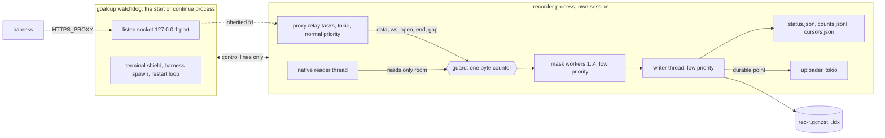

# PRD-02: Recorder core (one process pipeline, guards, writer, watchdog)

Id: PRD-02. Version: goalcup 1.0. Date: 29 October 2026. Base: main at 4b226de2.
Index: [PRD-00](PRD-00-index.md). Format: [PRD-01](PRD-01-record-format.md) (binding).

## Goal

One process carries every recorded byte from the proxy and the session-file reader through masking
to the part files, with no IPC, no producers and no failure budget. Any loss is a gap with a start
and an end, the harness is never slowed, and a dead recorder is back on the same port at once.

## Points served

3 (lead: never block or slow the harness, note a gap and go on), 1 and 2 (no cap of ours on calls,
streams, connections or subagents), 5 (the durable point the uploader sends from), 6 (written
counts and off time in `status.json`). Point 4 through the rule that raw bytes live only in memory
until PRD-05's masker has seen them (D14).

## Owner decisions it carries out

- Architecture option B, one process: proxy, native reader, masking, writer and uploader in the
  goalcup process. The proxy to daemon hand-off (IPC, producers, epochs, the shared queue, failure
  budgets) is removed (BRIEF3, 29 Oct evening).
- No caps of our own. Only stated memory guards that never stop recording: past one, write a gap
  and go on.
- Never block the harness. A drop caused by load never counts toward "the recorder is dead". Loss is
  never silent. Count a request only once its bytes are written. Show how long recording was off.
- Proxy failure: the recorder restarts itself on the same port fast, writes a gap for the dead time
  and marks the failure. A tiny watchdog that only restarts the recorder is allowed (29 Oct night).
- Check open file handles first (macOS default 256 per process) and raise the limit.
- Disk full: no special handling. The harness stops and the participant cleans up.
- Fresh core: copy only proven tricky parts; old crates are deleted in the same build.

## Today

| What | Where (src lines, `wc -l`) | Fact that matters here |
|---|---|---|
| The shared queue | `crates/goalcup-protocol/src/capture.rs:51` | 8 MiB for every producer of an entry, controls included |
| Stream and connection bounds | `capture.rs:58`, `:60`, `:63`, `:66` | 128 open streams, 128 connections, 65,536 producer IDs, 128 live producers |
| Sink refusal loses the whole producer | `crates/goalcup-daemon/src/runtime/capture/sink.rs:246-283` (file 556) | One frame that does not fit calls `lose(&mut state, &id, reason)` at `:279` |
| New epochs refused under load | `sink.rs:322` | `Pending` while the queue is over half full |
| Owner thread does everything | `runtime/capture/owner.rs:162-196` (file 388) | Drains the queue, runs every redactor and polls native files on one thread; sync every 800 ms (`:10`), native poll every 100 ms (`:16`), 256 items per drain (`:28`) |
| Failure budget | `crates/goalcup-cli/src/proxy/ingest.rs:98-108, 455-472` (file 1,177) | `MAX_CONNECTION_FAILURES = 10`, `STABLE_EPOCH = 60 s`, `latch_terminal` ends wire capture for good |
| Daemon ingest receiver | `crates/goalcup-daemon/src/ingest.rs` (1,356) | Socket, handshake, JSON frames with byte arrays as numbers (about 3.6 bytes per payload byte, M section 1.1 step 4) |
| Emitter terminal latches | `crates/goalcup-cli/src/proxy/api.rs:451-453, 599-601, 671-683` (file 824) | 129th stream or connection disables capture; one `Loss` per reason per launch |
| Native latches on refusal | `crates/goalcup-daemon/src/native_capture.rs:940-975` (file 1,632) | Any `Disabled` answer latches native off for the life of the adapter; caps at `:279-280` (32 streams, 1,024 files) |
| Redactor hold | `crates/goalcup-daemon/src/redact/stream.rs:125` (file 4,008, about half inline tests) | At most 16 KiB undecided per stream, fail closed past it |
| Proxy runtime | `crates/goalcup-cli/src/commands/start/proxy.rs:96-100` (file 437) | One tokio worker thread; the proxy dies with `goalcup start` (`:64-65`) |
| Open-file raise | `commands/start/proxy.rs:27, 33-62` | Soft limit raised to 2,304 (2 x 1,024 connections + 256) |
| Connection cap and 503 | `crates/goalcup-cli/src/proxy/mod.rs:112, 120, 991-996` (file 1,532) | The 1,025th connection gets a 503 |
| Accept loop restart cap | `proxy/mod.rs:1022`, `:1050-1100` | 5 restarts, then the port is no longer served; a rebind window refuses connections |
| Terminal sharing | `crates/goalcup-platform/src/terminal.rs:1-60` (file 482) | The harness shares the host's process group; the host catches (never ignores) SIGINT, SIGQUIT, SIGTSTP, SIGHUP |
| Native handle budget | `crates/goalcup-platform/src/handle_budget.rs:13` (file 79) | 32 handles for native capture |

Run 1 (`docs/research/results/2026-10-30-two-hour-run.md` on `origin/smart/tender-clarke-qupne3`,
measure 7): the daemon used 50 to 52 MB RSS and 17 to 18 open files; `goalcup start` 19 to 67 open
files; Codex up to 97. Recorded payload was about 0.25 MB/s on average, with bursts of about
30 MB when 20 subagents resent 1.5 MB contexts after a rate-limit window (M section 3, ask 2).

## Design

### 1. The shape



- **One recorder process per entry.** It holds the proxy, the native reader, the mask workers, the
  writer and the uploader. Nothing crosses a process boundary except a few control lines with the
  watchdog (section 8). No recorded byte is ever serialised for another process.
- **Threads.** Relay tasks on a tokio runtime (PRD-03 sets the count; default 2, since masking
  leaves the relay). One native thread (PRD-04). One to four mask workers. One writer thread. The
  uploader on the same tokio runtime (PRD-06). Mask workers, the writer and the native thread run
  at low priority (Linux `setpriority` per thread, nice 10; macOS `QOS_CLASS_UTILITY`), so a busy
  machine serves the harness and its relay first. Run 1's owner thread did masking, native polls
  and writing on one thread (`owner.rs:162-196`); that is split here.
- **One source of truth for loss.** Bytes are dropped in exactly one place, the guard at the front
  of the pipeline. Inside the pipeline every stage waits for the next one; that wait can never
  reach a relay, because the relay only offers and never waits.

### 2. The recorder handle (seam S1, owned here)

```rust
#[derive(Clone)] pub struct Recorder { /* Arc inside */ }
impl Recorder {
    pub fn open(&self, kind: StreamKind, conn: Sid, req: Sid, from: u64,
                flags: OpenFlags, meta: serde_json::Value) -> StreamHandle;
    pub fn event(&self, ev: serde_json::Value);           // start facts, notes, launch, exit
    pub fn room(&self) -> u64;                            // bytes free under the soft guard
    pub fn native_cursors(&self) -> Cursors;              // durable file offsets from the last boot or entry
    pub fn now(&self) -> Mono;                            // CLOCK_BOOTTIME or mach_continuous_time, ns
    pub fn counts(&self) -> Counts;                       // seam S4
    pub fn durable(&self) -> tokio::sync::watch::Receiver<Durable>;   // seam S4
}
pub struct StreamHandle { /* sid, next_off, open gap; owned by one task, not Clone */ }
impl StreamHandle {
    pub fn sid(&self) -> Sid;
    pub fn data(&mut self, t: Mono, bytes: bytes::Bytes);
    pub fn ws(&mut self, t: Mono, opcode: u8, fin: bool, bytes: bytes::Bytes);
    pub fn gap(&mut self, reason: GapReason, start: Mono, lost: Option<u64>, tail: Option<Value>);
    pub fn end(self, t: Mono, reason: EndReason, tail: Option<Value>);
}
impl Drop for StreamHandle { /* no end() called: END interrupted */ }
```

Rules every caller can rely on:

1. **Nothing blocks and nothing returns a value the caller must act on.** Every call is an atomic
   load, a counter update and an unbounded channel send of an `Arc` byte buffer. No lock is held
   across a call. A call after the seal is a no-op.
2. **Offsets are kept by the handle.** `from` is the first offset (0 for wire streams; the resumed
   file offset for native, section 9.3). Each `data` or `ws` piece moves `next_off` by its length,
   written or dropped. A caller that knows of its own loss (a decode that broke, a truncated file)
   calls `gap()`; the handle never invents a reason.
3. **Pieces over 256 KiB are split** into DATA records of at most 256 KiB (PRD-01 section 2). A
   WebSocket message keeps its opcode on every piece and `fin` on the last.
4. **`flags`** carry what the writer counts without parsing JSON: `POST`, `DECRYPTED`, `TUNNEL`.
   `meta` is masked by PRD-05's `mask_meta` on the stream's mask worker, never on the relay.
5. **Relay first, record second** (PRD-03's duty): forward the bytes to the peer, then offer the same
   `Bytes` (a reference count, no copy). Decoding (gzip, br, zstd, deflate, WebSocket inflate) stays
   on the relay before the offer, so a guard drop never breaks a decoder's state: the dropped bytes
   are decoded bytes and the decoder goes on.

### 3. Memory guards

There is one counter, `held`: bytes offered and not yet written to a part file. It covers the
mask worker queues, the masker hold, the channel to the writer and the writer's input. It goes up
on offer and down when the writer has handed the record to the compressor. It has two thresholds.

| Guard | Default | What passing it does | What it guards |
|---|---|---|---|
| **Soft** | 512 MiB, or one eighth of RAM if that is smaller (floor 128 MiB) | The offered DATA or WS piece is dropped and counted on its stream's open gap. OPEN, END, GAP and EVENT items are always admitted (they are small). Native reads only `room()`, so native never drops | The participant's memory. Run 1's worst burst was about 30 MB, 65 MB with 43 subagents (M section 3); 512 MiB is about 8 times that |
| **Hard** | 2 x soft | The recorder exits with code 75. The watchdog restarts it; the next boot writes `recorder_down` with cause `memory_guard_hard` | Memory when the writer is stuck for a long time (a hung disk) and control items keep coming |

The gap rule, kept entirely inside the `StreamHandle`, so no shared map is needed:

- The first dropped piece opens a gap on that stream: start wall and monotonic time = that piece's
  time, `off` = `next_off`, lost = its length. Later drops add to `lost`.
- A stream in a gap admits its next piece only when `held` is under three quarters of the soft guard
  (hysteresis, so one stream does not flap into thousands of tiny gaps). Streams not in a gap admit
  up to the soft guard.
- When a piece is admitted again, the handle first sends `GAP {reason memory_guard, start, end =
  this piece's time, off, lost + 1, tail {"guard":"held_bytes","limit":<soft>}}`, then the DATA.
- `end()` or `Drop` while a gap is open sends the GAP (end = the end time), then END. `END.seen`
  counts every offered byte, written or dropped.
- At the seal, an open gap is closed by the seal's own GAP `cut_at_seal` (section 11).
- Live counters for status: `dropped_bytes` (all bytes dropped this boot) and `streams_in_gap`.
  `goalcup status` can say "losing data now" before any GAP record exists (PRD-01 section 7).

Fairness: one guard means the stream that offers when memory is full loses bytes, which may be a
small WebSocket message while a large body is held. Accepted; the hysteresis and the 3/4 rule give
streams in a gap a lower claim. Per-stream shares are not built.

### 4. Masking off the relay: mask workers

- `N = clamp(available_parallelism / 2, 1, 4)` workers. A stream is pinned to worker `sid % N` at
  OPEN, so all its records pass one worker in order. Each worker owns the `StreamMasker`s of its
  streams (seam S2, PRD-05).
- Per item: OPEN runs `mask_meta`; DATA runs `push(bytes)` and gets back masked bytes of the same
  length and the masked spans; GAP first calls the masker's `gap()` (held bytes decided as end of
  input, PRD-05) and then passes the GAP on; END calls `finish()`. The worker emits DATA, then one
  MASK record per span (PRD-01 section 8), then the next item.
- A DATA record's time is the time of the earliest input piece whose bytes it holds (the hold can
  merge pieces). Its `off` is the source offset of its first byte, which equals the record offset
  because masks keep length.
- **A masker panic never writes raw bytes.** Each item runs inside `catch_unwind`. On a panic the
  piece is dropped, the stream's masker is replaced with a fresh one, and the worker writes a GAP
  with reason `mask_failed` (an ask of PRD-01) and the piece's length. The stream goes on.
- Worker to writer: one bounded channel of 256 records per worker. A full channel makes the worker
  wait. That wait never reaches a relay: it only lets `held` grow until the soft guard drops at the
  front.

### 5. The writer thread

One thread owns one `goalcup_format::PartWriter` (seam F1). Its loop:

1. Receive a record (1 s timeout). Write it. Subtract its offered size from `held`. Update the
   written counters and the per-sid table (kind, whether a GAP was written, native path and offset).
2. LINK when a second has passed since the last link and records were written, when 16 MiB raw wait
   since the last link, before rotation, and at the seal (PRD-01 section 10). Check the clock at
   each link and add `{"ev":"clock"}` when wall time moved more than 2 s from monotonic time.
3. COUNT every 60 s (PRD-01 section 9), followed by a LINK. Append the same counts with the link's
   `seq` to `counts.jsonl` (local only), so a later boot can sum boots without decoding parts.
4. `fdatasync` the part, then the index, at most every 5 s and at the seal. Then publish the
   **durable point** (part path, `c_end`, `raw_end`, link `seq` and hash) on the `watch` channel
   (seam S4) and write `cursors.json` (native path to generation and written offset) by atomic
   rename.
5. Every second, write `status.json` by atomic rename (section 6).
6. Rotate when PRD-01's rule says so.

A write error (EIO, ENOSPC, EMFILE on a new part) or a writer panic ends the process with exit code
74 (write error) or 70 (panic). There is no in-process retry: the restart path of section 8 is the
one recovery path, and it truncates to the last index line exactly as after a crash. Disk full
therefore gets no special handling: each boot fails, the watchdog moves to null mode (section 8),
the harness keeps working, and status says "recording off: disk write failed".

### 6. Written counts and off spans

- **Counted at write, by the writer only.** The keys are PRD-01 section 9's. `http_post` counts
  `http_req` OPENs written with `POST` and `DECRYPTED`; `ws_up_msgs` counts `ws_up` DATA written with
  `fin` and a text or binary opcode. `http_post + ws_up_msgs` is "model requests written". Nothing
  counts at selection (run 1 counted at selection: `proxy/http.rs:306-320`).
- **Entry totals** = the sum over earlier boots of their last durable COUNT (from `counts.jsonl`,
  keeping only lines whose link `seq` is at or below the recovered last link) plus this boot's live
  counters.
- **Off time** = the sum of the lengths of `sid 0` gaps (`recorder_down`). Status adds the open span
  while the recorder is in null mode (the watchdog writes `status.json` then, section 8).
- **`status.json`** (written here, read by PRD-10 and PRD-06):

```json
{"v":1,"updated":"2026-11-07T10:00:01Z","pid":4242,"boot":2,"mode":"recording",
 "written":{"model_requests":905,"http_post":243,"ws_up_msgs":662,"conns":120,"tunnels":118,
            "native_files":43,"native_bytes":48200000,"gaps":3,"lost_bytes":1500000},
 "losing":{"streams_in_gap":0,"dropped_bytes":0},
 "off":{"spans":1,"ms":2300,"since":null},
 "held_bytes":1048576,"held_peak":67108864,"guard":536870912,"writer_idle_ms":12,
 "durable":{"seq":3601,"raw_end":726000000},"deadline":"2026-11-14T00:00:00Z"}
```

`mode` is `recording`, `losing` (some stream in a gap), `writer_slow` (records wait and nothing was
written for 10 s; display only), `null` (records nothing), or `sealed`. The participant and the
heartbeat see `written`, `losing` and `off`; never an offered or selected count.

### 7. Never block or slow the harness: the rules

1. A relay never waits on recording. Its only calls are S1's (section 2, rule 1).
2. No backpressure on the wire. Backpressure exists only inside the pipeline and on native reads,
   where the file is the buffer (`room()`).
3. Loss under load is a stream gap, never a recorder state. There is nothing to count toward "dead":
   no producer, no epoch, no socket between proxy and recorder.
4. No cap on connections, streams, subagents, files or bytes. The only limits are the two memory
   guards (section 3) and the operating system's file limit (section 10), and neither refuses a
   harness connection.
5. Recording work runs at low priority; relays at normal priority.
6. A crash of the recorder resets the harness's open connections once; new connections wait in the
   kernel backlog for the restart (section 9). A crash loop falls back to null mode so the harness
   keeps working.

### 8. The watchdog (seam S8, owned here)

The watchdog is the `goalcup start` or `goalcup continue` process itself, after PRD-10 has done the
login, server approval and connector checks. PRD-10 calls `watchdog::run(plan) -> ExitCode`.

1. **Raise the open-file limit** (section 10), before anything else, so both children inherit it.
2. **Bind** `127.0.0.1:0` with `socket2`, backlog 4,096 (the kernel clamps it to `somaxconn`), with
   `FD_CLOEXEC` set. Make one `socketpair` for control lines. Keep both open for the whole run.
3. **Start the recorder**: the same `goalcup` binary with a hidden subcommand. In `pre_exec`:
   `setsid()` (terminal signals and a closed window never reach it), `dup2` the listener to fd 3 and
   the control socket to fd 4, clear `FD_CLOEXEC` on those two only. The harness never inherits them.
   First control line to the recorder: the start facts, the proxy credential and how the previous boot
   ended (`{"code":n}` or `{"signal":n}`). The credential travels only on this line, never in argv,
   env, a log or a record.
4. **Wait for `ready`** from the recorder (proxy accepting, part opened) for at most 10 s on the
   first boot only. If the first boot fails, refuse to launch the harness (nothing to break yet).
5. **Spawn the harness** from PRD-11's `LaunchPlan` (seam S3): its argv and env, plus `HTTPS_PROXY`
   with the fixed port and credential, in the watchdog's own process group (a TUI must stay in the
   terminal's foreground group: `crates/goalcup-cli/src/launch.rs:75-80`). Take the terminal shield
   copied from `goalcup-platform/src/terminal.rs` (catch, never ignore, SIGINT, SIGQUIT, SIGTSTP,
   SIGHUP; ignore SIGTTOU only after the fork: `terminal.rs:11-16`).
6. **Restart loop.** When the recorder exits without having sealed, start the next one at once. The
   port never closes because the watchdog holds the listener; connections made meanwhile wait in the
   backlog. Pause between restarts: 0, 0.1, 0.5, 1, 2, then 5 s, reset after 10 minutes alive.
   There is no restart cap.
7. **Null mode.** After 3 exits within 10 minutes, each less than 60 s after its start, the next
   recorder starts with `--null`: the proxy relays exactly as normal, every S1 call is a no-op, the
   writer does not run, the uploader still sends what is on disk. The watchdog writes
   `status.json` with `mode: "null"` and the time it began. After 5 minutes a normal boot is tried
   again; each failed try doubles the wait, up to 60 minutes. The next normal boot's `recorder_down`
   gap covers the whole span, with tail `{"cause":"null_mode","exits":n,"last":{...}}`.
8. **Forward facts**: harness exit (code or signal), the seal command (SIGUSR1 to the watchdog, sent
   by `goalcup seal`), and the deadline. Wait for `sealed` from the recorder, then hand over to the
   uploader's finish (PRD-06, PRD-10).

Control lines are one JSON object per line, at most 64 KiB, and carry no recorded bytes. Losing the
control socket never stops recording (section 9.2).

Size target: the watchdog about 350 src lines, of which about 200 are the copied shield.

### 9. Crash and restart

#### 9.1 What an `HTTPS_PROXY` harness sees

| What dies | Harness's open connections | New connections | Recording | How it ends |
|---|---|---|---|---|
| The recorder (crash, OOM kill, `kill -9`, exit 70, 74 or 75) | Reset once; the harness retries (Codex: `stream_max_retries` 5 and `request_max_retries` 4 by default; Claude Code's retry watchdog; others unverified, `docs/plans/2026-10-30-audit/F-week-long-risks.md:597-607`) | Wait in the kernel backlog, then are served by the next boot | One `recorder_down` gap from the last durable LINK to the next boot's first record | Automatic |
| Recorder crash loop | As above, each time | Served by the null-mode recorder | Off, shown in status with its start time | Automatic retry of normal mode |
| The watchdog only | Unaffected: the recorder holds the listener and serves on | Served | Goes on | The recorder sees EOF on fd 4, then watches the harness pid every second (pid plus start time, against reuse). When it is gone, or at the deadline, it seals with reason `harness_exit` (exit null) or `deadline` |
| Both (power loss, laptop crash, `kill -9` of both) | Refused: nobody holds the port | Refused | Off until the participant acts | `goalcup continue` closes the dead entry (9.3) and starts a new one. The harness must be restarted too |

The recorder never asks the harness to wait and never sets a base URL. The only harness-visible
effect of a recorder crash is one connection reset per open connection, the same as a network blip.

#### 9.2 How a boot starts (in this order)

1. Read the control line. Take the entry lock (`rec/lock`, `flock`); if another live recorder holds
   it, exit 0 at once (two recorders never write one entry).
2. Start the proxy on fd 3 at once (PRD-03). Records offered from now on wait under the guard.
3. On the writer thread: `PartWriter::recover()` (PRD-01 section 12): truncate to the last index
   line, close the frame, write the recovery frame with `GAP {sid 0, recorder_down, start = last
   LINK, end = now, lost 0, tail {"cause": <from the previous exit>, "prev": {...}}}` and a LINK.
   The boot number is the last PART's boot plus one, read from the part, not from the watchdog, so
   boots stay contiguous even after null-mode spans. Then PART, `start` (with `resume: true`),
   `prev_boot`, then the queued records.
4. Start the native reader with the cursors of section 9.3, then the uploader. Send `ready`.

Streams that were open in the dead boot have no END; the reader reads them as cut by the
`recorder_down` gap (PRD-01 section 7). In-flight requests are not resumed; the harness's retry is a
new request on a new stream.

#### 9.3 Native resume, across boots and entries

- `cursors.json` holds, per session file path (the ID), the generation, a file identity (device and
  inode) and the offset durably written. It is written only at a durable point (section 5, step 4).
- A new boot gives PRD-04 these cursors through `Recorder::native_cursors()`. A file with the same
  identity is reopened as a new `native` stream in this boot with `from` = its cursor. Bytes written
  after the last durable point and lost in the crash are therefore read again from the file: native
  loses nothing across a crash. A file whose identity changed starts a new generation from 0.
- `goalcup continue` copies the previous entry's `cursors.json` into the new entry, so a week of
  rollouts is never read twice. This needs PRD-01 to accept a stream that starts at `meta.from`
  (ask 3).

#### 9.4 `goalcup continue` after a dead entry

`pipeline::close_dead_entry(entry_dir)` (called by PRD-10 before `continue` starts a new entry, and
by `goalcup seal` on an entry with no live recorder):

1. Take `rec/lock`. If it is held, a recorder still lives: return `StillRecording` and let PRD-10
   tell the participant to run `goalcup seal` first.
2. Recover the last part as in 9.2 step 3, but the recovery frame holds `GAP {sid 0,
   recorder_down, start = last LINK, end = now, tail {"cause":"abandoned"}}`, the last counts, a
   `seal` event with reason `recovered` (ask 4), a LINK and the frame end, and an `E` index line.
   Nothing is appended after it.
3. Leave the parts for the uploader (PRD-06 uploads and commits the dead entry before or alongside
   the new one).

The tail says `"harness":"unknown"`: when both processes died, nobody knows whether the agent ran
in between, and the participant text must say so (PRD-10).

### 10. File handles and the open-file raise

| Holder | Descriptors |
|---|---|
| Each relayed connection, decrypted or tunnelled | 2 (client and upstream) |
| Listener, control socket, stdio | 5 |
| Part and index (4 for a moment at rotation) | 2 to 4 |
| `status.json`, `cursors.json`, `counts.jsonl` (opened, written, closed) | 1 at a time |
| Native reader: one parent chain and one file per poll, plus retained roots per source (PRD-04) | about 10 to 30 (`native_capture.rs:76-81`; run 1's daemon held 17 to 18 in all) |
| Uploader HTTP connections | 1 to 4 |
| Seal: `git` child pipes | 3, briefly |

So the recorder needs about 64 fixed descriptors plus 2 per open connection.

- **Raise** (watchdog step 1, copied from `commands/start/proxy.rs:33-62` with the target changed):
  set the soft `RLIMIT_NOFILE` to the hard limit. On macOS clamp it to `min(OPEN_MAX, hard)`
  (10,240), because `setrlimit` refuses `RLIM_INFINITY` there (Apple setrlimit(2) man page,
  [link](https://developer.apple.com/library/archive/documentation/System/Conceptual/ManPages_iPhoneOS/man2/setrlimit.2.html);
  `F-week-long-risks.md:131-133`). If that fails, try 4,096, then keep what we have. Log the result
  once and put it in the `start` event (`fd_limit`). The harness and the recorder inherit it.
- **Reserve** (an interface PRD-03 calls before each `accept`): `pipeline::fds::may_accept()` is
  true while `2 x open connections + 64` is under the limit. When false, the accept loop waits 10 ms
  and tries again, so new connections wait in the backlog: slower, never refused. A `note` event
  `fd_limit` is written once per episode with the limit and the connection count. The 1,024 task cap
  and the 503 (`proxy/mod.rs:112, 120, 991-996`) are gone.
- On a 256 default whose raise fails, about 96 connections can be open at once; the rest wait.
  Run 1's Codex with 20 subagents held up to 97 descriptors itself (measure 7), so this is the case
  the macOS pad run must watch.
- The native handle budget (`handle_budget.rs:13`, 32 handles) is not copied.

### 11. The seal

Triggers: harness exit (watchdog line), the deadline (the recorder's own timer from the start
facts), the seal command (watchdog line), SIGTERM to the recorder (reason `signal`).

1. Stop admitting new streams' payload: every S1 call after this point is a no-op. Relays keep
   relaying until the watchdog exits.
2. Drain: wait until `held` is 0, at most 60 s (5 s for `signal`).
3. Native finish (PRD-04: `native::finish(&recorder, harness_exited)`), final database snapshots
   after harness exit, within PRD-04's budget.
4. Writer: for every sid with records still unwritten, a `GAP cut_at_seal` with their bytes; for
   every open gap, a GAP ending at the seal; for every sid still open, `END cut_at_seal`. Then
   COUNT, the `seal` event (reason, exit, `workspace_head` from `git rev-parse HEAD`, `dirty` = SHA-256
   of `git status --porcelain -z`, each `git` call with a 10 s budget, null on failure), boots and
   totals, LINK, frame end, `E` line, `fdatasync`, durable point.
5. Send `sealed`, write `status.json` with `mode: "sealed"`, let the uploader finish (PRD-06).

### 12. The silent-loss paths of run 1, P1 to P14

From `docs/plans/2026-10-30-audit/M-two-hour-run.md:99-114`. Each is impossible by design or a gap
with a start and an end.

| P | Run 1 path | In 1.0 | Why | Test |
|---|---|---|---|---|
| P1 | Daemon queue full drops the whole producer (`sink.rs:279`) | Gap | No producer exists. Only the offered piece of one stream is dropped; that stream gets a `memory_guard` GAP with start, end, `off` and lost bytes; every other stream records on | `pipeline_guard.rs` |
| P2 | Proxy queue full (`proxy/ingest.rs:513-516`) | Impossible | There is no second queue: the one guard is the only drop point (P1) | `pipeline_guard.rs` |
| P3 | Failure budget latches wire capture off (`proxy/ingest.rs:98-108, 455-472`) | Impossible | No socket, epoch or failure count between proxy and writer. A recorder crash is a process restart with a `recorder_down` gap | `pipeline_no_latch.rs`, kill test |
| P4 | New epoch `Pending` past 5 s (`sink.rs:322`) | Impossible | No epochs. OPEN is always admitted | `pipeline_guard.rs` |
| P5 | Entry-wide 128 open streams (`sink.rs:425`) | Impossible | No stream bound. Per-stream memory (masker hold) is inside `held` | `pipeline_many_streams.rs` (20,000 streams) |
| P6 | Emitter 129th stream disables capture (`proxy/api.rs:451-453`) | Impossible | No emitter, no bound | `pipeline_many_streams.rs` |
| P7 | Emitter 129th connection (`proxy/api.rs:599-601`) | Impossible | No bound; descriptors are handled in section 10 by waiting, not refusing | `pipeline_many_streams.rs`, PRD-03 accept test |
| P8 | Capture table full, connection relayed raw (`proxy/mod.rs:1381-1392`) | Impossible | No table. Every connection is a `conn` stream, decrypted or tunnelled | PRD-03 |
| P9 | 65,536 producer IDs spent | Impossible | No producer IDs. `sid` is a u64 varint, never reused in a boot | none needed |
| P10 | One `Loss` per reason per launch (`proxy/api.rs:671-683`) | Impossible | Every loss is its own GAP on its own stream; every tunnel is its own `conn` stream. Nothing deduplicates | `pipeline_guard.rs` counts one GAP per drop episode per stream |
| P11 | Local framing error latches terminal | Impossible or gap | Records are built by the pipeline from typed calls, so a record cannot be malformed. A pipeline thread panic exits 70 and is a `recorder_down` gap | `pipeline_panic.rs` |
| P12 | Refused `Recovery` frame | Impossible | No recovery frames between processes. Boot recovery is local file work (PRD-01 section 12) | `pipeline_restart.rs` |
| P13 | Redactor refuses a frame; the producer is dropped silently while the sink admits it (`owner.rs:296-341`) | Gap | The masker has no refusal path. A masker panic drops only that piece and writes a `mask_failed` GAP; the stream goes on. A bad connector rule fails `goalcup start` before the harness launches | `pipeline_mask_panic.rs` |
| P14 | Native refused, latched off for the life of the adapter (`native_capture.rs:940-975`) | Impossible | Native reads only `room()` and never meets a refusal; unread bytes stay in the file. Across a crash it resumes from durable cursors (9.3) | `pipeline_native_room.rs` |

The rest of M's list, for completeness: P15 to P17 (native caps and finish budget) are PRD-04's and
have no cap. P18 (masker hold) is PRD-05's and masks, never loses. P19 (8 MiB per decoded read)
goes: decoding streams with no size bound (PRD-03). P20 (writer drops inadmissible records) cannot
happen: the writer writes every record it gets. P21 and P22 (write error, disk full) are exit 74
and a `recorder_down` gap, then null mode while the disk is full. P23 (accept loop restart cap) and
P24 (1,024 tasks, 503) are gone (sections 8 and 10). P25 (upload) is PRD-06's and loses nothing
local.

### 13. What moves from the old crates, and what is deleted

Nothing is linked from the old crates. "Copied" means a builder reads the old code and writes the
same behaviour into the new file, keeping the old tests' cases as acceptance cases where they apply.

| Old part (src lines incl. inline tests) | Fate in 1.0 | Who |
|---|---|---|
| `goalcup-daemon/src/redact.rs` (1,279), `redact/stream.rs` (4,008) | Rules, corpus and the hold algorithm copied into `src/mask/` in the same-length `*` form | PRD-05 |
| `goalcup-daemon/src/runtime/capture/writer.rs` (391) | Deleted. Replaced by `PartWriter` (PRD-01) and `src/pipeline/writer.rs`. Idea kept: closures (OPEN, END, GAP) are never refused | PRD-01, here |
| `runtime/capture/owner.rs` (388) | Deleted. Its one thread becomes mask workers, the writer thread and the native thread | here |
| `runtime/capture/sink.rs` (556), `goalcup-daemon/src/ingest.rs` (1,356), `goalcup-cli/src/proxy/ingest.rs` (1,177) | Deleted. No queue protocol, no producers | PRD-13 |
| `goalcup-daemon/src/native_capture.rs` (1,632), `runtime/capture/native_plan.rs` (311) | Discovery, generations and no-follow reads copied; caps, admission latch and handle budget dropped | PRD-04 |
| `goalcup-platform/src/sourcecap.rs` and `sourcecap/unix.rs` (616 + 669) | No-follow open chain copied | PRD-04 |
| `runtime/capture/mod.rs` (1,346), `finish.rs` (763), `harness.rs` (118), `harness_build.rs` (179) | Deleted. Seal flow rewritten in `src/pipeline/seal.rs` (section 11) | here |
| `runtime/daemon.rs` (640), `runtime/mod.rs` (117), `bin/goalcup-daemon.rs` (259), `control/*` (1,714), `registry.rs` (1,009), `status.rs` (149), `config.rs` (236), `fsutil.rs` (317) | Deleted. Private-file creation (0600 in a 0700 folder) is rewritten in a few lines in `src/pipeline/status.rs` | PRD-13 |
| `terminate/*` (2,498), `runtime/termination.rs` (285) | Deleted (termination proof is cut). Ending the harness at the deadline, if kept, is PRD-10's | PRD-13, PRD-10 |
| `workspace.rs` (485), `workspace_git.rs` (549) | Deleted. The seal's two `git` calls replace them (section 11) | here |
| `goalcup-cli/src/commands/start/proxy.rs:33-62` (open-file raise) | Copied into the watchdog with the new target | here |
| `goalcup-platform/src/terminal.rs` (482) | `Shield` copied into the watchdog | here |
| `goalcup-cli/src/launch.rs` (2,090), `subreaper.rs` (617) | Deleted. The watchdog spawns from `LaunchPlan` in about 60 lines | here, PRD-11 |
| `goalcup-cli/src/proxy/mod.rs:1022-1100` (accept restart cap) | Deleted | PRD-03 |

Daemon crate today: 23,045 src lines (including `runtime/capture/tests.rs`, 2,340) and 30,260 lines
under `crates/goalcup-daemon/tests/`. PRD-13 deletes all of it.

## Files it owns

Create:

- `crates/goalcup/Cargo.toml`: the scaffold with every dependency of the crate, declared once
  (PRD-00). This PRD's own: `goalcup-format`, `bytes`, `crossbeam-channel`, `serde_json`, `libc`,
  `socket2`, `tokio` (with `sync` and `rt-multi-thread`). Other PRDs name theirs in the night log in
  the first hour; the scaffold adds them.
- `crates/goalcup/src/lib.rs`: the module list, frozen after the scaffold.
- `crates/goalcup/src/pipeline/`: `mod.rs` (`Recorder`, `run_recorder`), `handle.rs`
  (`StreamHandle`, the gap rule), `guard.rs`, `mask_pool.rs`, `writer.rs`, `counts.rs`, `clock.rs`,
  `status.rs`, `cursors.rs`, `seal.rs`, `boot.rs`, `dead.rs` (`close_dead_entry`), `fds.rs`.
- `crates/goalcup/src/watchdog.rs` (see ask 7 for a folder).
- `crates/goalcup/tests/pipeline_*.rs`, `tests/watchdog_*.rs` (the second name is an ask of PRD-00).
- Local files in the entry folder: `rec/lock`, `status.json`, `counts.jsonl`, `cursors.json`.

Must not touch: `src/proxy/` (PRD-03), `src/native/` (PRD-04), `src/mask/` (PRD-05), `src/upload/`
(PRD-06), `src/connector/` (PRD-11), `src/cli/` and `src/main.rs` (PRD-10), `crates/goalcup-format/`
(PRD-01), `crates/goalcup-verify/` (PRD-08, PRD-09), `server/` (PRD-07), `connectors/` (PRD-11),
the old crates (PRD-13).

## Interfaces with other PRDs

| PRD | What crosses | Direction |
|---|---|---|
| PRD-01 | `PartWriter::{open, recover, write, link, rotate_if_due, seal}`, `Record`, `StreamKind`, `GapReason`, `EndReason`, `IndexLine` (F1) | Used here |
| PRD-03 | S1 (`open`, `data`, `ws`, `gap`, `end`), `proxy::serve(listener: std::net::TcpListener, recorder: Recorder, hosts) -> ProxyHandle`, `pipeline::fds::may_accept()`. PRD-03 must: relay first, then offer the same `Bytes`; decode before the offer; never hold a lock across an S1 call; never deduplicate losses; read the run CA and credential from the run folder so they are the same in every boot; keep a panic inside one connection's task; stop accepting only while `may_accept()` is false | Both |
| PRD-04 | S1 with `kind = native` or `snapshot`, `from` = cursor; `room()`; `native_cursors()`; `native::run(recorder, sources)` on its own thread; `native::finish(&recorder, harness_exited)` called by the seal | Both |
| PRD-05 | S2: `Masker::stream(kind) -> StreamMasker`; `StreamMasker::{push(&[u8]) -> Masked {bytes, spans}, gap() -> Masked, finish() -> Masked}`; `mask_meta(&mut Value)`; `mask_rules() -> Vec<String>` for the start event. Must be `Send`, keep length, and never return an error. `gap()` is an addition to PRD-00's S2 sketch | Used here |
| PRD-06 | S4: `Counts`, `Durable` on a `watch` channel; `status.json`; the uploader runs on the recorder's tokio runtime and in null mode; it uploads a dead entry closed by `close_dead_entry` | Used there |
| PRD-08 | Gap tail keys written here: `guard`, `limit`, `cause`, `prev`, `exits`, `harness`. Exit codes 70, 74, 75 | Used there |
| PRD-10 | `watchdog::run(plan) -> ExitCode` for `start` and `continue`; `pipeline::close_dead_entry(dir) -> Result<Closed, StillRecording>`; `status.json` schema (section 6); `goalcup seal` sends SIGUSR1 to the pid in `rec/watchdog.pid`, or SIGTERM to the recorder's pid in `status.json` when no watchdog lives | Used there |
| PRD-11 | S3 `LaunchPlan` (argv, env including CA variables, daemons to stop first) | Used here |
| PRD-12 | Pad cases for the kill test, the stalled writer and the low file limit (acceptance below) | Used there |
| PRD-13 | The deletions in section 13 | Done there |
| PRD-14 | A `test-hooks` cargo feature, off in release builds, for the stall and crash hooks below | Used here |
| PRD-15 | A DECISIONS entry: one process, one guard, restart by watchdog, null mode | Written there |
| PRD-17 | Lessons that touch this PRD: the terminal shield (caught, not ignored), the TUI process group, run 1's cause chain | Used here |

## What is cut

| Path | Src lines | Tests that go |
|---|---|---|
| `crates/goalcup-daemon/` (whole crate) | 23,045 | `crates/goalcup-daemon/tests/**` (30,260), among them `it/capture_ingest.rs` (3,095), `it/capture_lifecycle.rs` (3,529), `full/capture_finish_budget.rs` (1,267), `full/process_kill.rs` (1,285), `it/capture_native.rs` (2,664, cases copied by PRD-04) |
| `crates/goalcup-cli/src/proxy/ingest.rs` | 1,177 | `crates/goalcup-cli/tests/it/m2_capture_sender.rs` (1,991), `m2_ipc_compose.rs` (1,606), `m2_emitter.rs` (1,517), `restarts.rs` (497) |
| `crates/goalcup-cli/src/proxy/api.rs` recovery, epochs and latches | about 450 of 824 | in `m2_emitter.rs` |
| `crates/goalcup-cli/src/commands/start/proxy.rs` | 437 | in `start_launch.rs` |
| `crates/goalcup-platform/src/handle_budget.rs` | 79 | its unit tests |
| `crates/goalcup-protocol/src/capture.rs` queue, producer and frame types | most of 847 | `goalcup-protocol/tests/fixtures/m2-ingest/` |

PRD-13 deletes; this PRD only makes them dead. New code here: about 1,300 src lines (pipeline about
950, watchdog about 350) and about 1,500 test lines.

## Acceptance

### Real-run proofs (on the pad, PRD-12, Linux sandbox)

| # | Proof | Pass |
|---|---|---|
| R1 | **Kill test** (PRD-00 done item 2, PRD-01 acceptance 3). A Codex direct-key pad run with one subagent. `kill -9` the recorder twice, 2 minutes apart, while a response streams | The harness finishes its turn with no participant action. The entry decodes; exactly two `recorder_down` gaps, start before end, each under 2 s long; links verify across three boots; the watchdog log shows the first accept after each kill within 1 s; written model requests after the second kill are above zero; the server copy equals local |
| R2 | **Stalled writer.** A Codex run whose prompt asks for 20 subagents, built with `test-hooks`, with `GOALCUP_TEST_WRITER_STALL=90s` at minute 5 and `GOALCUP_TEST_GUARD_MB=64` | The harness never errors from the stall. Time to first byte per call during the stall is within 20% of the minute before it (from the recorded `http_resp` OPEN times against the request's). Every hole is covered by a `memory_guard` GAP (verifier invariant 4); `status.json` showed `losing` during the stall; recorder RSS stayed under guard + 300 MiB; no `recorder_down` gap |
| R3 | **Counts are written counts.** A Claude Code run with one subagent, then `goalcup-verify check` | The seal's `model_requests` equals the verifier's recount; `status.json` never showed a model request count above the written count at that second |
| R4 | **Low file limit.** `ulimit -Sn 256` in the sandbox shell, then the R2 prompt without the stall | `start` event shows the raised `fd_limit`; `/proc/<pid>/limits` of recorder and harness show it; no EMFILE in the logs; no refused connection |
| R5 | **Watchdog death.** `kill -9` the watchdog mid-run in a Claude Code run | The harness goes on; the recorder keeps writing; after the harness exits the entry seals with reason `harness_exit` and exit null within 5 s |
| R6 | **Null mode.** A `test-hooks` build with `GOALCUP_TEST_CRASH_AT_BOOT=4` (crash the first 4 boots after the first) and a forced first `kill -9` | The harness gets answers throughout; `status.json` shows `null` with a start time; the next normal boot writes one `recorder_down` gap with cause `null_mode` covering the span |
| R7 | **Continue after both die.** `kill -9` watchdog and recorder together, then `goalcup continue` | The old entry ends with `seal` reason `recovered` and an `abandoned` gap and is uploaded; the new entry's native streams start at the old cursors (no session file byte is recorded twice: verifier compares offsets per path) |
| R8 | **Writer throughput.** The load test L1 below, run once on the sandbox | Report sustained raw MB/s through mask and writer. Pass: at least 50 MB/s on 4 vCPU (run 1's 30 MB burst then clears in under a second). Below it, the night log names the stage and PRD-06 may lower zstd settings |

### Automated tests that guard them

- `pipeline_guard.rs`: a writer held still by a test hook; 40 streams offer 2 GiB in 1.5 MB bodies.
  Every S1 call returns in under 1 ms at the 99.9th percentile; the decoded record has one GAP per
  drop episode per stream, start before end, holes filled exactly; COUNT equals a recount.
- `pipeline_many_streams.rs`: 20,000 open streams and 5,000 `conn` streams at once, no refusal.
- `pipeline_native_room.rs`: guard full while a 10 MB file grows; after release, every file byte is
  in DATA, no gap.
- `pipeline_mask_panic.rs`: a test masker panics on a marker; a `mask_failed` GAP, the marker's bytes
  appear nowhere in the part, the stream goes on.
- `pipeline_restart.rs` and `watchdog_restart.rs`: the real binary with a fake upstream; `kill -9`
  the recorder; the port is unchanged; a connection made during the restart is served; boot numbers
  are contiguous; `prev_boot` names the signal; cursors resume.
- `pipeline_seal.rs`: open streams end `cut_at_seal`; queued bytes past the drain budget become
  `cut_at_seal` gaps; nothing follows the seal's LINK.
- `watchdog_rlimit.rs`: a soft limit of 256 is raised before both children start.
- `pipeline_no_latch.rs`: 1,000 guard episodes in a row; recording resumes after every one.

L1, `#[ignore]`, run by hand once overnight: a fake upstream, 40 clients sending 1.5 MB POSTs, one
WebSocket at 50 messages a second, 20 minutes; reports mask and writer MB/s, `held_peak` and RSS.

## Risks and blind spots

- **Writer throughput is unmeasured.** zstd with a 2^27 window and long matching, SHA-256 and
  masking per byte: if the sustained rate is below the inflow, a heavy run spends time in gaps. R8
  measures it in phase 1a; the mask workers scale, the writer does not.
- **Memory.** Up to 512 MiB held, plus about 141 MiB of compressor, plus relay buffers: about
  750 MiB peak beside a 400 MB harness. On a small machine the RAM/8 rule lowers the guard. An OOM
  kill is a `recorder_down` gap, not a silent loss.
- **Connection resets on a crash.** A harness without retries shows the agent an error. Hermes and
  most of the 15 are unmeasured (`F-week-long-risks.md:607`). R1 checks Codex only.
- **Backlog limits.** macOS `kern.ipc.somaxconn` is 128 by default and Linux `somaxconn` is 4,096
  since kernel 5.4 (both unverified on the target machines). Past it, a client's SYN is dropped and
  retried after about a second: slower, not refused (unverified on macOS).
- **Null mode records nothing.** A bug that crashes every boot turns a run into off time. It is
  shown, timed and retried, never silent, but it is still loss.
- **The watchdog is the single point of failure for the port only together with the recorder.** If
  both die the harness's calls are refused until the participant restarts.
- **Fairness of one guard** (section 3). A tiny message may lose while a large body is kept.
- **pid reuse** when the watchdog is gone: checked with the process start time, still a small risk.
- **`git` at the seal** may be slow on a huge repo: 10 s budget, then null fields.
- **Low priority threads on macOS** (`QOS_CLASS_UTILITY`) may be throttled on battery more than
  expected (unverified). The owner's Mac run should report `held_peak`.
- **Two writers on one entry** are prevented by `flock`, which does not work on some network
  filesystems. The entry folder is under `$GOALCUP_HOME`, local by default.

## Overridable defaults

| Default | Value | Who may change it |
|---|---|---|
| Soft guard | 512 MiB, or RAM/8 if smaller, floor 128 MiB | PRD-02, with R2 and R8 numbers |
| Hard guard | 2 x soft, then exit 75 | PRD-02 |
| Resume mark for a stream in a gap | 3/4 of soft | PRD-02 |
| Mask workers | `clamp(cores / 2, 1, 4)` | PRD-02 after R8 |
| Relay worker threads | 2 | PRD-03 |
| Background priority | nice 10 (Linux), utility QoS (macOS) | PRD-02 |
| Restart pauses | 0, 0.1, 0.5, 1, 2, 5 s; reset after 10 min alive | PRD-02 |
| Null mode | after 3 exits in 10 min each under 60 s; retry after 5 min, doubling to 60 min | PRD-02 |
| First boot ready wait | 10 s | PRD-10 |
| Seal drain | 60 s (5 s on a signal) | PRD-10 |
| Listen backlog | 4,096 | PRD-03 |
| File-handle reserve | 64 | PRD-03 |
| `status.json` | every 1 s | PRD-10 |
| `writer_slow` display | no write for 10 s while records wait | PRD-10 |

## Builder notes

Order of work:

1. Hour 0 to 1.5 (phase 0): the scaffold. `Cargo.toml`, `lib.rs`, S1, S4 and S8 as compiling stubs
   (`Recorder` whose calls do nothing, `watchdog::run` that spawns the harness with no recorder), so
   PRD-03, PRD-04, PRD-06 and PRD-10 can build at once. Publish the exact signatures in the night log.
2. `clock.rs`, `handle.rs` with the gap rule, `guard.rs`, then the writer thread on `PartWriter`
   (with a pass-through masker until PRD-05 lands). Get one HTTP request through PRD-03 into a part:
   that unlocks phase 1a.
3. `mask_pool.rs` with S2, `counts.rs`, `status.rs`, `cursors.rs`.
4. `watchdog.rs`: socket, rlimit, spawn, restart loop, shield, control lines. Then `boot.rs` with
   recovery and `dead.rs`.
5. `seal.rs`, null mode, `fds.rs`. Then R1 on the pad.

Traps from the audit:

- Never hold a lock across a channel send that can wait. Run 1's emitter held one lock through every
  frame of every subagent (`proxy/api.rs:5-8`; M section 3, ask 2).
- Never count before the write. Run 1 printed "Recording works: 1736 model calls" for 842 recorded.
- Never put the native poll, masking and writing on one thread (`owner.rs:162-196`).
- Never let a load event change a long-lived state. Run 1's every terminal latch (P3, P6, P7, P11,
  P12, P14) was a load event turned into "off for good".
- Never send bytes as JSON numbers or base64 inside the process: `bytes::Bytes` end to end.
- Set `FD_CLOEXEC` on the listener and the control socket, and clear it only in the recorder's
  `pre_exec`. A harness that inherits the listener keeps the port alive after goalcup is gone.
- A caught signal is reset in the child at `exec`; an ignored one is inherited (`terminal.rs:11-16`).
  Never `SIG_IGN` SIGINT in the watchdog before spawning the harness.
- The recorder must start the proxy before recovery: a slow recovery must not hold the harness.
- Recovery reads the boot number from the last PART, never from a counter in the watchdog.

How a watcher proves it in a real run: during any pad run, read `status.json` once a second and check
that `written.model_requests` never goes down and never exceeds the verifier's later recount at that
time. Once per night run R1 and R2, then `goalcup-verify check` on the entry and on the server copy.

## Asks of PRD-00 and PRD-01

1. **PRD-01, a GAP reason `mask_failed` (12):** a masker panic dropped a piece so that no raw byte is
   written. `lost` is the piece's length.
2. **PRD-01, reason 8 `write_error`:** in this design a write error ends the process (exit 74) and the
   next boot's `recorder_down` gap names it in its tail (`"cause":"write_error"`). Please mark reason 8
   reserved, or say it is never written, so the verifier does not expect it.
3. **PRD-01, a stream may start at `meta.from`:** native streams resumed in a later boot or entry
   start at their durable cursor (section 9.3). Invariant 4 becomes "contiguous from `meta.from`"
   (default 0). Without it, native either reads a week of files again or breaks invariant 4.
4. **PRD-01, seal reason `recovered`:** an entry closed by `continue` or `seal` after both processes
   died (section 9.4), with tail `harness: "unknown"`. Today section 11 lists four reasons.
5. **PRD-01, `note` values `fd_limit` and `writer_slow`,** and a start event key `fd_limit`.
6. **PRD-01 section 1, local files:** list `rec/lock`, `counts.jsonl` and `cursors.json` beside
   `status.json` as local only, never uploaded.
7. **PRD-00 ownership:** let `src/watchdog.rs` be a folder `src/watchdog/` (`mod.rs`, `shield.rs`,
   `spawn.rs`) and add `tests/watchdog_*.rs` to PRD-02. The copied shield is about 200 lines.
8. **PRD-00 seam S1:** this PRD refines the sketch: `data(t, bytes)` has no offset (the handle keeps
   it; `open` takes `from`), `open` takes `flags`, and `room()`, `native_cursors()` and `now()` are added.
   Seam S2 gains `StreamMasker::gap()`; please note it for PRD-05.
9. **PRD-00 architecture:** add null mode (section 8, step 7) to "Rules of the shape". It is how the
   watchdog keeps point 3 when the recorder cannot stay up, and it is the one place where recording is
   off while the harness runs.
10. **PRD-00 seam S8:** say that the watchdog is the `goalcup start` or `continue` process itself
    (PRD-10 hands over to `watchdog::run`), that the recorder runs in its own session, and that the
    control socket carries start facts, the credential, harness exit and the seal command, never
    recorded bytes.
