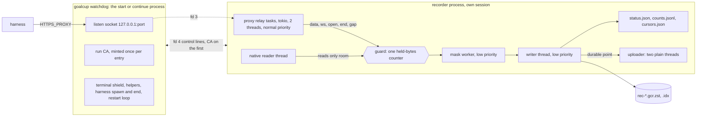

# PRD-02: Recorder core (one process pipeline, guards, writer, watchdog)

Id: PRD-02. Version: goalcup 1.0. Revision 2, 30 October 2026 (revision 1: 29 October). Base: main at
4b226de2. Index: [PRD-00](PRD-00-index.md) revision 2. Format: [PRD-01](PRD-01-record-format.md)
revision 2 (binding).

Revision 2 brings this PRD into line with PRD-00 and PRD-01 revision 2 and answers the three reviews
of 30 October (the consistency check, review A, review B). The last section lists each item and what
was done.

## Goal

One process carries every recorded byte from the proxy and the session-file reader through masking
to the part files, with no IPC for bytes, no producers and no failure budget. Any loss is a gap with
a start and an end, the harness is never slowed, and a dead recorder is back on the same port at once.

## Points served

3 (lead: never block or slow the harness, note a gap and go on), 1 and 2 (no cap of ours on calls,
streams, connections or subagents), 4 (raw bytes live only in the recorder's memory until PRD-05's
masker has seen them, D14; no core dumps, no secret in a panic message), 5 (the durable point the
uploader sends from), 6 (written counts and off time in `status.json`).

## Owner decisions it carries out

- Architecture option B, one process: proxy, native reader, masking, writer and uploader in the
  recorder process. The proxy to daemon hand-off (IPC, producers, epochs, the shared queue, failure
  budgets) is removed (ledger L2).
- No caps of our own. Only stated memory guards that never stop recording: past one, write a gap
  and go on.
- Never block the harness. A drop caused by load never counts toward "the recorder is dead". Loss is
  never silent. Count a request only once its bytes are written. Show how long recording was off.
- The recorder never stops for good (ledger R3): it restarts on the same port fast, writes a gap for
  the dead time and marks the failure. A tiny watchdog that only restarts the recorder is allowed.
- Check open file handles first (macOS default 256 per process) and raise the limit.
- Disk full: no special handling. The harness stops and the participant cleans up.
- Ending the harness at the deadline and on `goalcup seal` stays (owner question 11, default yes).
- Fresh core: copy only proven tricky parts; old crates are deleted in the same build.

## Today

| What | Where (src lines, `wc -l`) | Fact that matters here |
|---|---|---|
| The shared queue | `crates/goalcup-protocol/src/capture.rs:51` | 8 MiB for every producer of an entry, controls included |
| Stream and connection bounds | `capture.rs:58`, `:60`, `:63`, `:66` | 128 open streams, 128 connections, 65,536 producer IDs, 128 live producers |
| Sink refusal loses the whole producer | `crates/goalcup-daemon/src/runtime/capture/sink.rs:246-283` (file 556) | One frame that does not fit calls `lose(&mut state, &id, reason)` at `:279` |
| New epochs refused under load | `sink.rs:322` | `Pending` while the queue is over half full |
| Owner thread does everything | `runtime/capture/owner.rs:162-196` (file 388) | Drains the queue, runs every redactor and polls native files on one thread; sync every 800 ms (`:10`), native poll every 100 ms (`:16`), 256 items per drain (`:28`) |
| Failure budget | `crates/goalcup-cli/src/proxy/ingest.rs:98-108, 455-472` (file 1,177) | `MAX_CONNECTION_FAILURES = 10`, `STABLE_EPOCH = 60 s`, `latch_terminal` ends wire capture for good |
| Daemon ingest receiver | `crates/goalcup-daemon/src/ingest.rs` (1,356) | Socket, handshake, JSON frames with byte arrays as numbers (about 3.6 bytes per payload byte, M section 1.1 step 4) |
| Emitter terminal latches | `crates/goalcup-cli/src/proxy/api.rs:451-453, 599-601, 671-683` (file 824) | 129th stream or connection disables capture; one `Loss` per reason per launch |
| Native latches on refusal | `crates/goalcup-daemon/src/native_capture.rs:940-975` (file 1,632) | Any `Disabled` answer latches native off for the life of the adapter; caps at `:279-280` (32 streams, 1,024 files) |
| Redactor hold | `crates/goalcup-daemon/src/redact/stream.rs:125` (file 4,008, about half inline tests) | At most 16 KiB undecided per stream, fail closed past it |
| Proxy runtime | `crates/goalcup-cli/src/commands/start/proxy.rs:96-100` (file 437) | One tokio worker thread; the proxy dies with `goalcup start` (`:64-65`) |
| Open-file raise | `commands/start/proxy.rs:27, 33-62` | Soft limit raised only to 2,304 (2 x 1,024 connections + 256) |
| Connection cap and 503 | `crates/goalcup-cli/src/proxy/mod.rs:112, 120, 991-996` (file 1,532) | The 1,025th connection gets a 503 |
| Accept loop restart cap | `proxy/mod.rs:1022`, `:1050-1100` | 5 restarts, then the port is no longer served; a rebind window refuses connections |
| Terminal sharing | `crates/goalcup-platform/src/terminal.rs:1-26` (module comment), code `:27-292` (file 482) | The harness shares the host's process group; the host catches (never ignores) SIGINT, SIGQUIT, SIGTSTP, SIGHUP; `Modes` and `wait_resuming` restore the terminal |
| TUI process group | `crates/goalcup-cli/src/launch.rs:75-80` (file 2,090) | A TUI must stay in the terminal's foreground group, so the host can never signal the harness's group without signalling itself |
| Subreaper | `crates/goalcup-cli/src/subreaper.rs:73-74` (file 617) | `PR_SET_CHILD_SUBREAPER` on Linux; the sweep excludes children that started before the harness (`:11-14`) |
| Native handle budget | `crates/goalcup-platform/src/handle_budget.rs:13` (file 79) | 32 handles for native capture |
| Core dumps | `grep -rn "RLIMIT_CORE\|PR_SET_DUMPABLE" crates/` | No hit: nothing turns core dumps off today |

Run 1 (`docs/research/results/2026-10-30-two-hour-run.md` on `origin/smart/tender-clarke-qupne3`,
measure 7): the daemon used 50 to 52 MB RSS and 17 to 18 open files; `goalcup start` 19 to 67 open
files; Codex up to 97. Recorded payload was about 0.25 MB/s on average, with bursts of about
30 MB when 20 subagents resent 1.5 MB contexts after a rate-limit window (M section 3, ask 2).

## Design

### 1. The shape



- **One recorder process per entry.** It holds the proxy, the native reader, the mask worker, the
  writer and the uploader. Nothing crosses a process boundary except control lines with the
  watchdog (section 8). No recorded byte is ever serialised for another process.
- **Threads.** Relay tasks on a tokio runtime with 2 worker threads (PRD-03 states the count). One
  native thread (PRD-04). **One mask worker** in 1.0; a pool is built only if R8 shows masking is
  the slow stage (section 4). One writer thread. The uploader's two plain threads with a blocking
  client (PRD-06), never on the relay runtime. The mask worker, the writer, the native thread and
  the uploader run at low priority through `pipeline::low_priority()`: Linux `setpriority` per
  thread, nice 10. On macOS it is a no-op in 1.0 (per-thread QoS is deferred, PRD-00 "Not in this
  build"). Run 1's owner thread did masking, native polls and writing on one thread
  (`owner.rs:162-196`); that is split here.
- **One source of truth for loss.** Bytes are dropped in exactly one place, the guard at the front
  of the pipeline. Inside the pipeline every stage waits for the next one; that wait can never
  reach a relay, because the relay only offers and never waits.
- **Every timer uses boot time.** Deadline, restart pauses, null-mode retries, the seal's budgets
  and the status tick read `Recorder::now()` (`CLOCK_BOOTTIME` on Linux, `mach_continuous_time` on
  macOS) on a 1 s tick. No deadline is a runtime sleep: `std::time::Instant` and tokio timers use
  `CLOCK_MONOTONIC`, which stops during suspend (PRD-01 section 6).

### 2. The recorder handle (seam S1, owned here)

This is PRD-00's S1 block, plus `reserve()` (review A finding 10), added by a night-log line.

```rust
#[derive(Clone)] pub struct Recorder { /* Arc inside */ }
impl Recorder {
    pub fn open(&self, kind: StreamKind, conn: Sid, req: Sid, from: u64,
                flags: OpenFlags, meta: serde_json::Value) -> StreamHandle;
    pub fn event(&self, ev: serde_json::Value);           // notes and facts from other PRDs
    pub fn room(&self) -> u64;                            // bytes free under 3/4 of the soft guard
    pub fn reserve(&self, n: u64) -> Reserved;            // counts n in `held` until dropped
    pub fn native_cursors(&self) -> Cursors;              // durable file positions (section 9.3)
    pub fn now(&self) -> Mono;                            // boot time in ns, counts a suspend
    pub fn counts(&self) -> Counts;                       // S4
    pub fn durable(&self) -> tokio::sync::watch::Receiver<Durable>;   // S4
    #[cfg(feature = "test-hooks")]
    pub fn for_tests(room: u64) -> (Recorder, Calls);     // records every call; for PRD-14
}
pub struct StreamHandle { /* sid, next_off, guard gap state; owned by one task, not Clone */ }
impl StreamHandle {
    pub fn sid(&self) -> Sid;
    pub fn data(&mut self, t: Mono, bytes: bytes::Bytes);
    pub fn ws(&mut self, t: Mono, opcode: u8, fin: bool, bytes: bytes::Bytes);
    pub fn gap(&mut self, reason: GapReason, start: Mono, lost: Option<u64>, tail: Option<Value>);
    pub fn end(self, t: Mono, reason: EndReason, tail: Option<Value>);
}
impl Drop for StreamHandle { /* no end() called: END interrupted */ }
pub fn low_priority();                                    // for PRD-04 and PRD-06 threads
pub mod fds { pub fn may_accept() -> bool; }              // section 10, for PRD-03
```

Rules every caller can rely on:

1. **Nothing blocks and nothing returns a value the caller must act on.** Every call is an atomic
   load, a counter update and an unbounded channel send (`std::sync::mpsc`) of a `Bytes` (a
   reference count, no copy). No lock is held across a call. A call after the seal's stop is a no-op
   that only counts (section 11).
2. **The handle owns offsets.** `from` is the first offset (0 for wire streams; the resumed cursor
   for native, section 9.3). Each `data` or `ws` piece moves the offset by its length, written or
   dropped.
3. **A caller reports its own loss with `gap()`.** The GAP's `off` is the handle's offset, its start
   is `start`, its end is the time of the call. A caller whose loss runs on (a connection that
   stopped parsing) calls it when the loss ends, at the latest just before `end()`. `Some(n)` moves
   the offset by `n`; `None` means unknown and leaves it. If a guard gap is open on the handle, the
   handle writes that one first. A GAP on a `conn` stream is allowed (PRD-01 section 4).
4. **Pieces over 256 KiB are split** into DATA records of at most 256 KiB (PRD-01). A WebSocket
   message keeps its opcode on every piece and `fin` on the last. `ws(..., fin: true)` marks a
   message end; the mask worker passes it to the masker as a boundary (section 4).
5. **`flags`** carry what the writer counts without parsing JSON: `POST`, `DECRYPTED`, `TUNNEL`.
   `meta` is masked by PRD-05's `mask_meta` on the mask worker, never on the relay.
6. **Relay first, record second** (PRD-03's duty): forward the bytes to the peer, then offer the same
   `Bytes`. Decoding (gzip, br, zstd, deflate, WebSocket inflate) stays on the relay before the
   offer, so a guard drop never breaks a decoder's state: the dropped bytes are decoded bytes and
   the decoder goes on.
7. **`reserve(n)`** adds `n` to `held` and takes it off when the returned `Reserved` drops. PRD-03
   uses it for a decoder window (a brotli body may hold up to 16 MiB) after checking `room()`; with
   no room it does not decode that body and writes GAP `memory_guard` with guard `decoder_window`
   (PRD-01 guard list). Whether to use it is PRD-03's call; the guard then sees decoder memory.

### 3. Memory guards

There is one counter, `held`: bytes offered and not yet written to a part file, plus reservations.
It covers the mask worker's queue, the masker hold, the channel to the writer and the writer's
input. It goes up on offer and down when the writer has handed the record to the compressor. It has
two thresholds.

| Guard | Default | What passing it does | What it guards |
|---|---|---|---|
| **Soft** | 512 MiB, or one eighth of RAM if that is smaller (floor 128 MiB) | The offered DATA or WS piece is dropped and counted on its stream's open gap. OPEN, END, GAP and EVENT items are always admitted (they are small). Native reads only `room()`, so native never drops | The participant's memory. Run 1's worst burst was about 30 MB, 65 MB with 43 subagents (M section 3); 512 MiB is about 8 times that |
| **Hard** | 2 x soft | The recorder exits with code 75. The watchdog restarts it; the next boot writes `recorder_down` with cause `memory_guard_hard` | Memory when the writer is stuck for a long time (a hung disk) and control items keep coming |

The gap rule, kept entirely inside the `StreamHandle`, so no shared map is needed:

- The first dropped piece opens a gap on that stream: start wall and record time = that piece's
  time, `off` = the handle's offset, lost = its length. Later drops add to `lost`.
- A stream in a gap admits its next piece only when `held` is under three quarters of the soft guard
  (hysteresis, so one stream does not flap into thousands of tiny gaps). Streams not in a gap admit
  up to the soft guard. `room()` answers against the same three-quarter mark, so native reading
  never pushes the wire into the band where it drops; PRD-04 reads at most `room()` and subtracts
  nothing of its own.
- When a piece is admitted again, the handle first sends `GAP {reason memory_guard, start, end =
  this piece's time, off, lost + 1, tail {"guard":"held_bytes","limit":<soft>}}`, then the DATA.
- `end()` or `Drop` while a gap is open sends the GAP (end = the end time), then END. `END.seen`
  is the end offset (PRD-01 invariant 11).
- At the seal, an open gap is closed by the seal (section 11).
- Live counters for status: `dropped_bytes` (bytes dropped this boot) and `streams_in_gap`.
  `goalcup status` can say "losing data now" before any GAP record exists (PRD-01 section 7).

Fairness: one guard means the stream that offers when memory is full loses bytes, which may be a
small WebSocket message while a large body is held. Accepted; the hysteresis and the 3/4 rule give
streams in a gap a lower claim. Per-stream shares are not built.

Why the hard guard still exits (review A finding 4b weighed): past the hard mark only small control
items are filling memory, which means the writer has written nothing for a long time. Dropping
control items too would leave streams with no OPEN or no END that no reader can place, and a stuck
writer cannot write the gaps anyway. A new boot recovers the part file and names the span. The cost
is one reset per open connection, the same as any crash. On Linux the recorder also sets its
`oom_score_adj` to 500 at start, so under memory pressure the kernel kills the recorder (a
`recorder_down` gap) before the harness.

### 4. Masking off the relay: the mask worker

- One worker thread in 1.0. It owns every stream's `StreamMasker` (seam S2, PRD-05). The `Masker`
  is built at boot from the rules and exact values on the first control line (section 8).
- Per item: OPEN runs `mask_meta`; DATA runs `push(bytes)` and gets back masked bytes and spans; a
  piece with `fin` (end of a WebSocket message) then runs `boundary()`, so a fail-closed span never
  crosses a message (review A finding 3); GAP first runs the masker's `gap()` (held bytes decided as
  end of input) and then passes the GAP on; END runs `gap()` when its reason is not `complete`, then
  `finish()`, and masks a tail with upstream text (`trailers`) through `mask_meta`. The worker emits
  DATA, then one MASK record per span (PRD-01 section 8), then the next item. `fin` goes on the last
  DATA of the message; an empty message gets one empty DATA with `fin`.
- A DATA record's time is the time of the earliest input piece whose bytes it holds (the hold can
  merge pieces). Its `off` is the source offset of its first byte, which equals the record offset
  because masks keep length.
- **A masker panic never writes raw bytes.** Each item runs inside `catch_unwind`. On a panic the
  piece is dropped, the stream's masker is replaced with a fresh one, and the worker writes a GAP
  with reason `mask_failed` (12) and the piece's length. The stream goes on.
- Worker to writer: one bounded channel of 256 records. A full channel makes the worker wait. That
  wait never reaches a relay: it only lets `held` grow until the soft guard drops at the front.
- **The pool, when measured.** If R8 shows the mask worker is the slow stage, the builder adds
  `N = clamp(available_parallelism / 2, 1, 4)` workers with a stream pinned to worker `sid % N` at
  OPEN, and writes a night-log line. Nothing else changes.

### 5. The writer thread

One thread owns one `goalcup_format::PartWriter` (seam F1, `PartWriter::open(dir, PartOptions)`). Its
loop:

1. Receive a record (1 s timeout). Write it. Subtract its offered size from `held`. Update the
   written counters and the per-sid table (kind, whether a GAP was written, native path and offset,
   and for `conn` streams the `host` and `mode` read from the OPEN meta, the only meta it reads).
2. LINK when a second has passed since the last link and records were written, when 16 MiB raw wait
   since the last link, before rotation, and at the seal (PRD-01 section 10). At each link compare
   the clocks: add `{"ev":"clock"}` when wall time moved more than 2 s from the record clock, and
   `{"ev":"suspend"}` when the record clock moved more than 2 s past the awake clock (PRD-01
   section 6).
3. COUNT every 60 s (PRD-01 section 9, all its keys), followed by a LINK. Append the same counts with
   the link's `seq` to `counts.jsonl` (local only), so a later boot can sum boots without decoding
   part files.
4. `fdatasync` the part file, then the index, at most every 5 s, at rotation and at the seal. Then
   publish the **durable point** (part path, `c_end`, `raw_end`, link `seq` and hash, and the
   counters as they stood at that LINK) on the `watch` channel (seam S4), and write `cursors.json`
   (per native path: generation, file identity, written offset; per snapshot: size and `mtime_ns`)
   by atomic rename. Counts that leave the machine are these, never ahead of the durable LINK.
5. Every second, write `status.json` by atomic rename (section 6).
6. Rotate when PRD-01's rule says so (512 MiB raw or 60 minutes). Under `test-hooks`,
   `GOALCUP_TEST_ROTATE_MB` sets `PartOptions.rotate_at`; `goalcup-format` has no hooks.

A write error (EIO, ENOSPC, EMFILE on a new part file) or a writer panic ends the process with exit
code 74 (write error) or 70 (panic). There is no in-process retry: the restart path of section 8 is
the one recovery path, and it truncates to the last index line exactly as after a crash. GAP
reasons 8 and 9 are never written (PRD-01). Disk full therefore gets no special handling: each boot
fails, the watchdog moves to null mode (section 8), the harness keeps working, and status says
"recording off: disk write failed".

### 6. Written counts, off spans and `status.json`

- **Counted at write, by the writer only.** The keys are PRD-01 section 9's. `http_post` counts
  `http_req` OPENs written with `POST` and `DECRYPTED`; `ws_up_msgs` counts `ws_up` DATA written with
  `fin` and a text or binary opcode. `http_post + ws_up_msgs` is "model requests written", a request
  count, not a call count. Nothing counts at selection (run 1 counted at selection:
  `proxy/http.rs:306-320`).
- **Entry totals** = the sum over earlier boots of their last durable COUNT (from `counts.jsonl`,
  keeping only lines whose link `seq` is at or below the recovered last link) plus this boot's live
  counters.
- **Off time** = the sum of the lengths of `sid 0` `recorder_down` gaps. Status adds the open span
  while a null recorder runs.
- **Only recorders write `status.json`** (normal or null), so it has one writer. The watchdog's facts
  (harness pid, start, exit) reach the recorder on the control socket and the recorder writes them.
  In `mode: sealed`, `written` and `off` are the seal's `totals`, so the end screen equals the
  verifier's recount.

```json
{"v":1,"updated":"2026-11-07T10:00:01Z","pid":4242,"boot":2,"port":53817,"mode":"recording",
 "harness":{"pid":4250,"started":"2026-11-07T08:00:03Z","exit":null},
 "written":{"model_requests":905,"http_post":243,"ws_up_msgs":662,"conns":120,"tunnels":118,
            "native_files":43,"native_bytes":48200000,"gaps":3,"lost_bytes":1500000,
            "hosts":{"api.openai.com":905}},
 "last_request_at":"2026-11-07T09:59:58Z","last_native_at":"2026-11-07T09:59:59Z",
 "losing":{"streams_in_gap":0,"dropped_bytes":0},
 "off":{"spans":1,"ms":2300,"since":null},
 "notes":[{"at":"2026-11-07T09:12:00Z","what":"long_tunnel","host":"example.net"}],
 "held_bytes":1048576,"held_peak":67108864,"guard":536870912,"writer_idle_ms":12,
 "durable":{"seq":3601,"raw_end":726000000},"deadline":"2026-11-14T00:00:00Z"}
```

`mode` is `recording`, `losing` (some stream in a gap), `writer_slow` (records wait and nothing was
written for 10 s; display only), `null` (records nothing; `off.since` is set), or `sealed`.
`notes` holds the last 20 `note` events. `last_request_at` and `last_native_at` are the wall times of
the last written model request and native DATA (PRD-10's "agent is working but no request was
written" line). `port` lets `goalcup continue` ask for the same port (section 8). The participant
and the heartbeat see `written`, `losing` and `off`; never an offered or selected count. The
heartbeat's `failed` means `mode: null` (PRD-06, PRD-07).

### 7. Never block or slow the harness: the rules

1. A relay never waits on recording. Its only calls are S1's (section 2, rule 1).
2. No backpressure on the wire. Backpressure exists only inside the pipeline and on native reads,
   where the file is the buffer (`room()`).
3. Loss under load is a stream gap, never a recorder state. There is nothing to count toward "dead":
   no producer, no epoch, no socket between proxy and recorder.
4. No cap on connections, streams, subagents, files or bytes. The only limits are the two memory
   guards (section 3) and the operating system's file limit (section 10), and neither refuses a
   harness connection.
5. Recording work runs at low priority; relays at normal priority.
6. A crash of the recorder resets the harness's open connections once; new connections wait in the
   kernel backlog for the restart (section 9). A crash loop falls back to null mode so the harness
   keeps working.

### 8. The watchdog (seam S8, owned here)

The watchdog is the `goalcup start` or `goalcup continue` process itself, after PRD-10 has done the
approval, the mask values and the connector checks. PRD-10 calls
`watchdog::run(plan: LaunchPlan, facts: StartFacts) -> ExitCode`. It records nothing itself.

1. **Make the process safe and raise limits.** `PR_SET_DUMPABLE` 0 (Linux) at once: the watchdog
   holds the CA key and the exact mask values. Raise its own soft `RLIMIT_NOFILE` (section 10).
2. **Bind** `127.0.0.1:<port>` with `socket2`, backlog 4,096 (the kernel clamps it to `somaxconn`),
   `FD_CLOEXEC` set. On `continue`, first try the previous entry's `status.json` `port`, so a helper
   left from the previous entry reaches a live proxy (it then meets the new CA, a `tls_refused` GAP,
   not a silent miss); if taken, bind port 0. Make one `socketpair` for control lines. Keep both open
   for the whole run. Write `rec/watchdog.pid`.
3. **Mint the run CA** once per entry with PRD-03's `proxy::ca::RunCa::mint(&plan.hosts)` and write
   `run-ca.pem` (certificate only) and `bundle.pem` (OS roots plus the run CA) as 0600 files. The key
   never touches disk. Call `plan.finish_env(port, run_ca, bundle)`.
4. **Start the recorder**: the same `goalcup` binary with a hidden subcommand (PRD-10's `main.rs`
   dispatches it to `pipeline::run_recorder`). In `pre_exec`: `setsid()` (terminal signals and a
   closed window never reach it), `dup2` the listener to fd 3 and the control socket to fd 4, clear
   `FD_CLOEXEC` on those two only, `RLIMIT_CORE` 0, and the soft open-file limit to the hard limit
   (section 10). The harness never inherits fd 3 or fd 4. The first control line is below.
5. **Wait for `ready`** (proxy accepting, part file opened) for at most 10 s on the first boot only.
   If the first boot fails, refuse to launch the harness (nothing to break yet); PRD-10 words it.
6. **Run `plan.before`** (stop the connector's background helpers: OpenCode server, Hermes gateway,
   Codex app server, Droid), 10 s each, a failure only logged. PRD-10 no longer does this.
7. **Spawn the harness** from `plan` (argv, env with `HTTPS_PROXY=http://127.0.0.1:<port>`, no
   credential) in the watchdog's own process group (a TUI must stay in the terminal's foreground
   group: `launch.rs:75-80`), with its soft open-file limit set in `pre_exec` (section 10). On Linux
   the watchdog is a child subreaper (`PR_SET_CHILD_SUBREAPER`, copied from `subreaper.rs:73-74`),
   so a process the harness forks and leaves stays findable. After the spawn: take the terminal
   shield copied from `terminal.rs:27-292` (catch, never ignore, SIGINT, SIGQUIT, SIGTSTP, SIGHUP;
   ignore SIGTTOU only after the fork), set the watchdog's own `RLIMIT_CORE` to 0 (after the spawn,
   so the harness keeps its own), and send `launch` to the recorder.
8. **Restart loop.** When the recorder exits without having sealed, start the next one at once,
   with how the previous one ended. The port never closes because the watchdog holds the listener;
   connections made meanwhile wait in the backlog. Pause between restarts: 0, 0.1, 0.5, 1, 2, then
   5 s, reset after 10 minutes alive. There is no restart cap.
9. **Null mode.** After 3 exits within 10 minutes, each less than 60 s after its start, the next
   recorder starts with `--null` and `null_since` on its first line: the proxy relays exactly as
   normal, every S1 call is a no-op, the writer does not run, the uploader still sends what is on
   disk, and the null recorder writes `status.json` with `mode: "null"`. After 5 minutes the watchdog
   tries a normal boot again (SIGTERM the null recorder, which resets its connections once, then
   start a normal one); each failed try doubles the wait, up to 60 minutes. The next normal boot's
   `recorder_down` gap covers the whole span, tail `{"cause":"null_mode","exits":n,"last":{...}}`.
10. **End of the run.** The watchdog owns the deadline timer (boot time, from the start facts, reset
    by the server's `seconds_left` which the recorder forwards). On the deadline, on `goalcup seal`
    (SIGUSR1 to the pid in `rec/watchdog.pid`) and on the server's `stop` (forwarded by the
    recorder), it ends the harness: SIGTERM to the harness tree, SIGKILL after 10 s. The tree is the
    harness pid, its descendants by a parent walk (Linux `/proc/*/stat`, macOS `ps -A -o pid=,ppid=`),
    and on Linux the watchdog's own children that started no earlier than the harness and are not a
    recorder (orphans reparented by the subreaper; Codex's npm wrapper hides the native binary, D22,
    PRD-17 P7). The watchdog's own process group is never signalled. On a plain harness exit it ends
    nothing.
11. **Then the seal.** After the harness has exited or been ended: send `exit`, run `plan.after`
    (10 s each), then send `seal` with the reason (`harness_exit`, `deadline`, `seal_command`,
    `server_stop`). Wait for `sealed`, give SIGINT, SIGQUIT and SIGTSTP back (`Shield::harness_exited`),
    let PRD-10 show the end screen, and wait for the recorder's upload wrap-up (PRD-06, at most
    60 minutes on boot time). Ctrl-C now ends the watchdog only; the recorder, in its own session,
    finishes the wrap-up alone.

Control lines are one JSON object per line, at most 64 KiB, on fd 4. They carry no recorded byte and
are never logged.

| Direction | Line | Carries |
|---|---|---|
| Watchdog to recorder, first | `start` | Start facts (run, entry, deadline, server time, workspace, connector, `keep`, `build`, host list, native sources, mask rules), the exact mask values, the run CA (certificate and key, PEM), how the previous boot ended (`{"code":n}`, `{"signal":n}` or null), the harness pid and start time if launched, `null_since` for a null recorder. The boot number comes from the last part file, not from this line |
| Watchdog to recorder | `launch`, `exit` | Harness pid and program; exit code or signal. The recorder writes the `launch` and `exit` events and the `harness` block of `status.json` |
| Watchdog to recorder | `seal` | The reason; the recorder seals (section 11) |
| Recorder to watchdog | `ready`, `sealed` | Boot started; seal durable |
| Recorder to watchdog | `server` | The heartbeat answer's `stop`, `reason` and `seconds_left` (PRD-06's `ServerWord`, S10) |

Losing the control socket never stops recording (section 9.1, the watchdog row).

Size target: the watchdog about 450 src lines, of which about 266 are the copied shield, modes and
`wait_resuming`.

### 9. Crash and restart

#### 9.1 What an `HTTPS_PROXY` harness sees

| What dies | Harness's open connections | New connections | Recording | How it ends |
|---|---|---|---|---|
| The recorder (crash, OOM kill, `kill -9`, exit 70, 74 or 75) | Reset once; the harness retries (Codex: `stream_max_retries` 5 and `request_max_retries` 4 by default; Claude Code's retry watchdog; others unverified, `docs/plans/2026-10-30-audit/F-week-long-risks.md:597-607`) | Wait in the kernel backlog, then are served by the next boot | One `recorder_down` gap from the last durable LINK to the next boot's first record | Automatic |
| Recorder crash loop | As above, each time | Served by the null recorder | Off, shown in status with its start time | Automatic retry of normal mode |
| The watchdog only | Unaffected: the recorder holds the listener and serves on | Served | Goes on | The recorder sees EOF on fd 4, then watches the harness pid every second (pid plus start time, against reuse) and runs its own deadline timer. When the harness is gone, or at the deadline, it seals with reason `harness_exit` (exit null) or `deadline`. Nobody ends the harness or runs `plan.after` then |
| Both (power loss, laptop crash, `kill -9` of both) | Refused: nobody holds the port | Refused | Off until the participant acts | `goalcup continue` closes the dead entry (9.4) and starts a new one. The harness must be restarted too |

The recorder never asks the harness to wait and never sets a base URL. The only harness-visible
effect of a recorder crash is one connection reset per open connection, the same as a network blip.

Planned replacements (a null-mode retry, exit 74, exit 75) also reset open connections once. A
graceful hand-over, where the old recorder stops accepting and lingers on its open connections, was
weighed and not built (review A finding 4a): a lingering recorder relays long-lived WebSocket
connections for hours with nothing recorded and no gap that covers them, which is worse for point 1
than one reset the harness already survives (R1). The kill case runs on all three core harnesses
(PRD-12) so the reset cost is measured, not assumed.

#### 9.2 How a boot starts (in this order)

1. Before reading anything: core dumps off (`setrlimit(RLIMIT_CORE, 0)`, `prctl(PR_SET_DUMPABLE, 0)`
   on Linux), `oom_score_adj` 500 (Linux), and the panic hook: it writes only file, line and a fixed
   text to stderr and `goalcup.log`, never the panic message (an `expect` could format a value). A
   panic in the writer, the native thread or the uploader then exits 70; a panic inside a relay task
   or a masker call is caught where it happens (PRD-03 rule 4, section 4).
2. Read the first control line (it holds the CA key). Take the entry lock (`rec/lock`, `flock`),
   waiting up to 10 s for a dying previous boot to let go; if it is still held, exit 73 (two
   recorders never write one entry).
3. Start the proxy on fd 3 at once (PRD-03, `proxy::serve(listener, ProxyCtx { recorder, hosts, ca,
   extra_roots })`), so a slow recovery never holds the harness. Records offered from now on wait
   under the guard.
4. On the writer thread: `PartWriter::recover()` (PRD-01 section 12): truncate to the last index
   line, close the frame, write the recovery frame with `GAP {sid 0, recorder_down, start = last
   LINK, end = now, lost 0, tail {"cause": <from the previous exit>, "prev": {...}}}` and a LINK.
   The boot number is the last PART's boot plus one, read from the part file, never from the
   watchdog. Then PART, `start` (with `resume: true`, `fd_limit`, `mask_values`), `prev_boot`, then
   the queued records.
5. Start the native reader (`native::start(rec, sources) -> NativeReader`) with the cursors of 9.3,
   then the uploader (`upload::spawn`, PRD-06). Send `ready`.

Streams that were open in the dead boot have no END; the reader reads them as cut by the
`recorder_down` gap (PRD-01 section 7). In-flight requests are not resumed; the harness's retry is a
new request on a new stream.

#### 9.3 Native resume, across boots and entries

- `cursors.json` holds, per session file path (the ID), the generation, a file identity (`fid`:
  device, inode and on macOS birth time) and the offset durably written; per snapshot its size and
  `mtime_ns`. It is written only at a durable point (section 5, step 4).
- A new boot gives PRD-04 these cursors through `Recorder::native_cursors()`. A file with the same
  identity is reopened as a new `native` stream in this boot with `from` = its cursor. Bytes read
  after the last durable point and lost in the crash are read again from the file: native loses
  nothing across a crash (PRD-01 invariant 14 allows the overlap, forbids a hole). A file whose
  identity changed starts a new generation from 0.
- `goalcup continue` copies the previous entry's `cursors.json` into the new entry, so a week of
  rollouts is never read twice.

#### 9.4 `goalcup continue` after a dead entry

`pipeline::close_dead_entry(entry_dir) -> Result<Closed, StillRecording>` (called by PRD-10 before
`continue` starts a new entry, by `goalcup seal` on an entry with no live recorder, and by
`goalcup upload`, PRD-06):

1. Take `rec/lock` without waiting. If it is held, a recorder still lives: return `StillRecording`
   and let PRD-10 tell the participant to run `goalcup seal` first.
2. Recover the last part file as in 9.2 step 4, but the recovery frame holds `GAP {sid 0,
   recorder_down, start = last LINK, end = now, tail {"cause":"abandoned"}}`, the last COUNT totals
   from `counts.jsonl`, a `seal` event with reason `recovered` and `harness: "unknown"`, a LINK, the
   frame end and an `R` index line (PRD-01 section 12). Nothing is appended after it.
3. Leave the part files for the uploader (PRD-06 uploads and commits the dead entry before the new
   one).

No database copy is taken here (review A finding 9, case 1, weighed): a session database is
cumulative, the next entry's own seal copies the same files with every row, and `continue` carries
the cursors so transcripts lose nothing. The only loss is a participant who never runs goalcup
again after both processes died; the end screen of `goalcup upload` says the copy is missing.

### 10. File handles and the open-file raise

| Holder | Descriptors |
|---|---|
| Each relayed connection, decrypted or tunnelled | 2 (client and upstream) |
| Listener, control socket, stdio | 5 |
| Part file and index (4 for a moment at rotation) | 2 to 4 |
| `status.json`, `cursors.json`, `counts.jsonl`, `goalcup.log` (opened, written, closed) | 1 at a time |
| Native reader: one parent chain and one file per poll, plus retained roots per source (PRD-04) | about 10 to 30 (`native_capture.rs:76-81`; run 1's daemon held 17 to 18 in all) |
| Uploader HTTP connections | 1 to 4 |
| Seal: `git` child pipes | 3, briefly |

So the recorder needs about 64 fixed descriptors plus 2 per open connection.

- **The recorder** (its `pre_exec`): soft `RLIMIT_NOFILE` to the hard limit. On macOS clamp it to
  `min(OPEN_MAX, hard)` (10,240), because `setrlimit` refuses `RLIM_INFINITY` there (Apple setrlimit(2)
  man page,
  [link](https://developer.apple.com/library/archive/documentation/System/Conceptual/ManPages_iPhoneOS/man2/setrlimit.2.html);
  `F-week-long-risks.md:131-133`; PRD-17 P6). If that fails, try 4,096, then keep what we have.
  Copied from `commands/start/proxy.rs:33-62` with the target changed. The result goes in the `start`
  event (`fd_limit`).
- **The harness** (its `pre_exec`): `max(current soft, 4096)`, at most the hard limit, and on macOS
  at most `OPEN_MAX`. Not the hard limit: in Docker and many Linux sandboxes the hard limit is
  1,048,576, and tools the agent runs that loop over every descriptor or use `select()` slow down or
  break past 1,024 (review A finding 11). Codex with 20 subagents held up to 97 (measure 7).
- **The watchdog** raises its own soft limit the same way as the harness; it holds few descriptors.
- **Reserve** (an interface PRD-03 calls before each `accept`): `pipeline::fds::may_accept()` is
  true while `2 x open connections + 64` is under the recorder's limit. When false, the accept loop
  waits 10 ms and tries again, so new connections wait in the backlog: slower, never refused. PRD-03
  keeps an `EMFILE` retry only as a fallback and does not raise the limit itself. A `note` event
  `fd_limit` is written once per episode with the limit and the connection count. The 1,024 task cap
  and the 503 (`proxy/mod.rs:112, 120, 991-996`) are gone.
- On a 256 default whose raise fails, about 96 connections can be open at once; the rest wait. The
  owner's macOS pad run must watch this case.
- The native handle budget (`handle_budget.rs:13`, 32 handles) is not copied.

### 11. The seal

Triggers: the `seal` line from the watchdog (section 8 step 11, after the harness exited or was
ended and `plan.after` ran); when no watchdog lives, the recorder's own harness watch and deadline
timer, and the server's `stop` (reason `server_stop`, `harness: "running"`); SIGTERM to the recorder
(reason `signal`).

1. **Grace on a harness exit.** For reason `harness_exit` only, keep recording until no relay has
   moved a byte for 5 s, at most 30 s after the `exit` line, so a helper or child that finishes a
   call just after the harness is still recorded (review A finding 8; PRD-03's `ProxyHandle::idle`
   gives the quiet time). A connection held open and
   idle (Hermes's gateway holds them up to 600 s, PRD-17 P8) never holds the seal: idle is no
   bytes, not no connections.
2. **Stop.** Every S1 call after this point is a no-op that only counts: bytes offered after the
   stop and the `conn` streams that carried them, with their hosts (the writer's table for
   connections open at the stop; a short list for `conn` OPENs after it). Relays keep relaying.
3. **Drain:** wait until `held` is 0, at most 60 s (5 s for `signal`).
4. **Native finish:** `NativeReader::finish(harness_exited)`, which reads to the end and copies the
   `final` rows within PRD-04's 180 s guard.
5. **Writer:** for every sid with records still unwritten, a `GAP cut_at_seal` with their bytes; for
   every open guard gap, a GAP ending at the seal; for every sid still open, `END cut_at_seal`; when
   bytes were relayed after the stop, one `GAP after_stop` (15) on `sid 0` with tail `{"conns": n,
   "hosts": [...]}` (not off time). Then COUNT, the `seal` event (reason, `server_reason` for
   `server_stop`, exit, `harness`, `workspace_head` from `git rev-parse HEAD`, `dirty` = SHA-256 of
   `git status --porcelain -z`, each `git` call with a 10 s budget, null on failure, boots and
   totals), LINK, frame end, `E` line, `fdatasync`, durable point.
6. Send `sealed`, write `status.json` with `mode: "sealed"`, and let the uploader finish (PRD-06).
   Bytes relayed after the seal's LINK cannot be recorded; their count goes to `goalcup.log`.
7. **Outlived processes.** At the seal the watchdog lists its Linux children that started after the
   harness and are still alive (the subreaper keeps them findable); the recorder writes one `note`
   `outlived` with the count and program names (an ask of PRD-01), and PRD-10 says one line.

**The bound.** At the deadline the harness is ended within 10 s (SIGKILL after SIGTERM), `plan.after`
takes at most 10 s per command, the drain at most 60 s and the native finish at most 180 s. So the
seal LINK is durable at most about 4 minutes after the deadline plus the `after` commands. On a
harness exit add the grace (at most 30 s). The upload wrap-up after that never holds the harness.
PRD-02 owns the 60 s and 180 s numbers (PRD-00 S8).

### 12. The silent-loss paths of run 1, P1 to P14

From `docs/plans/2026-10-30-audit/M-two-hour-run.md:99-114`. Each is impossible by design or a gap
with a start and an end.

| P | Run 1 path | In 1.0 | Why | Test |
|---|---|---|---|---|
| P1 | Daemon queue full drops the whole producer (`sink.rs:279`) | Gap | No producer exists. Only the offered piece of one stream is dropped; that stream gets a `memory_guard` GAP with start, end, `off` and lost bytes; every other stream records on | `pipeline_guard.rs` |
| P2 | Proxy queue full (`proxy/ingest.rs:513-516`) | Impossible | There is no second queue: the one guard is the only drop point (P1) | `pipeline_guard.rs` |
| P3 | Failure budget latches wire capture off (`proxy/ingest.rs:98-108, 455-472`) | Impossible | No socket, epoch or failure count between proxy and writer. A recorder crash is a process restart with a `recorder_down` gap | `pipeline_no_latch.rs`, kill test |
| P4 | New epoch `Pending` past 5 s (`sink.rs:322`) | Impossible | No epochs. OPEN is always admitted | `pipeline_guard.rs` |
| P5 | Entry-wide 128 open streams (`sink.rs:425`) | Impossible | No stream bound. Per-stream memory (masker hold) is inside `held` | `pipeline_many_streams.rs` (20,000 streams) |
| P6 | Emitter 129th stream disables capture (`proxy/api.rs:451-453`) | Impossible | No emitter, no bound | `pipeline_many_streams.rs` |
| P7 | Emitter 129th connection (`proxy/api.rs:599-601`) | Impossible | No bound; descriptors are handled in section 10 by waiting, not refusing | `pipeline_many_streams.rs`, PRD-03 accept test |
| P8 | Capture table full, connection relayed raw (`proxy/mod.rs:1381-1392`) | Impossible | No table. Every connection is a `conn` stream, decrypted or tunnelled | PRD-03 |
| P9 | 65,536 producer IDs spent | Impossible | No producer IDs. `sid` is a u64 varint, never reused in a boot | none needed |
| P10 | One `Loss` per reason per launch (`proxy/api.rs:671-683`) | Impossible | Every loss is its own GAP on its own stream; every tunnel is its own `conn` stream. Nothing deduplicates | `pipeline_guard.rs` counts one GAP per drop episode per stream |
| P11 | Local framing error latches terminal | Impossible or gap | Records are built by the pipeline from typed calls, so a record cannot be malformed. A pipeline thread panic exits 70 and is a `recorder_down` gap | `pipeline_panic.rs` |
| P12 | Refused `Recovery` frame | Impossible | No recovery frames between processes. Boot recovery is local file work (PRD-01 section 12) | `pipeline_restart.rs` |
| P13 | Redactor refuses a frame; the producer is dropped silently while the sink admits it (`owner.rs:296-341`) | Gap | The masker has no refusal path. A masker panic drops only that piece and writes a `mask_failed` GAP; the stream goes on. A bad connector rule fails `goalcup start` before the harness launches (`Masker::new` returns an error) | `pipeline_mask_panic.rs` |
| P14 | Native refused, latched off for the life of the adapter (`native_capture.rs:940-975`) | Impossible | Native reads only `room()` and never meets a refusal; unread bytes stay in the file. Across a crash it resumes from durable cursors (9.3) | `pipeline_native_room.rs` |

The rest of M's list, for completeness: P15 to P17 (native caps and finish budget) are PRD-04's and
have no cap. P18 (masker hold) is PRD-05's and masks, never loses. P19 (8 MiB per decoded read)
goes: decoding streams with no size bound (PRD-03). P20 (writer drops inadmissible records) cannot
happen: the writer writes every record it gets. P21 and P22 (write error, disk full) are exit 74
and a `recorder_down` gap, then null mode while the disk is full. P23 (accept loop restart cap) and
P24 (1,024 tasks, 503) are gone (sections 8 and 10). P25 (upload) is PRD-06's and loses nothing
local.

### 13. What moves from the old crates, and what is deleted

Nothing is linked from the old crates. "Copied" means a builder reads the old code and writes the
same behaviour into the new file, keeping the old tests' cases as acceptance cases where they apply.

| Old part (src lines incl. inline tests) | Fate in 1.0 | Who |
|---|---|---|
| `goalcup-daemon/src/redact.rs` (1,279), `redact/stream.rs` (4,008) | Rules, corpus and the hold algorithm copied into `src/mask/` in the same-length `*` form | PRD-05 |
| `goalcup-daemon/src/runtime/capture/writer.rs` (391) | Deleted. Replaced by `PartWriter` (PRD-01) and `src/pipeline/writer.rs`. Idea kept: closures (OPEN, END, GAP) are never refused | PRD-01, here |
| `runtime/capture/owner.rs` (388) | Deleted. Its one thread becomes the mask worker, the writer thread and the native thread | here |
| `runtime/capture/sink.rs` (556), `goalcup-daemon/src/ingest.rs` (1,356), `goalcup-cli/src/proxy/ingest.rs` (1,177) | Deleted. No queue protocol, no producers | PRD-13 |
| `goalcup-daemon/src/native_capture.rs` (1,632), `runtime/capture/native_plan.rs` (311) | Discovery, generations and no-follow reads copied; caps, admission latch and handle budget dropped | PRD-04 |
| `goalcup-platform/src/sourcecap.rs` and `sourcecap/unix.rs` (616 + 669) | No-follow open chain copied | PRD-04 |
| `runtime/capture/mod.rs` (1,346), `finish.rs` (763), `harness.rs` (118), `harness_build.rs` (179) | Deleted. Seal flow rewritten in `src/pipeline/seal.rs` (section 11) | here |
| `runtime/daemon.rs` (640), `runtime/mod.rs` (117), `bin/goalcup-daemon.rs` (259), `control/*` (1,714), `registry.rs` (1,009), `status.rs` (149), `config.rs` (236), `fsutil.rs` (317) | Deleted. Private-file creation (0600 in a 0700 folder) is rewritten in a few lines in `src/pipeline/status.rs` | PRD-13 |
| `terminate/*` (2,498), `runtime/termination.rs` (285) | Deleted (termination proof is cut). Ending the harness at the deadline and on seal is the watchdog's, with no proof (section 8 step 10) | PRD-13, here |
| `workspace.rs` (485), `workspace_git.rs` (549) | Deleted. The seal's two `git` calls replace them (section 11) | here |
| `goalcup-cli/src/commands/start/proxy.rs:33-62` (open-file raise) | Copied into the watchdog with the new targets and the macOS clamp | here |
| `goalcup-platform/src/terminal.rs:27-292` (constants and handler, `Shield`, `Modes`, `wait_resuming`; PRD-17's `:60-292` plus the 33 lines above it that `Shield` needs) | Copied into `src/watchdog/shield.rs` | here |
| `goalcup-cli/src/subreaper.rs` (617) | About 20 lines copied: `PR_SET_CHILD_SUBREAPER` (`:73-74`) and the start-time filter idea (`:11-14`). The sweep, refusal and exit 1 are not | here |
| `goalcup-cli/src/launch.rs` (2,090) | Deleted. The watchdog spawns from `LaunchPlan` in about 60 lines | here, PRD-11 |
| `goalcup-cli/src/proxy/mod.rs:1022-1100` (accept restart cap) | Deleted | PRD-03 |

Daemon crate today: 23,045 src lines (including `runtime/capture/tests.rs`, 2,340) and 30,260 lines
under `crates/goalcup-daemon/tests/`. PRD-13 deletes all of it.

## Files it owns

Create:

- `crates/goalcup/Cargo.toml`: the scaffold, with every dependency of the crate declared once in
  phase 0 (PRD-00 phase 0 step 5). Versions are those in today's `Cargo.lock` where the crate is
  already locked; the integrator refreshes the lock at merge (PRD-16).

  | Use | Crates (locked version) |
  |---|---|
  | Pipeline, watchdog (here) | `goalcup-format` (path), `bytes` 1.12.1, `serde` 1.0.229 (derive), `serde_json` 1.0.151, `libc` 0.2.189, `socket2` 0.6.5 (`all`), `tokio` 1.53.1 (`rt-multi-thread`, `net`, `io-util`, `sync`, `time`, `macros`), `thiserror` 2.0.21. Channels are `std::sync::mpsc`, so no `crossbeam-channel` |
  | Proxy (PRD-03 ask 4) | `rustls` 0.23.43 (ring, std, tls12, no defaults), `tokio-rustls` 0.26.5, `rcgen` 0.14.10 (ring, pem), `webpki-roots` 1.0.9, `flate2` 1.1.10 (`rust_backend`), `brotli-decompressor` 5.0.3 (no defaults), `zstd` 0.13.3 (no defaults), `sha1` 0.11.0, `sha2` 0.10.9, `base64` 0.22.1, one HPACK decoder (PRD-03 names it; `loona-hpack` first choice, version unverified, not in the lock) |
  | Masking (PRD-05) | `regex` 1.13.1 |
  | Uploader and CLI (PRD-06, PRD-10) | `ureq` 2.12.1 (no defaults; TLS through the rustls connector hook, as `crates/goalcup-cli/src/upload/http.rs:4-6`), `hex` 0.4.3, `clap` 4.6.6 |
  | Connectors (PRD-11) | `toml` 0.8.23 |
  | Dev only (PRD-14) | `tempfile` 3.27.0, `x509-parser` 0.18.1, `h2` for the fake upstream (version unverified, not in the lock), the crate itself with `test-hooks` |

  A PRD that needs one more names it in the night log in the first hour; the scaffold adds it. The
  `test-hooks` feature is declared here, off by default.
- `crates/goalcup/src/lib.rs`: the module list, frozen after the scaffold.
- `crates/goalcup/src/pipeline/`: `mod.rs` (`Recorder`, `run_recorder`, `low_priority`), `handle.rs`
  (`StreamHandle`, the gap rule), `guard.rs`, `mask_worker.rs`, `writer.rs`, `counts.rs`, `clock.rs`,
  `status.rs`, `cursors.rs`, `seal.rs`, `boot.rs`, `dead.rs` (`close_dead_entry`), `fds.rs`,
  `secure.rs` (core dumps, `oom_score_adj`, panic hook).
- `crates/goalcup/src/watchdog/`: `mod.rs` (`run`, the restart loop, null mode, control lines),
  `shield.rs` (copied), `spawn.rs` (recorder and harness spawn, limits, helpers, ending the tree).
- `crates/goalcup/tests/pipeline_*.rs`, `tests/watchdog_*.rs`.
- Local files in the entry folder: `rec/lock`, `rec/watchdog.pid`, `status.json`, `counts.jsonl`,
  `cursors.json`; written by the watchdog with PRD-03's code: `run-ca.pem`, `bundle.pem`.

Must not touch: `src/proxy/` (PRD-03), `src/native/` (PRD-04), `src/mask/` (PRD-05), `src/upload/`
(PRD-06), `src/connector/` (PRD-11), `src/cli/` and `src/main.rs` (PRD-10), `tests/common/`
(PRD-14), `crates/goalcup-format/` (PRD-01), `crates/goalcup-verify/` (PRD-08, PRD-09), `server/`
(PRD-07), `connectors/` (PRD-11), the old crates (PRD-13).

## Interfaces with other PRDs

| PRD | What crosses | Direction |
|---|---|---|
| PRD-00 | S1, S4 and S8 as written in PRD-00 revision 2, plus `Recorder::reserve` (night-log line) | Both |
| PRD-01 | `PartWriter::{open(dir, PartOptions), recover, write, link, rotate_if_due, seal}`, `Record`, `StreamKind`, `GapReason`, `EndReason`, `IndexLine` (F1); GAP reasons 1, 2, 10, 12, 15; seal reasons incl. `recovered`, `server_stop`; notes `fd_limit`, `writer_slow`; the `clock` and `suspend` events; COUNT keys | Used here |
| PRD-03 | S1; `proxy::serve(listener, ProxyCtx { recorder, hosts, ca, extra_roots }) -> ProxyHandle`; `pipeline::fds::may_accept()`; `Recorder::reserve` for decoder windows; `proxy::ca::RunCa::{mint, write_files, export, import}` called by the watchdog (mint) and the recorder (import). PRD-03 must: relay first, then offer the same `Bytes`; decode before the offer; never hold a lock across an S1 call; never deduplicate losses; keep a panic inside one connection's task; not raise the open-file limit itself; run 2 relay threads | Both |
| PRD-04 | S1 with `kind = native` or `snapshot`, `from` = cursor; `room()` (already leaves a quarter of the soft guard free); `native_cursors()` with `gen`, `fid`, offset, snapshot size and `mtime_ns`; `low_priority()`; `native::start(rec, sources) -> NativeReader` at boot step 5; `NativeReader::finish(self, harness_exited) -> NativeFinish` at seal step 4, after the watchdog ran `plan.after` | Both |
| PRD-05 | S2: `Masker::new(rules, values) -> Result`, `Masker::stream(kind)`, `mask_meta`, `mask_rules`, `value_counts`; `StreamMasker::{push, boundary, gap, finish}` returning `Masked {bytes, spans}`. Must be `Send`, keep length, never return an error after `new` | Used here |
| PRD-06 | S4: `Counts`, `Durable` (with the counters at the durable LINK) on a `watch` channel, read by `borrow()` from plain threads; `status.json`; `upload::spawn` after boot recovery and in null mode; the seal hands over with `UploadHandle::finish`; S10 `ServerWord` read by the recorder and forwarded to the watchdog as the `server` line; `close_dead_entry` for `goalcup upload` | Both |
| PRD-08 | Gap tail keys written here: `guard`, `limit`, `cause`, `prev`, `exits`, `last`, `conns`, `hosts`. Exit codes 70, 73, 74, 75 as `recorder_down` causes | Used there |
| PRD-10 | `watchdog::run(plan, facts) -> ExitCode` for `start` and `continue`; the hidden recorder subcommand dispatched to `pipeline::run_recorder`; `pipeline::close_dead_entry(dir) -> Result<Closed, StillRecording>`; `status.json` (section 6, S4); `goalcup seal` sends SIGUSR1 to the pid in `rec/watchdog.pid`, or SIGTERM to the recorder's pid in `status.json` when no watchdog lives. PRD-10 drops its own helper stop (start step 7) and harness end; the sleep lock stays PRD-10's, held in the watchdog process | Used there |
| PRD-11 | S3 `LaunchPlan` (`program`, `argv`, `env`, `home`, `before`, `after`, `hosts`, `native`, `mask_rules`, `secret_values`), `finish_env(port, run_ca, bundle)` | Used here |
| PRD-12 | Pad cases: the kill case on all three core harnesses (`--kill-recorder`), the low file limit, the watchdog kill, continue after both die | Used there |
| PRD-13 | The deletions in section 13 | Done there |
| PRD-14 | The `test-hooks` feature in this scaffold; hooks `GOALCUP_TEST_WRITER_STALL`, `GOALCUP_TEST_GUARD_MB`, `GOALCUP_TEST_CRASH_AT_BOOT`, `GOALCUP_TEST_ROTATE_MB` (owner PRD-02, sets `PartOptions.rotate_at`); `Recorder::for_tests`. No silent-drop hook (cut, PRD-00) | Both |
| PRD-15 | A DECISIONS entry: one process, one guard, restart by watchdog, null mode, no core dumps | Written there |
| PRD-16 | Kill test R1 (2 s on the Codex pad run); X4's 5 s under A2 load is a different run; X3 reads `held_peak` | Used there |
| PRD-17 | Cases P1, P3 to P8, P15, R1, R2, R4, C11, C12 (listener is loopback only) | Used here |

## What is cut

| Path | Src lines | Tests that go |
|---|---|---|
| `crates/goalcup-daemon/` (whole crate) | 23,045 | `crates/goalcup-daemon/tests/**` (30,260), among them `it/capture_ingest.rs` (3,095), `it/capture_lifecycle.rs` (3,529), `full/capture_finish_budget.rs` (1,267), `full/process_kill.rs` (1,285), `it/capture_native.rs` (2,664, cases copied by PRD-04) |
| `crates/goalcup-cli/src/proxy/ingest.rs` | 1,177 | `crates/goalcup-cli/tests/it/m2_capture_sender.rs` (1,991), `m2_ipc_compose.rs` (1,606), `m2_emitter.rs` (1,517), `restarts.rs` (497) |
| `crates/goalcup-cli/src/proxy/api.rs` recovery, epochs and latches | about 450 of 824 | in `m2_emitter.rs` |
| `crates/goalcup-cli/src/commands/start/proxy.rs` | 437 | in `start_launch.rs` |
| `crates/goalcup-cli/src/launch.rs`, `subreaper.rs` | 2,090 + 617 | their tests |
| `crates/goalcup-platform/src/handle_budget.rs` | 79 | its unit tests |
| `crates/goalcup-protocol/src/capture.rs` queue, producer and frame types | most of 847 | `goalcup-protocol/tests/fixtures/m2-ingest/` |

PRD-13 deletes; this PRD only makes them dead. New code here: about 1,350 src lines (pipeline about
900 with one mask worker, watchdog about 450) and about 1,500 test lines (PRD-14's table).

## Acceptance

### Real-run proofs (on the pad, PRD-12, Linux sandbox, `GOALCUP_KEEP_PARTS=1`)

No real-run proof here needs a `test-hooks` build (review B T2). R2 and R6 keep their numbers so
other PRDs' references hold; they are automated tests now.

| # | Proof | Pass |
|---|---|---|
| R1 | **Kill test** (PRD-00 done item 2, PRD-01 acceptance 3). A Codex direct-key pad run (`full` prompt). `kill -9` the recorder twice, 2 minutes apart, while a response streams. PRD-12 runs the same `--kill-recorder` case on Claude Code and Hermes | The harness finishes its turn with no participant action and its own log shows no failed call it did not retry. The entry decodes; exactly two `recorder_down` gaps, start before end, each under 2 s long; links verify across three boots; the watchdog log shows the first accept after each kill within 1 s; written model requests after the second kill are above zero; every new `conn` to a listed host after a restart is `decrypt` (same CA); the server copy equals local |
| R2 | **Stalled writer**: now `pipeline_stall.rs` (below) | |
| R3 | **Counts are written counts.** A Claude Code run with one subagent, then `goalcup-verify check` | The seal's `model_requests` equals the verifier's recount; a watcher reading `status.json` every second never saw a model request count above the verifier's recount at that second; the end screen's numbers equal the seal's totals |
| R4 | **Low file limit.** `ulimit -Sn 256` in the sandbox shell, then a Codex run whose prompt asks for 20 subagents | `start` event shows the raised `fd_limit`; `/proc/<pid>/limits` shows the hard limit (or 10,240 on macOS) for the recorder and at least 4,096 for the harness; no EMFILE in the logs; no refused connection |
| R5 | **Watchdog death.** `kill -9` the watchdog mid-run in a Claude Code run | The harness goes on; the recorder keeps writing; after the harness exits the entry seals with reason `harness_exit` and exit null within 35 s (1 s watch plus at most 30 s grace) |
| R6 | **Null mode**: now `watchdog_null.rs` (below). PRD-10 acceptance 2 and PRD-06 U6 may still use the hook on a real run | |
| R7 | **Continue after both die.** `kill -9` watchdog and recorder together, then `goalcup continue` | The old entry ends with `seal` reason `recovered` and an `abandoned` gap and is uploaded; the new entry's native streams start at the old cursors (no session file byte is recorded twice outside the crash overlap: verifier invariant 14); the new entry got the same port |
| R8 | **Writer throughput, measured.** `by_hand_load` (below) once on a 4 vCPU sandbox | Reported, never a pass line (PRD-00: no speed number fails a gate). At or above 50 MB/s sustained through mask and writer, nothing changes. Below it, the night log names the slow stage: the mask worker gets the pool (section 4), or PRD-06 lowers zstd settings |

### Automated tests that guard them

No upper bound on elapsed time below 5 s; "never waits" is shown by holding the other side forever and
seeing the call return (PRD-14 section 4).

- `pipeline_guard.rs`: a writer held still by `GOALCUP_TEST_WRITER_STALL`; 40 streams offer 2 GiB in
  1.5 MB bodies. Every S1 call returns while the writer is held; the decoded record has one GAP per
  drop episode per stream, start before end, holes filled exactly; COUNT equals a recount.
- `pipeline_stall.rs` (was R2): the real binary, a fake upstream (PRD-14), 20 clients streaming 1.5 MB
  POSTs and one WebSocket, `GOALCUP_TEST_GUARD_MB=64`, the writer held for 90 s. Every client exchange
  completes (`within(30 s)` guards a hang only); every hole is a `memory_guard` GAP; `status.json`
  showed `losing` during the stall; no `recorder_down` gap; `held_peak` under 64 MiB plus 1 MiB.
- `pipeline_many_streams.rs`: 20,000 open streams and 5,000 `conn` streams at once, no refusal.
- `pipeline_native_room.rs`: guard full while a 10 MB file grows; after release, every file byte is
  in DATA, no gap.
- `pipeline_mask_panic.rs`: a test masker panics on a marker; a `mask_failed` GAP, the marker's bytes
  appear nowhere in the part file, the stream goes on. A `fin` piece reaches the masker as
  `boundary()`.
- `pipeline_restart.rs` and `watchdog_restart.rs`: the real binary with a fake upstream; `kill -9`
  the recorder; the port is unchanged and bound to `127.0.0.1` only; a connection made during the
  restart is served; boot numbers are contiguous; `prev_boot` names the signal; cursors resume; a
  decrypted connection after the restart verifies against the same `run-ca.pem`.
- `watchdog_null.rs` (was R6): `GOALCUP_TEST_CRASH_AT_BOOT=4` and a forced first kill. Connections are
  answered throughout; `status.json` shows `null` with a start time; the next normal boot writes one
  `recorder_down` gap with cause `null_mode` covering the span.
- `watchdog_end.rs`: a fake harness that forks a child and a detached grandchild; at the deadline and
  on SIGUSR1 all three get SIGTERM then SIGKILL; the watchdog and the recorder are never signalled;
  `plan.before` runs before the spawn and `plan.after` before the native finish.
- `pipeline_seal.rs`: open streams end `cut_at_seal`; queued bytes past the drain budget become
  `cut_at_seal` gaps; bytes relayed after the stop give one `after_stop` GAP; nothing follows the
  seal's LINK; a held-open idle connection does not delay the seal past the grace.
- `pipeline_secure.rs`: `/proc/<pid>/limits` of the recorder shows a core size of 0; `PR_GET_DUMPABLE`
  inside it returns 0; a panic whose message holds a marker writes file and line and never the
  marker.
- `watchdog_rlimit.rs`: a soft limit of 256 is raised before both children start: the recorder to
  the hard limit, the harness to 4,096 (with a macOS branch for the clamp).
- `pipeline_no_latch.rs`: 1,000 guard episodes in a row; recording resumes after every one.

`by_hand_load`, `#[ignore]`, run by hand once: a fake upstream, 40 clients sending 1.5 MB POSTs, one
WebSocket at 50 messages a second, 20 minutes; reports mask and writer MB/s, `held_peak`, RSS, and S1
call time at the 99.9th percentile.

## Risks and blind spots

- **Writer throughput is unmeasured.** zstd with a 2^27 window and long matching, SHA-256 and
  masking per byte: if the sustained rate is below the inflow, a heavy run spends time in gaps. R8
  measures it in phase 1a; the mask worker can become a pool, the writer cannot.
- **Memory.** Up to 512 MiB held, plus about 141 MiB of compressor, plus relay buffers and decoder
  windows not reserved by PRD-03: about 750 MiB peak beside a 400 MB harness. On a small machine the
  RAM/8 rule lowers the guard. An OOM kill is a `recorder_down` gap, not a silent loss, and
  `oom_score_adj` makes the recorder the kernel's first choice on Linux.
- **Connection resets on a crash and on planned replacements.** A harness without retries shows the
  agent an error. Hermes and most of the 15 are unmeasured (`F-week-long-risks.md:607`); the kill
  case on all three core harnesses measures it. A null-mode retry resets open connections once per
  try (at most about once an hour after the first tries).
- **Backlog limits.** macOS `kern.ipc.somaxconn` is 128 by default and Linux `somaxconn` is 4,096
  since kernel 5.4 (both unverified on the target machines). Past it, a client's SYN is dropped and
  retried after about a second: slower, not refused (unverified on macOS).
- **Null mode records nothing.** A bug that crashes every boot turns a run into off time. It is
  shown, timed and retried, never silent, but it is still loss.
- **The watchdog is the single point of failure for the port only together with the recorder.** If
  both die the harness's calls are refused until the participant restarts. If only the watchdog
  dies, nobody ends the harness at the deadline or runs `plan.after`.
- **Ending the harness tree** by a parent walk misses a process that double-forked away before the
  walk on macOS (no subreaper there). It keeps using the port until the watchdog exits, then is
  refused; the `outlived` note is Linux only.
- **Fairness of one guard** (section 3). A tiny message may lose while a large body is kept.
- **pid reuse** when the watchdog is gone: checked with the process start time, still a small risk.
- **`git` at the seal** may be slow on a huge repo: 10 s budget, then null fields.
- **`PR_SET_DUMPABLE` 0** makes `/proc/<pid>` of the recorder owned by root, so a same-user tool
  cannot read its `/proc` files. `goalcup status` reads files and checks pids with `kill(pid, 0)`,
  which still works. Memory paged to unencrypted swap on Linux is not covered (PRD-15 says so).
- **Low priority threads on macOS** are not lowered in 1.0 (QoS deferred). The owner's Mac run
  should report `held_peak`.
- **Two writers on one entry** are prevented by `flock`, which does not work on some network
  filesystems. The entry folder is under `$GOALCUP_HOME`, local by default.
- **Port reuse on `continue`** helps a leftover helper reach a live proxy, but the new entry mints a
  new CA, so that helper's decrypted calls fail TLS (a `tls_refused` GAP). Keeping one CA per run
  would need its key on disk; not done.

## Overridable defaults

| Default | Value | Who may change it |
|---|---|---|
| Soft guard | 512 MiB, or RAM/8 if smaller, floor 128 MiB | PRD-02, with `pipeline_stall` and R8 numbers |
| Hard guard | 2 x soft, then exit 75 | PRD-02 |
| Resume mark for a stream in a gap, and `room()` | 3/4 of soft | PRD-02 |
| Mask workers | 1; the pool `clamp(cores / 2, 1, 4)` only after R8 | PRD-02 |
| Relay worker threads | 2 | PRD-03 |
| Background priority | nice 10 (Linux); none on macOS in 1.0 | PRD-02 |
| `oom_score_adj` of the recorder | 500 (Linux) | PRD-02 |
| Restart pauses | 0, 0.1, 0.5, 1, 2, 5 s; reset after 10 min alive | PRD-02 |
| Null mode | after 3 exits in 10 min each under 60 s; retry after 5 min, doubling to 60 min | PRD-02 |
| First boot ready wait | 10 s | PRD-10 |
| Harness end | SIGTERM to the tree, SIGKILL after 10 s | PRD-02 (owner question 11) |
| Grace after a harness exit | until 5 s with no relayed byte, at most 30 s | PRD-02 |
| Seal drain | 60 s (5 s on a signal) | PRD-02 |
| Native finish guard | 180 s (PRD-04 builds it) | PRD-02, which owns the seal bound |
| Kill-test gap bound | 2 s on the Codex pad run (R1); PRD-16 X4 uses 5 s under A2's load | PRD-02 |
| Listen backlog | 4,096 | PRD-02 |
| File-handle reserve | 64 | PRD-02 |
| Harness open-file limit | `max(soft, 4096)`, at most hard (and `OPEN_MAX` on macOS) | PRD-02 |
| `status.json` | every 1 s | PRD-10 |
| `writer_slow` display | no write for 10 s while records wait | PRD-10 |

## Builder notes

Order of work, by PRD-00's slices:

1. **Phase 0 (H+0 to H+1.5): the scaffold.** `Cargo.toml` with the dependency table above, `lib.rs`,
   S1 (with `for_tests` and `reserve`), S4 and S8 as compiling stubs (`Recorder` whose calls do
   nothing, `watchdog::run` that spawns the harness with no recorder), so PRD-03, PRD-04, PRD-06,
   PRD-10 and PRD-14 can build at once. Publish the exact signatures in the night log.
2. **Core slice.** `clock.rs` (boot time, awake time), `handle.rs` with the gap rule, `guard.rs`, the
   writer thread on `PartWriter` (with a pass-through masker until PRD-05 lands), `secure.rs`. Get
   one HTTP request through PRD-03 into a part file: that unlocks phase 1a. Then `mask_worker.rs`
   with S2, `counts.rs`, `status.rs`, `cursors.rs`. A minimal watchdog: bind, mint the CA, the first
   control line, spawn one recorder, `ready`, spawn the harness, shield, `exit` and `seal` lines,
   `seal.rs` on a harness exit.
3. **Second slice.** `boot.rs` with recovery, the restart loop, null mode, `dead.rs`, `fds.rs` and the
   split file limits, `plan.before` and `plan.after`, ending the harness tree with the subreaper, the
   deadline, `goalcup seal`, the server `stop`, port reuse. Then R1 on the pad.
4. Measure R8 once the masker is real; build the pool only if it says so.

Traps from the audit:

- Never hold a lock across a channel send that can wait. Run 1's emitter held one lock through every
  frame of every subagent (`proxy/api.rs:5-8`; M section 3, ask 2).
- Never count before the write. Run 1 printed "Recording works: 1736 model calls" for 842 recorded.
- Never put the native poll, masking and writing on one thread (`owner.rs:162-196`).
- Never let a load event change a long-lived state. Run 1's every terminal latch (P3, P6, P7, P11,
  P12, P14) was a load event turned into "off for good".
- Never send bytes as JSON numbers or base64 inside the process: `bytes::Bytes` end to end.
- Set `FD_CLOEXEC` on the listener and the control socket, and clear it only in the recorder's
  `pre_exec`. A harness that inherits the listener keeps the port alive after goalcup is gone.
- A caught signal is reset in the child at `exec`; an ignored one is inherited (`terminal.rs:10-15`).
  Never `SIG_IGN` SIGINT in the watchdog before spawning the harness.
- Never signal the harness's process group: it is the watchdog's own (`launch.rs:75-80`).
- `PR_SET_DUMPABLE` is reset at `exec`: set it in the recorder after it starts, not in `pre_exec`.
  `RLIMIT_CORE` is inherited: set it in the recorder's `pre_exec` and in the watchdog only after the
  harness is spawned.
- No deadline on `Instant` or a tokio sleep: they stop during suspend.
- The recorder must start the proxy before recovery: a slow recovery must not hold the harness.
- Recovery reads the boot number from the last PART, never from a counter in the watchdog.
- The CA key and the exact mask values travel only on the first control line: never in argv, env, a
  file, a log line or a record.

How a watcher proves it in a real run: during any pad run, read `status.json` once a second and check
that `written.model_requests` never goes down and never exceeds the verifier's later recount at that
time. Once per build run R1 on Codex (and PRD-12's kill case on Claude Code and Hermes), then
`goalcup-verify check` on the entry and on the server copy.

## Asks of other PRDs

PRD-00 revision 2 and PRD-01 revision 2 settled revision 1's ten asks (credential cut, CA on the
first line, `src/watchdog/` folder, S1 shape, null mode in the rules, `mask_failed` 12, reasons 8 and
9 reserved, `meta.from`, seal reasons `recovered` and `server_stop`, notes `fd_limit` and
`writer_slow`, local files). What is left:

1. **PRD-00 S1:** add `Recorder::reserve(n) -> Reserved` (section 2 rule 7) and the
   `low_priority()` and `fds::may_accept()` helpers to the S1 block.
2. **PRD-01 section 11:** a `note` value `outlived` (`count`, `programs`), written at the seal when
   processes started by the harness are still alive (section 11 step 7).
3. **PRD-01 invariant 6 and section 12:** none needed; this PRD keeps the recovered seal inside the
   recovery frame (no close boot).
4. **PRD-03:** its revision 2 already takes `fds::may_accept()`, 2 relay threads and the CA on the
   first control line, and gives `ProxyHandle::idle`. Left: use `Recorder::reserve` for decoder
   windows if PRD-03 counts them (guard name `decoder_window`).
5. **PRD-04:** read at most `room()` with no subtraction of its own (it already stops at 3/4 of the
   soft guard). The database copy in `close_dead_entry` is not built (section 9.4).
6. **PRD-10:** drop start step 7 (helper stops) and the harness end at deadline and seal; both are
   the watchdog's. `status.json` has one writer, the recorder (`harness` included). Call
   `watchdog::run(plan, facts)`.
7. **PRD-12:** run `--kill-recorder` on the Claude Code and Hermes `full` rows with R1's pass lines.
8. **PRD-14:** drop `GOALCUP_TEST_SILENT_DROP` from the hook registry (cut, PRD-00) and make
   `GOALCUP_TEST_ROTATE_MB` PRD-02's (it sets `PartOptions.rotate_at`).
9. **PRD-16:** X3 reads `held_peak` (not `queue_bytes`); X4 cites PRD-02's defaults table for the 5 s
   bound; X6's `failed` means `mode: null`.

## Review answers

Sources: CC = the consistency check item; A = review A finding; B = review B item. Verdicts:
accepted, partly accepted, rejected.

| Item | Verdict and what changed |
|---|---|
| CC 3, B C1 (S1 shape) | Accepted. Section 2 is PRD-00's S1 with handle-owned offsets and caller-reported `gap()` (`Some(n)` moves the offset; no separate `skip`). `for_tests` added. `reserve()` added for A 10 |
| CC 6, B C5 (S8 carries the CA) | Accepted. The watchdog mints the CA with PRD-03's code, writes the two PEM files, sends certificate and key on the first control line (section 8 step 3, control-line table) |
| CC 12 (`src/watchdog/` folder) | Accepted. Files it owns |
| CC 25 (null mode in the rules) | Accepted in PRD-00; section 8 step 9 unchanged in substance |
| CC 28, CC 87 (`write_error`) | Accepted. Reasons 8 and 9 never written; a write error is exit 74 and a `recorder_down` cause (section 5) |
| CC 29 (`meta.from`) | Accepted by PRD-01; section 9.3 cites invariant 14 |
| CC 31 (seal reasons) | Accepted. `recovered` (9.4) and `server_stop` with `server_reason` (section 11) |
| CC 36, 37, 38 (notes, start keys, `held_*`) | Accepted. `fd_limit` and `mask_values` in `start`; `held_bytes`, `held_peak` everywhere; COUNT keys are PRD-01's |
| CC 40, CC 56 (local files, folder) | Accepted. Files it owns lists the entry-folder files; `run-ca.pem` and `bundle.pem` written by the watchdog |
| CC 41, B C4 (proxy credential) | Accepted. No credential anywhere: not on a control line, not in `HTTPS_PROXY`, not in a file |
| CC 42 (open-file raise owned twice) | Accepted. The watchdog raises (section 10); PRD-03 calls `fds::may_accept()` (ask 4) |
| CC 43 (`serve` signature) | Accepted. `serve(listener, ProxyCtx { recorder, hosts, ca, extra_roots })` |
| CC 44 (relay threads) | Accepted. 2, stated by PRD-03 |
| CC 45 (native API) | Accepted. `native::start` and `NativeReader::finish` (9.2 step 5, section 11 step 4); `low_priority()` and cursor contents added for PRD-04 |
| CC 46, B C7 (uploader runtime) | Accepted. Two plain threads (PRD-06); diagram and interfaces changed; `Durable` read by `borrow()` |
| CC 47, CC 76 (helpers and harness end) | Accepted. The watchdog runs `plan.before`, ends the harness tree at the deadline, on seal and on server `stop`, and runs `plan.after` before the native finish (section 8 steps 6, 10, 11) |
| CC 48 (status keys, pid file, log, hooks, `ServerWord`) | Partly. Accepted: `harness`, last 20 notes, `last_request_at`, `last_native_at`, `written.hosts`, sealed `written` equals seal totals, `rec/watchdog.pid`, `goalcup.log` through PRD-10's `cli::log::line`, `for_tests`, `ServerWord` forwarded to the watchdog. Rejected: the silent-drop hook (cut by PRD-00) |
| CC 49 (seal time budgets) | Accepted. Section 11 "The bound"; PRD-02 owns 60 s and 180 s |
| CC 50, B C24 (kill-test gap) | Accepted. 2 s on the Codex pad run, 5 s under A2's load, both in the defaults table as different runs |
| CC 51 (sub-millisecond bound) | Accepted. `pipeline_guard.rs` asserts "returns while the writer is held"; the 99.9th percentile goes to `by_hand_load` |
| CC 86 (`test-hooks` against the no-return guard) | Accepted by PRD-00; the feature is declared in this scaffold |
| CC 88 (`terminal.rs` range) | Accepted, checked in code: `Shield` needs the constants and handler at `:27-52`, so the copy is `:27-292`, PRD-17's range plus those lines |
| CC 94 (`GOALCUP_TEST_ROTATE_MB`) | Accepted. Set by PRD-02's writer through `PartOptions.rotate_at` (section 5 step 6) |
| CC 105 (`failed`) | Accepted. `failed` means `mode: null` (section 6) |
| A 2 (parser loss on a reused connection) | Partly. The `conn` GAP is PRD-03's through `gap()`; it counts in `lost_bytes` when written. Status cannot say "losing" during the unparsed span, because PRD-00's `gap()` is written when the loss ends; accepted as a small blind spot |
| A 3 (fail-closed across WebSocket messages) | Accepted. The mask worker calls `boundary()` at every `fin` (section 4) |
| A 4 (every exit resets every connection) | Partly. Accepted: `oom_score_adj` 500 (c), the kill case on all three core harnesses (d). Rejected with reasons: (a) the graceful hand-over, because a lingering recorder relays long-lived connections unrecorded with no gap (section 9.1); (b) a hard guard that drops instead of exits, because past it only control items fill memory and dropping them breaks stream closure (section 3) |
| A 5 (core file and panic text) | Accepted. Core dumps off and `PR_SET_DUMPABLE` 0 in the recorder and the watchdog, fixed-text panic hook, `pipeline_secure.rs` |
| A 6 (unlisted model host) | Partly. `last_request_at` and `last_native_at` in `status.json` let PRD-10 print its live line; the per-host flag is PRD-03's |
| A 8 (processes that outlive the harness) | Accepted: (a) a grace of up to 30 s after a harness exit and an `after_stop` GAP for bytes after the stop; (b) the Linux subreaper and an `outlived` note; (c) port reuse on `continue` through `status.json` `port` |
| A 9 (SQLite only at the seal) | Partly. Hourly copies are PRD-04's. The copy in `close_dead_entry` is rejected with a reason (section 9.4) |
| A 10 (decoder memory outside the guard) | Accepted the PRD-02 part: `Recorder::reserve`; whether to decode is PRD-03's |
| A 11 (harness file limit) | Accepted. The recorder gets the hard limit, the harness `max(soft, 4096)` (section 10) |
| A 14 (which clock) | Accepted. Every timer on boot time on a 1 s tick (section 1); traps list |
| A coverage gaps | Routed. The kill case per core harness is in R1 and PRD-12; sleep and route-drop cases are PRD-12's and PRD-16's. A whole-tree `SIGSTOP` does not stop the clocks, so it tests a frozen recorder, not the boot-time clock |
| B A4 (phase 1a slice) | Accepted. Builder notes follow PRD-00's slices; the minimal watchdog is in the core slice |
| B A9, M1 (dependency list) | Accepted. The dependency table in Files it owns, with locked versions; `crossbeam-channel` dropped for `std::sync::mpsc`; two crates marked unverified |
| B M2, O3 (`main.rs` dispatch) | Accepted. PRD-10's `main.rs` dispatches the hidden subcommand to `pipeline::run_recorder` |
| B M7 (`status.json` schema) | Accepted. It is S4; one writer |
| B N5 (silent-drop hook) | Accepted. Not built |
| B N6 (simplify null mode, drop the hard guard) | Rejected. Null mode keeps its timed retry: the recorder never stops for good (ledger R3, PRD-00). The hard guard stays because macOS has no OOM killer to bound memory; it is a few lines |
| B N7 (mask pool and QoS) | Accepted. One mask worker; the pool only after R8; no macOS QoS in 1.0 |
| B T2 (hook-based real runs) | Accepted. R2 and R6 become `pipeline_stall.rs` and `watchdog_null.rs`; no real-run proof here needs hooks |
| B T3 (speed numbers in the gate) | Accepted. R8 is measured and reported, never a pass line |
| B W8 (time to first byte within 20%) | Accepted. Dropped with R2's move; `by_hand_load` reports S1 call time |
| B section 10 (smaller plan) | Accepted in substance through PRD-00's slices |
